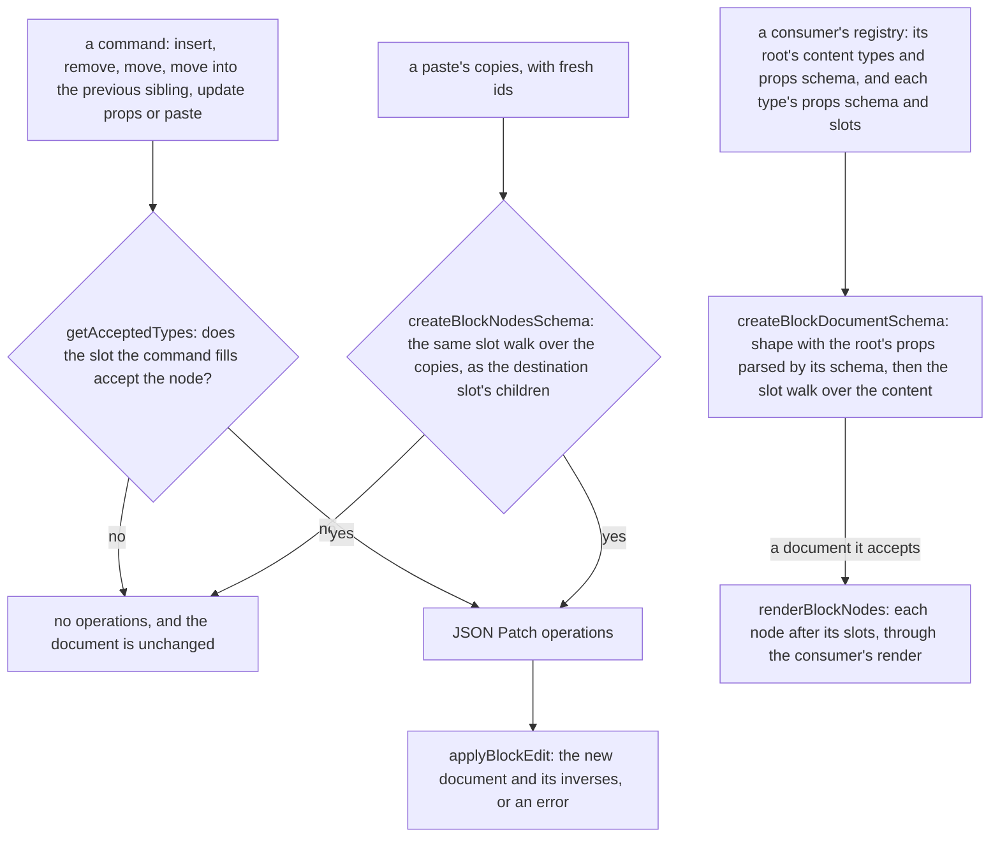

# Headless block editor core

The editing model of a block editor: a registry-checked document whose root declares its own content and props, commands that return JSON Patch operations, the navigation a canvas draws over it, and a fold that renders a checked document from its leaves up. It is built for the page builder's editors, which are its planned consumers in [the document model](../../resource/page-builder/document-model/design.md); the package's own tests run in the plain Node environment.

## How an edit runs

## Decisions

- **The registry declares its root.** A registry is an object: `root` holds the content types the document's root accepts and the props schema its props pass, and `types` holds the node types. The root is not a type in the list, since a reserved root type would make the document a node that a paste could copy and a slot could accept. Each function that reads types reads `types`, and `getRootAcceptedTypes` reads the root's content. The registry is generic over its definition, so a consumer's extended definitions keep their own type through the fold.
- **Commands return operations.** Each command reads the document it is given and returns the operations that change it, or none when the slot would refuse the node. A move is a remove and an add, so its inverse is the same two operations the other way round. A move's index is in the target slot once the node is removed, so moving the first of two siblings to the end of their shared slot is index 1, and an index past that end is an edit that cannot apply.
- **A root's props are edited as a node's are.** `updateBlockNodeProps` over the pointer `/root` writes `/root/props/<key>`, so the core has no command of its own for the root's props.
- **Nodes are addressed by JSON Pointer.** Each node keeps its id among its props, the root's content is `/content`, and a slot is a props key whose value is a list of child nodes. Helpers read pointers through `parseJsonPointer` and `readJsonValue` from `@esposter/shared`.
- **One slot walk checks every list of nodes.** `checkBlockNodes` refuses each child whose type is not in the registry or not allowed by its slot, whose props its type's schema refuses, or whose id is not a unique string, and it recurses into each slot. The document schema runs it over the root's content with the root's declared types, and `createBlockNodesSchema` runs it over a paste's copies with the destination slot's types, so the two share one walk and neither wraps copies in a document.
- **The document schema checks shape first, then the registry.** A recursive union over the registry would be the natural shape, but a union reports a failure at the union's own position, which buries the slot a refusal has to name. The schema parses each node's shape and parses the root's props with the root's own schema inside the document's shape, then the walk checks the content. Parsing the root's props in the shape gives a parsed document the root schema's type: the registry is generic over the root's props, so the webpage's parsed document carries its language as a typed prop. Rejected: checking the root's props in the refinement, which leaves every consumer's parsed root a loose record to narrow by hand. The refusal path is `["content", 0, "props", "items", 0]` for a heading in a list's items slot, `["content", 0]` for a heading the root's content refuses, and `["root", "props", "title"]` for a root whose props lack a title.
- **A paste checks its copies as the destination slot's children.** `pasteBlockNodes` re-mints the copies, then checks them with `createBlockNodesSchema` against the slot's accepted types. The root's content does not apply, so a heading pastes into a section's slot whatever the root accepts.
- **Refusals are empty operation lists, and an edit that cannot apply is an error.** A command refuses by returning nothing, so a history never records it. `applyBlockEdit` wraps `applyPatches` in `getResult`, so an operation that cannot apply, such as a prop update on a node no longer in the document, refuses the whole edit and leaves the document as it was.
- **A paste re-mints every id.** `remintBlockNode` gives a copy and every node in its slots fresh ids, so a copy shares none with the original and a copy of a node from another editor is refused by the registry.
- **Removal names the focus target in post-removal coordinates.** The next sibling takes the removed node's index, so its pointer is the same index; otherwise the previous sibling; otherwise the parent, and the root is the empty pointer.
- **A document lists its nodes in layer order.** `getBlockLayerRows` walks each list in index order, putting a node's row before the rows of its slots, one depth lower and in the order its type's definition declares them. Previous and next are the rows beside a node, so a neighbour can sit across a slot boundary, and a slot whose value is not a list contributes nothing.
- **Move to lists only slots outside the node's subtree.** `getAcceptingSlotPointers` checks each slot with `getAcceptedTypes`, the root's content first and then each node's slots in layer-row order, and it skips every slot under the node, its own slots included, so a node is never offered a place inside itself.
- **Move out and duplicate are compositions.** `moveOutAfterParent` is a `moveBlockNode` into the parent's slot at the parent's index plus one; the removal shifts only the node's own siblings, never the parent, so the refusals are the move's own. `duplicateBlockNode` is a `pasteBlockNodes` of the node into its own slot at its index plus one, so the copy gets fresh ids the same way a paste does.
- **The undo history is not the core's.** The bounded history that undoes a document's edits lives in `@esposter/shared`, [as its own capability](../../shared/bounded-history/design.md), so the core keeps no copy of it.
- **A document folds from its leaves up.** `renderBlockNodes` renders each node of a slot in order, after each of the node's slots has rendered, and hands the consumer's render function the node, its type's definition and each slot's output. A node whose type the registry lacks renders nothing, so a fold over a document that skipped its parse still renders what the registry knows. Each renderer walks the tree through this one fold rather than its own recursion.

## Key files

| File                                                                         | Role                                                                            |
| ---------------------------------------------------------------------------- | ------------------------------------------------------------------------------- |
| `packages/headless-block-editor/src/models/BlockRegistry.ts`                 | the registry: its root beside its types, generic over the type definition       |
| `packages/headless-block-editor/src/models/BlockRootDefinition.ts`           | the root's declared content types and props schema                              |
| `packages/headless-block-editor/src/services/createBlockDocumentSchema.ts`   | the document's shape, the root's content and props, the node limit and the walk |
| `packages/headless-block-editor/src/services/checkBlockNodes.ts`             | the slot walk: registry membership, slot acceptance, props, ids, and recursion  |
| `packages/headless-block-editor/src/services/createBlockNodesSchema.ts`      | a slot's children checked by the same walk                                      |
| `packages/headless-block-editor/src/services/getAcceptedTypes.ts`            | the types a slot accepts; the root's content types come from the registry       |
| `packages/headless-block-editor/src/services/moveBlockNode.ts`               | a move as a remove and an add, refused into its own subtree                     |
| `packages/headless-block-editor/src/services/moveIntoPreviousSibling.ts`     | a move to the end of the previous sibling's accepting slot                      |
| `packages/headless-block-editor/src/services/pasteBlockNodes.ts`             | copies with fresh ids, checked as the destination slot's children               |
| `packages/headless-block-editor/src/services/renderBlockNodes.ts`            | the fold from the leaves up, through a consumer's render function               |
| `packages/headless-block-editor/src/services/getFocusAfterRemoval.ts`        | the node that takes focus after a removal                                       |
| `packages/headless-block-editor/src/models/BlockLayerRow.ts`                 | a row of the layers tree: a node's depth, its pointer and its type              |
| `packages/headless-block-editor/src/services/getBlockLayerRows.ts`           | every node in layer order, a node's row before its slots' rows                  |
| `packages/headless-block-editor/src/services/getAdjacentBlockNodePointer.ts` | the node a row offset from another, past a slot boundary                        |
| `packages/headless-block-editor/src/services/getAcceptingSlotPointers.ts`    | every slot that accepts a node, outside the node's own subtree                  |
| `packages/headless-block-editor/src/services/moveOutAfterParent.ts`          | a move to just after the node's parent, in the slot that holds the parent       |
| `packages/headless-block-editor/src/services/duplicateBlockNode.ts`          | a paste of the node's copy straight after it, in its own slot                   |
| `packages/headless-block-editor/src/services/applyBlockEdit.ts`              | an edit applied as one, or refused whole                                        |
| `apps/web/shared/models/db/resource/JsonPatchOperation.ts`                   | the app's wire schema for an operation, beside its one consumer                 |

## Notes

- **The applier's schema stayed in the app.** The applier and its types live in `@esposter/shared`, but the zod schemas for a pointer and an operation, and their two limits, have only the resource content inputs as consumers. `scripts/src/workspace/sharedExportConsumers.test.ts` flags such exports in shared, so they sit beside `ReadResourceContentInput.ts` and `UpdateResourceContentInput.ts`. Shared keeps the operation types, `applyPatches` and the pointer parser.
- **Coalescing is the consumer's.** The core applies each edit whole and records nothing, so merging an interaction's edits into one undo entry belongs to the history that holds them: the page builder's [undo as patches](../../resource/page-builder/undo-as-patches/design.md) merges the edits of one interaction that set the same paths.
- **Not built: a slot type.** A slot is an entry of the registry's type `slots` record and a key of the node's props, not a model of its own.
- **The node limit is the consumer's.** `pasteBlockNodes` checks the copies against the slot and the registry but not the destination's node count; the consumer passes the limit to `createBlockDocumentSchema` and refuses an over-limit result.
- **Test titles are lowercase.** The repo's `prefer-lowercase-title` rule rejects capitals, so the scenario names are the same words in lowercase.
