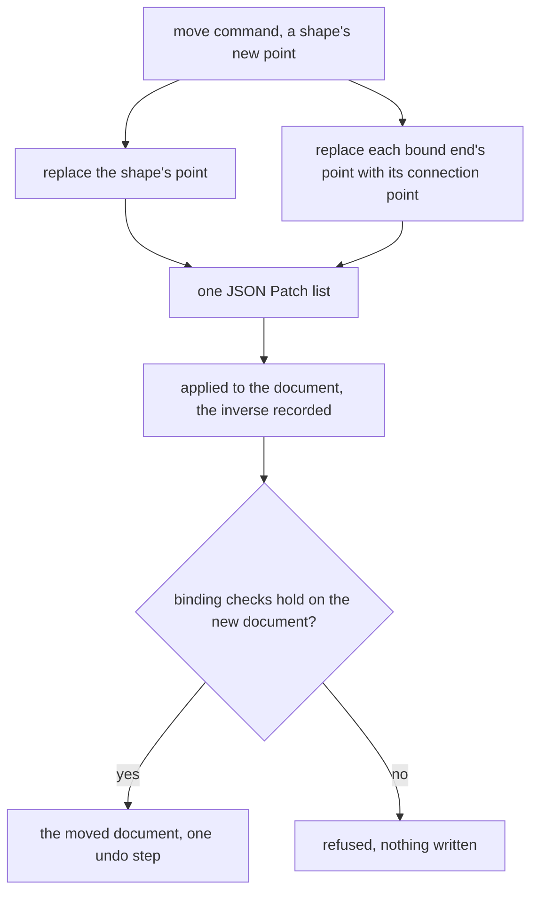

# Positioned elements

The headless editor core's second document model: typed elements placed by bounds in a list whose order is their z-order, with arrow ends bound to the connection points of shapes. Each command returns the JSON Patch that edits a document, and the geometry and routing are pure functions, so the whole model is tested without a DOM. It sits beside the [editor core](../editor-core/design.md)'s tree, which it does not change, and the [whiteboard](../../resource/whiteboard/design.md) is its consumer.

## How it works

A positioned document is a list of elements. Each element has a type and the fields that type holds. A shape has a kind from the basic and the flowchart sets, a position and size, a fill and its text. An arrow has two ends, each with a point, an arrowhead flag and an optional binding, a path kind and a label. A stroke holds a sequence of points and a width, a text holds a width and its text, an image holds a size and the id of its file, and a sticky note holds a size, a fill and its text. A text box stores no height: its height is the number of lines its text wraps to. An element's bounds are its box, the box its route covers for an arrow, the box its points cover for a stroke, or the box its wrapped lines cover for a text.

A binding names a shape by its id and one of its four connection points, numbered from the top clockwise. The document's schema runs the binding checks on every parse, so a document is refused when a binding names no shape of the document, names an annotation, or names a point the shape does not have. The same schema refuses a document in which two elements share an id, since a binding names its shape by id.

Each command reads the document and returns the operations that make the edit. A move of a shape returns the operations that set the shape's point and set the point of each arrow end bound to it to that shape's connection point, so the edit is one list and its inverse is one list. A bind to a shape the document does not hold, or to one that takes no connection, returns no operations, and a caller applies a list only as a whole.

The commands are insert, move, resize, bind, unbind, delete, z-order, and the update of an element's property or text. A bound end's point is kept at its connection point by the move, and so is the point of an arrow's end after a bind. Deleting a shape removes each arrow bound only to it and unbinds the end of each arrow bound to it that is bound elsewhere too. An arrow bound at both ends holds no position of its own, so a move of it returns no operations.

Geometry is computed in the core. Each shape's outline is drawn from its kind, the ellipse and the flowchart set among them, and a hit test asks whether a point lies inside a shape's outline or near an arrow's route or a stroke's points. An arrow's route is straight, curved, or right-angled. A right-angled route leaves each end along the direction of its connection point, through a short stub, and joins the two stubs with right angles. The exporter writes the same outlines, routes and text lines the editor draws, from the same functions.

## Decisions

- **The positioned model sits beside the tree.** An arrow joins two shapes, and forcing the canvas into the tree's slots would make each arrow a child of the shape it joins. The alternative was that slot model. The tree stays as it is, and the positioned model is a registry of its own element types beside it.
- **Elements are addressed by index.** A patch names an element by its position in the list, as the tree is addressed, so the core keeps one addressing model. The alternative was to key the list by id, which would spare an agent a read before it writes a patch. The cost is that an agent reads the list before it writes, and the content version guards that write.
- **A binding is a checked reference, not a graph.** The one reference an arrow needs is to a shape, and the core checks it with a lookup. The alternative was a graph engine with path search and traversal, which an arrow never needs, since no arrow reads past its own two ends.
- **A bound end's point is derived and marked read-only for agents.** The point is stored, so the saved document reads without the core, and it is the connection point the binding names. The alternative was a point an agent writes, which a patch cannot keep at the connection point, since a patch cannot compute the reroute the move does.
- **Text wraps by one rule with an estimated width.** Each character's advance is an estimate from the export's font size, a full-width character taking double a narrow one, so every machine and the server break a text at the same words. The rule breaks at each newline, breaks a line at a space where the next word would pass the width, breaks a word wider than the width where the width runs out, and never hyphenates. The alternative was to measure the wrap with the DOM or a canvas. A measure differs between machines, so the export would differ from one machine to the next, and the server could not run the export. The estimate is coarser than the font, so a line may draw a little wider or narrower than its box, and the rule accepts that for one answer everywhere.
- **Z-order is the list's order.** The list already keeps an order, so a second field would hold a copy of it. The alternative was an order field on each element, which a move of one element would have to keep in step with the others.

## Not built

- **Z-order and unbind have no caller in the app.** The commands exist and are tested in the core, but no control reorders elements, and no control detaches a bound arrow end. The [whiteboard](../../resource/whiteboard/design.md) states what the canvas does with each.
- **A text's wrapped lines are an estimate.** The decision above names the cost: a line can draw wider or narrower than its box, and nothing measures the font to correct it.

## Failure and retry

A command returns no operations when it cannot apply: a bind with no bindable shape, a z-order move to an index that names no element, a property the element does not hold. A document that fails the binding or id checks is refused at parse, so the caller receives a refusal and no document. None of these retries, since each is a pure answer to the document it was given.

## Key files

| File                                                                             | Role                                                                                    |
| -------------------------------------------------------------------------------- | --------------------------------------------------------------------------------------- |
| `packages/headless-block-editor/src/models/PositionedDocument.ts`                | the document: its element list, its schema and the refinement the checks run through    |
| `packages/headless-block-editor/src/models/PositionedElement.ts`                 | the union of the element types a positioned document holds                              |
| `packages/headless-block-editor/src/models/PositionedElementType.ts`             | the type each element carries, the discriminant of the union                            |
| `packages/headless-block-editor/src/models/ShapeElement.ts`                      | a shape: its kind, its box, its fill and its text                                       |
| `packages/headless-block-editor/src/models/ShapeKind.ts`                         | the basic and flowchart outlines a shape takes, the annotation among them               |
| `packages/headless-block-editor/src/models/ArrowElement.ts`                      | an arrow: its two ends, its path kind and its label                                     |
| `packages/headless-block-editor/src/models/ArrowEnd.ts`                          | one end of an arrow: its point, its binding when bound, and its arrowhead flag          |
| `packages/headless-block-editor/src/models/ArrowBinding.ts`                      | a binding: the shape's id and the index of one of its connection points                 |
| `packages/headless-block-editor/src/models/ArrowPathKind.ts`                     | the route an arrow takes: straight, curved or right-angled                              |
| `packages/headless-block-editor/src/services/checkPositionedDocument.ts`         | the refinement a document parses through: unique ids, then every binding                |
| `packages/headless-block-editor/src/services/checkPositionedBindings.ts`         | refuses a binding that names no shape of the document that takes it                     |
| `packages/headless-block-editor/src/services/getBindableShape.ts`                | the shape a binding names, when the shape is not an annotation and has the point        |
| `packages/headless-block-editor/src/services/insertPositionedElement.ts`         | the insert command                                                                      |
| `packages/headless-block-editor/src/services/movePositionedElement.ts`           | the move command, which reroutes each arrow bound to a moved shape in the same list     |
| `packages/headless-block-editor/src/services/getRerouteOperations.ts`            | the replacements that set each bound end's point to its shape's connection point        |
| `packages/headless-block-editor/src/services/resizePositionedElement.ts`         | the resize command, which reroutes each arrow bound to a resized shape in the same edit |
| `packages/headless-block-editor/src/services/bindPositionedArrowEnd.ts`          | the bind command, which sets an end's binding and moves it onto the connection point    |
| `packages/headless-block-editor/src/services/unbindPositionedArrowEnd.ts`        | the unbind command, which removes an end's binding                                      |
| `packages/headless-block-editor/src/services/deletePositionedElement.ts`         | the delete command, which cascades to the arrows bound only to a deleted shape          |
| `packages/headless-block-editor/src/services/changePositionedElementZOrder.ts`   | the z-order command, which moves an element from one index of the list to another       |
| `packages/headless-block-editor/src/services/updatePositionedElementProperty.ts` | the update of one property: a fill, or an arrow's route or arrowhead                    |
| `packages/headless-block-editor/src/services/updatePositionedElementText.ts`     | the update of an element's text                                                         |
| `packages/headless-block-editor/src/services/getElementBounds.ts`                | an element's bounds, with a text's height derived from the lines it wraps to            |
| `packages/headless-block-editor/src/services/getShapeOutline.ts`                 | a shape's outline, from its kind                                                        |
| `packages/headless-block-editor/src/services/getHitElementIndex.ts`              | the index of the element a point hits, the hit test the canvas uses                     |
| `packages/headless-block-editor/src/services/getEdgeMidpoints.ts`                | the four connection points of a box, from the top one clockwise                         |
| `packages/headless-block-editor/src/services/getArrowRoute.ts`                   | an arrow's polyline, by its path kind                                                   |
| `packages/headless-block-editor/src/services/getRightAngledRoute.ts`             | the right-angled route, with a stub out of each end along its connection point          |
| `packages/headless-block-editor/src/services/getArrowEndDirection.ts`            | the direction an end leaves its shape along                                             |
| `packages/headless-block-editor/src/services/applyBlockEdit.ts`                  | applies an edit's operations and returns their inverses, the core's shared apply        |
| `packages/headless-block-editor/src/services/export/toPositionedSvg.ts`          | the SVG of a positioned document, written from the same outlines and routes             |
| `packages/headless-block-editor/src/services/export/getWrappedLines.ts`          | a text's lines at a width, by the one wrapping rule                                     |
| `packages/headless-block-editor/src/services/export/wrapParagraph.ts`            | a paragraph's lines, breaking at spaces and then inside a word too wide for the width   |
| `packages/headless-block-editor/src/services/export/getTextWidth.ts`             | a text's width by the estimate every export and editor shares                           |
| `packages/headless-block-editor/src/services/export/getTextPlacement.ts`         | where an element's text sits and the width its lines wrap at                            |
| `packages/headless-block-editor/src/services/export/getTextLayout.ts`            | a text's wrapped lines laid out against its placement                                   |
| `packages/headless-block-editor/src/services/export/getSketchOffset.ts`          | the hand-drawn offset of one point, keyed on its id so a sketch repeats                 |
| `packages/headless-block-editor/src/services/export/getSketchedPoints.ts`        | an outline's points, each moved by its sketch offset                                    |

## Sources

No source beyond the repository's own design was taken for this capability. The JSON Patch operations its commands return are the ones the [editor core](../editor-core/design.md) already states.
