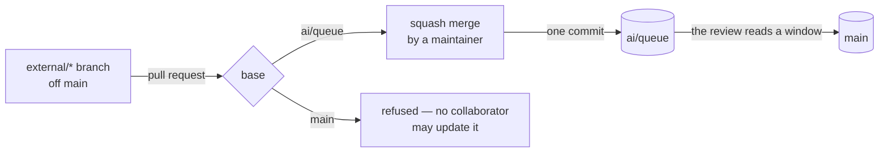

# Branch Namespaces

A branch's name says who may create it, who may push it, and how it reaches `main`. Nothing else has to be written down, and nothing has to be kept in sync: the rulesets in `apps/infra/src/github/rulesets/` are the rule, and this page is what they spell.

| Namespace     | Created by          | Pushed by                                                       | Reaches `main` how                                                                                                                                             |
| :------------ | :------------------ | :-------------------------------------------------------------- | :------------------------------------------------------------------------------------------------------------------------------------------------------------- |
| `main`        | —                   | the review's fast-forward, and nothing else                     | it is the reviewed prefix of `ai/queue`, so it is the release; production deploys from it                                                                      |
| `ai/queue`    | —                   | the working sessions by a plain push, and Renovate's auto-merge | the default branch; reviewed by the [review](../review/design.md), which fast-forwards `main` to the window's end; the development environment deploys from it |
| `ai/*`        | the working session | the working session — one GitHub account                        | through `ai/queue` only, the one `ai/*` branch the review reads                                                                                                |
| `renovate/*`  | Renovate            | Renovate                                                        | a pull request against `ai/queue`, auto-merged once its required checks pass, then reviewed like any session's commit                                          |
| `external/*`  | any collaborator    | any collaborator                                                | a pull request against `ai/queue`, squash-merged there by a maintainer, then reviewed like any commit                                                          |
| anything else | a maintainer        | a maintainer                                                    | merged into the maintainer's own `ai/queue` and pushed                                                                                                         |

Every change reaches `main` through `ai/queue` and the review. A branch that is not `ai/queue` is never the source of a `main` update, so `main` is always an ancestor of `ai/queue`.

## The contributor's path

A collaborator branches off `main` — always an ancestor of `ai/queue`, so the pull request shows their commits alone — under `external/`, the one prefix the creation rule leaves open, and opens the pull request against `ai/queue`. No review runs on the branch itself, so it may be pushed freely. A maintainer squash-merges it: the pull request's title and body become the one commit that lands on the queue, and from there it is reviewed like any session commit.

Someone without write access forks instead and opens the same pull request from the fork; CI runs only on pushes to the repository, so their pull request arrives untested and the queue's own CI is its first run.

## The rulesets

Bypass is granted per ruleset and never per rule, so a ref that needs one actor exempt from one rule and held to another is covered by two rulesets. The Admin repository role is the working session, the review and a maintainer merging by hand — one account; a ruleset cannot name an individual user.

The rulesets enforce the namespaces above. Branch creation is restricted to the namespaces that may create a branch. `main` is protected by `mainProtection.ts`, which leaves its updates to the Admin role, the review's account. The `ai/**` refs are held by `oneWriterRefs.ts`, which lets Renovate through as a bypass actor, because Renovate's pull requests merge into `ai/queue`. `queueStatusChecks.ts` holds those merges to CI's checks: Renovate is no bypass actor there, so its bumps land green, while the sessions' and the review's pushes, made as the Admin role, are not held to it. The rulesets' bypass lists are the files' own, so this page does not restate them.

## Key files

| File                                                  | Role                                                                       |
| :---------------------------------------------------- | :------------------------------------------------------------------------- |
| `apps/infra/src/github/rulesets/`                     | the rulesets, one file each                                                |
| `apps/infra/src/github/rulesets/mainProtection.ts`    | `main`'s update protection                                                 |
| `apps/infra/src/github/rulesets/queueStatusChecks.ts` | the checks a pull request into `ai/queue` must pass                        |
| `apps/infra/src/github/rulesets/oneWriterRefs.ts`     | the `ai/**` refs, with Renovate as a bypass actor                          |
| `apps/infra/src/github/repository.ts`                 | squash merge enabled, with the pull request's title and body as its commit |
| `apps/infra/src/github/branchDefault.ts`              | `ai/queue` as the default branch                                           |
| `renovate.json`                                       | Renovate's pull requests, which target the default branch and auto-merge   |
| `CONTRIBUTING.md`                                     | the contributor's steps                                                    |
| `.github/PULL_REQUEST_TEMPLATE.md`                    | the base-branch checkbox                                                   |

## Notes

- **A ruleset refuses the merge, never the opening.** A pull request a collaborator opens against `main` is unmergeable but still open, and the pull request template's checkbox and this page are the guard against opening one.
- **Rejected: a contributor pull request against `main`.** It would be a second writer on the reviewed prefix, and its merge would move `main` by a range no review read.
- **Rejected: an approving-review requirement on `main`.** Nobody but a bypass actor can update it, so the rule would gate only the actors it exempts.
- **Rejected: a ruleset pinning the queue's merge to a squash.** A merge method is a sub-option of the pull request rule, and bypass is per ruleset. A rule that requires a pull request for every update to `ai/queue` would refuse the sessions' plain pushes, which is how the queue is written. The squash is the maintainer's to choose from the merge button, and nothing enforces it.
