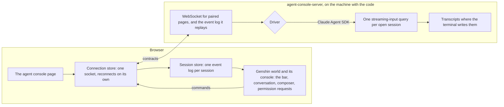

# Agent console

**Hidden from the game for now.** `/genshin` is the game alone, its opening and then its world, so it is faithful to the game with nothing of the console over it. The console's page code stays, unmounted, until it is rebuilt in the game's own style from `genshin-interface`; until then the link a host prints opens the game and pairs nothing.

The agent console is one page of the app, shown as Genshin at `/genshin`, that works the Claude Code sessions on a machine instead of the terminal: the conversation, every tool call and its result, the diffs, the permission prompts, the model, mode, context, cost and usage, subagents and the todo list, across every session on the host. It works the same sessions the terminal does. A session started here resumes with `claude --resume <id>`, and one started in a terminal resumes here. Nothing is lost moving between them, because both read and write the same transcripts.

It has two halves. The **host**, `agent-console-server`, runs on the machine with the code and the Claude Code login ([host](host/design.md)). The **page** is served by the app on the deployed site or on `pnpm dev`, and knows only which host it is paired with. Between them is one WebSocket carrying Zod contracts, which the page imports from the host's `contracts` subpath, so a change to the wire fails typecheck on both sides.

## How it works

- **The event log is the only state.** The host keeps each open session's events and replays them to a page that connects or reconnects. The page folds them per session, in a store keyed by session id, into everything it shows: the conversation, the timeline, the diffs, the checklist and the permission requests. An event updates only what it changes, and a reconnect that replays the log rebuilds all of it.
- **The agent is behind a driver.** The [Claude Agent SDK driver](claude-agent-sdk-driver/design.md) is the one that exists. Any other agent would be one more driver behind the same interface, and never a change to the page.
- **The look is behind a theme.** `AgentConsoleThemeMap` holds the default and the Genshin theme. The default is the world and its [console overlay](console-overlay/design.md) with no character. The console gives every theme a browser notification when a turn ends or a permission prompt waits while the tab is hidden, and a theme's reactions add to it. A reload replays history without ringing, because only events newer than the page's connection trigger a reaction. The Genshin theme adds an avatar and an element accent: a session the [persona plugin](../persona-plugin/README.md) started is presented as its character, named in the heads-up display, and the console sheet takes the character's element colour. The fold keeps the context each SessionStart hook added, and each theme looks there for its own plugin's lines: `Character: ` and `Element: ` for the persona plugin. A session is presented by the theme whose plugin started it, and no theme parses a card's prose. The avatar and accent are the character the session started as: one switched to inside it with the plugin's `use` is not followed.
- **Nothing waits forever.** The page reconnects with a backoff capped at thirty seconds for as long as it is open. A permission prompt waits on a person, as the terminal's does, but an interrupt settles it as a deny, and so does closing its session.

What the terminal shows and does, and where the console carries each part, is [terminal parity](terminal-parity/design.md).

## The pages of this feature

| Page                                                         | What it covers                                                                               |
| :----------------------------------------------------------- | :------------------------------------------------------------------------------------------- |
| [Host](host/design.md)                                       | the package, the printed link, the preflight, the replayed log and reconnection              |
| [Device pairing](device-pairing/design.md)                   | Connect in one click, a credential per device, the host's proof, and revoking a device       |
| [Remote connections](remote-connections/design.md)           | several hosts at once, a machine of the reader's own, and sessions grouped by host           |
| [Shell pane](shell-pane/design.md)                           | a terminal tab in the session's folder, on its host, drawn by xterm.js                       |
| [Host installer](host-installer/design.md)                   | the Windows executable, its self-install, the esposter-host link and the release asset       |
| [Session windows](session-windows/design.md)                 | each session in a console window of its own, the loopback gate, and stopping from either end |
| [Claude Agent SDK driver](claude-agent-sdk-driver/design.md) | sessions, the one place SDK messages become events, permissions, resume and fork             |
| [Side pane](side-pane/design.md)                             | any page of the app beside the conversation, opened with the embed flag and no code          |
| [Console overlay](console-overlay/design.md)                 | the bar, the keys, the console sheet, the pause menu, the loading screen and what they cost  |
| [Diff comments](diff-comments/design.md)                     | a comment on any line of a file's whole diff in the changes tab, sent together as one prompt |
| [Repository files](repository-files/design.md)               | @ to mention a file in the composer, and a read-only view of any file the session holds      |
| [Terminal parity](terminal-parity/design.md)                 | every terminal surface and action, and the part of the page that carries it                  |
| [Workflow comparison](workflow-comparison/design.md)         | the terminal's workflow against the console's, task by task, and what the console costs      |

## Key files

| File                                                                                              | Role                                                                               |
| :------------------------------------------------------------------------------------------------ | :--------------------------------------------------------------------------------- |
| `packages/agent-console-server/src/contracts.ts`                                                  | The wire the page imports: sessions, events, commands, server messages             |
| `packages/agent-console-server/src/services/server/createAgentConsoleServer.ts`                   | The host's socket, handshake, event log and command dispatch                       |
| `packages/agent-console-server/src/services/drivers/claudeAgentSdk/createClaudeAgentSdkDriver.ts` | The Claude Code driver                                                             |
| `apps/web/app/components/AgentConsole/Index.vue`                                                  | The console over the world, unmounted while it is hidden                           |
| `apps/web/app/store/agentConsole/connection.ts`                                                   | The socket, reconnection, and routing the host's messages into the session store   |
| `apps/web/app/store/agentConsole/session.ts`                                                      | Every session's folded view of its event log, which the page reads                 |
| `apps/web/app/services/agentConsole/themes/AgentConsoleThemeMap.ts`                               | The theme registry: the default, and the Genshin theme's avatar and element accent |
| `packages/genshin-text/src/services/ElementColorMap.ts`                                           | Element colours shared with the persona's generated module                         |

## Notes

- The Genshin theme's voice, scene and additional reactions, the views, the terminal-mirror driver and the MCP Apps tier of [extensions](../../../../changes/infra-agent-console-extensions/design.md) are still [proposals](../../../../changes/infra-agent-console-program/design.md). The default theme is the world every one of them is measured against.
- Cost is what the SDK reports for the session's query since the host opened it. A session resumed in a new host process starts that count again, as a new terminal process does.
