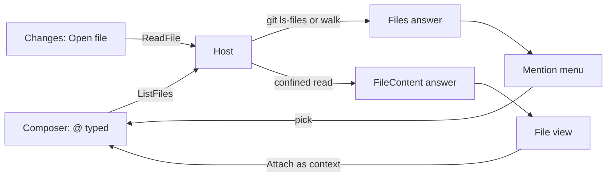

# Repository files

The composer takes a file by paste or drop, which needs the file open somewhere else. The Claude desktop app's Code tab also takes one from inside, typing `@` followed by a filename to add it to the conversation context, and this page is the console's version of that, with the file view the Code tab's file pane is.

## What it does

- **`@` in the composer** opens the session's files, as `/` opens the command palette. The list is asked of the host each time the menu opens, so a file made since the last open is listed. The page filters it as the reader types, up to fifty matches. A pick replaces the `@` text with `@path` followed by a space, which Claude Code itself resolves on the prompt, so the console reads nothing into the prompt.
- **Opening a file** from the changes tab's **Open file** button asks the host for its text. The file opens in a read-only view above the conversation, with its path, an **Attach as context** button that adds `@path` to the composer, a **Copy path** button, and a close control.
- **A path in a reply or tool input** opens the same view when it matches a path in the session's file list. The links work in prose, code and the JSON shown for a tool call; a path that is not in the list stays text.
- **A file the view cannot show says why.** A file over the limit `REPOSITORY_FILE_MAX_BYTE_LENGTH` declares, or one holding a NUL byte, is reported with its reason and no text.

The host answers both from the session's working directory. The file list is `git ls-files` there, untracked files that are not ignored included, and outside a repository a walk of the directory that skips `.git` and `node_modules`. Paths are sent with forward slashes whichever the platform.

## What it does not do

- **No editing.** An edit here would race the agent's own edits to the same file, and the checkpoints that make rewind work only cover the agent's. A person edits in their editor.
- **No open in an external editor.** The page cannot launch a desktop program; copying the path is the bridge.
- **Confined to the session.** A path is resolved against the working directory's real path, so a `..` or a symlink that leaves it is refused, and the page cannot read a file the session could not name.

## Key files

| File                                                                        | Role                                                         |
| --------------------------------------------------------------------------- | ------------------------------------------------------------ |
| `packages/agent-console-server/src/models/command/ListFilesCommand.ts`      | the list command, answered by the host                       |
| `packages/agent-console-server/src/models/command/ReadFileCommand.ts`       | the read command, its path relative to the working directory |
| `packages/agent-console-server/src/models/server/FilesMessage.ts`           | the list answer                                              |
| `packages/agent-console-server/src/models/server/FileContentMessage.ts`     | the read answer, with the notice that replaces its text      |
| `packages/agent-console-server/src/services/files/resolveRepositoryPath.ts` | the confinement to the working directory                     |
| `packages/agent-console-server/src/services/files/listRepositoryFiles.ts`   | `git ls-files`, with the directory walk outside a repository |
| `packages/agent-console-server/src/services/files/readRepositoryFile.ts`    | the size cap and the text check                              |
| `packages/agent-console-server/src/services/server/handleFileCommand.ts`    | answers both commands from the session's working directory   |
| `apps/web/app/store/agentConsole/file.ts`                                   | the session's file list and the opened file                  |
| `apps/web/app/store/agentConsole/connection.ts`                             | hands each answer to the file store                          |
| `apps/web/app/components/AgentConsole/Panel/Composer.vue`                   | the @ menu and the mention it inserts                        |
| `apps/web/app/components/AgentConsole/Markdown.vue`                         | links known paths in replies and code                        |
| `apps/web/app/components/AgentConsole/Panel/ToolCall.vue`                   | renders tool input through the path-linking markdown         |
| `apps/web/app/components/AgentConsole/Panel/File.vue`                       | the read-only file view                                      |
| `apps/web/app/components/AgentConsole/Panel/Changes.vue`                    | the Open file control on each file's diff                    |

## Sources

- [Claude Code desktop — file management](https://code.claude.com/docs/en/desktop) — "Type @ followed by a filename to add a file to the conversation context", with **Attach as context** and **Copy path** on the file pane's context menu.
