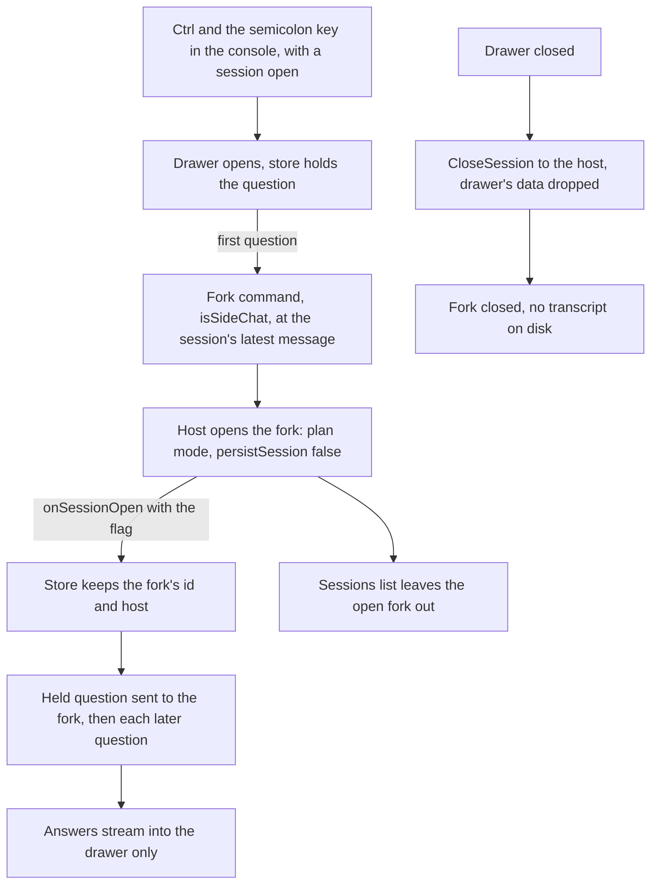

# Side Chat

A question about the work in progress, such as what a function the agent just wrote does, asked beside the conversation. It starts from the session's latest message, so it has the whole conversation as context, but it runs in plan mode and is never saved. Nothing it says is written back into the main conversation. Its drawer is opened with Ctrl+; in the console, with a session open, and it asks the session's host for a fork that exists only while the drawer is open.

## How it works

- **The chord and the drawer.** `Sheet.vue` opens the drawer on Ctrl+; only when a session is open, and `Panel/SideChat.vue` renders it as a column beside the console's tabs, with its own composer and its own conversation. Escape closes the drawer and nothing else. The drawer's session is read through `useAgentConsoleSession(isSideChat)`, which reads the side chat's session and draft rather than the console's, and both are held in `store/agentConsole/sideChat.ts`.
- **The first question forks.** `connection.ts` sends a `Fork` command with `isSideChat` and an empty message uuid, which the SDK reads as the session's latest message, and holds the question until the fork opens. Once it opens the question is sent to it. Every later question goes straight to the same fork, which already holds the conversation.
- **A fork that arrives too late is closed.** A fork that opens after the drawer was closed, or a second fork while one is already held, is sent `CloseSession` at once, since nothing shows it.
- **Plan mode from the first message.** `createSessionOpener` sets `permissionMode: plan` and `persistSession: false` on a side chat's query only, so no turn can run before the mode is in force and the SDK writes no transcript. `createClaudeAgentSdkDriver` refuses `setPermissionMode` for a side chat, so the mode cannot be switched to one that edits.
- **The sessions list leaves it out.** `listSessionSummaries` drops an open side chat from the list of unsaved sessions, because it is never saved. A side chat on a window-backed session reports its flag when the window's session opens (`serveSessionChild`) and again when the window rejoins the host (`createWindowDriver`), so the list stays right across both paths.
- **Closing discards it.** `closeSideChat` sends `CloseSession` for the fork, drops its view from the session store, and clears the drawer's open state, session, host, draft and held question. The host's `closeOpenSession` then denies any waiting permission request and removes the fork from its open map, so nothing reaches the main conversation.

## What is deliberately not in it

- **No merging back.** An answer that should steer the work is copied into the main composer by the person. The side chat never writes to the session.
- **No actions.** A question cannot become edits, since the fork is in plan mode and its mode cannot be changed.

## Notes

- The drawer's state is not kept through a reload: the store holds it in memory only, and closing the drawer discards its answers.

## Key files

| File                                                                                              | Its role                                                                             |
| ------------------------------------------------------------------------------------------------- | ------------------------------------------------------------------------------------ |
| `apps/web/app/components/AgentConsole/Sheet.vue`                                                  | the Ctrl+; chord, which opens the drawer beside the console's tabs                   |
| `apps/web/app/components/AgentConsole/Panel/SideChat.vue`                                         | the drawer: its header, its conversation and composer, and its close                 |
| `apps/web/app/store/agentConsole/sideChat.ts`                                                     | whether the drawer is open, the fork's session and host, the held question and draft |
| `apps/web/app/store/agentConsole/connection.ts`                                                   | sends the fork, holds and asks the question, and closes the fork                     |
| `apps/web/app/composables/agentConsole/useAgentConsoleSession.ts`                                 | reads the side chat's session when the drawer asks for it, the console's otherwise   |
| `apps/web/app/services/agentConsole/createSessionReads.ts`                                        | the reads of one session's view, shared by the console and the drawer                |
| `packages/agent-console-server/src/models/command/ForkCommand.ts`                                 | the `isSideChat` flag on a fork                                                      |
| `packages/agent-console-server/src/services/drivers/claudeAgentSdk/createClaudeAgentSdkDriver.ts` | passes the flag into the fork, and refuses a mode change for a side chat             |
| `packages/agent-console-server/src/services/drivers/claudeAgentSdk/createSessionOpener.ts`        | opens a side chat's query in plan mode with no transcript written                    |
| `packages/agent-console-server/src/services/drivers/claudeAgentSdk/closeOpenSession.ts`           | takes a closed session off the host, denying its waiting permissions                 |
| `packages/agent-console-server/src/services/drivers/claudeAgentSdk/listSessionSummaries.ts`       | leaves an open side chat out of the sessions list                                    |
| `packages/agent-console-server/src/services/drivers/window/createWindowDriver.ts`                 | holds the flag for a side chat in a window, for the list and for a rejoin            |
| `packages/agent-console-server/src/services/drivers/window/serveSessionChild.ts`                  | reports the flag when a window's session opens                                       |

## Sources

- [Claude Code desktop: side chat](https://code.claude.com/docs/en/desktop), which describes a side chat as a question that "uses your session's context but doesn't add anything back to the main conversation", opened with `Ctrl+;`.
- [Claude Agent SDK, TypeScript reference](https://code.claude.com/docs/en/agent-sdk/typescript), for the `persistSession` option, which when false saves no session to disk.
