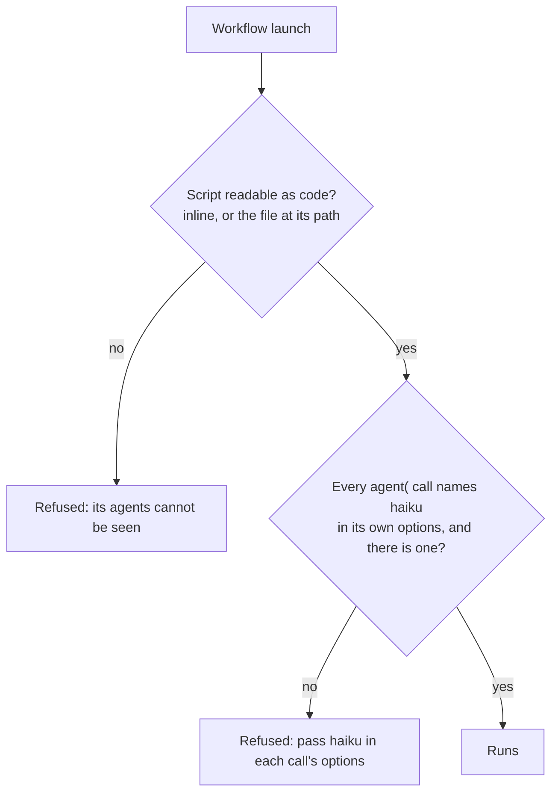
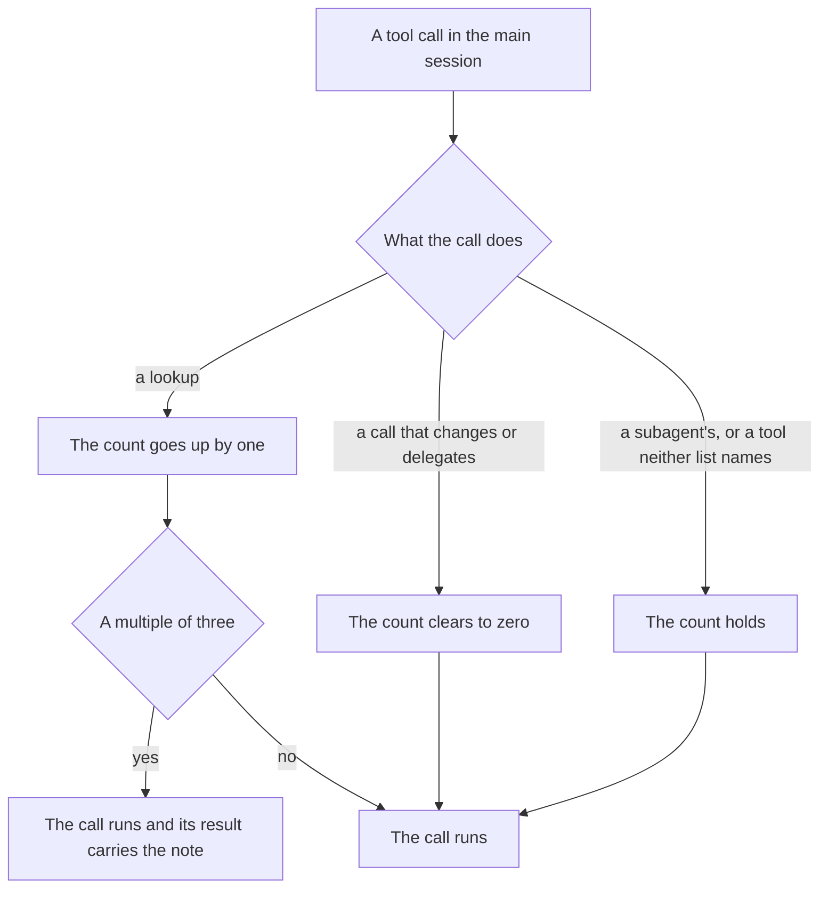

# Delegation guard

Part of [Genshin mods](../README.md). The main session is the expensive reader in this repository: a lookup it makes costs the family that thinks, and its result stays in the context of every later turn. The delegation rule says a chain of lookups whose next step is a lookup too belongs to a haiku subagent, which reads the chain and returns its conclusion. The rule is easy to state and easy to break one read at a time, so the guard counts the main session's lookups and says so when a run of them gets long. The rule's other half, that every subagent runs on haiku, it enforces outright: a launch on any other model is refused, and so is a workflow whose agents are not all on haiku.

## The launch gate

Every `Agent` call is decided before it runs. It passes only when its `model` is `haiku`. A launch naming another model is denied, and so is one naming none, which inherits the session's model, and any `fork`, which runs on the session's model whatever it names. The denial says what to do instead: pass model `haiku`, keep work too judged for haiku in the main session, and treat a spec haiku cannot carry as one with a call still open. The gate runs in every session, and a refused launch is not counted.

A workflow's agents are the same subagents, so the workflow gate below reads each workflow's script for them. **Rejected: refusing every workflow.** A workflow of haiku agents costs what the same agent launches cost, and the refusal only pushed the session onto one agent launch per unit, where a single workflow runs them all in one script.

## The workflow gate

A `Workflow` launch is decided before it runs, in every session. Its script is the inline one, or the file at the launch's path, and the launch passes only when each `agent(` call in the script passes `model` as a plain `'haiku'` or `"haiku"` literal in its own options object, with at least one such call. The check reads the code with its strings, template text and comments blanked, and it refuses whatever it cannot classify: a slash, a backslash outside a string, an HTML-style comment, a literal or comment left open, a name that reaches code the script does not show (`eval`, `Function`, `this`, `import`, `require`, `process`, `globalThis`, `Reflect`, `self`, `window`, `constructor`, `workflow`), and an `agent` that is not called. A saved workflow named with no script, and a path with no file, are refused too, since their agents cannot be seen.

The refusal is `WORKFLOW_MODEL_REFUSAL` in `packages/genshin-mods/src/services/constants.ts`, the launch gate's denial applied to each call's own options. A failure of the gate lets the launch through, as the [ward](../ward/design.md) does, so a failure never blocks a launch. **Rejected: a text match for the haiku literal anywhere in the script**, since a prompt quoting `model: 'haiku'` beside an opus call would pass; each call's own options are read instead.

## How it works

Every call the main session makes is classified before it runs. A lookup is a call to Read or WebFetch, or a Bash command that only reads: `cat`, `sed`, `grep`, `rg`, `find`, `ls`, `head`, `tail`, `awk`, `wc`, `git show`, `git log`, `git diff`, `gh run view`. No interpreter counts, since a script may write as readily as read. The engine's declarations for this build name no Grep, Glob or PowerShell tool, so a call to one never reaches the guard and is not counted. A leading `export` or `cd` chained ahead of the command is stripped first, so `cd "$W" && cat file` is a lookup, and a shell command run in the background is never one.

Calls that change the picture reset the count to zero: an Agent call, an Edit, a Write, a NotebookEdit, a shell command that is not a lookup, and each new prompt the person sends. A subagent's calls never count and never reset it, and neither do tools outside those lists, which leave the count as it was.

On the third lookup in a row, and on every third after it, the call runs as it would and its result carries a note the model reads after the result: the third lookup with no decision between them, the chain is handed to a haiku agent. The note is advice and never blocks a call.

## When it does not count

- A subagent's lookups. A subagent is already the hop the rule asks for, so the guard leaves its work and the main session's count alone.
- A failed guard. Any failure in the count lets the call through unchanged, as the [ward](../ward/design.md) does, so a failure never blocks a call.

## Key files

| File                                                                      | Role                                                                                                                                           |
| :------------------------------------------------------------------------ | :--------------------------------------------------------------------------------------------------------------------------------------------- |
| `packages/genshin-mods/src/services/delegation/registerDelegation.ts`     | The call hook: refuses an agent launch not on haiku, counts each call and adds the note to its result                                          |
| `packages/genshin-mods/src/services/delegation/getLaunchRefusal.ts`       | Whether an agent launch is refused, and the text it is told                                                                                    |
| `packages/genshin-mods/src/services/delegation/registerWorkflowGuard.ts`  | The `tool.call` hook on `Workflow`: refuses a launch unless every agent in its script is haiku                                                 |
| `packages/genshin-mods/src/services/delegation/checkIsHaikuOnlyScript.ts` | The pure check that every `agent(` call in a script passes the haiku model                                                                     |
| `packages/genshin-mods/src/services/delegation/checkIsHaikuOptions.ts`    | Whether one call's options object names haiku as its one `model` key                                                                           |
| `packages/genshin-mods/src/services/delegation/maskScriptCode.ts`         | The script's code, strings and comments blanked, or nothing when unreadable                                                                    |
| `packages/genshin-mods/src/services/delegation/findClosingBracket.ts`     | The index of the bracket closing the one at a given index, or -1 when none does                                                                |
| `packages/genshin-mods/src/services/delegation/findNonSpace.ts`           | The index of the first non-space character in a range                                                                                          |
| `packages/genshin-mods/src/services/delegation/findTopLevelComma.ts`      | The index of the first comma outside every bracket in a range, or -1 when there is none                                                        |
| `packages/genshin-mods/src/services/delegation/readWorkflowScript.ts`     | The launch's script, inline or from the file at its path when it is there                                                                      |
| `packages/genshin-mods/src/services/delegation/getCallStep.ts`            | Whether a call is a lookup, a reset or neither                                                                                                 |
| `packages/genshin-mods/src/services/delegation/checkIsLookupCommand.ts`   | Whether a shell command only reads, after its leading segments                                                                                 |
| `packages/genshin-mods/src/services/delegation/getNextStreak.ts`          | The count after one call                                                                                                                       |
| `packages/genshin-mods/src/services/delegation/getNudge.ts`               | Whether a count owes the note                                                                                                                  |
| `packages/genshin-mods/src/services/constants.ts`                         | The tool lists, the command patterns, the nudge interval and its text, the one agent model, and the refusals of an agent launch and a workflow |

## Notes

- The count judges a command by its first word after the leading segments, so a read reached another way (`pnpm exec cat`, a script that greps) is a reset. The guard errs toward asking less, since a note on a call that was not a lookup would be noise.
- The count lives in the session's state and is cleared by each prompt, so a run of lookups spanning two prompts is two runs.
- The mod has no command and no switch: it runs in every session, where the other mods are switched by their own command.
- The launch gate exists because a session sent some twenty lanes to opus, then sonnet, against the `llm-delegation` skill's two tiers, while its haiku runners landed their units for a fraction of the tokens. A rule the session could read past was not enough, so the user banned every model but haiku for a subagent.
