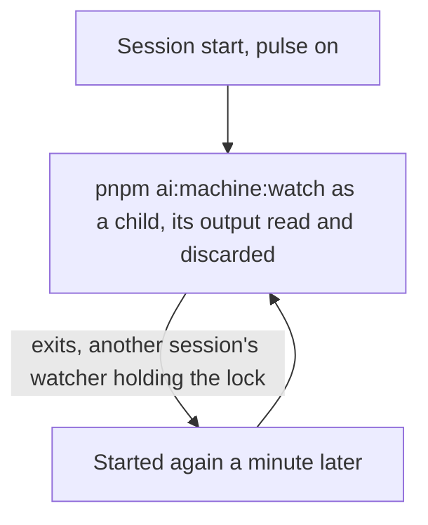

# Pulse

Part of [Genshin mods](../README.md). The machine watcher, `pnpm ai:machine:watch`, reads the machine's CPU, GPU and free memory each minute, writes its reading and pushes the machine's heartbeat. A watcher run under Monitor ends at the Monitor's expiry, which comes within thirty minutes and with the session, so the state would stop being written. The pulse runs the watcher as the session's own child, so it lives as long as the session does.

Pulse draws no row above the prompt and submits no prompt of its own.

## How it works

At session start, with pulse on, the plugin starts `pnpm ai:machine:watch` in the session's directory as a child process and reads its output as it arrives, a whole line at a time. Outside the repository the watcher's script is not there, so nothing starts. The watcher writes each reading to `~/.esposter/machine/state.json`, and it holds `~/.esposter/machine/watcher.lock` for its life, taken before its first sample: a watcher that finds the lock held by a live process exits, so two sessions starting together never sample the machine twice. A lock whose process is gone, written before the machine last booted, or left empty past the seconds' grace its writer has to write its process id in, is taken over: it is judged and replaced only by the one process holding its takeover file, with its holder and its time read through one open file, so two processes taking one over together never remove the lock the first has just taken, and a lock is only ever released by the process holding it. The watcher is the session's: it ends with the Claude Code process that started it. Each session starts its watcher again a minute after it exits, so while one session's watcher holds the lock the others' exit each minute, and once that session ends another open session takes the watching over within a minute.

## How to use it

Pulse is on by default, and `/pulse off` stops it; `/pulse on` turns it back on, and the switch is kept as every mod's is, on the [Genshin mods](../README.md) page. The switch is read at session start, so a change takes effect in the next session. With pulse off nothing starts the watcher, and `pnpm ai:resume` reports the watcher as not running until one is started by hand or a session with pulse on runs.

`pnpm ai:resume` has a `watcher` row for this: it is satisfied while the watcher's reading is fresh and its process is alive, and otherwise names `pnpm ai:machine:watch`, or starting a session with the plugin, as its action.

The watcher prints one line when the machine goes idle, `machine idle: …`, and repeats it on each reminder while the machine stays idle. Nothing in the session reads those lines: a run by hand prints them for the person reading.

## Notes

- A watcher stops with its session, so a machine with no session open reports no reading and its heartbeat pauses until one starts.

## Settled

- The idle wake, which submitted a prompt on the watcher's idle line telling the session to run `pnpm ai:fleet:fill` and launch a haiku agent per brief, was removed as useless, together with `ai:fleet:fill` itself. It is not to be re-added: nothing wakes a session on idle.

## Key files

| File                                                      | Role                                                                                                            |
| :-------------------------------------------------------- | :-------------------------------------------------------------------------------------------------------------- |
| `packages/genshin-mods/src/services/registerLifecycle.ts` | Session start starts the watcher, restarts it after it exits and discards its output                            |
| `packages/genshin-mods/src/services/constants.ts`         | The watcher's script path and the restart delay                                                                 |
| `scripts/src/services/machine/watchMachine.ts`            | The watcher's loop, which refuses to start while another watcher holds the claim                                |
| `scripts/src/services/machine/claimMachineWatch.ts`       | The watcher's claim, `watcher.lock`, taken before its first sample and taken over only once its process is gone |
| `scripts/src/services/machine/writeMachineState.ts`       | The watcher's write of its reading, renamed over the file it replaces                                           |
| `scripts/src/services/resume/getWatcherItems.ts`          | The `watcher` row of `pnpm ai:resume`                                                                           |
