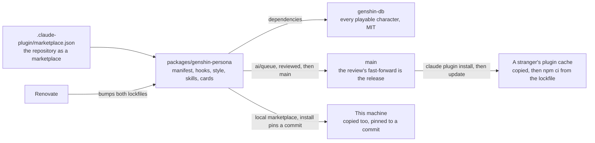

# Persona plugin

The personality half of the [Claude interface](../README.md): a new game patch costs one dependency bump this repository already automates, and nothing hand-written.

## Feature pages

| Page                                                       | What it covers                                                                                              |
| :--------------------------------------------------------- | :---------------------------------------------------------------------------------------------------------- |
| [Roster](roster/design.md)                                 | The game-data dependency every character is read from, and its per-version cache                            |
| [Picking a character](character-pick/design.md)            | The nearest-birthday pick, the typed lore pick and the record that holds a session's pick                   |
| [Switching characters](switching/design.md)                | The `use`, `pin` and `unpin` verbs and how each switch reaches the session's record                         |
| [Persona card](card/design.md)                             | What the session start prints and the model is given, and the output style that keeps the voice out of code |
| [Languages](languages/design.md)                           | The reply, interface and dub settings, and who writes each word a person reads                              |
| [Commands](commands/design.md)                             | One slash command per verb, and the skill that routes a request in words                                    |
| [Spinner](spinner/design.md)                               | The character's verbs for the spinner word and lines for the prompt hint                                    |
| [Accent and status line](accent-and-status-line/design.md) | The character's colour as the mods' accent, and the nameplate status line                                   |
| [Hooks module](engine-module/design.md)                    | The module the engine runs in-process, the status script and spoken replies                                 |

## Where it lives

Inside this monorepo, as a workspace package, published to npm as `genshin-persona`, that is also a plugin — a plugin is a directory with a manifest, and a marketplace is a repository with one file at its root naming where its plugins are. Everything a separate repository would need — dependency updates, formatting, lint, tests, the review pipeline — this one already runs.

The root manifest is the one file outside the package, and it is the one path the tool fixes: `.claude-plugin/marketplace.json` at the repository root names the repository as the marketplace `esposter`, owned by Esposter, listing each plugin package the repository holds — this one, follow-ups and genshin-mods. It lives beside the agent tree rather than inside it ([agent configuration](../../../architecture/agent-configuration/design.md)).



Two consequences shape the package, both forced by the remote install running a frozen `npm ci` in the copied plugin:

- **The dependencies are plain semver ranges, not catalog entries.** npm cannot read the workspace catalog protocol, so this is the one manifest in the repository whose dependencies state their own ranges; Renovate moves them, and the npm lockfile beside them, exactly as it moves everything else, and the outdated-dependency report finds the manifest by that lockfile and checks the ranges against it and the registry rather than flagging them as uncataloged.
- **The package declares no devDependencies.** A `workspace:` range would fail the same `npm ci`, so its tooling — Vitest, TypeScript, the shared configuration — resolves from the repository root's own installs, which is where node's lookup lands after the package's empty `node_modules`. Two lockfiles describe the same dependencies: the workspace lockfile serves the install here, the npm lockfile every cached install elsewhere, and neither is edited by hand. It is also why the [reference selection](../reference-selection/design.md) that generates the plugin's reference map lives in the repository's `scripts` rather than here, and why the speech engine's runtime is installed by the `voice` verb into the state directory rather than declared: either would ride along into every install.
- **Every entry is an `.mjs` that registers `tsx` before it loads its TypeScript**, so the plugin's code declares an `enum` where the rest of the repository does rather than a frozen object bent to suit node's own type stripping, which takes none. A hook or command line is a bare `node <path>` the tool runs, and `--import` cannot carry the registration there: on Windows the plugin root is a drive path, which `--import` reads as a URL scheme. So `tsx` is a dependency rather than a devDependency, carried into every install, and its transform cache keeps the cost after a first run to a few milliseconds over node alone.
- **It consumes no workspace package, though one route exists.** A _published_ package such as `@esposter/shared` could be named by a plain range, and "linkWorkspacePackages" would resolve it to the sibling here while the cached copy fetched the registry build. Declined: every release of that package would move the range and leave the frozen npm lockfile disagreeing with the manifest, so the public install would fail until someone regenerated it by hand — a coupling to another package's release cadence that nothing the plugin needs from `shared` earns. What it does need of a sibling — the game's languages and the game's own words, which [game text](../../../genshin/game-text/design.md) keeps in `genshin-text` — arrives the way the reference map does: generated into `src/generated/` by the repository's `scripts`, a copy a test holds byte for byte to its source, so the frozen lockfile never names it.

The same install rules out two shortcuts that get suggested: `pnpm-lock.yaml` is not a lockfile the installer reads (only bun's and npm's are), and no setting switches it to another package manager — "CLAUDE_PACKAGE_MANAGER" belongs to a third-party plugin's own scripts, not to the tool. `engines.node` is the root's `.node-version` restated on purpose: the plugin's floor (Temporal) travels with the copy, so `update:node` moves it with the pin, and a stranger's `npm ci` warns on it before a hook crashes.

A checkout declares itself: `.agents/settings.json` names the marketplace `esposter` with the relative source `.` and enables `genshin-persona@esposter`, so a clone opened in Claude Code installs the plugin at project scope once the person trusts the repository, on any machine and with no path anyone types. A plugin whose source is a relative path inside a directory marketplace is **copied like any other**, not linked: the CLI writes the files into its own cache under a directory named for the checkout's commit and runs them from there, so a pull that changes the plugin reaches nothing until an update moves the pin. Development that wants the working tree itself loaded passes `--plugin-dir`, which takes a directory for one session with no install and no pin, and is only correct with the installed copy disabled: two loads of one plugin fire every hook twice and, at two different commits, write each other's state. Elsewhere the release is a merge to `main`, which the [review](../../review/design.md) performs; an installed copy follows the marketplace on the tool's next plugin update — `claude plugin update`, which refreshes the marketplace first, or the background auto-update that runs on startup, which the tool leaves off for every marketplace but Anthropic's own and which the checkout therefore declares for itself: `autoUpdate` sits beside the source in `.agents/settings.json`, so a clone re-pins to its own current commit with nothing switched on by hand, and the toggle in the plugin UI reports the value as settings' rather than offering to change it. The plugin declares no version on purpose: with one, an installed copy moves only when the field is bumped, and a release here is a merge and no ceremony, so the version is the commit and every merge is an update. Nothing the update changes is the person's to repeat — the runtime is kept until its lockfile moves, and the weights until the engine does.

## Installable by anyone

The repository is public, so the marketplace is too: two commands for someone who wants the plugin without a checkout of their own — a clone needs neither, since its own settings declare both — and no listing in Anthropic's own directory, which was [decided against](../../../../rejected/infra/official-plugin-directory/design.md).

```bash
claude plugin marketplace add Esposter/Esposter
claude plugin install genshin-persona@esposter
```

The install copies the plugin into the plugin cache and, because the plugin root holds a package manifest and an npm lockfile, runs a frozen npm install there with lifecycle scripts off and a one-minute ceiling — the game-data package installs in a few seconds. What the public copy must not contain is as fixed as what it must: no image or audio lifted from the game. Its text is the exception, and a bounded one: the character data arrives through the dependency, the lines of the characters that dependency has none for yet ship generated from the game's own text in every language, and the persona cards are written in our words about how a character speaks, and the reference audio each character's voice is cloned from is fetched to the person's own state directory and never enters the repository at all ([per-character voices](../per-character-voices/design.md)).

## Notes

- Markdown files, a few scripts of a few dozen lines, and Renovate-owned dependencies in a workspace that already has hundreds; that is the whole maintenance surface.

## Key files

| File                                                  | Role                                                                                    |
| :---------------------------------------------------- | :-------------------------------------------------------------------------------------- |
| `.claude-plugin/marketplace.json`                     | The repository as the `esposter` marketplace, listing this package among its plugins    |
| `packages/genshin-persona/.claude-plugin/plugin.json` | The plugin manifest: discovery metadata and the user-configuration options              |
| `packages/genshin-persona/package.json`               | Every dependency as a plain range; no devDependencies, so the npm lockfile stays honest |
| `packages/genshin-persona/hooks/hooks.json`           | The session-start hook, and the hooks module beside it                                  |
| `packages/genshin-persona/scripts/pick.mjs`           | The entry every hook and command names: register `tsx`, then load the script beside it  |
