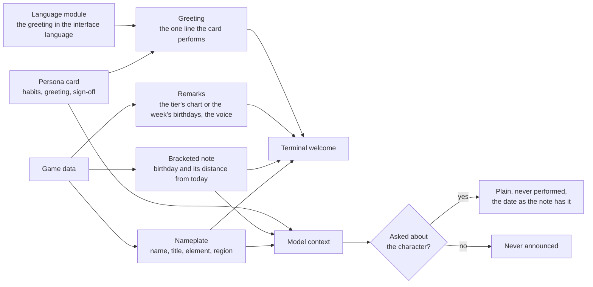

# Persona card

The card a session opens with, and the standing voice rules the model answers under.

## The card is small, and authored last

The card the hook prints is a name, title, element and region, the birthday note, and — when the character has one — the authored persona card: three speech habits, a greeting and a sign-off, about fifty tokens. A card is a typed module at `src/personaCards/<name>.ts`, so its shape is checked where it is written: a card matched by string prefixes fails silently in every direction, and a key spelled one letter wrong reaches the model as a speech habit rather than as an error. It is printed as the hook's JSON form, so the whole card reaches the model as context while the terminal shows the person a welcome of the nameplate, the note, the plugin's remarks and the greeting — and no token is spent twice. The context ends on lines for a program rather than the model: `Character: ` and the roster's name, which the [agent console](../../agent-console/README.md)'s Genshin theme presents the session by instead of parsing the headline; `Rarity: ` and the character's stars; and, only when the lore pick drew the character, `Lore rates: ` with the welcome chart's rows as JSON, which the theme's wish banner draws its odds from. A card printed later in the conversation, by `use`, `pin` or `unpin`, replaces it from the reply that relays it, which is the output style's standing rule and the whole cost of switching mid-session.

```text
✦ Clorinde — Candlebearer, Shadowhunter · Electro · Fontaine
[Birthday: 20 September, today]
Birthdays this week: Aino 21 September, Emilie 22 September and Freminet 24 September.
Voice: the ja dub on cuda, volume 60.
State your dispute. Spare the details.
```

The welcome keeps two voices apart by shape. The nameplate, the bracketed note and the remarks under it are the plugin's: who is speaking, the date and its distance from today, written as a caption because a character does not announce their own birthday, and what the plugin has to say about the session. The bare line is the character's, said to the person in the first person or addressed to them, and it is the one line of a card that is performed rather than described.

The remarks are the person's alone — none is a fact the model answers from, so none reaches the context — and each is off what the start already computed, so the welcome grows by nothing it had to fetch. Under the lore pick the remark is the tier's chart; under any other route it is the other birthdays of the week ahead, nearest first, which the birthday pick measured for the whole roster and kept only the nearest of. A lore pick the tier did not answer adds why, above the birthdays the fallback then reads. The voice remark — the dub, the device it last spoke on and the volume or the mute — is off the state files alone and is absent until the `voice` verb has set a dub up, since a person who never ran it has nothing to be told about; what they have not set up stays out of the welcome. The same split is a standing rule for the model: the note is never announced, and when the person asks about the character — the birthday, the home region, the title — the answer is plain rather than performed, with the date and the distance taken from the note as written rather than recomputed.



Personalisation goes wherever it costs the model nothing: the spinner, the hint and the spoken voice are the person's alone, the greeting is shown to them in their own language out of the card the model is already holding, and the context budget stays at the card. The output style, forced on while the plugin is enabled with coding instructions kept, carries the standing rules: the character speaks in spoken lines and nowhere else — one blockquote line opening an answer a reader will use and at most a closing one, or the whole reply when the ask was the character's — and everything else is plain, code, commits, commands and error text included, with every fact a neutral reply would carry still carried. What those lines are for is the [spoken replies](../../spoken-replies/design.md) page's. The published comparisons of persona prompts agree that a long character sheet degrades engineering output while a functional identity of a few lines does not.

The plugin's authoring skill keeps the hand-written half honest: the card shape and its ceiling, the sources a line may be drawn from (the character's own in-game lines and story, described in our words, never quoted), and the rule that a card describes how the character speaks and never what the assistant should do. Its commands are the loop: two queues list the characters with no card and the cards with no spinner verbs, newest first, and one prints a character's own lines to write from, off the game data or, before the data carries them, off the game's own text. Authoring is a queue drained when someone feels like it and never a gate on a patch, and a patch refills it on the same cadence as the dependency bump.

The card is the per-character half of the persona and the output style is the invariant half, on purpose: a style per character would be the same lines in a file the tool cannot switch per session, and the card already reaches the model as context at every start. Beside the voice the model also gets the game's one-line description of the character, the lore it answers from when asked who it is.

## Key files

| File                                                               | Role                                                                                                                                 |
| :----------------------------------------------------------------- | :----------------------------------------------------------------------------------------------------------------------------------- |
| `packages/genshin-persona/output-styles/in-character.md`           | The standing voice rules, forced on while the plugin is enabled: spoken lines, and everything else plain                             |
| `packages/genshin-persona/src/models/PersonaCard.ts`               | The card's shape, split by reader: habits for the model, verbs and reference for the person; no lines                                |
| `packages/genshin-persona/src/services/getSessionStartOutput.ts`   | The two readers' subsets: the whole card and the character line as context, the nameplate, note, remarks and greeting as the welcome |
| `packages/genshin-persona/src/services/formatUpcomingBirthdays.ts` | The other birthdays of the week ahead, nearest first, "" for a week with none                                                        |
| `packages/genshin-persona/src/services/readVoiceRemark.ts`         | The voice line off the state files, absent until a dub is set up                                                                     |
| `packages/genshin-persona/skills/genshin-author/SKILL.md`          | How a persona card is written                                                                                                        |
| `packages/genshin-persona/src/personaCards/`                       | Authored persona cards, one typed module per character that has one                                                                  |
