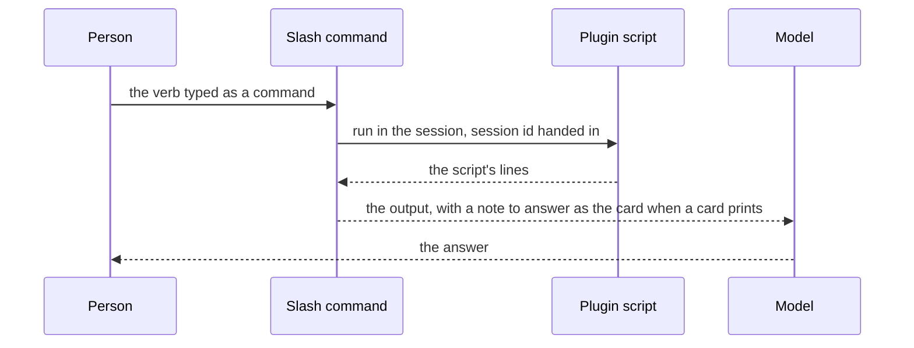

# Persona commands

Every control the persona plugin offers, as a slash command the menu lists.

## The commands

Every control is its own slash command — `/genshin-today`, `/genshin-roster`, `/genshin-use`, `/genshin-pin`, `/genshin-unpin`, `/genshin-mute`, `/genshin-unmute`, `/genshin-volume`, `/genshin-voice`, `/genshin-language`, `/genshin-reply`, `/genshin-status`, `/genshin-teardown` and `/genshin-viewer` — because a verb hidden inside one command's argument is invisible in the menu and a bare invocation of that command has no meaning. The plugin's hooks module registers them from the verb enum at session start, each with the line the menu shows, so a verb is a row in one map rather than a file of its own. A command runs the plugin's own script in the session, the session's id handed to it the way a Bash tool's subprocess carries it, and returns the script's lines as the command's output, which the model reads; a verb that prints a card adds one note telling the model to answer as it. One skill, `genshin`, is the model's and hidden from the menu: it carries the table of verbs, so a request put in words — who is this, louder, be Furina — reaches the right one, and a request that says nothing about how long is `use`, never `pin`. The roster is game data nothing but the script has read, so nothing about it is answered from memory, and the script's last line says when the change lands.

One of them changes nothing. Every setting is its own file in the state directory, which is the right shape for writing one and no shape at all for reading them, and `status` is the verb that reports them, with `voice` reporting its own dub. It prints the character and the reply language with their **provenance** rather than their values alone, because a value and where it came from are different facts and only the second explains the behaviour: whether this session has a character of its own or is reading the pin, and whether the reply language was set or cascaded. It reads the same files the other verbs write, so there is no second record of the state to keep in step.

## Notes

- `mute` and `unmute` decide whether the module hands a reply to the speak script at all, `volume` is a whole number of a hundred applied as a gain on the samples, and `voice` is the one verb that installs anything ([spoken replies](../../spoken-replies/design.md)).

## Key files

| File                                                                   | Role                                                                                         |
| :--------------------------------------------------------------------- | :------------------------------------------------------------------------------------------- |
| `packages/genshin-persona/mod/VerbDescriptionMap.ts`                   | Each verb's command and the line the menu shows, and the verbs that print a card             |
| `packages/genshin-persona/scripts/genshin.ts`                          | The commands' script: the verbs' usage in the interface language                             |
| `packages/genshin-persona/src/services/cli/commands/genshinCommand.ts` | Every verb, one file each beside it: the language cascade, the status report, and the queues |
| `packages/genshin-persona/skills/genshin/SKILL.md`                     | The model's router from a request in words to a verb, hidden from the menu                   |
