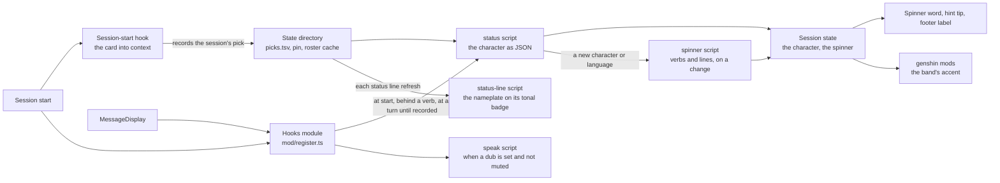

# Persona hooks module

The plugin's surfaces in the terminal, drawn by the engine from one hooks module rather than by settings the person edits.

## The module

The plugin's surfaces beside the card are drawn by the engine from a hooks module, `mod/register.ts`, a TypeScript module the engine runs in-process ([Claude Code mods](../../../../architecture/claude-mods/design.md)), so nothing is written into the person's settings and nothing outlives the plugin. The module has no Node, so everything that reads game data, state files or audio stays in the plugin's node scripts, which it runs as commands with the hook's input on stdin. It publishes the session's character as state — the name, the name the interface language spells, and a colour — which the [genshin mods](../../genshin-mods/README.md) draw their accent in.

## The status script

The status script reads the session's record, else the pin, else the birthday pick over the roster cache (`readSessionNameplate`), and prints the character as JSON for the module with whether it was the session's own record. It reads the state files and never the game data, which costs the better part of a second to load, so the module reads it at session start and behind every verb, and at a turn's start only while the record is missing: the session-start hook may still be writing it when the first read runs, and a lore pick records its answer after the birthday pick has stood in, so the character settles on the first turn and no turn after that starts a node process for it. A `/clear` or a resume carries on under a new session id with no session start for the module, so either marks the character unsettled again and the next turn reads the new session's pick. It never stands in another session's record: a `use` is that session's alone.

## The footer label

The character is named among the dim mode labels at the right of the prompt's footer, the engine's place for a standing word about the session. `$.ui.status`, which a mod might take for a status line, pins a notice under the prompt drawn with a warning mark, so it is not used; the label is added to the footer's list rather than drawn over it, so any other plugin's labels stay. It is the name the interface language spells, uncoloured as every label is.

## Spoken replies

The spoken replies are the engine's `MessageDisplay` event, which hands every flushed piece of a reply to the module as it would to a settings hook, whether or not one is configured; the module hands it to the speak script unchanged. The display waits on that event for about a node start per piece, a cost the voice earns and a plugin user with no voice should never pay, so the module checks the voice's dub file and the mute file first, which costs a file check and no node start. The native alternative, the turn's raw stream of text, would mean rebuilding the line batching and the piece numbering the speak script orders playback by, so the event stays the trigger ([spoken replies](../../spoken-replies/design.md)).

## How the surfaces connect

## Key files

| File                                                            | Role                                                                                                                               |
| :-------------------------------------------------------------- | :--------------------------------------------------------------------------------------------------------------------------------- |
| `packages/genshin-persona/mod/register.ts`                      | The hooks module: the spinner word and hint tip, the character published for the mods, the spoken replies and one command per verb |
| `packages/genshin-persona/types/index.d.ts`                     | The state the module publishes, and the shapes the status and spinner scripts print                                                |
| `packages/genshin-persona/scripts/status.ts`                    | The session's character as JSON for the module, and whether it is the session's own record; never the game data                    |
| `packages/genshin-persona/src/services/readSessionNameplate.ts` | The session's character off the state files and the roster cache, read by both the status and the status-line scripts              |
