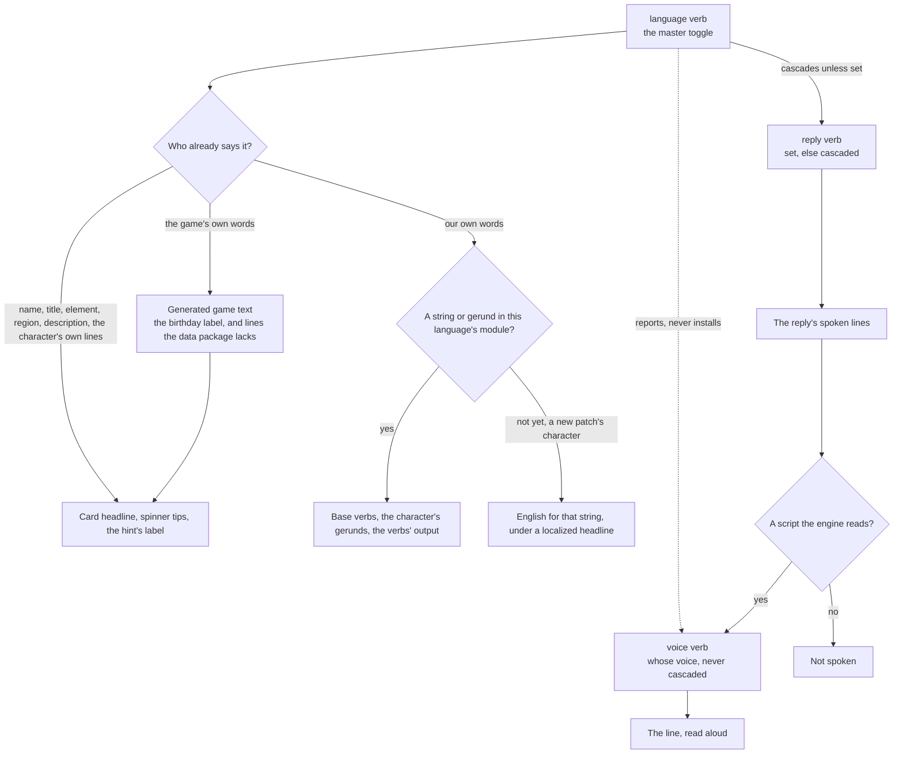

# Persona languages

The three settings that decide what a session reads, and what each one changes.

## The three languages

Three settings decide what a session reads, and they are deliberately not one axis — each answers a question the others cannot, and each costs something different to change.

| Tier      | Set                            | What it decides                      | Cost to change                                 |
| :-------- | :----------------------------- | :----------------------------------- | :--------------------------------------------- |
| Replies   | anything                       | what the model writes prose in       | a line of context                              |
| Interface | what the data package declares | every word the plugin puts on screen | a state file, and a module for our own words   |
| Dub       | four                           | whose voice reads a reply            | an install of about a gigabyte and a proof run |

**The set of interface languages is the game's own fifteen**, the `GameLanguage` enum [game text](../../../../genshin/game-text/design.md) keeps and the plugin carries a copy of, spelt as the data package spells them so either answers the other. Reading it costs nothing, where reading the data package's own list would cost a load of that package, so the list itself opens nothing, though the command's shared context read may load the package to build the roster on a cache miss; the game has added no language since it launched, and one it adds is a generator run. The `language` verb given no argument prints them, which is the whole of the discovery. Each is printed in its own words beside the word a person types for it — `Japanese (日本語)` — and either resolves, so what the verb invites is what it accepts.

Naming a language in its own words, and in any other's, is the runtime's job rather than a table of ours: `Intl.DisplayNames` already knows all of them. The one thing it needs that the game does not carry is a BCP-47 tag per language, which `genshin-text` keeps beside the enum; a name that is no game language — a reply language may be any — is shown as given, which is also the word a person typed.

The master toggle sits at the middle tier and cascades upward only: setting the interface language sets the reply language with it, and either stays overridable on its own afterwards. That is the per-setting customization without a matrix of switches, because an override is only written when somebody wants the two to disagree — labels in one language and prose in another, which is a real want in both directions.

**The reply language reaches the model as one line of context at the session start**, in the tool's context field rather than the output style, which the plugin ships and cannot vary per person. The line is left out only when the reply language and the interface language are both English: the card the model reads — headline, description, note — is in the interface language, and an English reply beside a Japanese card drifts into Japanese a line at a time unless told, the spoken lines first, since the style writes those in the character's register and the card is the register it has. The line names the spoken lines outright for the same reason.

**The dub stays outside the cascade and is reported on rather than changed.** It answers a different question from a set of four, and a download of most of a gigabyte must never be a side effect of a labels setting. So the interface verb ends by naming the state the dub is in: set to a language a dub exists for, it says so and names the command that installs it; set to any other, it says plainly that replies keep reading in whichever voice is already set up.

### What the data package answers, and what is ours

Passing the English name as the query language and the chosen one as the result language answers every field the card and the prompt hint show — the name, the title, the element and region text, and the one-line description — and answers the character's own voice lines in the same call, at the same count as English. The spinner's tips are those lines, so the largest readable surface localizes for the cost of two options on a query that is already made. The roster is read twice rather than once: the English records are the identity, the localized records are what is read, and they are matched on the id the package gives rather than on the order it returns them in.

What the game itself says is not ours to write either: the label over a birthday is the game's own word for it, read from the generated game text in the interface language, so the aside is right in every language without a module carrying it. What is ours is one authored module per language under `src/localizations/`, named for the language the way a card is named for its character: that language's base Teyvat verbs, the person's half of each card keyed by the character's English name, the locale the runtime formats against, and every line the verbs themselves print. Every one of the game's fifteen has a module, and one matrix test holds each to the roster, to English's count of base verbs, to no English pasted where its translation belongs and to every string filled. A language still inherits a string it lacks from English per string, so the state a new patch leaves — a character no module has gerunds or a greeting for yet — is legal rather than a missing key, and `untranslated` is that queue, the third beside `uncarded` and `unverbed`.

**Of the authored card, the greeting is translated and nothing else is.** The habits and the sign-off reach the model and not the person, and a model given them in English and asked to answer in Japanese answers in Japanese with the register intact, so they follow the reply language by themselves at no authoring cost. The greeting does not: the session-start hook prints it to the terminal as the welcome's last line, before the model has said a word, so it is a label a person reads in the interface language beside a headline and a note already in it. The language's module carries it per character, and a character it has no line for yet is greeted in the card's own words — one line in another script is a queue item, where a spinner mixing two scripts would be a broken one. That the greeting is a line the model performs is true of the model's copy and not of the person's, and the person's is the one that shows.

**The translated greeting shows in the welcome and nowhere else, and the card keeps its own.** The card is one block of the model's own English, three habits and a sign-off, and a localized line between them would be the two scripts in one list that the spinner's rules already refuse, for a greeting the person has read once in the welcome already. The split is by reader and not by channel: what the model is given stays as authored whichever surface carries it, and the person's greeting is the welcome's line.

**The words the runtime already has are never ours.** `Intl.RelativeTimeFormat` says "today", "tomorrow", "in 2 days" and "2 days ago" in every language the package names, with the plural forms a hand-written template gets wrong in Russian or Polish, and `Intl.ListFormat` joins the list a verb offers a choice from in that language's own punctuation; `Intl.DisplayNames` names the languages themselves. A module carries one locale for all three and no string for any of them. An i18n library was weighed for the module's own strings and declined: what it adds is a JSON layout and CLDR plurals, and the plurals are the part `Intl` already gives, while a typed function per string has the compiler check every placeholder's arity, which the library's keyed lookup does not, and the status report composes its many fields in a function and in no message format. Nobody in the loop is a translator with a translation tool; the model fills the queue, and a typed module is the shape it fills best.

### Identity and display

The English name is the identity: the pin, the pick records, the reference clips, the card modules and every wiki lookup are keyed by it, and it is stable across a change of language. Beside it rides the name that language spells the character by, which is what the prompt hint draws and the card heads. The character's colour is looked up by the **English** name and element for the same reason — a localized name or element text matches no key in either colour map, and the fallback is the mods' own accent, so the failure would have been silent. A typed name resolves against either, because the localized one is what a person sees and therefore copies.

A change of interface language rewrites the session's record, the pin and the spinner exactly as a change of character does, since all three carry the name being drawn. The roster cache is keyed by the data package's version **and** the language, so a change of either is a miss rather than a stale read. That name reaches a file path in the cache's own name, so the state file holding it is read only when it holds a bare run of letters, which every one of the package's names is; checking it against the package there is what costs the better part of a second, so a well-formed name it does not answer in falls back where it is used instead.

### What this deliberately does not reach

- **Claude Code's own interface stays English.** Its menus, its help, its permission dialogs and its own hints belong to the tool, and no plugin setting reaches them. What the plugin localizes is the whole of what a plugin owns. The revisit trigger is the tool taking a language setting of its own.
- **A character a language's module has no entry for yet reads in English for the words that are ours** — the base verbs ahead of no gerunds of their own, and the card's own greeting — under a localized name, title and tips, which is the state a new patch leaves until `untranslated` is drained, not a failure.
- **A dub exists for four of the fifteen**, so a French or Thai interface with a Japanese voice is a legal state and the common one outside those four.
- **Replies in a non-Latin script are not spoken**, because the engine's own gate drops them, so a cascade to Japanese silences a set-up voice until [multilingual spoken replies](../../../../../changes/infra-multilingual-spoken-replies/design.md) lands; the verb warns at the moment the cascade would cause it.
- **A character the data package has no lines for yet speaks the game's own lines, in every language the game ships.** `pnpm -C scripts genshin:text write` reads their voice-over lines out of the game's text for each language and commits them as one chunk per language beside the copy, loaded only for the language a spinner is read in. The characters it writes are the ones the installed data package lacks at the time it runs, so a dependency bump that carries them makes the generated rows dead weight until the next run drops them, and a character the game has announced but not released has no lines in either and shows their one-line description. The wiki stays the source of the clips a voice is cloned from, and of the stems those clips are filed under, which is audio and never ships.

## Key files

| File                                                        | Role                                                                                                                       |
| :---------------------------------------------------------- | :------------------------------------------------------------------------------------------------------------------------- |
| `packages/genshin-persona/src/localizations/`               | One authored module per language: its base Teyvat verbs, each character's gerunds, and every line the verbs print          |
| `packages/genshin-persona/src/models/Localization.ts`       | What a language's module holds, and what is absent from it because the data package answers it                             |
| `packages/genshin-persona/src/services/readLocalization.ts` | The language's own words over English's, merged per string so a half-translated language shows each in the language it has |
| `packages/genshin-persona/src/generated/genshinText/`       | The copy of `genshin-text`'s modules and game text the plugin runs, written by `genshin:text write`                        |
