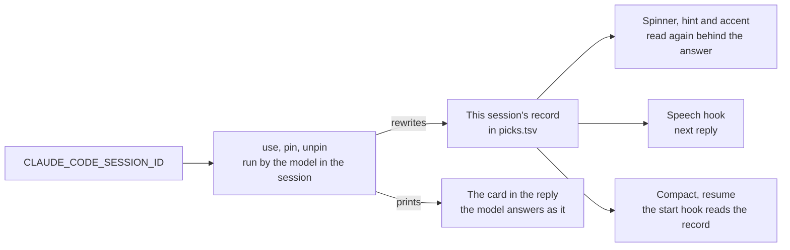

# Switching characters

The verbs that change the character, for one session or for every later one.

## Switching inside a session

The session's record is the one source every reader trusts — the start hook on a compact or resume, the hooks module, the speech — so changing a session's character is rewriting that record, and the tool makes the record reachable from inside the session: every Bash tool subprocess carries the session id in `CLAUDE_CODE_SESSION_ID`, the same id the hook input names. `use <name>` rewrites this session's record and leaves the pin as it stands; `pin <name>` writes the pin for every later session and rewrites this one's record too; `unpin` deletes the pin and gives this session a fresh pick. Each prints the card, and the card printed in the conversation is the one the model answers as from that reply on — the output style's standing rule. The command that ran the verb reads the character again behind its answer, so the spinner, the prompt hint and the mods' accent show the switch at once, and the voice follows from its next line. A session that started before the pin keeps its own record, because its conversation started with that character.

## Key files

| File                                                              | Role                                                                                      |
| :---------------------------------------------------------------- | :---------------------------------------------------------------------------------------- |
| `packages/genshin-persona/src/services/recordSessionCharacter.ts` | The one writer of a session's record, for the start hook and for `use`, `pin` and `unpin` |
