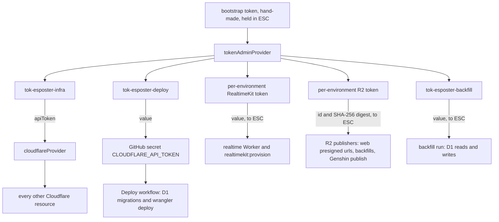

# Cloudflare tokens

Every Cloudflare account token the estate uses is an `AccountToken` resource in the Pulumi program. A consumer holds one token with the least permission groups its calls need, or one token per environment where it runs in both. The one token made by hand is the bootstrap token, which creates the others.

## How it works

Two explicit providers split the program's Cloudflare access. `tokenAdminProvider` is configured with the bootstrap token and creates every account token resource, so only those resources and the permission-group lookup read it. `cloudflareProvider` is configured with the infra token's value and creates every other Cloudflare resource, so the program reads no Cloudflare credential from config. The `cloudflareProvider` takes its `apiToken` from the infra token's resource, a data dependency that makes the engine create the infra token first. No ordering is written by hand.

Each consumer's value leaves the program in one of three ways. The Deploy token's value is the GitHub Actions secret `CLOUDFLARE_API_TOKEN`. The R2 pairs, the RealtimeKit tokens and the backfill token are stack outputs, and each reaches ESC by one `pulumi env set` per key. The infra token's value stays in the provider's state.

## The token table

Each row is one account token, and each permission group is read by its name from the account's own list. The R2 publishers and the RealtimeKit consumer each hold one token per environment.

| Account token                                                   | Consumer                                                                                                      | Permission groups                                                                                                                                                                                                                                                                  | Scope                                  | Value goes to                                                                                             |
| :-------------------------------------------------------------- | :------------------------------------------------------------------------------------------------------------ | :--------------------------------------------------------------------------------------------------------------------------------------------------------------------------------------------------------------------------------------------------------------------------------- | :------------------------------------- | :-------------------------------------------------------------------------------------------------------- |
| `bootstrap` (hand-made, ESC "bootstrapToken")                   | `tokenAdminProvider`, read only by the token resources                                                        | Account API Tokens Write                                                                                                                                                                                                                                                           | account                                | nowhere: it only creates the tokens below                                                                 |
| `tok-esposter-infra`                                            | `cloudflareProvider`, for every Cloudflare resource except the token resources                                | Account Settings Read, D1 Write, Queues Write, Workers R2 Storage Write, Workers Scripts Write; zone: Zone Read, Zone Write, DNS Write, Zone DNS Settings Write, Zone Settings Write, Zone Transform Rules Write, Workers Routes Write, Bot Management Write, Cache Settings Write | account, and every zone of the account | nowhere: the provider's `apiToken` in state                                                               |
| `tok-esposter-deploy`                                           | the Deploy workflow: D1 migrations and `wrangler deploy` of the three Workers                                 | Account Settings Read, D1 Write, Workers Scripts Write, Queues Write                                                                                                                                                                                                               | account                                | the GitHub secret `CLOUDFLARE_API_TOKEN`                                                                  |
| `dev-tok-esposter-realtimekit`, `prod-tok-esposter-realtimekit` | RealtimeKit: the realtime Worker's calls and `realtimekit:provision`                                          | Realtime Admin                                                                                                                                                                                                                                                                     | account                                | ESC `<env>_REALTIMEKIT_API_TOKEN`                                                                         |
| `dev-tok-esposter-r2`, `prod-tok-esposter-r2`                   | the environment's R2 publishers: the web Worker's presigned urls, the backfills, the Genshin publish          | Workers R2 Storage Bucket Item Write                                                                                                                                                                                                                                               | each bucket of the environment         | ESC `<env>_R2_ACCESS_KEY_ID` (the token's id) and `<env>_R2_SECRET_ACCESS_KEY` (the SHA-256 of its value) |
| `tok-esposter-backfill`                                         | a backfill run's D1 reads and writes through the D1 HTTP API, the `core` database of the environment it names | D1 Write                                                                                                                                                                                                                                                                           | account                                | ESC "CLOUDFLARE_BACKFILL_API_TOKEN", loaded by the run as `CLOUDFLARE_API_TOKEN`                          |

## The bootstrap token

The bootstrap token is the one credential a person makes by hand. It is an account token that may write account API tokens, and nothing else the program calls. ESC holds it as "bootstrapToken", and the stack reads it through the config key `CLOUDFLARE_BOOTSTRAP_API_TOKEN`, which only `tokenAdminProvider` uses. It expires on its own. The estate never rotates or deletes it, and its owner makes a new one when it expires, the one renewal done by hand.

## Providers

Both providers are explicit, and both are `protect: true`.

- `tokenAdminProvider` (`apps/infra/src/cloudflare/providers/tokenAdminProvider.ts`) takes the bootstrap token. The account token resources in `apps/infra/src/cloudflare/resources/accountTokens/` are made under it, and so is the permission-group lookup.
- `cloudflareProvider` (`apps/infra/src/cloudflare/providers/cloudflareProvider.ts`) takes the infra token's value. Every other Cloudflare resource the program declares is made under it. The token resources are the exception, since the infra token they create is what `cloudflareProvider` needs.

A token names its permission groups by their names, never by their ids. `getAccountTokenPermissionGroupId` (`apps/infra/src/cloudflare/services/getAccountTokenPermissionGroupId.ts`) reads the account's permission-group list by name through the provider's data source and returns that one group's id. A name the account does not carry fails the run with that name, so no permission-group id is written into the program.

## Names

A token's resource name is built by `getCloudflareResourceName` for an environment's token and by `getCloudflareAccountResourceName` for an account's, both from `@esposter/db-schema`. The name is therefore `<env>-tok-esposter-<responsibility>` or `tok-esposter-<responsibility>`, as `apps/infra/docs/cloudflare/naming-conventions.md` defines it. `scripts/src/workspace/ci/cloudflareTokenNames.test.ts` fails a token resource that builds its name any other way. The bootstrap token keeps its hand-made name, since nothing renames it.

## Outputs

A value a person or a workflow needs from a token is a stack output, one file each under `apps/infra/src/cloudflare/outputs/`.

- `devR2AccessKeyId` and `prodR2AccessKeyId` are each environment's R2 token's id, which is the S3 access key id.
- `devR2SecretAccessKey` and `prodR2SecretAccessKey` are the SHA-256 digest of the token's value, in hex, by `getR2SecretAccessKey`. The digest derives from a secret, so Pulumi keeps it secret.
- `devRealtimeKitApiToken` and `prodRealtimeKitApiToken` are each environment's RealtimeKit token value.
- `backfillApiToken` is the backfill token's value.

The Deploy token has no output. The GitHub secret `CLOUDFLARE_API_TOKEN` reads its value from the resource directly (`apps/infra/src/github/secrets/cloudflareApiToken.ts`).

Each output reaches ESC as one `pulumi env set` per key, as `apps/infra/docs/stacks.md` shows, so no script copies them. The keys are `<env>_R2_ACCESS_KEY_ID`, `<env>_R2_SECRET_ACCESS_KEY`, `<env>_REALTIMEKIT_API_TOKEN` and "CLOUDFLARE_BACKFILL_API_TOKEN".

## Notes

- **Rejected: one token for Deploy and infra.** The Deploy workflow needs four groups the infra token also holds and none of its zone groups. A merged token would give the Deploy workflow DNS, bot management and transform rules it never calls, and the workflow runs on every push, so the widening would be exercised by every CI run.
- **Rejected: one R2 pair across environments.** The dev and prod buckets are separate blast radii, so each environment's publishers hold only their own.
- **Rejected: borrowing the Deploy token for backfills.** Its value reaches only the GitHub secret, which no session can read back, so a backfill cannot hold it.
- **Rejected: a backfill token per environment.** D1's permission group is granted on the account and cannot be scoped to one database, so a pair per environment would grant the same reach twice.
- **One RealtimeKit token for both uses.** The realtime Worker's calls and `realtimekit:provision` make Realtime Admin calls and nothing else, so one token serves both. The provisioning creates apps, presets and webhooks, and holds no account token permission, since Pulumi makes the token.
- **Settled.** A hand-made account token beyond the bootstrap token is not reintroduced: every other token is an `AccountToken` resource.
- **Protection.** Every token and every resource is `protect: true`, so a change that would replace a token stops the run. A token's value changes only through a replacement, which lifts the protection for that one run and restores it. No scheduler re-rolls a token and no job checks expiry.
- **Group names.** A permission group's name is Cloudflare's. If Cloudflare renames one, the lookup fails the run by the old name, which is the signal to change the name in code.

## Key files

| File                                                                     | Role                                                                                               |
| :----------------------------------------------------------------------- | :------------------------------------------------------------------------------------------------- |
| `apps/infra/src/cloudflare/providers/tokenAdminProvider.ts`              | the bootstrap provider, read by the token resources and the permission-group lookup only           |
| `apps/infra/src/cloudflare/providers/cloudflareProvider.ts`              | the provider every other Cloudflare resource is made under, its `apiToken` the infra token's value |
| `apps/infra/src/cloudflare/resources/accountTokens/`                     | one `AccountToken` per consumer                                                                    |
| `apps/infra/src/cloudflare/services/getAccountTokenPermissionGroupId.ts` | a permission group's id, read by its name                                                          |
| `apps/infra/src/cloudflare/services/getAccountWideResources.ts`          | the policy resources of an account-wide token                                                      |
| `apps/infra/src/cloudflare/services/getR2BucketResources.ts`             | the policy resources of an environment's R2 token, one per bucket                                  |
| `apps/infra/src/cloudflare/services/getR2SecretAccessKey.ts`             | the S3 secret access key, the SHA-256 hex digest of a token's value                                |
| `apps/infra/src/cloudflare/outputs/`                                     | the stack outputs that reach ESC                                                                   |
| `apps/infra/src/github/secrets/cloudflareApiToken.ts`                    | the GitHub secret `CLOUDFLARE_API_TOKEN`, holding the Deploy token's value                         |
| `scripts/src/services/realtimeKit/applyRealtimeKitActions.ts`            | the RealtimeKit provisioning's apps, presets and webhooks, which creates no token                  |
| `scripts/src/workspace/ci/cloudflareTokenNames.test.ts`                  | fails a token resource whose name is built outside the naming helpers                              |
| `apps/infra/docs/cloudflare/naming-conventions.md`                       | the token names                                                                                    |
| `apps/infra/docs/stacks.md`                                              | the `pulumi env set` commands that write the outputs to ESC                                        |
| `.agents/skills/security/references/credentials.md`                      | the handling rules for every credential                                                            |
