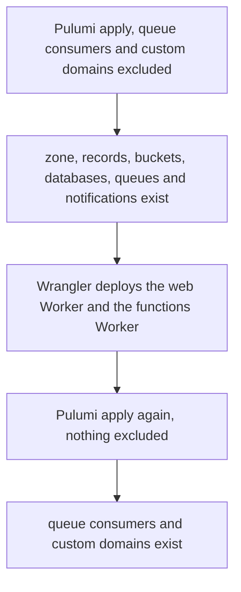

# Pulumi Layout

Every Cloudflare resource Esposter runs, and every GitHub repository setting, is declared in `apps/infra`, which is the source of truth for the single `prod` stack. Anything created by hand in the dashboard is drift, not a resource: it is imported and declared, or it is deleted.

## Layout rules

- **One resource per file**, named after the resource in camelCase and prefixed with its environment for resources that exist once per environment: `prodD1EsposterCore.ts`, `devQEsposterDeleteAccount.ts`.
- **Folders follow the Cloudflare resource type**: `src/cloudflare/resources/<resourceType>/`, such as `d1Databases/`, `r2Buckets/`, `queues/` and `queueConsumers/`. Finding a resource's declaration takes the type the dashboard shows it under.
- **Names come from one function.** `getCloudflareResourceName` and `getCloudflareAccountResourceName` build every name, and the Workers call the same functions, so a resource and the code that names it cannot disagree. A Pulumi logical name is that name. A resource applied under a different name previews as a delete and a create, so a rename of a stateful resource is a move of its data, never a relabel.
- **Providers are split.** `src/cloudflare/` holds the `@pulumi/cloudflare` resources and `src/github/` holds the `@pulumi/github` ones: collaborators, environments, labels, secrets written from ESC, and the branch rulesets that make a branch's name the rule for who may create and push it ([branch namespaces](../branch-namespaces/design.md)).
- **The naming shape** is written once in `apps/infra/docs/cloudflare/naming-conventions.md`: an environment token, an asset-type token and a workload token. Account-scoped resources drop the environment token.
- The package entrypoint `src/index.ts` is a generated barrel, and Pulumi runs the compiled `dist/index.js`.

## Resource inventory

What each folder under `src/cloudflare/resources/` holds:

| Folder                               | Resources                                                                                            |
| :----------------------------------- | :--------------------------------------------------------------------------------------------------- |
| `zones/`, `dnsRecords/`, `rulesets/` | The `esposter.com` zone, its apex and `www` records, and the redirect ruleset                        |
| `workersCustomDomains/`              | The custom domains of the web Worker and the functions Worker                                        |
| `d1Databases/`                       | The `core` database, one per environment                                                             |
| `r2Buckets/`                         | One bucket per storage bucket name, per environment, the `public-` buckets served on a custom domain |
| `r2BucketLifecycles/`                | The message-assets rule moving objects to Infrequent Access after thirty days                        |
| `r2BucketEventNotifications/`        | The object-create notifications that send bucket writes to a queue                                   |
| `queues/`                            | One queue and one dead-letter queue per job, per environment                                         |
| `queueConsumers/`                    | Each queue's consumer, which is the functions Worker                                                 |

The Workers' code is not in this list. Nitro writes the web Worker's configuration file and the functions Worker has its own, and both name the binding ids the program exports.

## Order of the first apply

A queue consumer names the functions Worker, and a custom domain names a Worker, so neither can be declared until its Worker exists. The first apply runs in three steps:

The exclusion is by resource type, so it holds for every instance of the type. Every later apply declares everything, and a preview is read before each apply. A full apply is never run with its preview skipped.

## Decisions

**Worker code is not a Pulumi resource.** Declaring each deploy as a `WorkerVersion` would make every application deploy a Pulumi update of the prod stack. CI runs Wrangler after its checks pass on `main`, and Pulumi declares the resources the Workers bind to, not the Workers' code.

## Notes

- **A GitHub default is declared rather than left to the settings page.** The provider owns the repository's Actions surface beside its refs: which actions a workflow may call, the token a job is handed when its workflow declares no `permissions:` of its own (read), and Dependabot's automatic pull requests, off because Renovate writes every version here and a second bot's pull request would arrive against `main`, outside the queue the review reads. Each has a GitHub default, and a default nobody declared is one a click flips with no diff to show for it. The exception is the ruleset parameter `require_extra_approval_for_unattributed_changes`, outside what `@pulumi/github` can express at the version the lockfile resolves ([branch namespaces](../branch-namespaces/design.md)). Private vulnerability reporting is on and set on the repository directly for the same reason. Requiring every action to be pinned to a sha is deliberately not taken: the review workflow checks out `ai/queue`, a moving ref by design, and a policy that counts a reusable workflow deadlocks every event it fires on, which no preview can prove either way.

## Key files

| File                                                                      | Role                                                                 |
| :------------------------------------------------------------------------ | :------------------------------------------------------------------- |
| `apps/infra/src/cloudflare/resources/`                                    | One file per Cloudflare resource, folders by resource type           |
| `packages/db-schema/src/services/cloudflare/constants.ts`                 | The committed account id every Cloudflare resource is declared under |
| `apps/infra/src/github/`                                                  | GitHub repository settings, labels, environments, rulesets, secrets  |
| `apps/infra/docs/cloudflare/naming-conventions.md`                        | The Cloudflare naming shape and its tokens                           |
| `packages/db-schema/src/services/cloudflare/getCloudflareResourceName.ts` | The name function the program and the Workers both call              |
