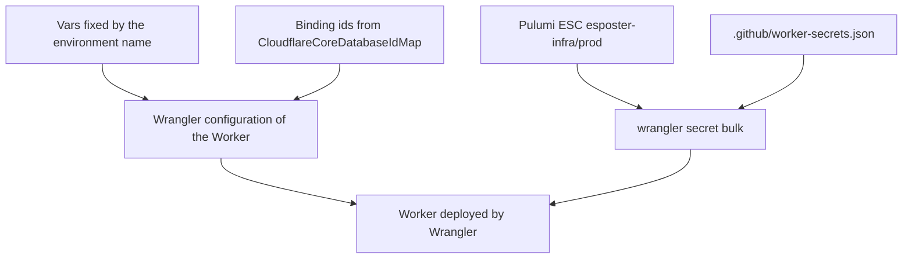

# Pulumi source of truth

A Worker's configuration is declared in the repository, not set in the Cloudflare dashboard. Settings held only in a dashboard are the one surface a review or a preview cannot see, so each Worker's values are written from the repository on every deploy, and each secret's value comes from the secrets environment the program reads.

## How it works

Each Worker's configuration has three sources, classified by the kind of value:

- **Plain values** that the environment's name fixes. The web Worker's come from `apps/web/configuration/wrangler.ts`, which writes one wrangler block per environment, and the functions Worker's are in its `wrangler.jsonc`.
- **Binding ids.** A D1 database's id is not a setting read from the environment. `CloudflareCoreDatabaseIdMap` commits each environment's id, and the wrangler blocks and the migrations read it from there.
- **Secrets.** Each secret is a schema key marked as a secret. `.github/worker-secrets.json` lists them per Worker, and the values are read from the Pulumi ESC environment `esposter-infra/prod` under `pulumiConfig.esposter-infra:<environment>_<NAME>`, so development and production values sit side by side in one environment. The deploy job writes them with `wrangler secret bulk` after the Worker deploys.

The web build bakes its public configuration into its runtime configuration, so the public client ids and the public push key are read from ESC before the build, and the origins come from the workflow's environment for each branch.

## What the repository does not hold

No secret value is in the code, in a wrangler configuration or in a stack file. A stack reads ESC rather than keeping a secret in its own configuration, so no encrypted value is committed. A value a Worker reads that is not declared in the repository is invisible to review, and a secret added to a Worker by hand is not in the list the deploy writes, so a later deploy does not restore it.

## Key files

| File                                                                      | Role                                                                   |
| :------------------------------------------------------------------------ | :--------------------------------------------------------------------- |
| `apps/web/configuration/wrangler.ts`                                      | The web Worker's wrangler block per environment, its vars and bindings |
| `apps/functions/wrangler.jsonc`                                           | The functions Worker's configuration                                   |
| `.github/worker-secrets.json`                                             | The secret names each Worker takes                                     |
| `packages/db-schema/src/models/cloudflare/CloudflareCoreDatabaseIdMap.ts` | Each environment's `core` database id                                  |
