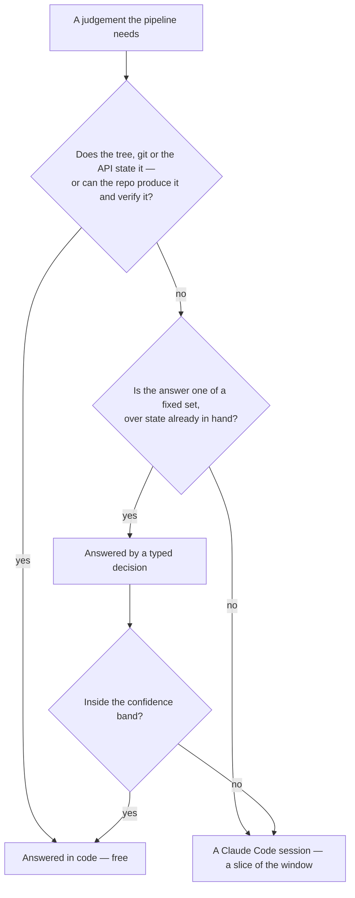

# Typed decisions

The pipeline's scarce resource is not money, it is **one shared Claude Code account window**. Every headless session the [review](../review/design.md) spawns — a reviewer, a fixer, a settler — comes out of the same allowance a person's session draws on, which is why a review run stops where it stands when the limit runs out and resumes on the next push.

So the cheapest session is the one never spawned. A judgement whose answer is one of a fixed set, and whose inputs the pipeline already holds, goes to a **typed-decision model** (TypeSafe's Jev, through `@typesafe-ai/sdk`) first. It returns a typed value and a probability rather than text, so there is nothing to parse and no way for it to answer outside the set it was given.

A question only ever moves **up** this diagram. Nothing the code can answer is asked of a model, and nothing a typed decision settles reaches a session.

The first box reaches further than it looks. Where the repository already holds a verifier for a mechanical answer, the deterministic tier does not have to know in advance whether that answer fits — it can produce it and let the verifier judge.

## Where it decides

| Judgement                                        | What it saves              |
| :----------------------------------------------- | :------------------------- |
| Which of the five triage roles is this issue in? | A person reading the issue |

Conflicts are not asked of this tier. A conflict has to be _edited_, and a typed decision returns a decision, never an artefact.

## Confidence is an escalation gate, not a quality bar

Nothing acts on an answer below `0.6`; a decision that writes outside the checkout — a label on someone's issue — needs `0.85`. What falls short is not an error. It is the case that goes up a tier: to the session that reads the tree, or to `needs-triage`, which is what a maintainer weighing an issue already means.

## With no key, everything still runs

`TYPESAFE_API_KEY` is a Pulumi-managed repository secret. Where it is absent — a fork, a local run, any test — every gate answers nothing and its caller escalates, so the pipeline behaves exactly as it did before there were gates. No path depends on a decision this tier made.

The key never reaches a spawned session either: the launcher withholds every secret-shaped variable from the child, and the session is given nothing but the credential that authenticates itself.
