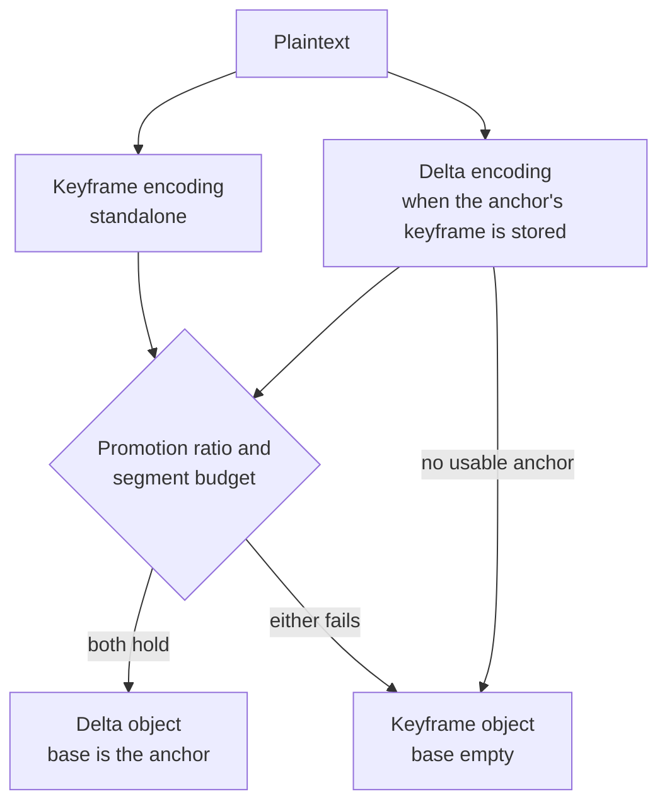
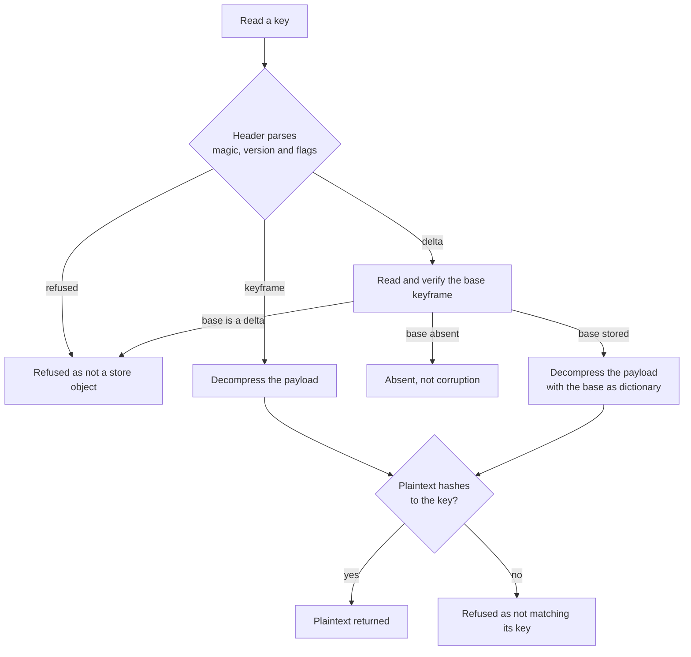

# Object format

A stored object is a header and a zstd frame, addressed by the hash of its plaintext, and a read returns plaintext only after that plaintext hashes to the key the object was read by.

## How it works

An object's key is the hex SHA-256 of its plaintext, computed from the content and not from the stored bytes. Two versions with identical content therefore resolve to one object whichever keyframe either write would have encoded against. The backend's create-only write is the only way an object lands, so an object is never written again under the same key.

An object is a header followed by a zstd frame. The header opens with the format's magic, then a format version, a flags byte that marks the object a keyframe or a delta, and the window log the encoder used. A delta's header also carries its base hash, the content address of the keyframe its frame was compressed against. The window log is recorded because a decoder admits a frame only within the window it declares, so the encoder's choice has to travel with the object. The compression level is not recorded, since decoding does not depend on it.

A write encodes the plaintext standalone, and, when the anchor names a keyframe the store still holds, again against that keyframe's plaintext as the dictionary. The delta is kept only when two gates both hold. The promotion ratio requires the delta to be at most a fixed share of the standalone size, so a version that has drifted far from its anchor is promoted. The segment budget requires the bytes already anchored to the keyframe, plus the delta, to fit within the keyframe's stored size times a budget ratio. The gates bound different costs: the ratio bounds how far one delta drifts, and the budget bounds what a segment accumulates across many small edits, which the ratio alone never catches. When either gate fails, the standalone keyframe is written with an empty base instead.

A read parses the header first. Bytes that do not open with the magic, carry a format version other than this one's, or carry a flag other than keyframe or delta are refused before the decompressor sees them. A keyframe's payload is decompressed on its own. A delta's base is read as well, verified against its own key, and refused if it is itself a delta; only then is the payload decompressed with the base's plaintext as the dictionary. Every result is hashed and compared with the key it was read by, so a truncated, altered or misfiled object is a refused read rather than a plausible document. A payload the decompressor itself rejects is refused with the decompressor's own error.

## Data model

| Part           | What it holds                                                            |
| -------------- | ------------------------------------------------------------------------ |
| Magic          | the marker every object opens with, so a stranger's bytes are refused    |
| Format version | the header's layout, bumped alone when that layout changes               |
| Flags          | keyframe or delta; any other value is refused                            |
| Window log     | the window the encoder used, which the decoder admits                    |
| Base hash      | a delta only: the content address of the keyframe its frame was built on |
| Payload        | the zstd frame, compressed against the base's plaintext for a delta      |

The magic, the version, the flag values and the byte offsets of each field are constants, named in the Key files below.

## Key files

| File                                                           | Role                                                                       |
| -------------------------------------------------------------- | -------------------------------------------------------------------------- |
| `packages/keyframe-store/src/services/constants.ts`            | the magic, the format version, the header layout, the flags and the ratios |
| `packages/keyframe-store/src/services/getContentAddress.ts`    | the SHA-256 address of a plaintext                                         |
| `packages/keyframe-store/src/services/encodeObject.ts`         | a keyframe or a delta, as bytes, with the window it recorded               |
| `packages/keyframe-store/src/services/parseObject.ts`          | the header parse, which refuses bytes outside the format                   |
| `packages/keyframe-store/src/services/decodeObject.ts`         | the decompression, with the base plaintext as the dictionary               |
| `packages/keyframe-store/src/services/decodeVerifiedObject.ts` | the one decode, checked against the key it was read by                     |
| `packages/keyframe-store/src/models/ParsedObject.ts`           | an object split at its header, before anything is decompressed             |
| `packages/shared/src/services/zstd/getWindowLog.ts`            | the window a write's encoder uses, from the sizes it spans                 |
| `packages/shared/src/services/zstd/constants.ts`               | the window ceiling and the default compression level                       |
| `packages/keyframe-store/src/createKeyframeStore.bench.md`     | the committed codec figures for each shape of edit                         |

## Notes

- **Adoption reads the whole object.** A write of content the store already holds, and a create-only write that a twin won, both read the stored object and verify it rather than checking its header. Checking the header alone was rejected: it can pass on an object whose payload no longer decodes to the address, and adopting such an object would credit a damaged write to this one.
- **A keyframe is verified before a delta is encoded against it.** Its plaintext is the dictionary, so a delta written over damage would depend on the damage and stop decoding once the keyframe was repaired. The write is refused instead.
- **The window is chosen per write.** It is the power-of-two window that spans the dictionary and the input together, clamped to the range the shared package sets. A window too narrow to span both leaves the encoder unable to match across them, and the output grows by a large factor.
- **A diff format was not used.** Dictionary compression gives the edit between two versions without a patch grammar or any knowledge of the document, which is the reason the [compression](../../architecture/compression/design.md) standard gives for zstd.

## Sources

- [Zstandard manual](https://facebook.github.io/zstd/zstd_manual.html): the dictionary a delta is compressed against, which the manual calls a prefix, and the frame and window terms this page uses. The manual describes compressing against a prefix as similar in outcome to a diff, which is the property the delta relies on.
