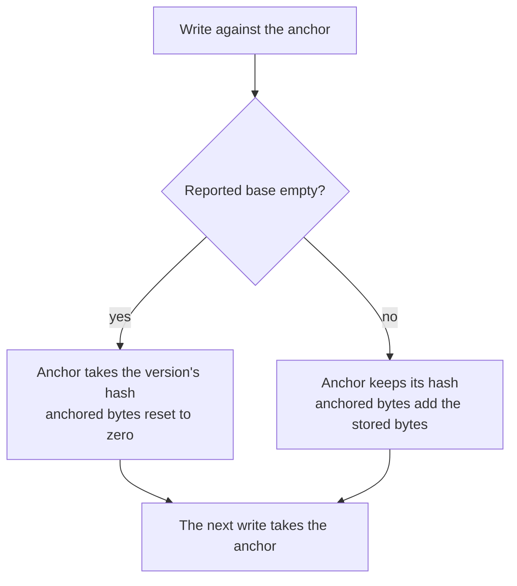
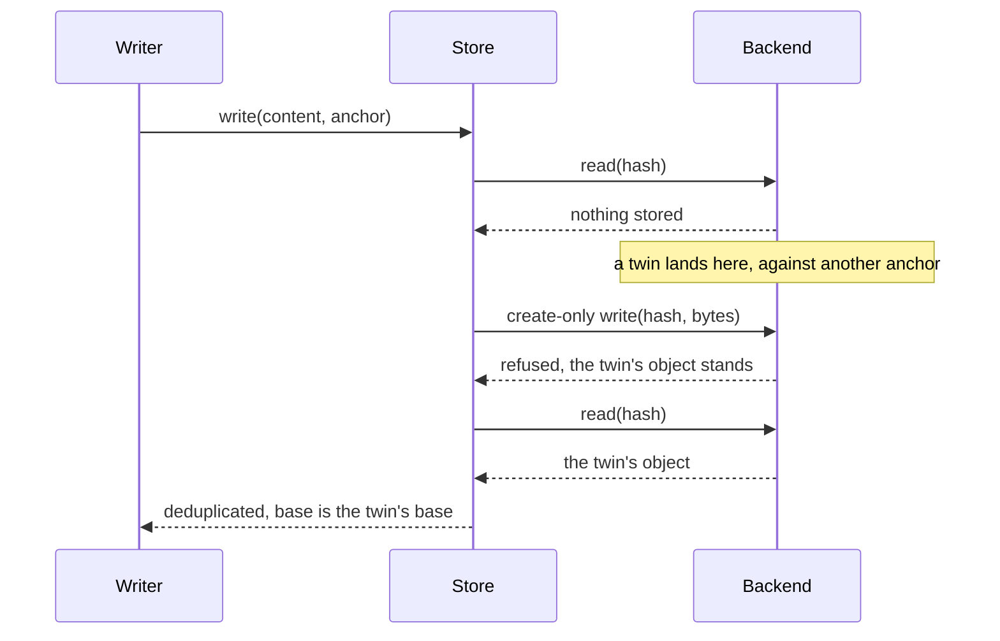

# Version store

The contract a caller writes and reads a lineage through: the anchor it passes, the base each write reports, reconstruction in at most two reads, collection by the caller's own records, and the backend the store is given.

## How it works

The store holds no lineage. A write takes a plaintext and the anchor the caller holds, and reports what it stored; a read takes a hash. The caller keeps the lineage as one anchor, the hash of the newest keyframe and the bytes anchored to it. After each write the caller reads the report. A report with an empty base means the version became a keyframe, so the anchor takes that version's hash and its anchored bytes reset to zero. A report with a base leaves the anchor's hash as it was and adds the bytes the write stored to the anchored bytes. The report's base is kept separately, in the caller's record of that version, because collection needs it.

A read is at most two reads. The object the hash names is read first. If it is a delta, its header names the keyframe, and that keyframe is the only other object read. A delta's base is always a keyframe, so no read walks a chain.

A write whose create-only write loses to a twin reports the twin's object rather than the one it encoded, because the twin's object is the one the backend holds. The base reported is the twin's, so the caller's record names a keyframe the stored bytes decode against.

Collection is the caller's answer. The caller passes the hashes an eviction released and every hash its surviving records name, either as their own hash or as a base. The store deletes each released hash that no retained hash names and returns the deleted hashes, so the caller can credit their bytes back. It reads no object to decide.

## Data model

| Model            | What it holds                                                                                                                                 |
| ---------------- | --------------------------------------------------------------------------------------------------------------------------------------------- |
| `VersionAnchor`  | the hash of the newest keyframe, empty for a lineage without one, and the bytes anchored to that keyframe                                     |
| `WrittenVersion` | the base, the hash, whether the content was already held, the plaintext size and the stored size the owner is charged                         |
| `ObjectStore`    | read, which answers undefined when nothing is stored; a create-only write, which reports whether this call created the object; delete by keys |
| `KeyframeStore`  | write, read and collect, each a `ResultAsync`                                                                                                 |

## Key files

| File                                                         | Role                                                                            |
| ------------------------------------------------------------ | ------------------------------------------------------------------------------- |
| `packages/keyframe-store/src/createKeyframeStore.ts`         | the write, read and collection, with adoption, promotion and the lost-race path |
| `packages/keyframe-store/src/models/KeyframeStore.ts`        | the contract a caller holds                                                     |
| `packages/keyframe-store/src/models/VersionAnchor.ts`        | the anchor a caller passes                                                      |
| `packages/keyframe-store/src/models/WrittenVersion.ts`       | the report a write returns                                                      |
| `packages/keyframe-store/src/models/ObjectStore.ts`          | the backend contract                                                            |
| `packages/keyframe-store/src/models/ObjectNotStoredError.ts` | the absent-version error, kept apart from corruption                            |
| `packages/keyframe-store/src/models/KeyframeStoreOptions.ts` | the tunables a caller may set                                                   |
| `packages/keyframe-store/src/createKeyframeStore.test.ts`    | the suite the scenarios name                                                    |

## Notes

- **An object once written is never touched until it is collected.**
- **The anchor's figures are trusted, not checked.** The segment budget is computed from the anchored bytes the caller supplies. The store does not sum stored sizes itself, so a caller whose figure drifts moves the budget with it.
- **The base a write reports is the one the record carries.** On a dedupe hit the report carries the stored object's base, which need not equal the anchor the caller passed. Recording the anchor in its place would name a keyframe that the stored delta may never decode against, so a collection could delete a keyframe a live version still depends on.
- **Content must serialize to the same bytes.** The address is the hash of the plaintext, so a caller whose serialization changes between writes gets a new address, and deduplication stops without any error. The store takes bytes and returns bytes, so it cannot detect this.
- **A retained list that omits a base loses its keyframe.** Collection deletes a keyframe no retained hash names, even when a delta still names it as its base. That delta then reads as absent, so the retained list has to name every base the surviving records carry.
- **A collected version is absent, not corrupt.** A read whose object, or whose delta's base, is gone fails with `ObjectNotStoredError`, which is kept apart from the corruption error, so a caller may answer it as not found without hiding damage.
- **Two anchors refuse differently.** An anchor whose object is a delta fails the write and stores nothing. An anchor whose keyframe is no longer stored starts a new lineage: the content is written as a keyframe with an empty base.
- **The backend receives content addresses as its keys.** The store does not scope them, so a backend may place them under any prefix. The app scopes its objects by resource, as the [resource version store](../../resource/resource-version-store/design.md) page describes.
