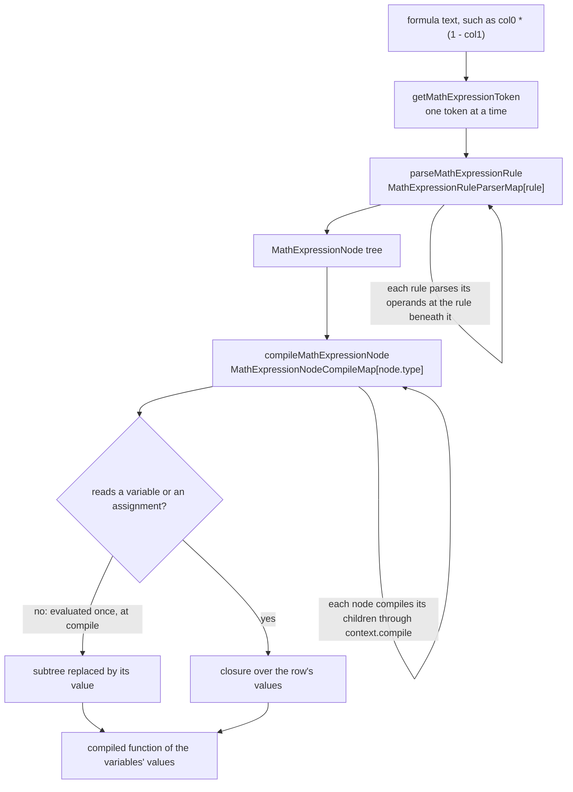

# Math Expression Language

The language of the `math-expression-compiler` package: a formula over numeric variables, such as `col0 * (1 - col1)`, is parsed into a tree and compiled once into a function of plain numbers. The language keeps the value mathjs gives every formula that evaluates to a finite number, and the package's parity record holds it to that.

## How it works

A formula passes through a parser and a compiler, each a set of small files dispatched by a map. The source is one folder per concern, each with its types under `models/` and its functions under `services/`: `compiler`, `function`, `names`, `parser` and `shared`. `names` has functions and no types of its own. The parser's rules sit in `services/parser/rule/` and its tokens in `services/parser/token/`, the compiler's node compilers in `services/compiler/node/`, and the function table's signature builders in `services/function/signature/`. Every function is in a file of its own, named for it, and each rule and each node type is one file, so the two maps are the one place that gathers them.

The parser is recursive descent over a chain of grammar rules, `MathExpressionGrammarRule`, ordered from the loosest binding to the tightest: assignment, conditional, the logical operators, the bitwise operators, the comparisons, shifts, addition, multiplication, implicit product, division before product, percentage, unary, power, nullish coalescing, the left-hand operand and a symbol. The chain is the precedence table below. Each rule has a file of its own, and `MathExpressionRuleParserMap` maps each rule to its parser. `parseMathExpressionRule` looks the rule up and calls it. A rule parses its operands by calling the `parse` it was handed, which is `parseMathExpressionRule` itself, so no two rule files import each other. The operator levels share `parseLeftAssociative`, which groups `a - b - c` as `(a - b) - c` and reads its operator tokens from `MathExpressionOperatorMap`.

The parser builds a `MathExpressionNode` tree, one node type each for an assignment, a binary operation, a call, a comparison, a conditional, a group, a list, a logical operation, a name, a number, a percentage and a unary operation. A parse returns the tree, or the first error positioned at the character it starts at.

The compiler turns the tree and the names of its variables into one function. `compileMathExpression` gives each name the formula assigns a slot, then compiles the root with `compileMathExpressionNode`, which takes the node's compiler from `MathExpressionNodeCompileMap`. A node compiler compiles its children through `context.compile` and imports no other node compiler. A subtree that reads no variable and no assignment is evaluated once, at compile time, and replaced by its value, so `2 ^ 10 * col0` runs one multiplication per row. A subtree that yields no number folds to the same no-value the rows would get. The function yields `NaN` where a formula has no numeric answer, which the sheet shows as an empty cell.

## The bar

**Every formula mathjs evaluates to a finite number, given numbers for its variables, keeps its value.** The parity record is `mathExpressionParity.snapshot.json`, which holds mathjs's answers over a corpus of formulas: every operator form, every precedence pair and every function over a spread of inputs. The parity test evaluates the same corpus with the package and requires the same answer. Non-tolerant entries must match exactly, and tolerant ones, the special functions whose series are the package's own, match within `MATH_EXPRESSION_RELATIVE_TOLERANCE` and `MATH_EXPRESSION_ABSOLUTE_TOLERANCE`, both declared in `services/function/constants.ts`.

Three kinds of difference are allowed, and each is listed in the snapshot by the formula it applies to:

- **A fix.** Where mathjs's answer is a defect, the package's is the correct one. Each fix names its cause in the snapshot: the tracker issue, or a sentence saying what mathjs gets wrong where the tracker has none. Each in-scope fix has a regression test whose title carries its cause.
- **Booleans become numbers.** A comparison or a logical operator yields `1` or `0`. Inside arithmetic or a conditional, where mathjs converts the boolean, the value is the same.
- **Syntax that reaches a number only through a non-numeric value.** Strings, units, matrices, objects, property access, `null` and `undefined`, ranges, several statements and function definitions are not in the language. A flat list of numbers in square brackets is the exception, read as an argument of a function that takes a list, so `sum([col0, col1])` and `dot([col0, col1], [0.3, 0.7])` keep their values. A list inside a list is a matrix, and stays out.

A formula mathjs evaluates and the package refuses is recorded as an error in the snapshot, never as `NaN`. A `NaN` answer passes any entry that expects `NaN`, such as `0 / 0`, so a refusal read that way would pass unseen. The parity test therefore requires every entry not recorded as an error to parse.

## The language

The precedence is mathjs's. From the loosest binding to the tightest:

| Operators                   | Meaning                                                                   |
| --------------------------- | ------------------------------------------------------------------------- |
| `=`                         | assignment: binds a name for the rest of the formula and yields the value |
| `? :`                       | conditional, right associative                                            |
| `or`, `xor`, `and`          | logical, in that order                                                    |
| `\|`, `^\|`, `&`            | bitwise or, exclusive or, and, in that order                              |
| `==` `!=` `<` `<=` `>` `>=` | comparison, chained                                                       |
| `<<` `>>` `>>>`             | shifts                                                                    |
| `+` `-`                     | add, subtract, and their percentage forms                                 |
| `*` `/` `%` `mod`           | multiply, divide, modulo                                                  |
| implicit multiplication     | `2 col0`, `(1 + 2)(3 + 4)`, with mathjs's division exception              |
| postfix `%`                 | percentage                                                                |
| unary `+` `-` `~` `not`     | sign, bitwise not, logical not                                            |
| `^`                         | power, right associative                                                  |
| `??`                        | nullish coalescing, which over numbers yields its left side               |
| postfix `!` `'`             | factorial, and transpose, which is the identity on a number               |
| `name(…)`, `( … )`, `[ … ]` | function call, grouping, a function's list argument                       |

- **A condition is truthy** when it is neither zero nor `NaN`. `and` and `or` evaluate their right side only when the left does not decide them, and so do `&` and `|`: `0 & x` is `0` and `-1 | x` is `-1` without reading `x`.
- **Power binds tighter than a sign**, so `-2 ^ 2` is `-4`, and its right operand may carry one, so `2 ^ -1` is `0.5`. Factorial binds tighter still, so `-3!` is `-6` and `2 ^ 3!` is `64`.
- **Modulo is floored**, taking the sign of the divisor: `-7 % 3` is `2`, where JavaScript's `%` gives `-1`. A dividend within mathjs's own tolerances of a whole multiple of the divisor gives `0`, so `mod(10.8, 1.2)` and `0.3 mod 0.1` are `0`. mathjs gives a residue of the binary round-off there, sometimes against the divisor's sign ([#513](https://github.com/josdejong/mathjs/issues/513), [#2936](https://github.com/josdejong/mathjs/issues/2936)).
- **`%` is a percentage** when no operand follows it, or a sign does: `8%` is `0.08`, `100 * 3%` is `3` and `100*25% + 2` is `27`. Followed by any other operand it is modulo, so `8 % 3` and `8% 3` are both `2`. A percentage added to or taken from a value is a percentage of that value, so `100 + 3%` and `100 - 3%` are `103` and `97`. Added to a percentage, a percentage adds as a value, so `10% + 20%` is `0.3` and `10% + 20% + 30%` is `0.6`. The one fix that changes how a formula parses is here: `7 % -3`, which mathjs reads as a modulo of a signed divisor, `-2`, is `7% - 3`, `-2.93`, and a modulo of a signed divisor is written `mod(7, -3)` ([#3563](https://github.com/josdejong/mathjs/issues/3563)).
- **Implicit multiplication** binds tighter than `*` and `/`, except a division of a number, signed or not, by an unsigned number, followed by a name or a parenthesis, which divides first: `1/2 col0` is `(1/2) * col0`. A signed divisor is outside the exception, as in mathjs, so `1/-2 col0` is `1 / (-2 col0)`. Two bare numbers side by side, `2 3`, are an error, as in mathjs. A parenthesis after a name is a call, never a product.
- **A chained comparison** `a < b < c` holds when each adjacent pair does.
- **Bitwise operators and shifts** take integers, as mathjs's do, and anything else is an error, which the cell shows as empty.
- **Factorial** of a non-integer is `gamma(n + 1)`, as in mathjs, and of any negative number is an error, as mathjs's is.
- **A number** is decimal digits with an optional fraction and an optional exponent, whose `e` takes a digit after its optional sign, so `2e.5` is an error as in mathjs. It can also be a radix literal: `0x`, `0b` or `0o`, then that radix's digits, an optional fraction and an optional word size such as `i8`, which reads the digits as a signed integer of that many bits, so `0xFFi8` is `-1` and `0x1FFi8`, too wide for eight bits, is an error. A radix literal stops at the first character that is not one of its digits, so `0x` before a name is zero times the name, where mathjs refuses it ([#2374](https://github.com/josdejong/mathjs/issues/2374), [#3421](https://github.com/josdejong/mathjs/issues/3421)). A comment runs from `#` to the end of the line.
- **Spaces, tabs and non-breaking spaces separate tokens**, as in mathjs, and so does a newline inside parentheses. Outside them a newline starts another statement, which the language leaves out.
- **A name** is a letter, an underscore or a dollar sign followed by those and digits. It resolves to an assigned name, then a column variable, then a constant: `pi` and `PI`, `e` and `E`, `tau`, `phi`, `LN2`, `LN10`, `LOG2E`, `LOG10E`, `SQRT1_2`, `SQRT2`, `Infinity`, `NaN`, `true` and `false`. A name is looked up only as an own entry of the scope or a table, so `constructor` or `__proto__` is an unknown name rather than a member of an object's prototype.
- **Functions** are every mathjs function that reads numbers and flat lists of numbers to a number or a boolean, under mathjs's names and with every such signature it accepts: `max(col0, col1)` and `max([col0, col1])`, `quantileSeq([col0, col1, col2], 0.5)`, `distance([0, 0], [col0, col1])`, `setSize([col0, col1, col0])`. A function whose answer for a list is a list stays out, with the matrices. `random`, `randomInt` and `pickRandom` are out too.
- **A function mathjs gets wrong is correct here.** `and`, `or` and `xor` take one argument or more where mathjs reads exactly two ([#2483](https://github.com/josdejong/mathjs/issues/2483)), `nthRoot` of a perfect power is exact ([#2464](https://github.com/josdejong/mathjs/issues/2464)), and `coth`, `csch` and `sech` are the reciprocals of `tanh`, `sinh` and `cosh`, keeping their precision near zero ([#2967](https://github.com/josdejong/mathjs/issues/2967)). `erfinv` is present, the one function mathjs lacks that a formula has no other way to write ([#2011](https://github.com/josdejong/mathjs/issues/2011)).
- **The defects the corpus found are fixed too**, each listed in the snapshot by its cause. A comparison under `|` is its one or zero, so `2 < 3 | 4` is `5`, where mathjs takes the four as a boolean and answers `1`. A conditional nests in a conditional's true branch, so `1 ? 2 ? 3 : 4 : 5` is `3`, where mathjs refuses it. A stray `:` or an unclosed parenthesis after a percentage, `1 ? 2 : 3 : 4` and `3% (2`, is an error, where mathjs drops what follows. `isPrime` of a non-integer is false, where mathjs answers true for `1.5`. `catalan` stays finite well past the index where mathjs's factorials overflow. So does `bernoulli`: mathjs overflows to infinity from 198, and from that index the package switches from the recurrence to the closed form, so its answer stays finite until the number itself overflows at 260. `zeta` of a negative number and `lgamma` keep their digits where mathjs's series lose them: `zeta(-5)` is `-1/252`, where mathjs answers `-0.003965`. The norms and `hypot` keep their magnitudes where mathjs loses them: its infinity norms pass over a `NaN` magnitude, which its `max` answers `NaN` for, and its minus infinity norm passes over a zero before a larger magnitude, so `norm([0, 1], -1 / 0)` is `1`, where the smallest magnitude is `0`. The infinity norms fold from the first magnitude, as `max` and `min` do, and `hypot` compares its magnitudes exactly, so `hypot(0, 1e-16)` is not `0` and two infinite magnitudes give an infinite length.
- **A function's cost is bounded**, since a cell must never take seconds. `isPrime` is a deterministic Miller–Rabin test, and every double above the safe integers is even, so it is composite at once. `combinations` and the other counting functions stop once the count overflows. `stirlingS2` answers directly when its second argument is zero, equals the count or exceeds it. Otherwise it builds only the band of the triangle its answer needs, the columns up to its second argument or the diagonals down to it, whichever is narrower, and refuses a band too large to build in a cell's time.
- **`round` rounds half away from zero at its digit count**, corrected for binary representation, so `round(-2.5)` is `-3` and `round(1.005, 2)` is `1.01`. `Math.round` would give `-2` and `1`.
- **`max` and `min` compare as mathjs's `larger` and `smaller` do**, within its relative and absolute tolerances, so of two nearly equal values the first is kept: `max(0.3, 0.1 + 0.2)` is `0.3`, where `Math.max` gives `0.30000000000000004`. A `NaN` among the values answers `NaN`.
- **`hypot` is mathjs's running rescale**, the largest magnitude so far scaling the sum of squares, so its last bit is mathjs's. `Math.hypot` uses another algorithm, and differs from mathjs in the last bit for some vectors.
- **An unknown name evaluates to `NaN`**, which the column shows as an empty cell. The edit form names it before the formula is saved.

**Errors name where a formula fails.** Where mathjs's parser refuses a formula the words are its own, `Parenthesis ) expected (char 7)`, `Unexpected operator ) (char 8)` and `Unexpected end of expression (char 4)`. Where mathjs found the fault only when evaluating, the words are the package's, since mathjs's run-time wording names no position: `Unknown function "foo" (char 1)`, where mathjs says `Undefined function foo`. A nesting deeper than `MAX_MATH_EXPRESSION_DEPTH`, declared in `services/parser/constants.ts`, is a parse error rather than a stack overflow, since a user types the formula and it is stored at any length the content limit allows.

## Decisions

**An own parser and compiler, not mathjs's engine.** mathjs is on the [dependency admission](../../architecture/dependency-admission/design.md) stop list as an engine, and that verdict holds for its product: units, matrices, complex numbers, big numbers, fractions and symbolic algebra. The column uses none of it. Keeping the engine was rejected because the column's schema is shared with the client and imports the parser, so the sheet editor would fetch the whole engine for its arithmetic. Loading it later was the other way to pay less, and it lost for the same reason: the editor fetched the engine on its first math column. A recursive descent parser over mathjs's numeric syntax, with a table of its numeric functions, is static code with nothing to maintain against a moving platform. Another expression library, `expr-eval`, was rejected because its parser evaluates member access and has carried a prototype pollution advisory, and a dependency for a parser this size would put back the surface being removed.

**A package of its own, not `@esposter/shared`.** Every app and package imports shared, and the function table with its special functions nearly doubled that bundle for consumers that never evaluate a formula. Shared is for small utilities with no opinion of their own, and a language with a grammar, a function table and a parity record is not one. The special functions stay in the package rather than a numerics package of their own, since nothing reads them outside a formula. They split out when something else does.

**A formula the parser refuses is an error in the record, not `NaN`.** The parity record names a refusal as an error so the test can require every other entry to parse. A blanket tolerance over the rows was rejected, since it hides which divergences are intended. Each special function whose mathjs series loses more digits than the tolerance allows is a fix instead.

**A percentage after a sign is a percentage, not a modulo.** mathjs reads a `%` before a sign as a modulo, which makes `10% + 20%` zero. Its maintainers call that parse a defect ([#3563](https://github.com/josdejong/mathjs/issues/3563)), so the language reads it as a percentage. The cost is that `7 % -3` changes meaning, and a modulo of a signed divisor is written `mod(7, -3)`.

**Names resolve as own entries, and free names follow evaluation order.** A name resolved through the prototype chain is the class of escape mathjs's security advisories were about, so names resolve only as own entries of the scope and the tables. The free names of a formula, which the edit form checks against the sheet's columns, are the names read before anything binds them, walked in evaluation order. A flat set of every name would accept `x * (x = 2)`, which reads `x` before its assignment runs, so the walk gives `x` as free there. Over numbers, the right side of `??` never runs, so it reads nothing, and `col0 ?? zz` has `col0` as its only free name.

**The function table is enumerated by probing mathjs, not from its documentation.** The documentation does not list every signature a function accepts. Each exported function was called with numbers and flat lists in every shape it could take, so no function a formula could have called is missed. `random`, `randomInt` and `pickRandom` are left out because a computed cell must show the same value on every render, and a seed is not a column concept.

**A function is a list of signatures, and a list is a node.** A list in square brackets can only be written, never computed from a column, so a call's shape is known when the formula parses: which arguments are lists, and how many there are. Each function declares its signatures, each a range of arities and a list of parameter kinds, and `matchMathExpressionSignature` serves both the parser's check and the compiler's binding. Two shapes lost. A per-function flag saying whether a list is allowed, required or forbidden could express a list only as a function's sole argument, so `dot([1, 2], [3, 4])` had no way in. Per-row dispatch on the values' types, as mathjs does, repeats work the compiler does once. A computation takes its arguments as one array, not spread into a JavaScript call, because spreading a list of a few hundred thousand numbers overflows the stack. A signature can also carry a scalar form for one or two numbers, `computeUnary` or `computeBinary`. An operator, or a call with one or two plain arguments, uses that form, so `col0 * 2` builds no array per row. Building the array on every call was rejected because it took about a third of a row's evaluation on the [compile bench](../../../../packages/math-expression-compiler/src/services/compiler/compileMathExpression.bench.md).

**A formula is compiled once, and its constants are folded.** mathjs's `evaluate` parsed the formula again for every cell. A parse cache keyed by the formula's text would stop that, but it keeps a per-cell search for sources and a per-cell scope object, and it is a cache to bound. A tree-walking evaluator would read the parsed tree for every row, repeating the name lookups and the dispatch on node kinds that the compiler does once. The compiled function keeps `and`, `or`, `&`, `|` and the conditional lazy as closures.

**A division before a group, and a percent sign, decide by their next tokens.** A division is read before an implicit product only when its divisor is a plain number followed by a name or a parenthesis. A `%` is a modulo only when an operand other than a sign follows it. Each of these choices reads one or two tokens ahead and never parses the operand on trial. A trial parse that is thrown away is repeated by the parse that follows it, and a group nested inside the operand holds its own trial. The work doubled with each level, so twenty nested groups took seconds, and a formula stored that way would stall every reader of the sheet. mathjs's division rule looks ahead the same way. Its percentage rule parses on trial and doubles in the same way, and the language does not inherit that defect. Caching each trial by its position was rejected because one token answers the question, and a cache is state to keep in step with the parser. The [parse bench](../../../../packages/math-expression-compiler/src/services/parser/parseMathExpression.bench.md) times both choices at two nesting depths.

**One file per rule and per node, with no import between them.** Mutually recursive functions could share a file, but that breaks one function per file. Having them import each other is what `import/no-cycle` refuses. The map and the context break the cycle: a rule reaches another only through the `parse` it is handed, and a node compiler reaches its children only through `context.compile`.

**A function's cost is bounded by its algorithm.** `isPrime` is a Miller–Rabin test, since trial division takes a large part of a second on a large prime. The counting functions stop once their count overflows, where mathjs's `combinations(1e9, 5e8)` takes seconds to reach the same empty cell. `stirlingS2` builds only the band its answer needs, since building the whole triangle is what a cell cannot afford.

**Comparisons and logical operators yield one or zero, not a boolean.** mathjs's boolean is turned into an empty cell by the column, so a bare comparison showed nothing. A typed result, such as a boolean column from a comparison, was rejected for the same reason the value model is numeric: the column's filters, statistics and charts expect one number type.

## Notes

- **The value model is numbers alone, on purpose.** A survey runner on the editor core ([deferred](../../../deferred/resource/survey-on-editor-core/design.md)) would need SurveyJS's condition language: strings, booleans and arrays, `{name}` references bound to answers, `=` as equality and list operators such as `contains`. That is a different grammar over a different value model, so it would be its own parser and compiler, reusing this one's numeric function table and its error wording. Widening this language to it would put a type check into every operator of every sheet cell, the per-row dispatch the compiler exists to remove.
- **The sheet's use of the language is the computed columns capability.** The stored schema, the edit form's parse and unbound-name check, and the compile once per column list are in [computed columns](../../resource/sheet/computed-columns/design.md).

## Upstream

The verdicts on mathjs's tracker, with the evidence behind each, are in the [area README](../README.md).

## Key files

Every path starts at the repository root.

| File                                                                                         | Role                                                                                          |
| -------------------------------------------------------------------------------------------- | --------------------------------------------------------------------------------------------- |
| `packages/math-expression-compiler/src/services/parser/parseMathExpression.ts`               | Entry point: a formula to its tree, or the first positioned error                             |
| `packages/math-expression-compiler/src/services/compiler/compileMathExpression.ts`           | Entry point: a tree and its variable names to a function of the variables' values             |
| `packages/math-expression-compiler/src/services/names/getMathExpressionNames.ts`             | The free names of a tree, in evaluation order, for the edit form's unbound-name check         |
| `packages/math-expression-compiler/src/models/parser/MathExpressionGrammarRule.ts`           | The grammar's rules, from the loosest binding to the tightest                                 |
| `packages/math-expression-compiler/src/services/parser/MathExpressionRuleParserMap.ts`       | Map: each grammar rule to its parser                                                          |
| `packages/math-expression-compiler/src/services/parser/parseMathExpressionRule.ts`           | Dispatcher: looks a rule up in the map, and is the `parse` each rule is handed                |
| `packages/math-expression-compiler/src/services/parser/parseLeftAssociative.ts`              | The shared left-grouping level for every operator rule                                        |
| `packages/math-expression-compiler/src/services/parser/MathExpressionOperatorMap.ts`         | Map: each operator rule's tokens to the function or logical operator a node names             |
| `packages/math-expression-compiler/src/models/shared/MathExpressionNode.ts`                  | The parsed tree, a list among its node types                                                  |
| `packages/math-expression-compiler/src/services/compiler/MathExpressionNodeCompileMap.ts`    | Map: each node type to its compiler                                                           |
| `packages/math-expression-compiler/src/services/compiler/compileMathExpressionNode.ts`       | Dispatcher: compiles a node with its type's compiler, and folds a constant subtree            |
| `packages/math-expression-compiler/src/models/compiler/MathExpressionCompileContext.ts`      | What a node compiler receives: the slots, the variable indices and `compile` for its children |
| `packages/math-expression-compiler/src/services/function/MathExpressionFunctionMap.ts`       | The function table: each function's signatures under its mathjs name                          |
| `packages/math-expression-compiler/src/models/function/MathExpressionSignature.ts`           | A signature: its arities, its parameter kinds and its computation                             |
| `packages/math-expression-compiler/src/services/shared/matchMathExpressionSignature.ts`      | The signature a call's argument kinds fit, for the parser's check and the compiler's binding  |
| `packages/math-expression-compiler/src/services/shared/MathExpressionConstantMap.ts`         | The named constants                                                                           |
| `packages/math-expression-compiler/src/services/function/computeExtreme.ts`                  | The tolerant fold `max`, `min` and the infinity norms share                                   |
| `packages/math-expression-compiler/src/services/compiler/mathExpressionParity.test.ts`       | The parity test: the corpus evaluated with the package, a test per fix cause                  |
| `packages/math-expression-compiler/src/services/compiler/mathExpressionParity.snapshot.json` | mathjs's answers over the corpus, with each allowed difference and its cause                  |

## Sources

- [mathjs expression syntax](https://mathjs.org/docs/expressions/syntax.html): the operator table, the precedence order and the implicit multiplication rules the language keeps.
- [mathjs on npm](https://www.npmjs.com/package/mathjs): its parser, `lib/esm/expression/parse.js`, read for each grammar rule before the rule was written, and the source of each recorded answer in the parity snapshot.
