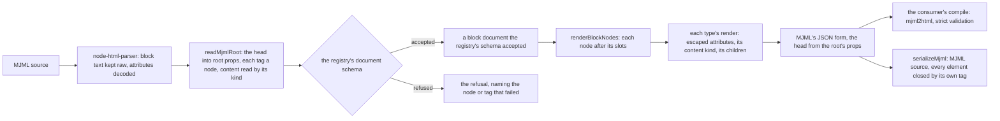

# mjml-blocks

`packages/mjml-blocks` (npm `mjml-blocks`) holds MJML's component set as block types on the [headless block editor](../headless-block-editor/editor-core/design.md). Each type carries its attributes in MJML's own type grammar, MJML's defaults, the tags it may hold and its content kind. A document renders to MJML's JSON form, serialises to MJML source, and reads back from MJML source, refusing every tag, attribute or value the package does not take. The package has no framework, no DOM and no MJML runtime: the compile is the consumer's, one `mjml2html` call with strict validation.

The email editor's canvas, preview and fields belong to the [email change](../../changes/resource-page-builder-email/design.md), and the server's compile to the document model. What the package does not own is MJML's own, so each rule is held equal to the installed MJML rather than copied from it.

## How a document becomes MJML and back

- **The render.** `renderMjmlDocument` folds the document through `renderBlockNodes` into MJML's JSON form: a tag, its attributes, and its children or its content. The render escapes every attribute value once, since MJML writes a value exactly as given, and an option stamps each node's id as its `css-class` so the proof can find its box.
- **The serialiser.** `serializeMjml` writes that JSON as MJML source for the export. It writes every element with its own closing tag and no indentation, so an element that closes nothing never swallows its siblings.
- **The read back.** `parseMjmlDocument` reads source with `node-html-parser`, which keeps the content of each ending tag as raw text, decodes every attribute value and closes every self-closing tag. A head tag becomes a root prop, a body tag a node, and the content of a content-kind tag goes through its kind's reader. The result is parsed by the registry's document schema, so the refusal has one path, and it names the node that does not fit.

## Decisions

- **The component set is MJML's, current and whole.** Parity is with MJML 5's components, so a component the plugin never shipped is in the set too. Each block type's name is its MJML tag, so the render, the slot rules and the canvas key on one name.
- **The head is the root's props.** A head component belongs to the whole email, so `lang` and `dir` sit on `mjml`, `mj-title` and `mj-preview` are text props, `mj-font` is a list of a name and a stylesheet address, `mj-breakpoint` and `mj-body`'s attributes are maps, and `mj-attributes` is a map per type. `mj-style` is a list, and its schema refuses a `<` in the CSS so the CSS can never close its element.
- **Components left out of MJML's set are refused by name.** `mj-include` reads files from the compiling server's disk, `mj-html-attributes` and `mj-class` target attributes by selector and share named classes, and the community components are not part of MJML's own preset. A head or body tag the package does not take is refused under its own name.
- **Slots are MJML's nesting map.** Each container's `children` slot is the allow list MJML's core preset registers for its tag, and the root's content is the list for `mj-body`. A consumer's own leaf is added where MJML allows a leaf. A test holds every allow list equal to the installed preset, so a release that changes the nesting fails a test.
- **Attributes are declared once, in MJML's grammar.** Each table entry is `color`, `enum(...)`, `unit(...)`, `boolean`, `integer` or `string`. The props schema and the editor's field descriptors are derived from it, and two tests hold each table equal to the installed component's attributes and defaults, less `css-class` and `mj-class`.
- **An unset attribute stays absent.** A node's props hold what its author set. The cascade answers an attribute in MJML's order: the node's own value, the root's value for its type, the root's value for all components where the type takes the attribute and its grammar accepts the value, then MJML's default. MJML's defaults are not Zod defaults, since parsing would write every default into every node and `mj-attributes` could never apply.
- **Content is one of three kinds.** Rich text goes through the consumer's definition. A plain label is written escaped, and an imported label holding an element is refused at its node. Raw HTML is stored only as the sanitiser returns it, so a raw block never holds a script.
- **An image's alternative text is required or marked decorative.** A decorative image renders an empty `alt`, and the read back turns an empty `alt` into the decorative flag, so the two are inverses.
- **The read back is `node-html-parser`.** MJML's own XML parser drops an `mj-include` without a word, needs MJML's component registry to know its ending tags, and reads the disk. parse5 reads a self-closing custom tag as an open one, which swallows its siblings on import.
- **The compile is the consumer's.** The package holds no copy of MJML at runtime. MJML and its preset are development dependencies, used only by the tests that hold the tables equal to the installed release.

## Upstream

The plugin's tracker holds a few hundred issues and pull requests, most of them closed, and it routes questions to its discussions. Every item has one verdict below, and the table is generated from the audit's verdict map, checked to name each item exactly once. Most of the in-scope items are the component set, the head and the escaping, and each in-scope defect or feature has the test that proves it, or a note on the reading that does. Items the page builder's editor owns are out of scope here, and so are MJML's own compiler's behaviours, which are MJML's to fix.

Reproduced against the installed plugin, `grapesjs-mjml` 1.0.8, without GrapesJS, since the editor is not installed beside this package:

- **[#392](https://github.com/GrapesJS/mjml/issues/392) and [#393](https://github.com/GrapesJS/mjml/pull/393)**: the plugin's bundle throws `window is not defined` when it loads under Node, and so does `mjml-browser` 4.18.0, the MJML build its parser imports (`src/components/parser.ts`, line 2). The pin is `rendering where there is no document object model`, which runs with no `document` present.
- **[#391](https://github.com/GrapesJS/mjml/issues/391)**: `mjml-browser` 4.18.0 writes a `css-class` holding `` into its output verbatim. The render escapes it once, so the pin is `#391 an attribute holding markup is written escaped once`.
- **[#100](https://github.com/GrapesJS/mjml/issues/100)** (closed): the same compile writes a double quote inside an attribute unescaped, so `class="a"b"` breaks the output. Closed upstream, it is pinned by `an attribute holding a quote is escaped once`.
- **[#330](https://github.com/GrapesJS/mjml/issues/330)** (open): `src/components/Image.ts` makes `width` stylable (lines 22 to 23), and its `getStylesToAttributes` removes only `auto` (lines 56 to 61), so a percentage from the style manager reaches MJML unchanged, and MJML's image width takes pixels only. Proven by reading the source; the pin is `#330 #339 #344 #262 #96 an image's width takes pixels only, and auto is refused`.
- **[#388](https://github.com/GrapesJS/mjml/issues/388)** (open): `src/components/Head.ts` makes `mj-attributes` droppable in the head (lines 13 to 20), and no component type in `src/components` registers its children, so no defaults reach the canvas. Proven by reading the source; the compile half of the cascade is pinned by `#388 #269 #358 #367 #368 mj-attributes applies, and MJML's defaults fill what a node sets none`.
- **[#406](https://github.com/GrapesJS/mjml/issues/406)** (open): the plugin's manifest pins `mjml-browser` at `^4.18.0` (`package.json`, line 32), where MJML 5 is current. The package compiles on MJML 5, pinned by `#406 the email compiles on the MJML 5 the package pins`.

The in-scope features that are open (#203, #351, #390, #436) are the package's own tests, which exercise each attribute and element the plugin's issue asks for. The four MJML components the tracker never mentions (`mj-accordion`, `mj-breakpoint`, `mj-html-attributes` and `mj-include`) have no item here; they come from the component comparison alone, and the first two are in the set.

| Upstream                                            | Verdict                            | Proof                                                                                                                                                                   |
| :-------------------------------------------------- | :--------------------------------- | :---------------------------------------------------------------------------------------------------------------------------------------------------------------------- |
| [#1](https://github.com/GrapesJS/mjml/issues/1)     | out of scope — page builder editor | Owned by the email editor: clone of styled attributes is GrapesJS core clone behaviour (the thread links grapesjs#129)                                                  |
| [#2](https://github.com/GrapesJS/mjml/issues/2)     | false positive                     | usage question; answered with editor.runCommand('mjml-get-code')                                                                                                        |
| [#3](https://github.com/GrapesJS/mjml/issues/3)     | false positive                     | Windows install error; maintainer says fixed in later releases                                                                                                          |
| [#4](https://github.com/GrapesJS/mjml/issues/4)     | in scope — feature                 | `rendering a parsed email returns its source`                                                                                                                           |
| [#5](https://github.com/GrapesJS/mjml/issues/5)     | out of scope — page builder editor | Owned by the email editor: request for an editor UI to edit MJML source; answer is copy into the importer                                                               |
| [#6](https://github.com/GrapesJS/mjml/issues/6)     | out of scope — page builder editor | Owned by the email editor: export button in the editor panel                                                                                                            |
| [#7](https://github.com/GrapesJS/mjml/issues/7)     | out of scope — page builder editor | Owned by the email editor: link management in the built-in RTE                                                                                                          |
| [#8](https://github.com/GrapesJS/mjml/issues/8)     | in scope — feature                 | `rendering a parsed email returns its source`                                                                                                                           |
| [#9](https://github.com/GrapesJS/mjml/issues/9)     | false positive                     | GrapesJS core error on old version; maintainer could not reproduce                                                                                                      |
| [#10](https://github.com/GrapesJS/mjml/issues/10)   | out of scope — page builder editor | Owned by the email editor: layers nested inside a self-closing mj-image on import; editor layer tree (fix: void false override)                                         |
| [#11](https://github.com/GrapesJS/mjml/issues/11)   | out of scope — page builder editor | Owned by the email editor: GrapesJS undoManager initialisation error in the editor core                                                                                 |
| [#12](https://github.com/GrapesJS/mjml/issues/12)   | false positive                     | fails on GrapesJS >= 0.9.32; fixed in plugin v0.10.4 per maintainer                                                                                                     |
| [#13](https://github.com/GrapesJS/mjml/issues/13)   | in scope — defect                  | `rendering a parsed email returns its source`                                                                                                                           |
| [#14](https://github.com/GrapesJS/mjml/issues/14)   | false positive                     | duplicate of #149 (self-closing mj-image; closing tag workaround)                                                                                                       |
| [#15](https://github.com/GrapesJS/mjml/issues/15)   | false positive                     | usage question about destroying the editor; answer is to drop undoManager:false                                                                                         |
| [#16](https://github.com/GrapesJS/mjml/issues/16)   | false positive                     | duplicate of #11 (same Backbone.UndoManager error)                                                                                                                      |
| [#17](https://github.com/GrapesJS/mjml/issues/17)   | false positive                     | not reproduced; maintainer says fixed in a later release (release not named)                                                                                            |
| [#18](https://github.com/GrapesJS/mjml/pull/18)     | false positive                     | GrapesJS upgrade PR merged; dependency change, no component behaviour                                                                                                   |
| [#19](https://github.com/GrapesJS/mjml/issues/19)   | false positive                     | GrapesJS version compatibility (above 0.12.6); closed completed, no component behaviour                                                                                 |
| [#20](https://github.com/GrapesJS/mjml/issues/20)   | false positive                     | dist folder out of date; packaging only, minification now provided                                                                                                      |
| [#21](https://github.com/GrapesJS/mjml/issues/21)   | out of scope — page builder editor | Owned by the email editor: 'Invalid target position' when adding columns; editor drag configuration                                                                     |
| [#22](https://github.com/GrapesJS/mjml/pull/22)     | false positive                     | removes jQuery calls; no component behaviour                                                                                                                            |
| [#23](https://github.com/GrapesJS/mjml/pull/23)     | out of scope — page builder editor | Owned by the email editor: mj-container height so the sorter can drop blocks; canvas drop behaviour                                                                     |
| [#24](https://github.com/GrapesJS/mjml/pull/24)     | out of scope — page builder editor | Owned by the email editor: webpack output for delayed editor init; plugin-to-editor integration, PR closed unmerged                                                     |
| [#25](https://github.com/GrapesJS/mjml/issues/25)   | out of scope — page builder editor | Owned by the email editor: grapesjs-mjml editor not working on IE11; editor core support                                                                                |
| [#26](https://github.com/GrapesJS/mjml/issues/26)   | out of scope — page builder editor | Owned by the email editor: removing the last section removed mj-container; editor deletion behaviour (fixed by #23)                                                     |
| [#27](https://github.com/GrapesJS/mjml/issues/27)   | false positive                     | usage; editor.getHtml() returns MJML, use mjml-get-code for HTML                                                                                                        |
| [#28](https://github.com/GrapesJS/mjml/issues/28)   | false positive                     | usage; duplicate question answered in #27                                                                                                                               |
| [#29](https://github.com/GrapesJS/mjml/issues/29)   | out of scope — mjml                | Owned by MJML's compiler, upstream: responsive rendering; maintainer says it is MJML's issue, not the plugin's                                                          |
| [#30](https://github.com/GrapesJS/mjml/issues/30)   | false positive                     | duplicate of #29 (Outlook rendering)                                                                                                                                    |
| [#31](https://github.com/GrapesJS/mjml/issues/31)   | false positive                     | usage; plugin already on latest stable MJML (later MJML 4 in #105)                                                                                                      |
| [#32](https://github.com/GrapesJS/mjml/issues/32)   | out of scope — page builder editor | Owned by the email editor: merge tags through the RTE; editor text feature                                                                                              |
| [#33](https://github.com/GrapesJS/mjml/issues/33)   | false positive                     | usage/docs; the preset repository does not exist here                                                                                                                   |
| [#34](https://github.com/GrapesJS/mjml/issues/34)   | out of scope — page builder editor | Owned by the email editor: block category in the block manager; editor UI (fixed in next release)                                                                       |
| [#35](https://github.com/GrapesJS/mjml/issues/35)   | in scope — defect                  | `rendering a parsed email returns its source`; `#35 #4 #118 #124 #207 #208 #248 #249 #284 #351 #370 #371 a head's font, preview and style reach the compiled email`     |
| [#36](https://github.com/GrapesJS/mjml/issues/36)   | out of scope — page builder editor | Owned by the email editor: CKEditor wraps mj-text content in spans; RTE output, mj-text may contain any HTML                                                            |
| [#37](https://github.com/GrapesJS/mjml/issues/37)   | out of scope — page builder editor | Owned by the email editor: third column could not be dropped more than once; editor drag, not reproduced                                                                |
| [#38](https://github.com/GrapesJS/mjml/issues/38)   | false positive                     | duplicate of #17 (attributes stripped)                                                                                                                                  |
| [#39](https://github.com/GrapesJS/mjml/issues/39)   | false positive                     | usage question; mj-raw now exists (#224 merged)                                                                                                                         |
| [#40](https://github.com/GrapesJS/mjml/issues/40)   | false positive                     | question answered: mj-hero already included (#142 added hero)                                                                                                           |
| [#41](https://github.com/GrapesJS/mjml/issues/41)   | in scope — defect                  | `#41 #144 #240 a childless element is written with its own closing tag, so its sibling survives`; `#41 #149 a self-closing image beside a text reads back as two nodes` |
| [#42](https://github.com/GrapesJS/mjml/issues/42)   | out of scope — page builder editor | Owned by the email editor: layer visibility toggle in the layer manager                                                                                                 |
| [#43](https://github.com/GrapesJS/mjml/issues/43)   | out of scope — page builder editor | Owned by the email editor: canvas view issues; editor view, not reproduced on latest                                                                                    |
| [#44](https://github.com/GrapesJS/mjml/issues/44)   | out of scope — page builder editor | Owned by the email editor: deleting social icons; editor trait UI                                                                                                       |
| [#45](https://github.com/GrapesJS/mjml/issues/45)   | out of scope — page builder editor | Owned by the email editor: container colour stopped drops in the canvas; fixed in v0.1.5                                                                                |
| [#46](https://github.com/GrapesJS/mjml/issues/46)   | out of scope — page builder editor | Owned by the email editor: trait display setting in the editor; explained in #50                                                                                        |
| [#47](https://github.com/GrapesJS/mjml/issues/47)   | out of scope — page builder editor | Owned by the email editor: emptying the canvas deleted the container; editor deletion                                                                                   |
| [#48](https://github.com/GrapesJS/mjml/issues/48)   | false positive                     | duplicate of #149 (self-closing tags)                                                                                                                                   |
| [#49](https://github.com/GrapesJS/mjml/issues/49)   | out of scope — page builder editor | Owned by the email editor: style vs style-default in a component model; style manager writes                                                                            |
| [#50](https://github.com/GrapesJS/mjml/issues/50)   | out of scope — page builder editor | Owned by the email editor: changing social icon colour removed network settings; style manager write into traits, closed fixed                                          |
| [#51](https://github.com/GrapesJS/mjml/issues/51)   | out of scope — page builder editor | Owned by the email editor: import button preventDefault; editor command UI                                                                                              |
| [#52](https://github.com/GrapesJS/mjml/issues/52)   | out of scope — page builder editor | Owned by the email editor: mj-body style manager options; editor UI (mj-body only supports width and background)                                                        |
| [#53](https://github.com/GrapesJS/mjml/issues/53)   | false positive                     | demo page blocked by a third-party script; not a plugin defect                                                                                                          |
| [#54](https://github.com/GrapesJS/mjml/issues/54)   | false positive                     | usage question on save and load storage                                                                                                                                 |
| [#55](https://github.com/GrapesJS/mjml/issues/55)   | false positive                     | usage question on adding CKEditor; answered                                                                                                                             |
| [#56](https://github.com/GrapesJS/mjml/issues/56)   | in scope — defect                  | `#56 #268 #304 #307 a section and a wrapper take full-width and compile`                                                                                                |
| [#57](https://github.com/GrapesJS/mjml/issues/57)   | false positive                     | usage; export needs an mjml root, reporter closed as no longer an issue                                                                                                 |
| [#58](https://github.com/GrapesJS/mjml/issues/58)   | false positive                     | usage; plugin name changed                                                                                                                                              |
| [#59](https://github.com/GrapesJS/mjml/issues/59)   | false positive                     | usage; field tokens answered with a block                                                                                                                               |
| [#60](https://github.com/GrapesJS/mjml/issues/60)   | out of scope — page builder editor | Owned by the email editor: attributes lost when dragging to canvas; editor drag, fixed                                                                                  |
| [#61](https://github.com/GrapesJS/mjml/issues/61)   | false positive                     | empty question                                                                                                                                                          |
| [#62](https://github.com/GrapesJS/mjml/issues/62)   | false positive                     | duplicate of #85 (mj-container background colour)                                                                                                                       |
| [#63](https://github.com/GrapesJS/mjml/issues/63)   | false positive                     | usage; padding is already editable on selected section                                                                                                                  |
| [#64](https://github.com/GrapesJS/mjml/issues/64)   | false positive                     | usage; demo repository is not hosted here                                                                                                                               |
| [#65](https://github.com/GrapesJS/mjml/issues/65)   | false positive                     | mjml4 upgrade request; fixed by #105 (MJML 4)                                                                                                                           |
| [#66](https://github.com/GrapesJS/mjml/issues/66)   | false positive                     | usage; mjml-get-code returns HTML                                                                                                                                       |
| [#67](https://github.com/GrapesJS/mjml/issues/67)   | out of scope — page builder editor | Owned by the email editor: remote data load into the editor; storage and editor load                                                                                    |
| [#68](https://github.com/GrapesJS/mjml/issues/68)   | out of scope — page builder editor | Owned by the email editor: CKEditor plugin integration; RTE                                                                                                             |
| [#69](https://github.com/GrapesJS/mjml/pull/69)     | out of scope — page builder editor | Owned by the email editor: tablet device preview PR closed unmerged; editor preview                                                                                     |
| [#70](https://github.com/GrapesJS/mjml/issues/70)   | in scope — feature                 | `rendering a parsed email returns its source`                                                                                                                           |
| [#71](https://github.com/GrapesJS/mjml/issues/71)   | false positive                     | usage; an image in a column fills the column width by MJML design                                                                                                       |
| [#72](https://github.com/GrapesJS/mjml/issues/72)   | false positive                     | server gunzip deployment error for the min file                                                                                                                         |
| [#73](https://github.com/GrapesJS/mjml/issues/73)   | false positive                     | MJML v4 request; fixed by #105                                                                                                                                          |
| [#74](https://github.com/GrapesJS/mjml/issues/74)   | out of scope — page builder editor | Owned by the email editor: third-party aviary image editor request; editor asset tool, service shut down                                                                |
| [#75](https://github.com/GrapesJS/mjml/issues/75)   | out of scope — page builder editor | Owned by the email editor: image upload in the asset manager; editor                                                                                                    |
| [#76](https://github.com/GrapesJS/mjml/issues/76)   | false positive                     | usage; storage payload question                                                                                                                                         |
| [#77](https://github.com/GrapesJS/mjml/issues/77)   | out of scope — page builder editor | Owned by the email editor: editor not compatible with IE11; GrapesJS core                                                                                               |
| [#78](https://github.com/GrapesJS/mjml/issues/78)   | out of scope — page builder editor | Owned by the email editor: invalid target position in v0.0.27; editor drag, fixed in v0.0.31                                                                            |
| [#79](https://github.com/GrapesJS/mjml/issues/79)   | out of scope — page builder editor | Owned by the email editor: property slider default unit; style manager                                                                                                  |
| [#80](https://github.com/GrapesJS/mjml/issues/80)   | out of scope — page builder editor | Owned by the email editor: defaults not shown in the style manager after drop; editor UI, fixed v0.1.19                                                                 |
| [#81](https://github.com/GrapesJS/mjml/issues/81)   | in scope — feature                 | `rendering a parsed email returns its source`                                                                                                                           |
| [#82](https://github.com/GrapesJS/mjml/issues/82)   | out of scope — page builder editor | Owned by the email editor: background image cannot be removed; style manager                                                                                            |
| [#83](https://github.com/GrapesJS/mjml/issues/83)   | out of scope — page builder editor | Owned by the email editor: column padding control; style manager and canvas padding option                                                                              |
| [#84](https://github.com/GrapesJS/mjml/issues/84)   | in scope — feature                 | `rendering a parsed email returns its source`                                                                                                                           |
| [#85](https://github.com/GrapesJS/mjml/issues/85)   | out of scope — page builder editor | Owned by the email editor: mj-container colour blocked new sections; editor, container gone in MJML 4                                                                   |
| [#86](https://github.com/GrapesJS/mjml/issues/86)   | out of scope — page builder editor | Owned by the email editor: background image cannot be removed; style manager                                                                                            |
| [#87](https://github.com/GrapesJS/mjml/issues/87)   | out of scope — page builder editor | Owned by the email editor: paste error with CKEditor; RTE                                                                                                               |
| [#88](https://github.com/GrapesJS/mjml/issues/88)   | out of scope — page builder editor | Owned by the email editor: container width broke block DnD; editor drag, fixed v0.1.8                                                                                   |
| [#89](https://github.com/GrapesJS/mjml/pull/89)     | false positive                     | PR removing mj-container, unmerged; superseded by MJML 4 (#99, #105)                                                                                                    |
| [#90](https://github.com/GrapesJS/mjml/issues/90)   | out of scope — page builder editor | Owned by the email editor: text loses focus while editing; RTE                                                                                                          |
| [#91](https://github.com/GrapesJS/mjml/issues/91)   | false positive                     | usage; getHtml returns MJML, works via editor command                                                                                                                   |
| [#92](https://github.com/GrapesJS/mjml/pull/92)     | out of scope — page builder editor | Owned by the email editor: invalid target position fix; editor drag (merged)                                                                                            |
| [#93](https://github.com/GrapesJS/mjml/issues/93)   | out of scope — page builder editor | Owned by the email editor: styling text inside button through an RTE; editor content, mj-button content is plain text                                                   |
| [#94](https://github.com/GrapesJS/mjml/issues/94)   | false positive                     | not reproduced in latest version                                                                                                                                        |
| [#95](https://github.com/GrapesJS/mjml/issues/95)   | out of scope — page builder editor | Owned by the email editor: drag and drop broken in demo; editor                                                                                                         |
| [#96](https://github.com/GrapesJS/mjml/issues/96)   | in scope — defect                  | `#330 #339 #344 #262 #96 an image's width takes pixels only, and auto is refused`                                                                                       |
| [#97](https://github.com/GrapesJS/mjml/issues/97)   | false positive                     | usage; runCommand('mjml-get-code').html                                                                                                                                 |
| [#98](https://github.com/GrapesJS/mjml/issues/98)   | out of scope — page builder editor | Owned by the email editor: adding a link via built-in RTE; editor                                                                                                       |
| [#99](https://github.com/GrapesJS/mjml/issues/99)   | false positive                     | mj-container removed in MJML 4; plugin moved to MJML 4 in #105                                                                                                          |
| [#100](https://github.com/GrapesJS/mjml/issues/100) | in scope — defect                  | `an attribute holding a quote is escaped once`                                                                                                                          |
| [#101](https://github.com/GrapesJS/mjml/issues/101) | false positive                     | node-sass install on node 10; tooling                                                                                                                                   |
| [#102](https://github.com/GrapesJS/mjml/pull/102)   | false positive                     | node-sass PR closed unmerged; tooling                                                                                                                                   |
| [#103](https://github.com/GrapesJS/mjml/issues/103) | out of scope — mjml                | Owned by MJML's compiler, upstream: invalid regex inside the bundled mjml-browser build; MJML compiler dependency                                                       |
| [#104](https://github.com/GrapesJS/mjml/issues/104) | false positive                     | usage; run:mjml-import:change event added in v0.2.3                                                                                                                     |
| [#105](https://github.com/GrapesJS/mjml/pull/105)   | false positive                     | MJML 4 upgrade PR merged; dependency change                                                                                                                             |
| [#106](https://github.com/GrapesJS/mjml/issues/106) | false positive                     | no reproduction given; maintainer asked for one, closed completed                                                                                                       |
| [#107](https://github.com/GrapesJS/mjml/pull/107)   | out of scope — page builder editor | Owned by the email editor: empty PR to edit a mjml button; editor UI, unmerged                                                                                          |
| [#108](https://github.com/GrapesJS/mjml/pull/108)   | false positive                     | tiny refactor PR merged; no behaviour change                                                                                                                            |
| [#109](https://github.com/GrapesJS/mjml/pull/109)   | in scope — feature                 | `rendering a parsed email returns its source`                                                                                                                           |
| [#110](https://github.com/GrapesJS/mjml/issues/110) | false positive                     | plugin initialisation with MJML 4 syntax; fixed in later release (demo uses current code)                                                                               |
| [#111](https://github.com/GrapesJS/mjml/pull/111)   | false positive                     | navbar refactor PR merged; no behaviour change                                                                                                                          |
| [#112](https://github.com/GrapesJS/mjml/issues/112) | false positive                     | duplicate of #110                                                                                                                                                       |
| [#113](https://github.com/GrapesJS/mjml/issues/113) | false positive                     | parser override option shipped in #341; the replacement compiles with MJML 5 Node, so the option is not needed                                                          |
| [#114](https://github.com/GrapesJS/mjml/issues/114) | false positive                     | mj-chart is a community component outside MJML's own set; closed for inactivity                                                                                         |
| [#115](https://github.com/GrapesJS/mjml/pull/115)   | false positive                     | webpack/eslint/mjml tooling PR merged                                                                                                                                   |
| [#116](https://github.com/GrapesJS/mjml/issues/116) | false positive                     | no reproduction; the path is the reporter's own sending pipeline (Google API)                                                                                           |
| [#117](https://github.com/GrapesJS/mjml/issues/117) | false positive                     | usage; bundler alias to mock the mjml module                                                                                                                            |
| [#118](https://github.com/GrapesJS/mjml/issues/118) | in scope — defect                  | `#35 #4 #118 #124 #207 #208 #248 #249 #284 #351 #370 #371 a head's font, preview and style reach the compiled email`                                                    |
| [#119](https://github.com/GrapesJS/mjml/issues/119) | out of scope — page builder editor | Owned by the email editor: style manager border-detached units; editor UI                                                                                               |
| [#120](https://github.com/GrapesJS/mjml/issues/120) | out of scope — page builder editor | Owned by the email editor: column padding in canvas; columnsPadding option, editor view                                                                                 |
| [#121](https://github.com/GrapesJS/mjml/issues/121) | out of scope — page builder editor | Owned by the email editor: highlight lost after moving a component; editor                                                                                              |
| [#122](https://github.com/GrapesJS/mjml/issues/122) | in scope — feature                 | `rendering a parsed email returns its source`                                                                                                                           |
| [#123](https://github.com/GrapesJS/mjml/pull/123)   | in scope — feature                 | `rendering a parsed email returns its source`                                                                                                                           |
| [#124](https://github.com/GrapesJS/mjml/pull/124)   | in scope — defect                  | `#35 #4 #118 #124 #207 #208 #248 #249 #284 #351 #370 #371 a head's font, preview and style reach the compiled email`                                                    |
| [#125](https://github.com/GrapesJS/mjml/issues/125) | out of scope — page builder editor | Owned by the email editor: social group mode not changed in the canvas; view hard-codes styles, export is correct per reporter                                          |
| [#126](https://github.com/GrapesJS/mjml/issues/126) | false positive                     | plugin options in a Vue app; not reproduced                                                                                                                             |
| [#127](https://github.com/GrapesJS/mjml/issues/127) | out of scope — page builder editor | Owned by the email editor: style-default not shown in the style manager; fixed by #163                                                                                  |
| [#128](https://github.com/GrapesJS/mjml/issues/128) | false positive                     | usage; regex question on JS                                                                                                                                             |
| [#129](https://github.com/GrapesJS/mjml/issues/129) | false positive                     | duplicate of #149 (self-closing tags on import)                                                                                                                         |
| [#130](https://github.com/GrapesJS/mjml/pull/130)   | in scope — feature                 | `rendering a parsed email returns its source`                                                                                                                           |
| [#131](https://github.com/GrapesJS/mjml/issues/131) | false positive                     | usage; create a block instead                                                                                                                                           |
| [#132](https://github.com/GrapesJS/mjml/issues/132) | out of scope — page builder editor | Owned by the email editor: copy column toolbar; editor                                                                                                                  |
| [#133](https://github.com/GrapesJS/mjml/issues/133) | in scope — feature                 | `rendering a parsed email returns its source`                                                                                                                           |
| [#134](https://github.com/GrapesJS/mjml/issues/134) | false positive                     | usage; Angular setup error                                                                                                                                              |
| [#135](https://github.com/GrapesJS/mjml/issues/135) | out of scope — page builder editor | Owned by the email editor: font colour not changing in style manager; editor, avoidInlineStyle                                                                          |
| [#136](https://github.com/GrapesJS/mjml/pull/136)   | false positive                     | empty PR; superseded by #142                                                                                                                                            |
| [#137](https://github.com/GrapesJS/mjml/issues/137) | out of scope — page builder editor | Owned by the email editor: UI language request; editor i18n, added by #192                                                                                              |
| [#138](https://github.com/GrapesJS/mjml/pull/138)   | false positive                     | duplicate of #123 (carousel WIP)                                                                                                                                        |
| [#139](https://github.com/GrapesJS/mjml/issues/139) | false positive                     | maintainer attributes it to void custom elements; duplicate of #149                                                                                                     |
| [#140](https://github.com/GrapesJS/mjml/pull/140)   | false positive                     | README docs for grapesjs 0.15.8; docs only                                                                                                                              |
| [#141](https://github.com/GrapesJS/mjml/issues/141) | out of scope — mjml                | Owned by MJML's compiler, upstream: mj-section background-size cover/contain; maintainer says related to MJML not the plugin                                            |
| [#142](https://github.com/GrapesJS/mjml/pull/142)   | in scope — defect                  | `#142 #150 #184 #185 #361 a wrapper and a hero are body content, and a group holds columns`                                                                             |
| [#143](https://github.com/GrapesJS/mjml/issues/143) | false positive                     | uglify-js build support request; tooling                                                                                                                                |
| [#144](https://github.com/GrapesJS/mjml/pull/144)   | in scope — defect                  | `#41 #144 #240 a childless element is written with its own closing tag, so its sibling survives`                                                                        |
| [#145](https://github.com/GrapesJS/mjml/issues/145) | false positive                     | CKEditor setup question                                                                                                                                                 |
| [#146](https://github.com/GrapesJS/mjml/pull/146)   | false positive                     | duplicate config line removal; no behaviour                                                                                                                             |
| [#147](https://github.com/GrapesJS/mjml/issues/147) | out of scope — page builder editor | Owned by the email editor: span with inline style inside mj-button; RTE content, maintainer says not easily fixed                                                       |
| [#148](https://github.com/GrapesJS/mjml/issues/148) | out of scope — page builder editor | Owned by the email editor: resizable components in the editor; editor                                                                                                   |
| [#149](https://github.com/GrapesJS/mjml/issues/149) | out of scope — page builder editor | Owned by the email editor: GrapesJS's native HTML parser treats custom tags as void on import; editor import (fixed via useXmlParser)                                   |
| [#150](https://github.com/GrapesJS/mjml/issues/150) | in scope — defect                  | `#184 #150 #185 a section in a wrapper compiles with no body of its own`                                                                                                |
| [#151](https://github.com/GrapesJS/mjml/issues/151) | out of scope — mjml                | Owned by MJML's compiler, upstream: mj-image broken when body has width; MJML compiles the whole document differently for standalone parts                              |
| [#152](https://github.com/GrapesJS/mjml/issues/152) | false positive                     | vague report with no example; closed                                                                                                                                    |
| [#153](https://github.com/GrapesJS/mjml/issues/153) | false positive                     | duplicate of #167 (canvas column padding)                                                                                                                               |
| [#154](https://github.com/GrapesJS/mjml/issues/154) | false positive                     | usage; MJML passes no custom attributes, extend component                                                                                                               |
| [#155](https://github.com/GrapesJS/mjml/issues/155) | false positive                     | fixed by later release v0.4.0 (official mjml-browser build)                                                                                                             |
| [#156](https://github.com/GrapesJS/mjml/issues/156) | false positive                     | fork report; fixes cherry-picked elsewhere                                                                                                                              |
| [#157](https://github.com/GrapesJS/mjml/issues/157) | false positive                     | duplicate of #149                                                                                                                                                       |
| [#158](https://github.com/GrapesJS/mjml/pull/158)   | false positive                     | bundle of proposed fixes PR closed inactive; split into separate PRs                                                                                                    |
| [#159](https://github.com/GrapesJS/mjml/issues/159) | out of scope — page builder editor | Owned by the email editor: canvas does not render in Angular; editor                                                                                                    |
| [#160](https://github.com/GrapesJS/mjml/issues/160) | out of scope — page builder editor | Owned by the email editor: textable components placeholder text; editor                                                                                                 |
| [#161](https://github.com/GrapesJS/mjml/issues/161) | false positive                     | not reproduced on v0.1.17                                                                                                                                               |
| [#162](https://github.com/GrapesJS/mjml/pull/162)   | out of scope — page builder editor | Owned by the email editor: IE11 style attribute write; editor render, merged                                                                                            |
| [#163](https://github.com/GrapesJS/mjml/pull/163)   | out of scope — page builder editor | Owned by the email editor: style-default merged into style on init; style manager display, merged                                                                       |
| [#164](https://github.com/GrapesJS/mjml/pull/164)   | out of scope — page builder editor | Owned by the email editor: merge of a fork fixing #98 (RTE link); editor                                                                                                |
| [#165](https://github.com/GrapesJS/mjml/pull/165)   | false positive                     | merge commit without a described change                                                                                                                                 |
| [#166](https://github.com/GrapesJS/mjml/issues/166) | false positive                     | duplicate of #155 (minified build firstChild null)                                                                                                                      |
| [#167](https://github.com/GrapesJS/mjml/issues/167) | out of scope — page builder editor | Owned by the email editor: canvas rendering differs from MJML site; intentional for dragging per maintainer                                                             |
| [#168](https://github.com/GrapesJS/mjml/issues/168) | false positive                     | not reproduced on latest release                                                                                                                                        |
| [#169](https://github.com/GrapesJS/mjml/issues/169) | false positive                     | usage; custom blocks are the answer                                                                                                                                     |
| [#170](https://github.com/GrapesJS/mjml/pull/170)   | false positive                     | superseded by #183 (unpinned MJML)                                                                                                                                      |
| [#171](https://github.com/GrapesJS/mjml/pull/171)   | out of scope — page builder editor | Owned by the email editor: handle on attributes change; editor model (fix for #86), merged                                                                              |
| [#172](https://github.com/GrapesJS/mjml/pull/172)   | out of scope — page builder editor | Owned by the email editor: wrong constant in command panel; editor command, unmerged                                                                                    |
| [#173](https://github.com/GrapesJS/mjml/issues/173) | out of scope — page builder editor | Owned by the email editor: Firefox selector error in demo; editor, closed no longer an issue                                                                            |
| [#174](https://github.com/GrapesJS/mjml/issues/174) | false positive                     | usage; mjml3 to mjml4 migration question                                                                                                                                |
| [#175](https://github.com/GrapesJS/mjml/issues/175) | false positive                     | duplicate of #174                                                                                                                                                       |
| [#176](https://github.com/GrapesJS/mjml/pull/176)   | false positive                     | empty webpack update PR; tooling                                                                                                                                        |
| [#177](https://github.com/GrapesJS/mjml/issues/177) | false positive                     | duplicate of #182 (social toolbar)                                                                                                                                      |
| [#178](https://github.com/GrapesJS/mjml/issues/178) | out of scope — page builder editor | Owned by the email editor: copy icon toolbar; editor                                                                                                                    |
| [#179](https://github.com/GrapesJS/mjml/issues/179) | in scope — defect                  | `#179 #196 a node's id and an unset attribute are never written` and `#179 an id attribute is refused at its node, not taken as the node's id`                          |
| [#180](https://github.com/GrapesJS/mjml/pull/180)   | false positive                     | empty PR                                                                                                                                                                |
| [#181](https://github.com/GrapesJS/mjml/issues/181) | false positive                     | duplicate of #77 (IE11)                                                                                                                                                 |
| [#182](https://github.com/GrapesJS/mjml/issues/182) | out of scope — page builder editor | Owned by the email editor: social elements not shown on the canvas; editor render, fixed by #274 in v0.6.0                                                              |
| [#183](https://github.com/GrapesJS/mjml/pull/183)   | false positive                     | dependency: unpins MJML version; merged                                                                                                                                 |
| [#184](https://github.com/GrapesJS/mjml/pull/184)   | in scope — defect                  | `#184 #150 #185 a section in a wrapper compiles with no body of its own`                                                                                                |
| [#185](https://github.com/GrapesJS/mjml/pull/185)   | in scope — defect                  | `#184 #150 #185 a section in a wrapper compiles with no body of its own`                                                                                                |
| [#186](https://github.com/GrapesJS/mjml/issues/186) | out of scope — page builder editor | Owned by the email editor: drag and drop of mj-wrapper; editor drag, fixed by #142                                                                                      |
| [#187](https://github.com/GrapesJS/mjml/pull/187)   | false positive                     | npm publish workflow; tooling                                                                                                                                           |
| [#188](https://github.com/GrapesJS/mjml/issues/188) | out of scope — page builder editor | Owned by the email editor: default padding on dropped mj-image; editor block default                                                                                    |
| [#189](https://github.com/GrapesJS/mjml/pull/189)   | false positive                     | CI build workflow; tooling                                                                                                                                              |
| [#190](https://github.com/GrapesJS/mjml/issues/190) | out of scope — page builder editor | Owned by the email editor: defaults not reflected in the style manager after drop; editor UI, fixed v0.1.19                                                             |
| [#191](https://github.com/GrapesJS/mjml/issues/191) | out of scope — page builder editor | Owned by the email editor: mystery padding in mj-column in editor; columnsPadding option, canvas only                                                                   |
| [#192](https://github.com/GrapesJS/mjml/pull/192)   | out of scope — page builder editor | Owned by the email editor: i18n integration for the editor                                                                                                              |
| [#193](https://github.com/GrapesJS/mjml/issues/193) | out of scope — page builder editor | Owned by the email editor: CKEditor styling after style manager; editor                                                                                                 |
| [#194](https://github.com/GrapesJS/mjml/issues/194) | false positive                     | usage; pass MJML to init components                                                                                                                                     |
| [#195](https://github.com/GrapesJS/mjml/issues/195) | false positive                     | usage; custom blocks instead of a custom component                                                                                                                      |
| [#196](https://github.com/GrapesJS/mjml/issues/196) | in scope — defect                  | `#179 #196 a node's id and an unset attribute are never written`                                                                                                        |
| [#197](https://github.com/GrapesJS/mjml/pull/197)   | in scope — defect                  | `rendering a parsed email returns its source`                                                                                                                           |
| [#198](https://github.com/GrapesJS/mjml/pull/198)   | false positive                     | dependency bump (bl); merged                                                                                                                                            |
| [#199](https://github.com/GrapesJS/mjml/issues/199) | in scope — defect                  | `rendering a parsed email returns its source`                                                                                                                           |
| [#200](https://github.com/GrapesJS/mjml/issues/200) | out of scope — page builder editor | Owned by the email editor: German translation request; editor locale                                                                                                    |
| [#201](https://github.com/GrapesJS/mjml/pull/201)   | out of scope — page builder editor | Owned by the email editor: German locale; editor UI, merged                                                                                                             |
| [#202](https://github.com/GrapesJS/mjml/issues/202) | in scope — defect                  | `#202 a body width caps the email at the width it sets`                                                                                                                 |
| [#203](https://github.com/GrapesJS/mjml/issues/203) | in scope — feature                 | `rendering a parsed email returns its source`                                                                                                                           |
| [#204](https://github.com/GrapesJS/mjml/pull/204)   | out of scope — page builder editor | Owned by the email editor: wrapper children order after drop; editor sorter, merged                                                                                     |
| [#205](https://github.com/GrapesJS/mjml/issues/205) | false positive                     | usage; replacing the RTE per docs                                                                                                                                       |
| [#206](https://github.com/GrapesJS/mjml/issues/206) | out of scope — page builder editor | Owned by the email editor: links in mj-text not selectable by default; RTE and canvas                                                                                   |
| [#207](https://github.com/GrapesJS/mjml/issues/207) | in scope — defect                  | `#35 #4 #118 #124 #207 #208 #248 #249 #284 #351 #370 #371 a head's font, preview and style reach the compiled email`                                                    |
| [#208](https://github.com/GrapesJS/mjml/pull/208)   | in scope — defect                  | `#35 #4 #118 #124 #207 #208 #248 #249 #284 #351 #370 #371 a head's font, preview and style reach the compiled email`                                                    |
| [#209](https://github.com/GrapesJS/mjml/issues/209) | false positive                     | usage; extend mj-image not working, use a custom block                                                                                                                  |
| [#210](https://github.com/GrapesJS/mjml/issues/210) | false positive                     | usage; full-width attribute answers it                                                                                                                                  |
| [#211](https://github.com/GrapesJS/mjml/pull/211)   | out of scope — page builder editor | Owned by the email editor: French locale; editor UI, merged                                                                                                             |
| [#212](https://github.com/GrapesJS/mjml/pull/212)   | out of scope — page builder editor | Owned by the email editor: Portuguese locale; editor UI, merged                                                                                                         |
| [#213](https://github.com/GrapesJS/mjml/issues/213) | false positive                     | compatibility with GrapesJS 0.16.27; version issue                                                                                                                      |
| [#214](https://github.com/GrapesJS/mjml/issues/214) | false positive                     | index.html script paths in an unmaintained repo                                                                                                                         |
| [#215](https://github.com/GrapesJS/mjml/issues/215) | false positive                     | duplicate of #149 (self-closing mj-divider on import)                                                                                                                   |
| [#216](https://github.com/GrapesJS/mjml/issues/216) | false positive                     | Docker image request; out of scope for the project                                                                                                                      |
| [#217](https://github.com/GrapesJS/mjml/pull/217)   | false positive                     | dependency bump (ini); closed                                                                                                                                           |
| [#218](https://github.com/GrapesJS/mjml/issues/218) | false positive                     | usage; runCommand('mjml-code-to-html') runs validation                                                                                                                  |
| [#219](https://github.com/GrapesJS/mjml/pull/219)   | in scope — defect                  | `rendering a parsed email returns its source`                                                                                                                           |
| [#220](https://github.com/GrapesJS/mjml/pull/220)   | out of scope — page builder editor | Owned by the email editor: stylable moved to defaults; style manager, merged                                                                                            |
| [#221](https://github.com/GrapesJS/mjml/issues/221) | out of scope — page builder editor | Owned by the email editor: column copy toolbar; editor                                                                                                                  |
| [#222](https://github.com/GrapesJS/mjml/issues/222) | false positive                     | duplicate of #149 (self-closing mj-image)                                                                                                                               |
| [#223](https://github.com/GrapesJS/mjml/issues/223) | out of scope — page builder editor | Owned by the email editor: cannot drop blocks in React canvas; editor                                                                                                   |
| [#224](https://github.com/GrapesJS/mjml/pull/224)   | in scope — feature                 | `rendering a parsed email returns its source`                                                                                                                           |
| [#225](https://github.com/GrapesJS/mjml/issues/225) | false positive                     | closed as unrelated to the plugin; mjml-browser error without reproduction                                                                                              |
| [#226](https://github.com/GrapesJS/mjml/issues/226) | false positive                     | disregard                                                                                                                                                               |
| [#227](https://github.com/GrapesJS/mjml/issues/227) | false positive                     | usage; demo source location                                                                                                                                             |
| [#228](https://github.com/GrapesJS/mjml/issues/228) | out of scope — page builder editor | Owned by the email editor: button text not modifiable in demo (Firefox); editor RTE                                                                                     |
| [#229](https://github.com/GrapesJS/mjml/pull/229)   | false positive                     | refactor to grapesjs-cli; tooling                                                                                                                                       |
| [#230](https://github.com/GrapesJS/mjml/pull/230)   | in scope — feature                 | `rendering a parsed email returns its source`                                                                                                                           |
| [#231](https://github.com/GrapesJS/mjml/issues/231) | out of scope — mjml                | Owned by MJML's compiler, upstream: mj-hero 600px cap is MJML output bounded by mj-body width                                                                           |
| [#232](https://github.com/GrapesJS/mjml/issues/232) | out of scope — page builder editor | Owned by the email editor: resizable views container; GrapesJS UI                                                                                                       |
| [#233](https://github.com/GrapesJS/mjml/issues/233) | out of scope — page builder editor | Owned by the email editor: default open blocks; editor                                                                                                                  |
| [#234](https://github.com/GrapesJS/mjml/issues/234) | out of scope — page builder editor | Owned by the email editor: clone links components via __symbol; GrapesJS core                                                                                           |
| [#235](https://github.com/GrapesJS/mjml/issues/235) | out of scope — page builder editor | Owned by the email editor: style manager not updated after change; editor                                                                                               |
| [#236](https://github.com/GrapesJS/mjml/issues/236) | in scope — defect                  | `rendering a parsed email returns its source`                                                                                                                           |
| [#237](https://github.com/GrapesJS/mjml/pull/237)   | out of scope — page builder editor | Owned by the email editor: padding in style manager; editor, merged                                                                                                     |
| [#238](https://github.com/GrapesJS/mjml/issues/238) | false positive                     | usage; Facebook social element semantics per MJML docs                                                                                                                  |
| [#239](https://github.com/GrapesJS/mjml/issues/239) | false positive                     | duplicate of #149 (unclosed tags on export; fixed by #240)                                                                                                              |
| [#240](https://github.com/GrapesJS/mjml/pull/240)   | in scope — defect                  | `#41 #144 #240 a childless element is written with its own closing tag, so its sibling survives`                                                                        |
| [#241](https://github.com/GrapesJS/mjml/issues/241) | out of scope — mjml                | Owned by MJML's compiler, upstream: mj-group stacking on small devices; responsive behaviour is MJML's, maintainer closed as fixed                                      |
| [#242](https://github.com/GrapesJS/mjml/issues/242) | out of scope — page builder editor | Owned by the email editor: dragging an extra social element not shown; editor, fixed                                                                                    |
| [#243](https://github.com/GrapesJS/mjml/issues/243) | out of scope — page builder editor | Owned by the email editor: demo image source over https; demo asset URL                                                                                                 |
| [#244](https://github.com/GrapesJS/mjml/pull/244)   | out of scope — page builder editor | Owned by the email editor: custom image source option for editor blocks; merged                                                                                         |
| [#245](https://github.com/GrapesJS/mjml/issues/245) | out of scope — page builder editor | Owned by the email editor: wrapper background colour hides content; editor render, fixed by #247                                                                        |
| [#246](https://github.com/GrapesJS/mjml/issues/246) | false positive                     | usage; MJML has no per-viewport image attributes                                                                                                                        |
| [#247](https://github.com/GrapesJS/mjml/pull/247)   | out of scope — page builder editor | Owned by the email editor: wrapper children render when styles change; editor, merged                                                                                   |
| [#248](https://github.com/GrapesJS/mjml/issues/248) | in scope — defect                  | `#35 #4 #118 #124 #207 #208 #248 #249 #284 #351 #370 #371 a head's font, preview and style reach the compiled email`                                                    |
| [#249](https://github.com/GrapesJS/mjml/pull/249)   | in scope — defect                  | `#35 #4 #118 #124 #207 #208 #248 #249 #284 #351 #370 #371 a head's font, preview and style reach the compiled email`                                                    |
| [#250](https://github.com/GrapesJS/mjml/issues/250) | false positive                     | usage; custom component in React, use a block                                                                                                                           |
| [#251](https://github.com/GrapesJS/mjml/issues/251) | out of scope — mjml                | Owned by MJML's compiler, upstream: MJML does not emit an id attribute; compiler behaviour                                                                              |
| [#252](https://github.com/GrapesJS/mjml/issues/252) | false positive                     | placeholder for a text component; not an MJML attribute, unanswered                                                                                                     |
| [#253](https://github.com/GrapesJS/mjml/issues/253) | out of scope — page builder editor | Owned by the email editor: .moz-text-html style missing in head; RTE output                                                                                             |
| [#254](https://github.com/GrapesJS/mjml/issues/254) | false positive                     | usage; loading an external template in Vue                                                                                                                              |
| [#255](https://github.com/GrapesJS/mjml/issues/255) | false positive                     | usage; duplicate container identifiers                                                                                                                                  |
| [#256](https://github.com/GrapesJS/mjml/issues/256) | out of scope — mjml                | Owned by MJML's compiler, upstream: MJML does not compile back from HTML; MJML limitation                                                                               |
| [#257](https://github.com/GrapesJS/mjml/issues/257) | in scope — defect                  | `#257 a column's width is written as its own attribute, which MJML lays out`                                                                                            |
| [#258](https://github.com/GrapesJS/mjml/issues/258) | false positive                     | usage; any component is extendable via the GrapesJS API                                                                                                                 |
| [#259](https://github.com/GrapesJS/mjml/issues/259) | out of scope — page builder editor | Owned by the email editor: multi-column layout differs Chrome and Firefox; editor canvas, fixed                                                                         |
| [#260](https://github.com/GrapesJS/mjml/issues/260) | out of scope — page builder editor | Owned by the email editor: empty body in Firefox; canvas min-height                                                                                                     |
| [#261](https://github.com/GrapesJS/mjml/issues/261) | false positive                     | duplicate of #70 (mj-table)                                                                                                                                             |
| [#262](https://github.com/GrapesJS/mjml/issues/262) | in scope — defect                  | `#330 #339 #344 #262 #96 an image's width takes pixels only, and auto is refused`                                                                                       |
| [#263](https://github.com/GrapesJS/mjml/issues/263) | false positive                     | duplicate of #225                                                                                                                                                       |
| [#264](https://github.com/GrapesJS/mjml/issues/264) | false positive                     | duplicate of #265 (updates without refresh)                                                                                                                             |
| [#265](https://github.com/GrapesJS/mjml/issues/265) | out of scope — page builder editor | Owned by the email editor: updates without refreshing the page; editor, shouldn't be an issue now                                                                       |
| [#266](https://github.com/GrapesJS/mjml/issues/266) | out of scope — page builder editor | Owned by the email editor: naming the block manager; editor UI                                                                                                          |
| [#267](https://github.com/GrapesJS/mjml/issues/267) | out of scope — page builder editor | Owned by the email editor: canvas renders mj-social-element text inside img; view, the MJML itself is correct                                                           |
| [#268](https://github.com/GrapesJS/mjml/issues/268) | in scope — defect                  | `#56 #268 #304 #307 a section and a wrapper take full-width and compile`                                                                                                |
| [#269](https://github.com/GrapesJS/mjml/issues/269) | in scope — feature                 | `#388 #269 #358 #367 #368 mj-attributes applies, and MJML's defaults fill what a node sets none`                                                                        |
| [#270](https://github.com/GrapesJS/mjml/pull/270)   | in scope — defect                  | `rendering a parsed email returns its source`                                                                                                                           |
| [#271](https://github.com/GrapesJS/mjml/pull/271)   | false positive                     | duplicate of #274 (social element drag)                                                                                                                                 |
| [#272](https://github.com/GrapesJS/mjml/issues/272) | out of scope — page builder editor | Owned by the email editor: copy column toolbar; editor                                                                                                                  |
| [#273](https://github.com/GrapesJS/mjml/issues/273) | out of scope — page builder editor | Owned by the email editor: onRender never called; plugin view API in editor                                                                                             |
| [#274](https://github.com/GrapesJS/mjml/pull/274)   | out of scope — page builder editor | Owned by the email editor: social and navbar re-render on update; editor, merged (fix for #182)                                                                         |
| [#275](https://github.com/GrapesJS/mjml/pull/275)   | out of scope — page builder editor | Owned by the email editor: Catalan and Spanish locales; editor UI, merged                                                                                               |
| [#276](https://github.com/GrapesJS/mjml/pull/276)   | false positive                     | dependency bump (follow-redirects); merged                                                                                                                              |
| [#277](https://github.com/GrapesJS/mjml/pull/277)   | false positive                     | dependency bump (url-parse); closed                                                                                                                                     |
| [#278](https://github.com/GrapesJS/mjml/issues/278) | out of scope — page builder editor | Owned by the email editor: dragging text creates a read-only div; editor drag                                                                                           |
| [#279](https://github.com/GrapesJS/mjml/issues/279) | false positive                     | duplicate of #149 (mj-image not enclosing)                                                                                                                              |
| [#280](https://github.com/GrapesJS/mjml/issues/280) | false positive                     | duplicate of #149 (mj-button disappears after import)                                                                                                                   |
| [#281](https://github.com/GrapesJS/mjml/issues/281) | out of scope — page builder editor | Owned by the email editor: moving one column in three columns; editor, fixed                                                                                            |
| [#282](https://github.com/GrapesJS/mjml/pull/282)   | false positive                     | dependency bump (node-forge); closed                                                                                                                                    |
| [#283](https://github.com/GrapesJS/mjml/pull/283)   | false positive                     | dependency bump (minimist); closed                                                                                                                                      |
| [#284](https://github.com/GrapesJS/mjml/issues/284) | in scope — defect                  | `#35 #4 #118 #124 #207 #208 #248 #249 #284 #351 #370 #371 a head's font, preview and style reach the compiled email`                                                    |
| [#285](https://github.com/GrapesJS/mjml/issues/285) | in scope — defect                  | `#285 the source is the mjml element alone, with no body tag around it`                                                                                                 |
| [#286](https://github.com/GrapesJS/mjml/issues/286) | out of scope — page builder editor | Owned by the email editor: components disappear on clone or move; editor, fixed                                                                                         |
| [#287](https://github.com/GrapesJS/mjml/pull/287)   | false positive                     | dependency bump (async); closed                                                                                                                                         |
| [#288](https://github.com/GrapesJS/mjml/issues/288) | out of scope — page builder editor | Owned by the email editor: layer manager hides do not hide canvas components; editor                                                                                    |
| [#289](https://github.com/GrapesJS/mjml/issues/289) | out of scope — page builder editor | Owned by the email editor: base64 image asset attribute error; editor asset manager                                                                                     |
| [#290](https://github.com/GrapesJS/mjml/issues/290) | out of scope — page builder editor | Owned by the email editor: column border drawn twice in editor; editor canvas, fixed                                                                                    |
| [#291](https://github.com/GrapesJS/mjml/issues/291) | out of scope — page builder editor | Owned by the email editor: editor broken since GrapesJS 0.19.4; GrapesJS core compatibility, fixed                                                                      |
| [#292](https://github.com/GrapesJS/mjml/issues/292) | false positive                     | usage; plugin supports MJML 4 partially, per-element issues instead                                                                                                     |
| [#293](https://github.com/GrapesJS/mjml/pull/293)   | false positive                     | dependency bump (terser); closed                                                                                                                                        |
| [#294](https://github.com/GrapesJS/mjml/issues/294) | out of scope — page builder editor | Owned by the email editor: invalid target position; editor drag, closed not planned                                                                                     |
| [#295](https://github.com/GrapesJS/mjml/issues/295) | out of scope — page builder editor | Owned by the email editor: cannot add components to blank canvas; editor drag                                                                                           |
| [#296](https://github.com/GrapesJS/mjml/pull/296)   | out of scope — page builder editor | Owned by the email editor: sections draggable onto blank canvas PR; editor, unmerged                                                                                    |
| [#297](https://github.com/GrapesJS/mjml/issues/297) | out of scope — page builder editor | Owned by the email editor: grapesjs-mjml with GrapesJS 0.19.4 and React; editor integration                                                                             |
| [#298](https://github.com/GrapesJS/mjml/pull/298)   | false positive                     | refactor to TypeScript and option changes; no behaviour                                                                                                                 |
| [#299](https://github.com/GrapesJS/mjml/issues/299) | false positive                     | usage; runCommand('mjml-code-to-html')                                                                                                                                  |
| [#300](https://github.com/GrapesJS/mjml/issues/300) | false positive                     | empty report                                                                                                                                                            |
| [#301](https://github.com/GrapesJS/mjml/pull/301)   | false positive                     | dependency bump (loader-utils); closed                                                                                                                                  |
| [#302](https://github.com/GrapesJS/mjml/pull/302)   | false positive                     | dependency bump (loader-utils); closed                                                                                                                                  |
| [#303](https://github.com/GrapesJS/mjml/issues/303) | out of scope — page builder editor | Owned by the email editor: mj-group missing from the block manager; block set                                                                                           |
| [#304](https://github.com/GrapesJS/mjml/pull/304)   | in scope — defect                  | `#56 #268 #304 #307 a section and a wrapper take full-width and compile`                                                                                                |
| [#305](https://github.com/GrapesJS/mjml/issues/305) | out of scope — page builder editor | Owned by the email editor: navbar-link text duplicated after RTE edit then style change; RTE and style manager                                                          |
| [#306](https://github.com/GrapesJS/mjml/issues/306) | false positive                     | usage; MJML drops unknown attributes such as custom-data                                                                                                                |
| [#307](https://github.com/GrapesJS/mjml/issues/307) | in scope — defect                  | `#56 #268 #304 #307 a section and a wrapper take full-width and compile`                                                                                                |
| [#308](https://github.com/GrapesJS/mjml/pull/308)   | out of scope — page builder editor | Owned by the email editor: Hebrew locale; editor UI, merged                                                                                                             |
| [#309](https://github.com/GrapesJS/mjml/pull/309)   | false positive                     | dependency bump (json5); merged                                                                                                                                         |
| [#310](https://github.com/GrapesJS/mjml/pull/310)   | false positive                     | typo fix PR merged; docs                                                                                                                                                |
| [#311](https://github.com/GrapesJS/mjml/issues/311) | false positive                     | usage; how getChildrenSelector works                                                                                                                                    |
| [#312](https://github.com/GrapesJS/mjml/pull/312)   | out of scope — page builder editor | Owned by the email editor: French translations; editor locale, merged                                                                                                   |
| [#313](https://github.com/GrapesJS/mjml/issues/313) | false positive                     | usage; conversion from MJML to GrapesJS JSON is not in scope                                                                                                            |
| [#314](https://github.com/GrapesJS/mjml/issues/314) | out of scope — page builder editor | Owned by the email editor: canvas rendering broken relative to MJML site; editor canvas, no export output cited                                                         |
| [#315](https://github.com/GrapesJS/mjml/issues/315) | false positive                     | usage; MJML has no per-device style attributes                                                                                                                          |
| [#316](https://github.com/GrapesJS/mjml/issues/316) | false positive                     | usage; import event via runCommand                                                                                                                                      |
| [#317](https://github.com/GrapesJS/mjml/issues/317) | false positive                     | usage; preMjml/postMjml options configuration                                                                                                                           |
| [#318](https://github.com/GrapesJS/mjml/pull/318)   | in scope — feature                 | `rendering a parsed email returns its source`                                                                                                                           |
| [#319](https://github.com/GrapesJS/mjml/issues/319) | false positive                     | usage; traits documentation                                                                                                                                             |
| [#320](https://github.com/GrapesJS/mjml/pull/320)   | false positive                     | dependency bump (webpack); merged                                                                                                                                       |
| [#321](https://github.com/GrapesJS/mjml/pull/321)   | false positive                     | empty PR                                                                                                                                                                |
| [#322](https://github.com/GrapesJS/mjml/pull/322)   | out of scope — page builder editor | Owned by the email editor: colour scheme and custom block classes; editor theming, unmerged                                                                             |
| [#323](https://github.com/GrapesJS/mjml/issues/323) | out of scope — page builder editor | Owned by the email editor: no blocks in the canvas with React; editor                                                                                                   |
| [#324](https://github.com/GrapesJS/mjml/issues/324) | out of scope — page builder editor | Owned by the email editor: component not draggable in editor; editor drag                                                                                               |
| [#325](https://github.com/GrapesJS/mjml/issues/325) | false positive                     | TypeScript typings namespace; fixed in v1.0.5 per maintainer                                                                                                            |
| [#326](https://github.com/GrapesJS/mjml/issues/326) | out of scope — page builder editor | Owned by the email editor: text edit after background colour; RTE                                                                                                       |
| [#327](https://github.com/GrapesJS/mjml/issues/327) | out of scope — page builder editor | Owned by the email editor: navbar and CKEditor; RTE                                                                                                                     |
| [#328](https://github.com/GrapesJS/mjml/issues/328) | out of scope — page builder editor | Owned by the email editor: default width shown in the editor traits; editor UI                                                                                          |
| [#329](https://github.com/GrapesJS/mjml/issues/329) | out of scope — page builder editor | Owned by the email editor: navbar link duplicated on paste; closed not reproduced, RTE                                                                                  |
| [#330](https://github.com/GrapesJS/mjml/issues/330) | in scope — defect                  | `#330 #339 #344 #262 #96 an image's width takes pixels only, and auto is refused`                                                                                       |
| [#331](https://github.com/GrapesJS/mjml/pull/331)   | false positive                     | dependency bump (word-wrap); merged                                                                                                                                     |
| [#332](https://github.com/GrapesJS/mjml/issues/332) | out of scope — page builder editor | Owned by the email editor: mjml in React not draggable; editor drag                                                                                                     |
| [#333](https://github.com/GrapesJS/mjml/issues/333) | out of scope — page builder editor | Owned by the email editor: mjml in React component not draggable; editor, closed as solved                                                                              |
| [#334](https://github.com/GrapesJS/mjml/issues/334) | false positive                     | usage; MJML output cannot be parsed back, not a plugin feature                                                                                                          |
| [#335](https://github.com/GrapesJS/mjml/issues/335) | false positive                     | usage; conditional templates not built in                                                                                                                               |
| [#336](https://github.com/GrapesJS/mjml/issues/336) | out of scope — page builder editor | Owned by the email editor: text link popup under fullscreen; editor z-index                                                                                             |
| [#337](https://github.com/GrapesJS/mjml/issues/337) | out of scope — page builder editor | Owned by the email editor: custom RTE action; editor RTE                                                                                                                |
| [#338](https://github.com/GrapesJS/mjml/issues/338) | out of scope — page builder editor | Owned by the email editor: borders lost after dropping over a column; GrapesJS Droppable                                                                                |
| [#339](https://github.com/GrapesJS/mjml/issues/339) | in scope — defect                  | `#330 #339 #344 #262 #96 an image's width takes pixels only, and auto is refused`                                                                                       |
| [#340](https://github.com/GrapesJS/mjml/issues/340) | false positive                     | question answered: MJML body does not support background image                                                                                                          |
| [#341](https://github.com/GrapesJS/mjml/pull/341)   | false positive                     | custom parser option merged; not a component capability                                                                                                                 |
| [#342](https://github.com/GrapesJS/mjml/issues/342) | false positive                     | plugin dependency mismatch (GrapesJS 0.21.5 with mjml 1.0.5)                                                                                                            |
| [#343](https://github.com/GrapesJS/mjml/issues/343) | false positive                     | usage; findType API                                                                                                                                                     |
| [#344](https://github.com/GrapesJS/mjml/pull/344)   | in scope — defect                  | `#330 #339 #344 #262 #96 an image's width takes pixels only, and auto is refused`                                                                                       |
| [#345](https://github.com/GrapesJS/mjml/issues/345) | out of scope — page builder editor | Owned by the email editor: selector manager classes missing; editor configuration                                                                                       |
| [#346](https://github.com/GrapesJS/mjml/issues/346) | false positive                     | duplicate of #70 (mj-table request)                                                                                                                                     |
| [#347](https://github.com/GrapesJS/mjml/issues/347) | false positive                     | usage; set style on HTML content                                                                                                                                        |
| [#348](https://github.com/GrapesJS/mjml/issues/348) | false positive                     | usage; get the rendered HTML                                                                                                                                            |
| [#349](https://github.com/GrapesJS/mjml/issues/349) | out of scope — page builder editor | Owned by the email editor: button content and style in the editor; editor, works on latest core                                                                         |
| [#350](https://github.com/GrapesJS/mjml/issues/350) | false positive                     | usage; custom MJML components not possible with mjml-browser                                                                                                            |
| [#351](https://github.com/GrapesJS/mjml/issues/351) | in scope — feature                 | `#35 #4 #118 #124 #207 #208 #248 #249 #284 #351 #370 #371 a head's font, preview and style reach the compiled email`                                                    |
| [#352](https://github.com/GrapesJS/mjml/issues/352) | false positive                     | custom component usage question                                                                                                                                         |
| [#353](https://github.com/GrapesJS/mjml/issues/353) | false positive                     | usage; extend supported tags                                                                                                                                            |
| [#354](https://github.com/GrapesJS/mjml/issues/354) | false positive                     | project status question, not a defect                                                                                                                                   |
| [#355](https://github.com/GrapesJS/mjml/issues/355) | false positive                     | usage; custom mj-class component                                                                                                                                        |
| [#356](https://github.com/GrapesJS/mjml/issues/356) | out of scope — page builder editor | Owned by the email editor: mj-class not rendering in the editor view; export is correct per reporter                                                                    |
| [#357](https://github.com/GrapesJS/mjml/issues/357) | out of scope — page builder editor | Owned by the email editor: typing shows previous text; CKEditor plugin behaviour                                                                                        |
| [#358](https://github.com/GrapesJS/mjml/pull/358)   | in scope — defect                  | `mj-section has the default attributes MJML's component sets`                                                                                                           |
| [#359](https://github.com/GrapesJS/mjml/issues/359) | out of scope — page builder editor | Owned by the email editor: divider drop removes image border; editor drop                                                                                               |
| [#360](https://github.com/GrapesJS/mjml/issues/360) | out of scope — page builder editor | Owned by the email editor: extra 10px column padding in canvas only; columnsPadding, email output has none                                                              |
| [#361](https://github.com/GrapesJS/mjml/pull/361)   | in scope — defect                  | `#142 #150 #184 #185 #361 a wrapper and a hero are body content, and a group holds columns`                                                                             |
| [#362](https://github.com/GrapesJS/mjml/issues/362) | out of scope — page builder editor | Owned by the email editor: CKEditor not working; RTE                                                                                                                    |
| [#363](https://github.com/GrapesJS/mjml/issues/363) | false positive                     | usage; remove default button styles by changing the component                                                                                                           |
| [#364](https://github.com/GrapesJS/mjml/issues/364) | out of scope — page builder editor | Owned by the email editor: text widget and RTE conflict in demo; editor                                                                                                 |
| [#365](https://github.com/GrapesJS/mjml/issues/365) | out of scope — page builder editor | Owned by the email editor: image drag causes malformed MJML error; editor drop placement                                                                                |
| [#366](https://github.com/GrapesJS/mjml/pull/366)   | false positive                     | test setup PR merged; no behaviour                                                                                                                                      |
| [#367](https://github.com/GrapesJS/mjml/issues/367) | in scope — defect                  | `#388 #269 #358 #367 #368 mj-attributes applies, and MJML's defaults fill what a node sets none`                                                                        |
| [#368](https://github.com/GrapesJS/mjml/pull/368)   | in scope — defect                  | `#388 #269 #358 #367 #368 mj-attributes applies, and MJML's defaults fill what a node sets none`                                                                        |
| [#369](https://github.com/GrapesJS/mjml/pull/369)   | false positive                     | unmerged proposal duplicating #368                                                                                                                                      |
| [#370](https://github.com/GrapesJS/mjml/issues/370) | in scope — defect                  | `#35 #4 #118 #124 #207 #208 #248 #249 #284 #351 #370 #371 a head's font, preview and style reach the compiled email`                                                    |
| [#371](https://github.com/GrapesJS/mjml/pull/371)   | in scope — defect                  | `#35 #4 #118 #124 #207 #208 #248 #249 #284 #351 #370 #371 a head's font, preview and style reach the compiled email`                                                    |
| [#372](https://github.com/GrapesJS/mjml/pull/372)   | false positive                     | merged bug-fix PR with no description to map                                                                                                                            |
| [#373](https://github.com/GrapesJS/mjml/pull/373)   | false positive                     | dependency bump (node-notifier, jest); merged                                                                                                                           |
| [#374](https://github.com/GrapesJS/mjml/pull/374)   | false positive                     | dependency bump (webpack-dev-middleware); merged                                                                                                                        |
| [#375](https://github.com/GrapesJS/mjml/pull/375)   | false positive                     | dependency bump (express); merged                                                                                                                                       |
| [#376](https://github.com/GrapesJS/mjml/pull/376)   | false positive                     | dependency bump (follow-redirects); merged                                                                                                                              |
| [#377](https://github.com/GrapesJS/mjml/pull/377)   | false positive                     | dependency bump (ws); merged                                                                                                                                            |
| [#378](https://github.com/GrapesJS/mjml/pull/378)   | false positive                     | dependency bump (tough-cookie, jest); merged                                                                                                                            |
| [#379](https://github.com/GrapesJS/mjml/pull/379)   | false positive                     | dependency bump (braces, jest); merged                                                                                                                                  |
| [#380](https://github.com/GrapesJS/mjml/pull/380)   | false positive                     | dependency bump (webpack); merged                                                                                                                                       |
| [#382](https://github.com/GrapesJS/mjml/pull/382)   | false positive                     | dependency bump (serve-static, express); merged                                                                                                                         |
| [#383](https://github.com/GrapesJS/mjml/pull/383)   | false positive                     | dependency bump (send, express); merged                                                                                                                                 |
| [#384](https://github.com/GrapesJS/mjml/pull/384)   | false positive                     | dependency bump (body-parser, express); merged                                                                                                                          |
| [#385](https://github.com/GrapesJS/mjml/issues/385) | out of scope — page builder editor | Owned by the email editor: wrapper breaks after deleting a section then changing properties; editor rerender                                                            |
| [#387](https://github.com/GrapesJS/mjml/pull/387)   | false positive                     | dependency bump (cookie, express); merged                                                                                                                               |
| [#388](https://github.com/GrapesJS/mjml/issues/388) | in scope — defect                  | `#388 #269 #358 #367 #368 mj-attributes applies, and MJML's defaults fill what a node sets none`                                                                        |
| [#389](https://github.com/GrapesJS/mjml/issues/389) | out of scope — page builder editor | Owned by the email editor: redo does not restore an image; editor undo                                                                                                  |
| [#390](https://github.com/GrapesJS/mjml/issues/390) | in scope — feature                 | `mj-divider takes the attributes MJML's component allows, less css-class and mj-class`; `mj-divider has the default attributes MJML's component sets`                   |
| [#391](https://github.com/GrapesJS/mjml/issues/391) | in scope — defect                  | `#391 an attribute holding markup is written escaped once`                                                                                                              |
| [#392](https://github.com/GrapesJS/mjml/issues/392) | in scope — defect                  | `rendering where there is no document object model`                                                                                                                     |
| [#393](https://github.com/GrapesJS/mjml/pull/393)   | in scope — defect                  | `rendering where there is no document object model`                                                                                                                     |
| [#394](https://github.com/GrapesJS/mjml/issues/394) | out of scope — page builder editor | Owned by the email editor: default placeholder URL in editor blocks; block default, not an MJML default                                                                 |
| [#396](https://github.com/GrapesJS/mjml/pull/396)   | out of scope — page builder editor | Owned by the email editor: Polish translations; editor locale, merged                                                                                                   |
| [#397](https://github.com/GrapesJS/mjml/issues/397) | out of scope — page builder editor | Owned by the email editor: background image preview missing in style manager; editor                                                                                    |
| [#398](https://github.com/GrapesJS/mjml/pull/398)   | false positive                     | badge in README; docs                                                                                                                                                   |
| [#399](https://github.com/GrapesJS/mjml/pull/399)   | out of scope — page builder editor | Owned by the email editor: toHTML option passing in GrapesJS editor model; editor serialisation API                                                                     |
| [#401](https://github.com/GrapesJS/mjml/pull/401)   | false positive                     | dependency bump (on-headers, compression); merged                                                                                                                       |
| [#402](https://github.com/GrapesJS/mjml/pull/402)   | false positive                     | dependency bump (http-proxy-middleware); merged                                                                                                                         |
| [#403](https://github.com/GrapesJS/mjml/pull/403)   | false positive                     | dependency bump (express); merged                                                                                                                                       |
| [#404](https://github.com/GrapesJS/mjml/pull/404)   | false positive                     | dependency bump (serialize-javascript); merged                                                                                                                          |
| [#405](https://github.com/GrapesJS/mjml/pull/405)   | false positive                     | dependency bump (form-data, jest); merged                                                                                                                               |
| [#406](https://github.com/GrapesJS/mjml/issues/406) | in scope — defect                  | `#406 the email compiles on the MJML 5 the package pins`                                                                                                                |
| [#407](https://github.com/GrapesJS/mjml/issues/407) | out of scope — page builder editor | Owned by the email editor: partly styled text drags apart; RTE content                                                                                                  |
| [#408](https://github.com/GrapesJS/mjml/pull/408)   | false positive                     | dependency bump (js-yaml); merged                                                                                                                                       |
| [#409](https://github.com/GrapesJS/mjml/pull/409)   | false positive                     | dependency bump (node-forge); merged                                                                                                                                    |
| [#410](https://github.com/GrapesJS/mjml/pull/410)   | false positive                     | dependency bump (express); superseded by #411                                                                                                                           |
| [#411](https://github.com/GrapesJS/mjml/pull/411)   | false positive                     | dependency bump (qs, express, jest); merged                                                                                                                             |
| [#412](https://github.com/GrapesJS/mjml/pull/412)   | false positive                     | dependency bump (lodash); merged                                                                                                                                        |
| [#413](https://github.com/GrapesJS/mjml/pull/413)   | false positive                     | dependency bump (webpack); merged                                                                                                                                       |
| [#414](https://github.com/GrapesJS/mjml/pull/414)   | false positive                     | dependency bump (qs, express, jest); merged                                                                                                                             |
| [#415](https://github.com/GrapesJS/mjml/pull/415)   | false positive                     | MJML version bump PR merged; dependency                                                                                                                                 |
| [#416](https://github.com/GrapesJS/mjml/pull/416)   | false positive                     | dependency bump (node-forge); merged                                                                                                                                    |
| [#417](https://github.com/GrapesJS/mjml/pull/417)   | false positive                     | dependency bump (minimatch); merged                                                                                                                                     |
| [#418](https://github.com/GrapesJS/mjml/pull/418)   | false positive                     | dependency bump (webpack); merged                                                                                                                                       |
| [#419](https://github.com/GrapesJS/mjml/pull/419)   | false positive                     | dependency bump (qs, express, jest); merged                                                                                                                             |
| [#420](https://github.com/GrapesJS/mjml/pull/420)   | false positive                     | dependency bump (flatted); open                                                                                                                                         |
| [#421](https://github.com/GrapesJS/mjml/pull/421)   | false positive                     | dependency bump (picomatch); open                                                                                                                                       |
| [#422](https://github.com/GrapesJS/mjml/pull/422)   | false positive                     | dependency bump (node-forge); open                                                                                                                                      |
| [#423](https://github.com/GrapesJS/mjml/pull/423)   | false positive                     | dependency bump (lodash); open                                                                                                                                          |
| [#424](https://github.com/GrapesJS/mjml/pull/424)   | false positive                     | dependency bump (lodash.template); open                                                                                                                                 |
| [#425](https://github.com/GrapesJS/mjml/pull/425)   | false positive                     | dependency bump (follow-redirects); open                                                                                                                                |
| [#426](https://github.com/GrapesJS/mjml/pull/426)   | out of scope — page builder editor | Owned by the email editor: unsplash placeholder URL in editor blocks; block set default                                                                                 |
| [#427](https://github.com/GrapesJS/mjml/pull/427)   | false positive                     | empty PR "Fixed bugs and updated"                                                                                                                                       |
| [#428](https://github.com/GrapesJS/mjml/pull/428)   | false positive                     | dependency bump (@babel plugin); open                                                                                                                                   |
| [#429](https://github.com/GrapesJS/mjml/pull/429)   | false positive                     | dependency bump (tmp, inquirer); open                                                                                                                                   |
| [#430](https://github.com/GrapesJS/mjml/pull/430)   | false positive                     | dependency bump (launch-editor); open                                                                                                                                   |
| [#431](https://github.com/GrapesJS/mjml/issues/431) | out of scope — page builder editor | Owned by the email editor: mj-image flicker on editing non-src attributes; editor DOM reconciliation                                                                    |
| [#432](https://github.com/GrapesJS/mjml/pull/432)   | out of scope — page builder editor | Owned by the email editor: PR for #431 image DOM reconciliation; editor, open                                                                                           |
| [#433](https://github.com/GrapesJS/mjml/pull/433)   | false positive                     | dependency bump (shell-quote); open                                                                                                                                     |
| [#434](https://github.com/GrapesJS/mjml/pull/434)   | false positive                     | dependency bump (form-data, jest); open                                                                                                                                 |
| [#436](https://github.com/GrapesJS/mjml/pull/436)   | in scope — feature                 | `mj-divider has the default attributes MJML's component sets`                                                                                                           |
| [#437](https://github.com/GrapesJS/mjml/pull/437)   | out of scope — page builder editor | Owned by the email editor: placeholder image URL in block defaults; editor block set, open                                                                              |
| [#438](https://github.com/GrapesJS/mjml/pull/438)   | out of scope — page builder editor | Owned by the email editor: border-radius corner order in style manager; editor composite, open                                                                          |

## Sources

- [MJML documentation](https://documentation.mjml.io/): the component set, each component's attributes and defaults, the head components, and "Using MJML in JSON", the object form `mjml2html` takes in place of markup.
- `mjml-core`'s `createComponent`: `htmlAttributes` writes each attribute with its value as given, which is why the render escapes.
- `mjml-preset-core`'s `dependencies`: the allowed children of every tag, which the slots are held equal to.
- `mjml-parser-xml`'s `MJMLParser`: `ignoreIncludes` defaults to true, and the ending tags come from its `components` option.
- [node-html-parser](https://github.com/taoqf/node-html-parser): the block text elements and the decoded attributes the read back uses.
- [GrapesJS MJML](https://github.com/GrapesJS/mjml): the plugin whose surface the package meets, and whose tracker the Upstream table answers.
