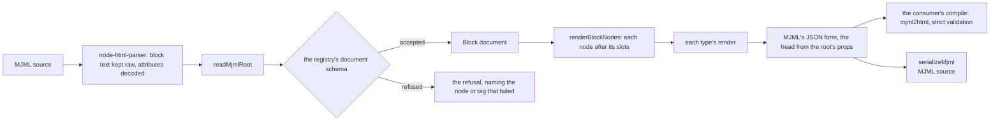

# mjml-blocks

`packages/mjml-blocks` (npm `mjml-blocks`) holds MJML's component set as block types on the [headless block editor](../vue-block-editor-headless/editor-core/design.md). Each type carries its attributes in MJML's own type grammar, MJML's defaults, the tags it may hold and its content kind. A document renders to MJML's JSON form, serialises to MJML source, and reads back from MJML source, refusing every tag, attribute or value the package does not take. The package has no framework, no DOM and no MJML runtime: the compile is the consumer's, one `mjml2html` call with strict validation.

The email editor's canvas, preview and fields belong to the [email editor](../resource/page-builder/email/design.md), and the server's compile to the document model. What the package does not own is MJML's own, so each rule is held equal to the installed MJML rather than copied from it.

- [Block types](block-types/design.md) — each MJML component as a block type, its attributes and content kind, and the files each part of the behaviour lives in.

## How a document becomes MJML and back

- **The render.** `renderMjmlDocument` folds the document through `renderBlockNodes` into MJML's JSON form: a tag, its attributes, and its children or its content. The render escapes every attribute value once, since MJML writes a value exactly as given, and an option stamps each node's id as its `css-class` so the proof can find its box.
- **The serialiser.** `serializeMjml` writes that JSON as MJML source for the export. It writes every element with its own closing tag and no indentation, so an element that closes nothing never swallows its siblings.
- **The read back.** `parseMjmlDocument` reads source with `node-html-parser`, which keeps the content of each ending tag as raw text, decodes every attribute value and closes every self-closing tag. A head tag becomes a root prop, a body tag a node, and the content of a content-kind tag goes through its kind's reader. The result is parsed by the registry's document schema, so the refusal has one path, and it names the node that does not fit.

## Decisions

- **The component set is MJML's, current and whole.** Parity is with the components of the MJML release the `pnpm-workspace.yaml` catalog pins, so a component the plugin never shipped is in the set too. Each block type's name is its MJML tag, so the render, the slot rules and the canvas key on one name.
- **The head is the root's props.** A head component belongs to the whole email, so `lang` and `dir` sit on `mjml`, `mj-title` and `mj-preview` are text props, `mj-font` is a list of a name and a stylesheet address, `mj-breakpoint` and `mj-body`'s attributes are maps, and `mj-attributes` is a map per type. `mj-style` is a list, and its schema refuses a `<` in the CSS so the CSS can never close its element.
- **Components left out of MJML's set are refused by name.** `mj-include` reads files from the compiling server's disk, `mj-html-attributes` and `mj-class` target attributes by selector and share named classes, and the community components are not part of MJML's own preset. A head or body tag the package does not take, or a second tag of one the head or body reads once, is refused under its name in angle brackets (`<mj-include>`, `<body>`), a key no prop the root or the head reads can be. The `mjml` element takes `lang` and `dir` as root props, the direction held as `direction`, and any other attribute it carries is refused under `<mjml>`.
- **Slots are MJML's nesting map.** Each container's `children` slot is the allow list MJML's core preset registers for its tag, and the root's content is the list for `mj-body`. A consumer's own leaf is added where MJML allows a leaf. A test holds every allow list equal to the installed preset, so a release that changes the nesting fails a test.
- **A consumer's leaf renders with the consumer's context.** A leaf type brings its own render, and `renderMjmlDocument` hands it the `context` its options carry, typed by the registry, so a survey invite builds its link from the site's origin while MJML's own types ignore the context. Rejected: a registry built per origin, which would leave the email's persisted schema depending on where it renders.
- **The root's props are typed by the registry.** `MjmlRegistry` is the core's registry over `MjmlRootProps`, inferred from the root's schema, so `parseMjmlDocument` returns an `MjmlDocument` whose head is typed, and the render reads it without parsing it a second time.
- **Attributes are declared once, in MJML's grammar.** Each table entry is `color`, `enum(...)`, `unit(...)`, `boolean`, `integer` or `string`. The editor's field descriptors are read from the tables, each props schema spreads the same table through `createMjmlAttributeShape`, so its keys are the table's keys, and two tests hold each table equal to the installed component's attributes and defaults, less `css-class` and `mj-class`. The [block types page](block-types/design.md) states the rest of each component's rules.
- **An unset attribute stays absent.** A node's props hold what its author set. The cascade answers an attribute in MJML's order: the node's own value, the root's value for its type, the root's value for all components, then MJML's default. MJML writes the root's value for all components into every type that takes its name, so the root refuses one unless each such type accepts it; the [block types page](block-types/design.md) holds that rule. MJML's defaults are not Zod defaults, since parsing would write every default into every node and `mj-attributes` could never apply.
- **Content is one of three kinds.** Rich text goes through the consumer's definition. A plain label is written escaped, and an imported label holding an element is refused at its node. Raw HTML is stored only as the sanitiser returns it, so a raw block never holds a script.
- **The kind's schema is one map.** `MjmlContentKindSchemaMap` holds the content schema of each fixed kind, the label's and the raw's. A label-kind or raw-kind component takes its content schema from that map and declares none of its own, and the renderer parses content with the same entry, so the kind and its schema cannot drift apart. Rich text is the exception: its schema is the consumer's definition's, which the map does not hold. The map is typed to cover every fixed kind, so a new fixed kind without a schema is a compile error. A definition whose kind is a label or a raw cannot hold a schema whose content is not a string: `MjmlBlockTypeDefinition` refuses it at compile time, on the generic path as on each node's. Label and raw are both strings, so a component given the other kind's entry, or a copy of an entry, is refused by its test.
- **An image's alternative text is required or marked decorative.** A decorative image renders an empty `alt`, and the read back turns an empty `alt` into the decorative flag, so the two are inverses.
- **The read back is `node-html-parser`.** MJML's own XML parser drops an `mj-include` without a word, needs MJML's component registry to know its ending tags, and reads the disk. parse5 reads a self-closing custom tag as an open one, which swallows its siblings on import.
- **The compile is the consumer's.** The package holds no copy of MJML at runtime. MJML and its preset are development dependencies, used only by the tests that hold the tables equal to the installed release.

## Upstream

The plugin's tracker holds a few hundred issues and pull requests, most of them closed, and it routes questions to its discussions. Every item has one verdict. The table keeps the in-scope items, each with the test that proves it or a note on the reading that does, and the rest are counted below. Most of the in-scope items are the component set, the head and the escaping. Items the page builder's editor owns are out of scope here, and so are MJML's own compiler's behaviours, which are MJML's to fix. The reproductions use the `grapesjs-mjml` 1.0.8 plugin installed without GrapesJS itself, since the editor is not installed beside this package.

The in-scope features that are open (#203, #351, #390, #436) are the package's own tests, which exercise each attribute and element the plugin's issue asks for. The MJML components the tracker never mentions (`mj-accordion`, `mj-breakpoint`, `mj-html-attributes` and `mj-include`) have no item here; they come from the component comparison alone, and the first two are in the set.

| Upstream                                            | Verdict            | Proof                                                                                                                                                                                                                                                                      |
| :-------------------------------------------------- | :----------------- | :------------------------------------------------------------------------------------------------------------------------------------------------------------------------------------------------------------------------------------------------------------------------- |
| [#4](https://github.com/GrapesJS/mjml/issues/4)     | in scope — feature | `rendering a parsed email returns its source`                                                                                                                                                                                                                              |
| [#8](https://github.com/GrapesJS/mjml/issues/8)     | in scope — feature | `rendering a parsed email returns its source`                                                                                                                                                                                                                              |
| [#13](https://github.com/GrapesJS/mjml/issues/13)   | in scope — defect  | `rendering a parsed email returns its source`                                                                                                                                                                                                                              |
| [#35](https://github.com/GrapesJS/mjml/issues/35)   | in scope — defect  | `rendering a parsed email returns its source`; `#35 #4 #118 #124 #207 #208 #248 #249 #284 #351 #370 #371 a head's font, preview and style reach the compiled email`                                                                                                        |
| [#41](https://github.com/GrapesJS/mjml/issues/41)   | in scope — defect  | `#41 #144 #240 a childless element is written with its own closing tag, so its sibling survives`; `#41 #149 a self-closing image beside a text reads back as two nodes`                                                                                                    |
| [#56](https://github.com/GrapesJS/mjml/issues/56)   | in scope — defect  | `#56 #268 #304 #307 a section and a wrapper take full-width and compile`                                                                                                                                                                                                   |
| [#70](https://github.com/GrapesJS/mjml/issues/70)   | in scope — feature | `rendering a parsed email returns its source`                                                                                                                                                                                                                              |
| [#81](https://github.com/GrapesJS/mjml/issues/81)   | in scope — feature | `rendering a parsed email returns its source`                                                                                                                                                                                                                              |
| [#84](https://github.com/GrapesJS/mjml/issues/84)   | in scope — feature | `rendering a parsed email returns its source`                                                                                                                                                                                                                              |
| [#96](https://github.com/GrapesJS/mjml/issues/96)   | in scope — defect  | `#330 #339 #344 #262 #96 an image's width takes pixels only, and auto is refused`                                                                                                                                                                                          |
| [#100](https://github.com/GrapesJS/mjml/issues/100) | in scope — defect  | `an attribute holding a quote is escaped once`. Closed upstream. The same compile writes a double quote inside an attribute unescaped, so `class="a"b"` breaks the output.                                                                                                 |
| [#109](https://github.com/GrapesJS/mjml/pull/109)   | in scope — feature | `rendering a parsed email returns its source`                                                                                                                                                                                                                              |
| [#118](https://github.com/GrapesJS/mjml/issues/118) | in scope — defect  | `#35 #4 #118 #124 #207 #208 #248 #249 #284 #351 #370 #371 a head's font, preview and style reach the compiled email`                                                                                                                                                       |
| [#122](https://github.com/GrapesJS/mjml/issues/122) | in scope — feature | `rendering a parsed email returns its source`                                                                                                                                                                                                                              |
| [#123](https://github.com/GrapesJS/mjml/pull/123)   | in scope — feature | `rendering a parsed email returns its source`                                                                                                                                                                                                                              |
| [#124](https://github.com/GrapesJS/mjml/pull/124)   | in scope — defect  | `#35 #4 #118 #124 #207 #208 #248 #249 #284 #351 #370 #371 a head's font, preview and style reach the compiled email`                                                                                                                                                       |
| [#130](https://github.com/GrapesJS/mjml/pull/130)   | in scope — feature | `rendering a parsed email returns its source`                                                                                                                                                                                                                              |
| [#133](https://github.com/GrapesJS/mjml/issues/133) | in scope — feature | `rendering a parsed email returns its source`                                                                                                                                                                                                                              |
| [#142](https://github.com/GrapesJS/mjml/pull/142)   | in scope — defect  | `#142 #150 #184 #185 #361 a wrapper and a hero are body content, and a group holds columns`                                                                                                                                                                                |
| [#144](https://github.com/GrapesJS/mjml/pull/144)   | in scope — defect  | `#41 #144 #240 a childless element is written with its own closing tag, so its sibling survives`                                                                                                                                                                           |
| [#150](https://github.com/GrapesJS/mjml/issues/150) | in scope — defect  | `#184 #150 #185 a section in a wrapper compiles with no body of its own`                                                                                                                                                                                                   |
| [#179](https://github.com/GrapesJS/mjml/issues/179) | in scope — defect  | `#179 #196 a node's id and an unset attribute are never written` and `#179 an id attribute is refused at its node, not taken as the node's id`                                                                                                                             |
| [#184](https://github.com/GrapesJS/mjml/pull/184)   | in scope — defect  | `#184 #150 #185 a section in a wrapper compiles with no body of its own`                                                                                                                                                                                                   |
| [#185](https://github.com/GrapesJS/mjml/pull/185)   | in scope — defect  | `#184 #150 #185 a section in a wrapper compiles with no body of its own`                                                                                                                                                                                                   |
| [#196](https://github.com/GrapesJS/mjml/issues/196) | in scope — defect  | `#179 #196 a node's id and an unset attribute are never written`                                                                                                                                                                                                           |
| [#197](https://github.com/GrapesJS/mjml/pull/197)   | in scope — defect  | `rendering a parsed email returns its source`                                                                                                                                                                                                                              |
| [#199](https://github.com/GrapesJS/mjml/issues/199) | in scope — defect  | `rendering a parsed email returns its source`                                                                                                                                                                                                                              |
| [#202](https://github.com/GrapesJS/mjml/issues/202) | in scope — defect  | `#202 a body width caps the email at the width it sets`                                                                                                                                                                                                                    |
| [#203](https://github.com/GrapesJS/mjml/issues/203) | in scope — feature | `rendering a parsed email returns its source`                                                                                                                                                                                                                              |
| [#207](https://github.com/GrapesJS/mjml/issues/207) | in scope — defect  | `#35 #4 #118 #124 #207 #208 #248 #249 #284 #351 #370 #371 a head's font, preview and style reach the compiled email`                                                                                                                                                       |
| [#208](https://github.com/GrapesJS/mjml/pull/208)   | in scope — defect  | `#35 #4 #118 #124 #207 #208 #248 #249 #284 #351 #370 #371 a head's font, preview and style reach the compiled email`                                                                                                                                                       |
| [#219](https://github.com/GrapesJS/mjml/pull/219)   | in scope — defect  | `rendering a parsed email returns its source`                                                                                                                                                                                                                              |
| [#224](https://github.com/GrapesJS/mjml/pull/224)   | in scope — feature | `rendering a parsed email returns its source`                                                                                                                                                                                                                              |
| [#230](https://github.com/GrapesJS/mjml/pull/230)   | in scope — feature | `rendering a parsed email returns its source`                                                                                                                                                                                                                              |
| [#236](https://github.com/GrapesJS/mjml/issues/236) | in scope — defect  | `rendering a parsed email returns its source`                                                                                                                                                                                                                              |
| [#240](https://github.com/GrapesJS/mjml/pull/240)   | in scope — defect  | `#41 #144 #240 a childless element is written with its own closing tag, so its sibling survives`                                                                                                                                                                           |
| [#248](https://github.com/GrapesJS/mjml/issues/248) | in scope — defect  | `#35 #4 #118 #124 #207 #208 #248 #249 #284 #351 #370 #371 a head's font, preview and style reach the compiled email`                                                                                                                                                       |
| [#249](https://github.com/GrapesJS/mjml/pull/249)   | in scope — defect  | `#35 #4 #118 #124 #207 #208 #248 #249 #284 #351 #370 #371 a head's font, preview and style reach the compiled email`                                                                                                                                                       |
| [#257](https://github.com/GrapesJS/mjml/issues/257) | in scope — defect  | `#257 a column's width is written as its own attribute, which MJML lays out`                                                                                                                                                                                               |
| [#262](https://github.com/GrapesJS/mjml/issues/262) | in scope — defect  | `#330 #339 #344 #262 #96 an image's width takes pixels only, and auto is refused`                                                                                                                                                                                          |
| [#268](https://github.com/GrapesJS/mjml/issues/268) | in scope — defect  | `#56 #268 #304 #307 a section and a wrapper take full-width and compile`                                                                                                                                                                                                   |
| [#269](https://github.com/GrapesJS/mjml/issues/269) | in scope — feature | `#388 #269 #358 #367 #368 mj-attributes applies, and MJML's defaults fill what a node sets none`                                                                                                                                                                           |
| [#270](https://github.com/GrapesJS/mjml/pull/270)   | in scope — defect  | `rendering a parsed email returns its source`                                                                                                                                                                                                                              |
| [#284](https://github.com/GrapesJS/mjml/issues/284) | in scope — defect  | `#35 #4 #118 #124 #207 #208 #248 #249 #284 #351 #370 #371 a head's font, preview and style reach the compiled email`                                                                                                                                                       |
| [#285](https://github.com/GrapesJS/mjml/issues/285) | in scope — defect  | `#285 the source is the mjml element alone, with no body tag around it`                                                                                                                                                                                                    |
| [#304](https://github.com/GrapesJS/mjml/pull/304)   | in scope — defect  | `#56 #268 #304 #307 a section and a wrapper take full-width and compile`                                                                                                                                                                                                   |
| [#307](https://github.com/GrapesJS/mjml/issues/307) | in scope — defect  | `#56 #268 #304 #307 a section and a wrapper take full-width and compile`                                                                                                                                                                                                   |
| [#318](https://github.com/GrapesJS/mjml/pull/318)   | in scope — feature | `rendering a parsed email returns its source`                                                                                                                                                                                                                              |
| [#330](https://github.com/GrapesJS/mjml/issues/330) | in scope — defect  | `#330 #339 #344 #262 #96 an image's width takes pixels only, and auto is refused`. Proven by reading `src/components/Image.ts`: its "getStylesToAttributes" removes only `auto`, so a percentage from the style manager reaches MJML, whose image width takes pixels only. |
| [#339](https://github.com/GrapesJS/mjml/issues/339) | in scope — defect  | `#330 #339 #344 #262 #96 an image's width takes pixels only, and auto is refused`                                                                                                                                                                                          |
| [#344](https://github.com/GrapesJS/mjml/pull/344)   | in scope — defect  | `#330 #339 #344 #262 #96 an image's width takes pixels only, and auto is refused`                                                                                                                                                                                          |
| [#351](https://github.com/GrapesJS/mjml/issues/351) | in scope — feature | `#35 #4 #118 #124 #207 #208 #248 #249 #284 #351 #370 #371 a head's font, preview and style reach the compiled email`                                                                                                                                                       |
| [#358](https://github.com/GrapesJS/mjml/pull/358)   | in scope — defect  | `mj-section has the default attributes MJML's component sets`                                                                                                                                                                                                              |
| [#361](https://github.com/GrapesJS/mjml/pull/361)   | in scope — defect  | `#142 #150 #184 #185 #361 a wrapper and a hero are body content, and a group holds columns`                                                                                                                                                                                |
| [#367](https://github.com/GrapesJS/mjml/issues/367) | in scope — defect  | `#388 #269 #358 #367 #368 mj-attributes applies, and MJML's defaults fill what a node sets none`                                                                                                                                                                           |
| [#368](https://github.com/GrapesJS/mjml/pull/368)   | in scope — defect  | `#388 #269 #358 #367 #368 mj-attributes applies, and MJML's defaults fill what a node sets none`                                                                                                                                                                           |
| [#370](https://github.com/GrapesJS/mjml/issues/370) | in scope — defect  | `#35 #4 #118 #124 #207 #208 #248 #249 #284 #351 #370 #371 a head's font, preview and style reach the compiled email`                                                                                                                                                       |
| [#371](https://github.com/GrapesJS/mjml/pull/371)   | in scope — defect  | `#35 #4 #118 #124 #207 #208 #248 #249 #284 #351 #370 #371 a head's font, preview and style reach the compiled email`                                                                                                                                                       |
| [#388](https://github.com/GrapesJS/mjml/issues/388) | in scope — defect  | `#388 #269 #358 #367 #368 mj-attributes applies, and MJML's defaults fill what a node sets none`. Proven by reading `src/components/Head.ts`: `mj-attributes` is droppable in the head, and no component type registers its children, so no defaults reach the canvas.     |
| [#390](https://github.com/GrapesJS/mjml/issues/390) | in scope — feature | `mj-divider takes the attributes MJML's component allows, less css-class and mj-class`; `mj-divider has the default attributes MJML's component sets`                                                                                                                      |
| [#391](https://github.com/GrapesJS/mjml/issues/391) | in scope — defect  | `#391 an attribute holding markup is written escaped once`. `mjml-browser` 4.18.0 writes a `css-class` holding `` verbatim, and the render escapes it once.                                                                                    |
| [#392](https://github.com/GrapesJS/mjml/issues/392) | in scope — defect  | `rendering where there is no document object model`. The plugin's bundle throws `window is not defined` when it loads under Node, as `mjml-browser` 4.18.0 does, the MJML build its parser imports.                                                                        |
| [#393](https://github.com/GrapesJS/mjml/pull/393)   | in scope — defect  | `rendering where there is no document object model`. The same pin as #392.                                                                                                                                                                                                 |
| [#406](https://github.com/GrapesJS/mjml/issues/406) | in scope — defect  | `a valid email compiles under strict validation`. The plugin's own manifest, outside this repository, pins `mjml-browser` at `^4.18.0`, where MJML 5 is current; the package compiles on MJML 5 under strict validation.                                                   |
| [#436](https://github.com/GrapesJS/mjml/pull/436)   | in scope — feature | `mj-divider has the default attributes MJML's component sets`                                                                                                                                                                                                              |

The other items are counted, not listed, each on the [plugin's tracker](https://github.com/GrapesJS/mjml/issues):

- 206 false positive
- 154 out of scope, owned by the page builder's editor
- 8 out of scope, owned by MJML's compiler

## Sources

- [MJML documentation](https://documentation.mjml.io/): the component set, each component's attributes and defaults, the head components, and "Using MJML in JSON", the object form `mjml2html` takes in place of markup.
- `mjml-core`'s "createComponent": `htmlAttributes` writes each attribute with its value as given, which is why the render escapes.
- `mjml-preset-core`'s `dependencies`: the allowed children of every tag, which the slots are held equal to.
- `mjml-parser-xml`'s `MJMLParser`: `ignoreIncludes` defaults to true, and the ending tags come from its `components` option.
- [node-html-parser](https://github.com/taoqf/node-html-parser): the block text elements and the decoded attributes the read back uses.
- [GrapesJS MJML](https://github.com/GrapesJS/mjml): the plugin whose surface this package replaced, and whose tracker the Upstream table answers.
