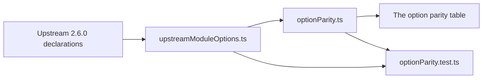

# nuxt-security-module

`packages/nuxt-security-module` is the replacement for [nuxt-security](https://github.com/Baroshem/nuxt-security), the Nuxt module that sets security headers, a nonce-based Content Security Policy, CORS, basic auth, a rate limiter, an XSS validator and a request size limiter. The app runs this package in place of the upstream. This section is the record the package was built against.

The decision to absorb it, and the rule a security-shaped absorption meets, are recorded in [dependency admission](../architecture/dependency-admission/design.md).

## Pages

- [Upstream audit](upstream/design.md) — every issue and pull request on the upstream repository, open and closed, with its verdict and the severity of any security defect.
- [Defaults review](defaults-review/design.md) — each header and option the module sets by default, its recommended value from the published sources, and a keep, change or remove verdict.

## Status

The package builds the headers, the nonce Content Security Policy, subresource integrity, the prerender policy, the header and CORS handlers, the allowed methods, basic auth, the request size limit, a rate limiter behind a store interface, CSRF by the double submit cookie, the route rules' `security` key and strict mode, and the `removeLoggers` option, which sets the bundler's `dropConsole`. Its module options are validated by one Zod schema per option group, so a bad option stops the build with its path. Each part has unit tests, and each in-scope audit defect that this code fixes has a regression test titled with its issue number. The package typechecks, lints and builds. Its Nitro plugins and middleware run inside the app, which registers the package in place of the upstream. A built app's rendered page carries the headers, a nonce that matches the Content Security Policy and integrity attributes that match their files, and no `X-Powered-By` header. The integrity attributes cover every file the build writes to its public directory, the client bundles included, so each `/_nuxt` script, stylesheet and preload link of the built check carries one that matches its served bytes.

Decided not to build, with the reason on the [upstream audit](upstream/design.md#decisions-not-built):

- The XSS validator is not built.

What is decided against is in [rejected](../../rejected/nuxt-security-module/), and what is deferred, with the trigger that reopens it, is in [deferred](../../deferred/nuxt-security-module/).

## Per-request cost

Each hot path is a benchmark beside its source, and each has a committed report of its means: the nonce, the headers, the route rules and the page rewrite in `src/runtime/nitro/plugins/` and `src/runtime/services/`, and the server chain in `src/runtime/server/middleware/`. The comparison with the upstream 2.6.0 ran once on the same host, over the same page of about sixty sections, with each path compared by its median. The figures are ratios and magnitudes, with the upstream's time over ours:

- **Applying the headers to a response** is about 6 times faster: a few microseconds against tens of microseconds. Upstream rebuilds each request's rules and writes its headers through its own helpers, where ours reads rules resolved once.
- **Rewriting a rendered page with its nonce and SRI attributes** is about 20 to 30 times faster. This is the largest gap, since upstream's two rewrites run as regular expressions over each section after masking its quoted attributes, and ours scan each tag once.
- **Resolving a request's route rules** is about 5 times faster: a few microseconds against tens of microseconds. Upstream builds its router and clones its route table for every request. Ours matches a table built once at startup and merges the matched rules only for the event.
- **Generating the nonce** is the same on both sides, a few microseconds each. The module does not claim a gain here.
- **The whole server chain** is about 7 times faster under both configurations. The chain is the handlers each module registers for a request to a page path, measured in `src/runtime/server/middleware/serverChain.bench.ts` with the app's options and with a minimal configuration that keeps only the request size limit. Upstream registers its server middlewares whatever the config says, and each one runs on every request, looks up the route's rules and returns early when its feature is off. Ours registers a handler only when its option is on, so a disabled feature costs nothing per request. The minimal configuration is the one that shows it: upstream's five handlers still run, and ours runs one.

The chain figures are medians of three one-off runs of the same harness on one host, at 2000 iterations after warm-up, both sides reading `serverChain.fixture.ts`. Upstream's median is the upstream 2.6.0 handlers with its own defaults laid under the same options, so its default XSS validator runs under the app's options, as it would for an app that does not set it off. The ratio varies widely across the three runs under the app's options, and sits near seven under the minimal one. The committed bench reports means and gates them; it does not record the medians.

Not comparable, or not measured:

- Allocations were not counted, so no figure of fewer allocations is claimed.
- The headers' native baseline differs between the two sides (their serializers differ), so only the full paths are compared, not their baselines.
- Both sides run on a stand-in event, not a live server: ours on the H3 v2 event shape, upstream's on a node response through h3 v1, with Nitro's runtime stood in for. Their own `h3` and `radix3` versions are the ones installed for each.
- The two sides order their SRI and nonce rewrites differently, so the rewrite figure is their total cost and not one step's.

## Option parity

Every option of upstream 2.6.0 has exactly one verdict below: ported under our name, ported with a changed default (the note cites the source the default rests on), dropped as legacy, or out of scope with its reason. The rows are the module's top-level options and the keys of its `headers`, which is where `X-XSS-Protection` sits. The keys inside an object option, such as `rateLimiter`'s token count, are carried by that option's row.

The table is generated from `services/optionParity.ts`, against the upstream option names in `services/upstreamModuleOptions.ts`, which are read from the 2.6.0 `ModuleOptions` and `SecurityHeaders` declarations. The option parity test fails when an upstream option has no row or has two, so a newer upstream option shows up as a missing row when the names are read again.

Most rows are ported under upstream's own default. A changed default's note names the source it rests on, and the two rows with no port give their reasons. Every option without a port has its reason.

| Upstream option                         | Verdict                 | Ours                                    | Note                                                                                                                                                                                                                                                                                                              |
| :-------------------------------------- | :---------------------- | :-------------------------------------- | :---------------------------------------------------------------------------------------------------------------------------------------------------------------------------------------------------------------------------------------------------------------------------------------------------------------- |
| `allowedMethodsRestricter`              | ported, changed default | `allowedMethodsRestricter`              | Upstream's default is `methods: '*'`, which refuses no method, so a default-on handler only adds per-request work. Ours is off, and the cost is measured on the module page                                                                                                                                       |
| `basicAuth`                             | ported                  | `basicAuth`                             | Same default: off                                                                                                                                                                                                                                                                                                 |
| `contentSecurityPolicyReportOnly`       | ported                  | `contentSecurityPolicyReportOnly`       | Same default: off                                                                                                                                                                                                                                                                                                 |
| `corsHandler`                           | ported                  | `corsHandler`                           | Same default: the development server's origin, the same methods and a `204` preflight                                                                                                                                                                                                                             |
| `csrf`                                  | ported                  | `csrf`                                  | Same default: off. Ours is the double submit cookie of the OWASP CSRF Prevention Cheat Sheet, not upstream's `nuxt-csurf` module                                                                                                                                                                                  |
| `enabled`                               | ported                  | `enabled`                               | Same default: on                                                                                                                                                                                                                                                                                                  |
| `headers`                               | ported, changed default | `headers`                               | Its keys carry the changed defaults: see `headers.contentSecurityPolicy`, `headers.permissionsPolicy` and `headers.strictTransportSecurity`                                                                                                                                                                       |
| `headers.contentSecurityPolicy`         | ported, changed default | `headers.contentSecurityPolicy`         | Ours adds `default-src 'self'` and `base-uri 'none'` and keeps the reviewed set in `defaults-review.md`, from OWASP, CSP Level 3 and the Fetch standard                                                                                                                                                           |
| `headers.crossOriginEmbedderPolicy`     | ported                  | `headers.crossOriginEmbedderPolicy`     | Same default: `credentialless` in production and `unsafe-none` in development, as `defaults-review.md` records                                                                                                                                                                                                    |
| `headers.crossOriginOpenerPolicy`       | ported                  | `headers.crossOriginOpenerPolicy`       | Same default: `same-origin`                                                                                                                                                                                                                                                                                       |
| `headers.crossOriginResourcePolicy`     | ported                  | `headers.crossOriginResourcePolicy`     | Same default: `same-origin`, from the Fetch standard                                                                                                                                                                                                                                                              |
| `headers.originAgentCluster`            | ported                  | `headers.originAgentCluster`            | Same default: `?1`, from MDN's `Origin-Agent-Cluster`                                                                                                                                                                                                                                                             |
| `headers.permissionsPolicy`             | ported, changed default | `headers.permissionsPolicy`             | Ours denies the features OWASP's `ci/headers_add.json` denies by default, where upstream denies five. The list is in `defaults-review.md`                                                                                                                                                                         |
| `headers.referrerPolicy`                | ported                  | `headers.referrerPolicy`                | Same default: `no-referrer`, from OWASP                                                                                                                                                                                                                                                                           |
| `headers.strictTransportSecurity`       | ported, changed default | `headers.strictTransportSecurity`       | Ours is two years, `max-age=63072000`, where upstream is 180 days. The sources are in the [defaults review](defaults-review/design.md)                                                                                                                                                                            |
| `headers.xContentTypeOptions`           | ported                  | `headers.xContentTypeOptions`           | Same default: `nosniff`, from OWASP                                                                                                                                                                                                                                                                               |
| `headers.xDNSPrefetchControl`           | ported                  | `headers.xDNSPrefetchControl`           | Same default: `off`, from OWASP                                                                                                                                                                                                                                                                                   |
| `headers.xDownloadOptions`              | ported                  | `headers.xDownloadOptions`              | Same default: `noopen`                                                                                                                                                                                                                                                                                            |
| `headers.xFrameOptions`                 | ported                  | `headers.xFrameOptions`                 | Same default: `SAMEORIGIN`                                                                                                                                                                                                                                                                                        |
| `headers.xPermittedCrossDomainPolicies` | ported                  | `headers.xPermittedCrossDomainPolicies` | Same default: `none`, from OWASP                                                                                                                                                                                                                                                                                  |
| `headers.xXSSProtection`                | dropped (legacy)        | —                                       | Legacy. MDN's `X-XSS-Protection` page records the header as non-standard and deprecated, and browsers have removed the auditor it configured, so its value does nothing. Our serializer test pins it not sent                                                                                                     |
| `hidePoweredBy`                         | ported                  | `hidePoweredBy`                         | Same default: on                                                                                                                                                                                                                                                                                                  |
| `nonce`                                 | ported                  | `nonce`                                 | Same default: on                                                                                                                                                                                                                                                                                                  |
| `rateLimiter`                           | ported, changed default | `rateLimiter`                           | Upstream is on at 150 tokens per five minutes, keyed on a forwarded address the client can write (upstream audit #83 and #196). Ours is off by default, and a rebuilt limiter is ours to add                                                                                                                      |
| `removeLoggers`                         | ported, changed default | `removeLoggers`                         | Upstream drops console calls by default. Ours is off, since what an app logs is its own choice and no OWASP, MDN or W3C source asks for them to be dropped                                                                                                                                                        |
| `requestSizeLimiter`                    | ported                  | `requestSizeLimiter`                    | Same defaults: 2 MB for a request and 8 MB for a file upload, declared in `getDefaultModuleOptions`. The app sets its own from `MAX_REQUEST_SIZE` and `MAX_FILE_REQUEST_SIZE`                                                                                                                                     |
| `sri`                                   | ported                  | `sri`                                   | Same default: on                                                                                                                                                                                                                                                                                                  |
| `ssg`                                   | ported                  | `ssg`                                   | Same defaults: the meta and script hashes on, the style hashes off                                                                                                                                                                                                                                                |
| `strict`                                | ported                  | `strict`                                | Same default: off                                                                                                                                                                                                                                                                                                 |
| `xssValidator`                          | out of scope            | —                                       | The module has no XSS validator. Its filter rejects ordinary text and passes a script once `escapeHtml` is off, as the app's `security.test.ts` measures. OWASP's XSS Prevention Cheat Sheet calls for output encoding rather than input filtering, and rich text is sanitised at its Zod boundary, which owns it |
