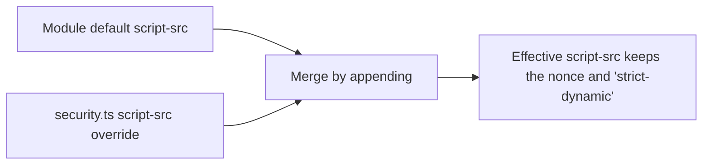

# nuxt-security defaults review

The module's defaults are the first thing a new app inherits, so the package starts from a reviewed set rather than from upstream's. This page records a verdict on each header and option the module sets by default, against published guidance, and the package's defaults are written from these verdicts.

The starting set is the one `nuxt-security@2.6.0` ships in `defaultConfig.mjs`. Each row's module default column is the value the package sends now, as `packages/nuxt-security-module/src/services/getDefaultSecurityHeaders.ts` and `packages/nuxt-security-module/src/services/getDefaultModuleOptions.ts` set it. Our app does not set `strict`, and strict mode changes one directive, `script-src`, which the first row names. Recommended values are quoted from the sources in the last section.

## Headers

| Header                                 | Module default                                                                                                                                                                                                                                                                                                                                                                                                                                     | Recommended                                                                                                                                                                                                                                                                                                          | Verdict                                                                                                                                                                                                                                                                                                                                                                                                                                                                                                                                                                                                                                                                                           |
| :------------------------------------- | :------------------------------------------------------------------------------------------------------------------------------------------------------------------------------------------------------------------------------------------------------------------------------------------------------------------------------------------------------------------------------------------------------------------------------------------------- | :------------------------------------------------------------------------------------------------------------------------------------------------------------------------------------------------------------------------------------------------------------------------------------------------------------------- | :------------------------------------------------------------------------------------------------------------------------------------------------------------------------------------------------------------------------------------------------------------------------------------------------------------------------------------------------------------------------------------------------------------------------------------------------------------------------------------------------------------------------------------------------------------------------------------------------------------------------------------------------------------------------------------------------ |
| `Content-Security-Policy`              | `default-src 'self'`, `base-uri 'none'`, `font-src 'self' https: data:`, `form-action 'self'`, `frame-ancestors 'self'`, `img-src 'self' data:`, `object-src 'none'`, `script-src-attr 'none'`, `style-src 'self' https: 'unsafe-inline'`, `script-src 'self' https: 'unsafe-inline' 'strict-dynamic' 'nonce-…'`, `upgrade-insecure-requests`. Under `strict`, `script-src` is `'self' 'strict-dynamic' 'nonce-…'` and no other directive changes. | OWASP: `default-src 'self'; form-action 'self'; base-uri 'self'; object-src 'none'; frame-ancestors 'none'`. Our `base-uri 'none'` is stricter than OWASP's `'self'` and stays. CSP3 §3.3 says `frame-ancestors` is ignored in a `<meta>` element, so it only protects when sent as a header, which the module does. | **Keep**: the package sets `default-src 'self'`, so a fetch type without its own directive is limited to the same origin. `frame-ancestors 'self'` stays the package's default, not OWASP's `'none'`, since a consumer may frame its own pages; our app overrides it to `'none'` (see our overrides).                                                                                                                                                                                                                                                                                                                                                                                             |
| `Strict-Transport-Security`            | `max-age=63072000; includeSubDomains`, a two-year `max-age` with no `preload`. `strict` does not change it.                                                                                                                                                                                                                                                                                                                                        | OWASP: `max-age=63072000; includeSubDomains`. RFC 6797 §6.1.1 defines `max-age` in seconds from receipt, and §8.1 requires a UA to ignore the header over plain HTTP.                                                                                                                                                | **Keep**: the package sends the OWASP value above. `preload` stays out: the preload list is a separate commitment to take on its own.                                                                                                                                                                                                                                                                                                                                                                                                                                                                                                                                                             |
| `X-Frame-Options`                      | `SAMEORIGIN`. `strict` does not change it.                                                                                                                                                                                                                                                                                                                                                                                                         | OWASP: `deny`. MDN: `DENY` blocks framing from any origin, and CSP `frame-ancestors` is the more complete control.                                                                                                                                                                                                   | **Keep** `SAMEORIGIN` as the package's default; our app overrides it to `DENY` (see our overrides).                                                                                                                                                                                                                                                                                                                                                                                                                                                                                                                                                                                               |
| `Referrer-Policy`                      | `no-referrer`. `strict` does not change it.                                                                                                                                                                                                                                                                                                                                                                                                        | OWASP: `no-referrer`                                                                                                                                                                                                                                                                                                 | **Keep**.                                                                                                                                                                                                                                                                                                                                                                                                                                                                                                                                                                                                                                                                                         |
| `Permissions-Policy`                   | An empty allowlist for every feature the package lists, except `sync-xhr`, which allows the same origin. `strict` does not change it.                                                                                                                                                                                                                                                                                                              | OWASP lists a deny-by-default set of features in `ci/headers_add.json` in its repository, which the package's denials are taken from.                                                                                                                                                                                | **Keep**: the package lists the same features as OWASP's Permissions-Policy, one for one, each with the same allowlist (`packages/nuxt-security-module/src/services/getDefaultSecurityHeaders.ts`). Our `self` grants in `security.ts` stay: autoplay, camera, clipboard-read, clipboard-write, display-capture, fullscreen, gamepad and microphone.                                                                                                                                                                                                                                                                                                                                              |
| `Cross-Origin-Opener-Policy`           | `same-origin`                                                                                                                                                                                                                                                                                                                                                                                                                                      | OWASP: `same-origin`                                                                                                                                                                                                                                                                                                 | **Keep**.                                                                                                                                                                                                                                                                                                                                                                                                                                                                                                                                                                                                                                                                                         |
| `Cross-Origin-Embedder-Policy`         | `credentialless` in production, `unsafe-none` in development. The `nuxtAssets` server plugin (`apps/web/server/plugins/nuxtAssets.ts`) sets `credentialless` on `/_nuxt/` `.js` responses in every environment, so a dedicated worker starts under the page's policy.                                                                                                                                                                              | OWASP: `require-corp`. MDN: `require-corp` loads only same-origin resources, or those that set `Cross-Origin-Resource-Policy` to allow embedding; `credentialless` loads no-cors cross-origin resources without a CORP header, sending them without credentials.                                                     | **Keep** `credentialless`. Nothing in the app needs cross-origin isolation, since no code constructs a `SharedArrayBuffer` or reads `crossOriginIsolated`, so the header costs nothing today and keeps isolation available for a feature that needs it. `require-corp` is rejected: it blocks every cross-origin no-cors load whose response carries no `Cross-Origin-Resource-Policy`, such as an OAuth provider's avatar, a hosted blob asset or a third-party script, where `credentialless` loads them without credentials. A browser without `credentialless` support ignores the header, so nothing fails there. This is a deliberate deviation from OWASP and the reason is recorded here. |
| `Cross-Origin-Resource-Policy`         | `same-origin`                                                                                                                                                                                                                                                                                                                                                                                                                                      | OWASP: `same-origin`. The Fetch standard §3.7 allows `same-origin`, `same-site` and `cross-origin`.                                                                                                                                                                                                                  | **Keep**.                                                                                                                                                                                                                                                                                                                                                                                                                                                                                                                                                                                                                                                                                         |
| `X-Content-Type-Options`               | `nosniff`                                                                                                                                                                                                                                                                                                                                                                                                                                          | OWASP: `nosniff`                                                                                                                                                                                                                                                                                                     | **Keep**.                                                                                                                                                                                                                                                                                                                                                                                                                                                                                                                                                                                                                                                                                         |
| `X-DNS-Prefetch-Control`               | `off`                                                                                                                                                                                                                                                                                                                                                                                                                                              | OWASP: `off`                                                                                                                                                                                                                                                                                                         | **Keep**.                                                                                                                                                                                                                                                                                                                                                                                                                                                                                                                                                                                                                                                                                         |
| `X-Permitted-Cross-Domain-Policies`    | `none`                                                                                                                                                                                                                                                                                                                                                                                                                                             | OWASP: `none`                                                                                                                                                                                                                                                                                                        | **Keep**.                                                                                                                                                                                                                                                                                                                                                                                                                                                                                                                                                                                                                                                                                         |
| `Origin-Agent-Cluster`                 | `?1`                                                                                                                                                                                                                                                                                                                                                                                                                                               | MDN: `?1` asks for an origin-keyed agent cluster, and any other value is ignored.                                                                                                                                                                                                                                    | **Keep**.                                                                                                                                                                                                                                                                                                                                                                                                                                                                                                                                                                                                                                                                                         |
| `X-XSS-Protection`                     | Not sent.                                                                                                                                                                                                                                                                                                                                                                                                                                          | MDN: the header is non-standard and deprecated, and it recommends `Content-Security-Policy` instead. OWASP's recommended set does not list it.                                                                                                                                                                       | **Keep** unsent: browsers no longer read it, and `packages/nuxt-security-module/src/runtime/services/serializeSecurityHeaders.test.ts` pins that no such header is written.                                                                                                                                                                                                                                                                                                                                                                                                                                                                                                                       |
| `X-Download-Options`                   | Not sent.                                                                                                                                                                                                                                                                                                                                                                                                                                          | Not in OWASP's Secure Headers Project or its HTTP Headers Cheat Sheet, and MDN has no compatibility entry for it.                                                                                                                                                                                                    | **Removed from the package**. The header is an Internet Explorer 8 feature that removes the Open option from the download dialog, per Microsoft's archived documentation, and http.dev lists IE8 and later as the only browsers that recognise it. It states that Chrome, Firefox and Safari do not implement it, and no current browser is named as honouring it. Internet Explorer has been retired, so the option, its header-name entry, its schema and its tests are deleted.                                                                                                                                                                                                                |
| `X-Powered-By` (`hidePoweredBy: true`) | Removed from every response, since `hidePoweredBy` defaults to `true`.                                                                                                                                                                                                                                                                                                                                                                             | OWASP: remove all `X-Powered-By` headers, from its HTTP Headers Cheat Sheet.                                                                                                                                                                                                                                         | **Keep the option**. Nuxt's renderer writes `x-powered-by: Nuxt` on every rendered HTML document and on payload responses, and `@nuxt/nitro-server`'s island handler writes it on every island response, each unconditionally. Nitro and h3 set no such header; h3 only lists the name in its response-header type. `packages/nuxt-security-module/src/runtime/nitro/plugins/hidePoweredBy.ts` deletes it from the response when `hidePoweredBy` is on, which is the default, so the built app's pages carry none.                                                                                                                                                                                |

## Our overrides

`apps/web/configuration/security.ts` sets the module's options, and `apps/web/configuration/routeRules.ts` adds to it. Each override and whether it still makes sense:

| Override                                                                                                                                              | Where         | Still right?                                                                                                                                                                                                                                                                                                                                                                                                                                                                                                                                                                                                                                                            |
| :---------------------------------------------------------------------------------------------------------------------------------------------------- | :------------ | :---------------------------------------------------------------------------------------------------------------------------------------------------------------------------------------------------------------------------------------------------------------------------------------------------------------------------------------------------------------------------------------------------------------------------------------------------------------------------------------------------------------------------------------------------------------------------------------------------------------------------------------------------------------------- |
| `img-src` with `https:` on every route                                                                                                                | `security.ts` | **Keep**. Members embed images from anywhere on the web, and a per-route policy cannot hold in an app that navigates on the client; the accepted privacy cost is in the [security posture](../../architecture/security-posture/design.md).                                                                                                                                                                                                                                                                                                                                                                                                                              |
| `script-src: "'unsafe-eval'"`                                                                                                                         | `security.ts` | **Keep**. The module appends a consumer's sources to the defaults (`packages/nuxt-security-module/src/services/mergeDirectives.ts` and `mergeSources.ts`), so `'unsafe-eval'` joins `'self'`, `https:`, `'strict-dynamic'` and the nonce rather than replacing them.                                                                                                                                                                                                                                                                                                                                                                                                    |
| `script-src-elem` with `'unsafe-inline'`, `self` and the two hosts that serve scripts                                                                 | `security.ts` | **Keep**, with the cost named. The override sets `script-src-elem`, which governs script elements in place of `script-src`, so the response's nonce reaches no script element and `'unsafe-inline'` is what lets an inline script run. It stays while a published page renders in a sandboxed srcdoc iframe (`SrcdocIframe.vue`): the iframe inherits this policy, and the inline scripts `renderWebpageDocument` writes into it carry no nonce, so naming the nonce here would block a published page's tabs, typed text and countdown. Closing it takes a document written with a nonce its page can read, and a check in a browser that a published page still runs. |
| `style-src-elem` with `'unsafe-inline'` and `self`                                                                                                    | `security.ts` | **Keep**.                                                                                                                                                                                                                                                                                                                                                                                                                                                                                                                                                                                                                                                               |
| `worker-src` with `self` and `blob:`                                                                                                                  | `security.ts` | **Keep**. It serves pdfjs and Desmos.                                                                                                                                                                                                                                                                                                                                                                                                                                                                                                                                                                                                                                   |
| `permissionsPolicy` grants for `autoplay`, `camera`, `clipboard-read`, `clipboard-write`, `display-capture`, `fullscreen`, `gamepad` and `microphone` | `security.ts` | **Keep**. Each is a call the app makes: RealtimeKit, the PDF viewer, the Genshin world's music and controller input, and the copy buttons. `permissionsPolicy.test.ts` fails when a call has no grant.                                                                                                                                                                                                                                                                                                                                                                                                                                                                  |
| `frame-ancestors 'none'` and `xFrameOptions: "DENY"`                                                                                                  | `security.ts` | **Keep**. No page frames the app by its address: the page builder's and the email preview's frames are `srcdoc` documents, which no response header governs, so the stricter pair costs nothing a page uses. A browser check confirmed both kinds of `srcdoc` frame still render and a frame by address is refused. `security.test.ts` holds both values.                                                                                                                                                                                                                                                                                                               |
| `rateLimiter: false`                                                                                                                                  | `security.ts` | **Keep**. The rate limiter defects in the [upstream audit](../upstream/design.md) do not reach us while it is off.                                                                                                                                                                                                                                                                                                                                                                                                                                                                                                                                                      |
| `requestSizeLimiter` from `MAX_REQUEST_SIZE`                                                                                                          | `security.ts` | **Keep, narrowed**. The module default is 2 MB, declared in `getDefaultModuleOptions`, and ours comes from `MAX_REQUEST_SIZE`, a shared constant. The module's 8 MB limit for a request claiming `multipart/form-data` is removed: no route reads a multipart body, and a limit a client's own header can select is no limit at all ([file uploads](../../architecture/file-uploads/design.md)).                                                                                                                                                                                                                                                                        |

The module's middleware runs after the app's own `server/middleware` files, since Nitro lists the scanned files first and `addServerHandler` has no option to go ahead of them. The size limit wraps a body only for what runs after it, so no app middleware reads one, which `serverMiddlewareBody.test.ts` holds.

The `script-src` override, as the merge applies it:

## Key files

| File                                                                      | Role                                             |
| :------------------------------------------------------------------------ | :----------------------------------------------- |
| `apps/web/configuration/security.ts`                                      | The module's options and the app's overrides     |
| `apps/web/configuration/routeRules.ts`                                    | The route rules that add to the module's options |
| `packages/nuxt-security-module/src/services/getDefaultSecurityHeaders.ts` | The package's default header values              |

## Sources

- [OWASP Secure Headers Project](https://owasp.org/www-project-secure-headers/), whose recommended values are in its repository's [the recommended header list](https://raw.githubusercontent.com/OWASP/www-project-secure-headers/master/ci/headers_add.json).
- [OWASP HTTP Headers Cheat Sheet](https://cheatsheetseries.owasp.org/cheatsheets/HTTP_Headers_Cheat_Sheet.html), for removing `X-Powered-By`, and for its omission of `X-Download-Options` from the recommended set.
- [Microsoft's archived documentation on the download experience](<https://learn.microsoft.com/en-us/previous-versions/windows/internet-explorer/ie-developer/compatibility/jj542450(v=vs.85)>), for the NoOpen directive and the Internet Explorer 8 support behind `X-Download-Options`.
- [http.dev's page on X-Download-Options](https://http.dev/x-download-options), for its note that Chrome, Firefox and Safari do not implement the header.
- [MDN's browser compatibility data for HTTP headers](https://github.com/mdn/browser-compat-data/tree/main/http/headers), which has an entry for neither `X-Download-Options` nor `X-Powered-By`.
- The installed [`nuxt`](https://www.npmjs.com/package/nuxt), [`@nuxt/nitro-server`](https://www.npmjs.com/package/@nuxt/nitro-server) and [`nitro`](https://www.npmjs.com/package/nitro) builds, read at the versions `apps/web` resolves, for the `x-powered-by` writes and the header's absence from Nitro and h3.
- [CSP Level 3](https://www.w3.org/TR/CSP3/), for `frame-ancestors`, `script-src-elem` and the `'unsafe-inline'` rules.
- [Fetch standard](https://fetch.spec.whatwg.org/), §3.7 for `Cross-Origin-Resource-Policy`.
- [RFC 6797](https://www.rfc-editor.org/rfc/rfc6797), for `Strict-Transport-Security`.
- MDN: [`Cross-Origin-Embedder-Policy`](https://developer.mozilla.org/en-US/docs/Web/HTTP/Headers/Cross-Origin-Embedder-Policy), [`X-XSS-Protection`](https://developer.mozilla.org/en-US/docs/Web/HTTP/Headers/X-XSS-Protection), [`Origin-Agent-Cluster`](https://developer.mozilla.org/en-US/docs/Web/HTTP/Headers/Origin-Agent-Cluster) and [`X-Frame-Options`](https://developer.mozilla.org/en-US/docs/Web/HTTP/Headers/X-Frame-Options).
