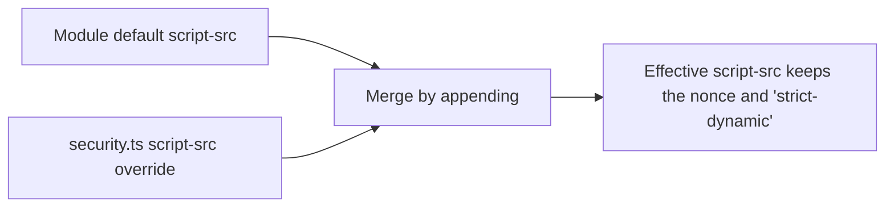

# nuxt-security defaults review

The module's defaults are the first thing a new app inherits, so the absorbed package starts from a reviewed set rather than from upstream's. This page reviews each header and option the module sets by default against published guidance. The package's defaults are written from the verdicts below.

The default set is the one `nuxt-security@2.6.0` ships in `defaultConfig.mjs`. Our app does not set `strict`, so the non-strict defaults apply, and the strict set is noted where it differs. Recommended values are quoted from the sources linked in the last section. Where a source could not be read, the verdict is marked undecided rather than filled from memory.

## Headers

| Header                                 | Module default                                                                                                                                                                                                                                                                                                                                                                                                                                                                                                                                                                                             | Recommended                                                                                                                                                                                                                                                                                                          | Verdict                                                                                                                                                                                                                                                                                                                                                                                                                                                                                                                     |
| :------------------------------------- | :--------------------------------------------------------------------------------------------------------------------------------------------------------------------------------------------------------------------------------------------------------------------------------------------------------------------------------------------------------------------------------------------------------------------------------------------------------------------------------------------------------------------------------------------------------------------------------------------------------- | :------------------------------------------------------------------------------------------------------------------------------------------------------------------------------------------------------------------------------------------------------------------------------------------------------------------- | :-------------------------------------------------------------------------------------------------------------------------------------------------------------------------------------------------------------------------------------------------------------------------------------------------------------------------------------------------------------------------------------------------------------------------------------------------------------------------------------------------------------------------- |
| `Content-Security-Policy`              | `base-uri 'none'`, `font-src 'self' https: data:`, `form-action 'self'`, `frame-ancestors 'self'`, `img-src 'self' data:`, `object-src 'none'`, `script-src-attr 'none'`, `style-src 'self' https: 'unsafe-inline'`, `script-src 'self' https: 'unsafe-inline' 'strict-dynamic' 'nonce-…'`, `upgrade-insecure-requests`. Strict: `default-src 'none'`; `connect-src`, `font-src`, `frame-src`, `img-src`, `manifest-src`, `media-src` and `worker-src` each `'self'` alone; `style-src 'self' 'nonce-…'`; `script-src 'self' 'strict-dynamic' 'nonce-…'`; and prerendered styles hashed (`ssg.hashStyles`) | OWASP: `default-src 'self'; form-action 'self'; base-uri 'self'; object-src 'none'; frame-ancestors 'none'`. Our `base-uri 'none'` is stricter than OWASP's `'self'` and stays. CSP3 §3.3 says `frame-ancestors` is ignored in a `<meta>` element, so it only protects when sent as a header, which the module does. | **Keep**: the package sets `default-src 'self'` (`packages/nuxt-security-module/src/services/getDefaultSecurityHeaders.ts`), so a fetch type without its own directive is limited to the same origin, which is the change this row asked for. `frame-ancestors 'self'` stays, not OWASP's `'none'`, because our agent console frames same-origin pages.                                                                                                                                                                     |
| `Strict-Transport-Security`            | `max-age=15552000; includeSubDomains` (180 days). Strict: `max-age=31536000; includeSubDomains; preload`                                                                                                                                                                                                                                                                                                                                                                                                                                                                                                   | OWASP: `max-age=63072000; includeSubDomains`. RFC 6797 §6.1.1 defines `max-age` in seconds from receipt, and §8.1 requires a UA to ignore the header over plain HTTP.                                                                                                                                                | **Keep**: the package sends `max-age=63072000; includeSubDomains`, the two-year `max-age` this row asked for. `preload` stays out: the preload list is a separate commitment to take on its own.                                                                                                                                                                                                                                                                                                                            |
| `X-Frame-Options`                      | `SAMEORIGIN`. Strict: `DENY`                                                                                                                                                                                                                                                                                                                                                                                                                                                                                                                                                                               | OWASP: `deny`. MDN: `DENY` blocks framing from any origin, and CSP `frame-ancestors` is the more complete control.                                                                                                                                                                                                   | **Keep** `SAMEORIGIN`. `DENY` would block our agent console, whose side pane frames same-origin pages (`apps/web/app/components/AgentConsole/Pane/SidePane.vue`).                                                                                                                                                                                                                                                                                                                                                           |
| `Referrer-Policy`                      | `no-referrer`                                                                                                                                                                                                                                                                                                                                                                                                                                                                                                                                                                                              | OWASP: `no-referrer`                                                                                                                                                                                                                                                                                                 | **Keep**.                                                                                                                                                                                                                                                                                                                                                                                                                                                                                                                   |
| `Permissions-Policy`                   | Empty allowlists for `camera`, `display-capture`, `fullscreen`, `geolocation` and `microphone`. The strict set is longer and disables more features.                                                                                                                                                                                                                                                                                                                                                                                                                                                       | OWASP lists a deny-by-default set of features in `ci/headers_add.json` in its repository, which the package's denials are taken from.                                                                                                                                                                                | **Keep**: the default lists the same features as OWASP's Permissions-Policy, one for one (`packages/nuxt-security-module/src/services/getDefaultSecurityHeaders.ts`), so the extension this row asked for is in place. Our `self` grants in `security.ts` stay: autoplay, camera, clipboard-read, clipboard-write, display-capture, fullscreen, gamepad and microphone. The default denies every other feature except `sync-xhr`, which it limits to the same origin, as OWASP does.                                        |
| `Cross-Origin-Opener-Policy`           | `same-origin`                                                                                                                                                                                                                                                                                                                                                                                                                                                                                                                                                                                              | OWASP: `same-origin`                                                                                                                                                                                                                                                                                                 | **Keep**.                                                                                                                                                                                                                                                                                                                                                                                                                                                                                                                   |
| `Cross-Origin-Embedder-Policy`         | `credentialless` in production, `unsafe-none` in development. The `nuxtAssets` server plugin (`apps/web/server/plugins/nuxtAssets.ts`) sets `credentialless` on `/_nuxt/` `.js` responses in development too. Strict: `require-corp` in production.                                                                                                                                                                                                                                                                                                                                                        | OWASP: `require-corp`. MDN: `require-corp` loads only same-origin resources, or those that set `Cross-Origin-Resource-Policy` to allow embedding; `credentialless` loads no-cors cross-origin resources without a CORP header, sending them without credentials.                                                     | **Keep** `credentialless`. Under `require-corp` a cross-origin no-cors load needs CORP permission, and a CORS-mode load needs a successful CORS check instead. Desmos is a CORS-mode load, since `useScript` gives a cross-origin script `crossorigin="anonymous"`; MediaPipe's script is loaded by the library itself. Whether each resource's response meets its request mode is unverified, so `require-corp` waits on that check in phase 2. This is a deliberate deviation from OWASP and the reason is recorded here. |
| `Cross-Origin-Resource-Policy`         | `same-origin`                                                                                                                                                                                                                                                                                                                                                                                                                                                                                                                                                                                              | OWASP: `same-origin`. The Fetch standard §3.7 allows `same-origin`, `same-site` and `cross-origin`.                                                                                                                                                                                                                  | **Keep**.                                                                                                                                                                                                                                                                                                                                                                                                                                                                                                                   |
| `X-Content-Type-Options`               | `nosniff`                                                                                                                                                                                                                                                                                                                                                                                                                                                                                                                                                                                                  | OWASP: `nosniff`                                                                                                                                                                                                                                                                                                     | **Keep**.                                                                                                                                                                                                                                                                                                                                                                                                                                                                                                                   |
| `X-DNS-Prefetch-Control`               | `off`                                                                                                                                                                                                                                                                                                                                                                                                                                                                                                                                                                                                      | OWASP: `off`                                                                                                                                                                                                                                                                                                         | **Keep**.                                                                                                                                                                                                                                                                                                                                                                                                                                                                                                                   |
| `X-Permitted-Cross-Domain-Policies`    | `none`                                                                                                                                                                                                                                                                                                                                                                                                                                                                                                                                                                                                     | OWASP: `none`                                                                                                                                                                                                                                                                                                        | **Keep**.                                                                                                                                                                                                                                                                                                                                                                                                                                                                                                                   |
| `Origin-Agent-Cluster`                 | `?1`                                                                                                                                                                                                                                                                                                                                                                                                                                                                                                                                                                                                       | MDN: `?1` asks for an origin-keyed agent cluster, and any other value is ignored.                                                                                                                                                                                                                                    | **Keep**.                                                                                                                                                                                                                                                                                                                                                                                                                                                                                                                   |
| `X-XSS-Protection`                     | `0`                                                                                                                                                                                                                                                                                                                                                                                                                                                                                                                                                                                                        | MDN: the header is non-standard and deprecated, and it recommends `Content-Security-Policy` instead. OWASP's recommended set does not list it.                                                                                                                                                                       | **Keep**: the package sends no `X-XSS-Protection`, as this row asked, since browsers no longer read it, and the serializer test pins that (`packages/nuxt-security-module/src/runtime/services/serializeSecurityHeaders.test.ts`). The `0` in the Module default column is upstream's value, which the package drops.                                                                                                                                                                                                       |
| `X-Download-Options`                   | `noopen`                                                                                                                                                                                                                                                                                                                                                                                                                                                                                                                                                                                                   | OWASP does not list it, and no source for it is read yet.                                                                                                                                                                                                                                                            | **Undecided**: read its source in phase 2 before a verdict.                                                                                                                                                                                                                                                                                                                                                                                                                                                                 |
| `X-Powered-By` (`hidePoweredBy: true`) | Removed from responses                                                                                                                                                                                                                                                                                                                                                                                                                                                                                                                                                                                     | Not read from a source for this review.                                                                                                                                                                                                                                                                              | **Undecided**: confirm the source in phase 2.                                                                                                                                                                                                                                                                                                                                                                                                                                                                               |

## Our overrides

`apps/web/configuration/security.ts` sets the module's options, and `apps/web/configuration/routeRules.ts` adds to it. Each override and whether it still makes sense:

| Override                                                                                                                                              | Where         | Still right?                                                                                                                                                                                                                                                                                                                                                                                                                                           |
| :---------------------------------------------------------------------------------------------------------------------------------------------------- | :------------ | :----------------------------------------------------------------------------------------------------------------------------------------------------------------------------------------------------------------------------------------------------------------------------------------------------------------------------------------------------------------------------------------------------------------------------------------------------- |
| `img-src` with `https:` on every route                                                                                                                | `security.ts` | **Keep**. Members embed images from anywhere on the web, and a per-route policy cannot hold in an app that navigates on the client; the accepted privacy cost is in the [security posture](../../architecture/security-posture/design.md).                                                                                                                                                                                                             |
| `script-src: "'unsafe-eval'"`                                                                                                                         | `security.ts` | **Keep**. The module appends a consumer's sources to the defaults (`packages/nuxt-security-module/src/services/mergeDirectives.ts` and `mergeSources.ts`), so `'unsafe-eval'` joins `'self'`, `https:`, `'strict-dynamic'` and the nonce rather than replacing them.                                                                                                                                                                                   |
| `script-src-elem` with the nonce, `self` and the two hosts that serve scripts                                                                         | `security.ts` | **Keep**. The override sets `script-src-elem`, which governs script elements in place of `script-src`, so it names the nonce itself: every script element the server renders carries the response's nonce, and a browser that reads CSP3 runs an inline script only with it, `'unsafe-inline'` being absent. The app prerenders nothing, so its pages carry no hashes. `security.test.ts` holds the nonce in the list and `'unsafe-inline'` out of it. |
| `style-src-elem` with `'unsafe-inline'` and `self`                                                                                                    | `security.ts` | **Keep**.                                                                                                                                                                                                                                                                                                                                                                                                                                              |
| `worker-src` with `self` and `blob:`                                                                                                                  | `security.ts` | **Keep**. It serves pdfjs and Desmos.                                                                                                                                                                                                                                                                                                                                                                                                                  |
| `permissionsPolicy` grants for `autoplay`, `camera`, `clipboard-read`, `clipboard-write`, `display-capture`, `fullscreen`, `gamepad` and `microphone` | `security.ts` | **Keep**. Each is a call the app makes: LiveKit, the PDF viewer, the Genshin world's music and controller input, and the copy buttons. `permissionsPolicy.test.ts` fails when a call has no grant.                                                                                                                                                                                                                                                     |
| `rateLimiter: false`                                                                                                                                  | `security.ts` | **Keep**. The rate limiter defects in the [upstream audit](../upstream/design.md) do not reach us while it is off.                                                                                                                                                                                                                                                                                                                                     |
| `requestSizeLimiter` from `MAX_REQUEST_SIZE` and `MAX_FILE_REQUEST_SIZE`                                                                              | `security.ts` | **Keep**. The module defaults are 2 MB and 8 MB, declared in `getDefaultModuleOptions`, and ours come from `MAX_REQUEST_SIZE` and `MAX_FILE_REQUEST_SIZE`, shared constants.                                                                                                                                                                                                                                                                           |

The module's middleware runs after the app's own `server/middleware` files, since Nitro lists the scanned files first and `addServerHandler` has no option to go ahead of them. The size limit wraps a body only for what runs after it, so no app middleware reads one, which `serverMiddlewareBody.test.ts` holds.

The `script-src` override, as the merge applies it:

## Key files

| File                                                                      | Role                                             |
| :------------------------------------------------------------------------ | :----------------------------------------------- |
| `apps/web/configuration/security.ts`                                      | The module's options and the app's overrides     |
| `apps/web/configuration/routeRules.ts`                                    | The route rules that add to the module's options |
| `packages/nuxt-security-module/src/services/getDefaultSecurityHeaders.ts` | The package's default header values              |

## Sources

- [OWASP Secure Headers Project](https://owasp.org/www-project-secure-headers/), whose recommended values are in its repository's [the recommended header list](https://raw.githubusercontent.com/OWASP/www-project-secure-headers/master/ci/headers_add.json).
- [CSP Level 3](https://www.w3.org/TR/CSP3/), for `frame-ancestors`, `script-src-elem` and the `'unsafe-inline'` rules.
- [Fetch standard](https://fetch.spec.whatwg.org/), §3.7 for `Cross-Origin-Resource-Policy`.
- [RFC 6797](https://www.rfc-editor.org/rfc/rfc6797), for `Strict-Transport-Security`.
- MDN: [`Cross-Origin-Embedder-Policy`](https://developer.mozilla.org/en-US/docs/Web/HTTP/Headers/Cross-Origin-Embedder-Policy), [`X-XSS-Protection`](https://developer.mozilla.org/en-US/docs/Web/HTTP/Headers/X-XSS-Protection), [`Origin-Agent-Cluster`](https://developer.mozilla.org/en-US/docs/Web/HTTP/Headers/Origin-Agent-Cluster) and [`X-Frame-Options`](https://developer.mozilla.org/en-US/docs/Web/HTTP/Headers/X-Frame-Options).
