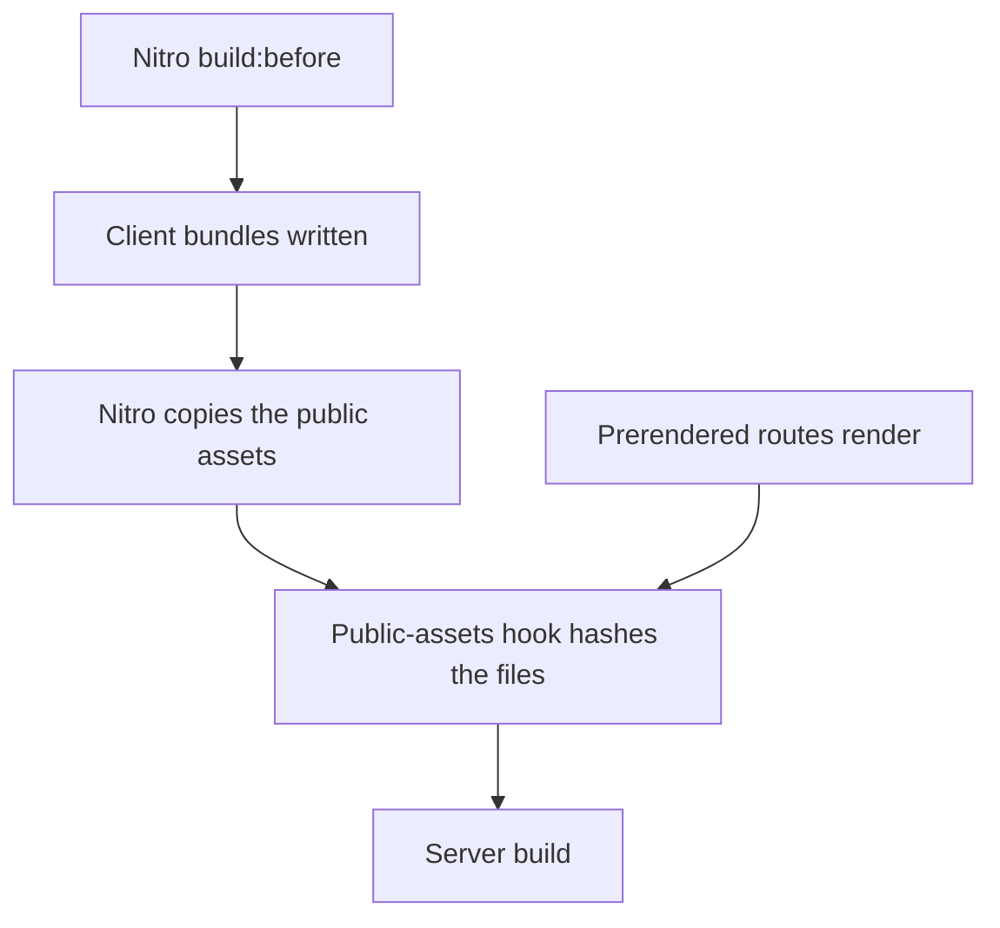

# nuxt-security upstream audit

This is the audit [nuxt-security-module](../README.md) owes before its code: every issue and pull request on [nuxt-security](https://github.com/Baroshem/nuxt-security), open and closed, and graded by the [dependency admission](../../architecture/dependency-admission/design.md) triage. The verdicts are the audit's record. Each defect's regression test lands with the code, named after its issue, and must fail against the upstream package before it passes against ours.

## How it was read

The upstream repository holds several hundred items, a little over half of them pull requests. Every one was read from its body and its comments, which the tracker's API returns in full. A first pass classified each item from its own text and comments, and every security-relevant verdict was then checked against the installed copy of the module. Where a verdict rests on the thread alone, the evidence says `unverified` and the phase that reproduces it is named in the defect list below.

Security severity is graded as [the spec](spec.md) requires.

## Counts

| Kind          | Items | Defect | Fixed upstream | Already built | Out of scope | False positive | Noise | Fix (PR) |
| :------------ | ----: | -----: | -------------: | ------------: | -----------: | -------------: | ----: | -------: |
| Issues        |   334 |     73 |              6 |            22 |           84 |            139 |    10 |        — |
| Pull requests |   382 |      — |              — |             — |            — |              1 |    31 |      350 |

Across the whole tracker, about a dozen items carry a high security severity and close to a hundred a medium one, whatever their kind. Pull requests are read as the issue they close, so a fix counts once against its issue, not again as a PR-FIX row where the thread links the two.

## What our configuration triggers

This audit compares against `nuxt-security@2.6.0`, the upstream package the module replaces. Four of its options decide which of its defects can reach the app:

- **The app runs no XSS validator**, so every XSS validator defect stays off the request path: the 400s and hangs on uploads, multipart and socket.io bodies (#147, #364, #400, #472, #616), the body consumed before tRPC reads it (#613), and the rich-text rejection (#720). The measurement behind that decision was taken against the `xss` package, which the app does not depend on.
- **`rateLimiter: false`** keeps the rate limiter defects off the path too: client-supplied `X-Forwarded-For` spoofing (#83, #196), the proxied-route skip (#619), and the prerender crash (#680). The rate limiter itself is ours to rebuild if we ever want one.
- **`csp` overrides** for `script-src`, `script-src-elem` and `style-src-elem` replace the module's defaults rather than extending them, which is a defect of our configuration and not an upstream one. The [defaults review](../defaults-review/design.md) records it.
- **`nonce: true`** is exposed to the nonce-handling defects. `nuxt-security` 2.6.0 carries the fixes for #594, #610, #699 and #704, which phase 2 pins with tests. The streaming defect #757 is still open and needs `experimental.ssrStreaming`, which our Nuxt config does not enable, so it does not reach us today.

The SRI defects that remain open are the ones to watch: `sri: true` is the default, and #655 and #657 concern how it treats preload links and entry import maps. #657 does not reach the built app: it needs an entry import map, and the app emits none, since `entryImportMap` is off in `apps/web/configuration/experimental.ts`. #655 does reach it. The module hashes every file the build writes to its public directory, the client bundles included, once Nitro has copied the public assets and before it builds the server, so each modulepreload link carries an integrity attribute. The hook is not Nitro's `build:before`, which runs before the client bundles are written. The built check ran on a minimal app built with the module, not on the app's root page: its `/_nuxt` script, its stylesheet and both of its modulepreload links each carry the sha384 of the bytes the server serves. Whether a browser ignores or warns on an integrity attribute on a preload link is the effect #655 reports, and no browser runs in the check, so #655 stays open. The module does not hash in development, which serves the bundles from memory. A prerendered route renders before the hook fires, by the order of Nitro's build, so it carries no client-bundle hash; that order is read from the build's source, not measured.

The build order the hook sits in:

## Verdicts

The table keeps each item whose verdict is a defect (`DEFECT`) or a request the module already serves (`ALREADY-BUILT`), newest first, with its evidence. The other items are counted in the [Counts](#counts) table above, by their verdict: `FIXED-UPSTREAM` for a defect that 2.6.0 does not have, `PR-FIX` for a pull request that fixes an issue, `FALSE-POSITIVE`, `OUT-OF-SCOPE`, and `NOISE` for a release, bump or placeholder with no behaviour in it. Each one is on the [upstream tracker](https://github.com/Baroshem/nuxt-security/issues).

| Upstream                                                     | Kind  | State  | Verdict       | Security | Evidence                                                                                                                                                                                                                                                |
| :----------------------------------------------------------- | :---- | :----- | :------------ | :------- | :------------------------------------------------------------------------------------------------------------------------------------------------------------------------------------------------------------------------------------------------------ |
| [#760](https://github.com/Baroshem/nuxt-security/issues/760) | Issue | open   | DEFECT        | medium   | Title says nonce CSP breaks inline styles with Tailwind; body truncated, unverified; may be CSP style-attribute semantics.                                                                                                                              |
| [#757](https://github.com/Baroshem/nuxt-security/issues/757) | Issue | open   | DEFECT        | medium   | With experimental.ssrStreaming, body scripts flushed before render:html get no nonce, so strict CSP blocks them.                                                                                                                                        |
| [#737](https://github.com/Baroshem/nuxt-security/issues/737) | Issue | open   | DEFECT        | none     | Module.ts sets Vite options that clash with Vite 8 esbuild and oxc options; unverified.                                                                                                                                                                 |
| [#732](https://github.com/Baroshem/nuxt-security/issues/732) | Issue | open   | DEFECT        | low      | Module assigns routeRules for /__nuxt_hints/** instead of merging, dropping user keys; csrf then blocks hints requests; reporter repro.                                                                                                                 |
| [#720](https://github.com/Baroshem/nuxt-security/issues/720) | Issue | open   | DEFECT        | medium   | xssValidator rejects valid rich-text POST because any sanitizer change is flagged; reproduction linked; unverified.                                                                                                                                     |
| [#681](https://github.com/Baroshem/nuxt-security/issues/681) | Issue | open   | DEFECT        | none     | bunx install reports incompatible version and ERR_PACKAGE_PATH_NOT_EXPORTED; reporter says the fix belongs in module package.json; unverified.                                                                                                          |
| [#680](https://github.com/Baroshem/nuxt-security/issues/680) | Issue | open   | DEFECT        | low      | useStorage called at module top level crashes prerender; build failure only; maintainer proposes moving init into handler.                                                                                                                              |
| [#678](https://github.com/Baroshem/nuxt-security/issues/678) | Issue | open   | DEFECT        | none     | Reporter says disabling the module stops ISR payload 404; maintainer cannot reproduce; middleware unidentified; unverified.                                                                                                                             |
| [#677](https://github.com/Baroshem/nuxt-security/issues/677) | Issue | open   | DEFECT        | low      | Maintainer suspects ZAP misreports; ACAO star on HTML pages not confirmed in a browser; unverified.                                                                                                                                                     |
| [#667](https://github.com/Baroshem/nuxt-security/issues/667) | Issue | closed | DEFECT        | medium   | Needs app: Nuxt payload inline script lacks nonce when CMS text has a quote; fixed by PR 670 patch                                                                                                                                                      |
| [#657](https://github.com/Baroshem/nuxt-security/issues/657) | Issue | open   | DEFECT        | medium   | SRI hashes mismatch with Nuxt 4 entryImportMap on dynamic imports; blocks scripts. Not reproduced in the built app: `entryImportMap` is off, and the built root page has no import map                                                                  |
| [#656](https://github.com/Baroshem/nuxt-security/issues/656) | Issue | closed | DEFECT        | medium   | Nonce undefined in production after 2.3.0; upgrade requested, closed, resolution not in digest; unverified                                                                                                                                              |
| [#655](https://github.com/Baroshem/nuxt-security/issues/655) | Issue | open   | DEFECT        | low      | SRI added to preload and modulepreload links per RFC; maintainer admits glitches possible. Now in the built app: each modulepreload link carries an integrity attribute. No browser runs in the build check, so its effect on the page is not observed. |
| [#651](https://github.com/Baroshem/nuxt-security/issues/651) | Issue | closed | DEFECT        | none     | TypeScript rejects csrf in per-route routeRules because module types omit it; fixed by PR 652                                                                                                                                                           |
| [#632](https://github.com/Baroshem/nuxt-security/issues/632) | Issue | open   | DEFECT        | low      | routeRules nitro plugin calls useRuntimeConfig without event, risking Cloudflare failure; maintainer report; unverified                                                                                                                                 |
| [#618](https://github.com/Baroshem/nuxt-security/issues/618) | Issue | open   | DEFECT        | none     | Relative cdnURL makes SSG build fail with Invalid URL; fix in PR 622 still open                                                                                                                                                                         |
| [#616](https://github.com/Baroshem/nuxt-security/issues/616) | Issue | closed | DEFECT        | medium   | xssValidator breaks multer uploads; maintainer says module-side; workaround xssValidator false                                                                                                                                                          |
| [#613](https://github.com/Baroshem/nuxt-security/issues/613) | Issue | open   | DEFECT        | medium   | XSS validator consumes request body so tRPC and other libraries cannot read it; module's own middleware                                                                                                                                                 |
| [#605](https://github.com/Baroshem/nuxt-security/issues/605) | Issue | closed | ALREADY-BUILT | none     | Built: the `contentSecurityPolicyReportOnly` option.                                                                                                                                                                                                    |
| [#602](https://github.com/Baroshem/nuxt-security/issues/602) | Issue | open   | DEFECT        | low      | Needs app: Redirect responses carry CSP with literal nonce-{{nonce}} placeholder; reporter repro; unverified                                                                                                                                            |
| [#595](https://github.com/Baroshem/nuxt-security/issues/595) | Issue | closed | DEFECT        | medium   | basicAuth read runtime config outside event handler, breaking Cloudflare; fixed by PR 599                                                                                                                                                               |
| [#594](https://github.com/Baroshem/nuxt-security/issues/594) | Issue | closed | DEFECT        | high     | Needs app: Nonce regex rewrites script text inside attributes, so sanitized HTML becomes executable; fixed by PR 658                                                                                                                                    |
| [#587](https://github.com/Baroshem/nuxt-security/issues/587) | Issue | closed | DEFECT        | medium   | Needs app: the upstream `70-securityHeaders.js` removes a `false` header only when it equals the route-rule value. The serializer probe passes; the plugin path is not reached by a unit probe.                                                         |
| [#586](https://github.com/Baroshem/nuxt-security/issues/586) | Issue | closed | DEFECT        | medium   | Needs app: Duplicate nonce attributes added beside nuxt/image nonces; fixed by PR 593 overriding them                                                                                                                                                   |
| [#576](https://github.com/Baroshem/nuxt-security/issues/576) | Issue | closed | DEFECT        | none     | removeLoggers minifier option stripped Tailwind utilities layer in prod; fixed by PR 577                                                                                                                                                                |
| [#515](https://github.com/Baroshem/nuxt-security/issues/515) | Issue | open   | DEFECT        | medium   | corsHandler origin not reflected, wildcard header persists; working route-level config per Morgbn comment; unverified                                                                                                                                   |
| [#505](https://github.com/Baroshem/nuxt-security/issues/505) | Issue | open   | DEFECT        | medium   | Default Access-Control-Allow-Origin overrides corsHandler origin per reporter; vejja confirms per-resource defaults; unverified                                                                                                                         |
| [#504](https://github.com/Baroshem/nuxt-security/issues/504) | Issue | open   | DEFECT        | low      | Per-page header rules from 1000-page SSG exceed Cloudflare Pages limit; workaround ssg.exportToPresets false per vejja                                                                                                                                  |
| [#472](https://github.com/Baroshem/nuxt-security/issues/472) | Issue | closed | DEFECT        | medium   | xssValidator hangs socket.io POST requests; reporter repro; one maintainer repro found an unrelated cause; unverified                                                                                                                                   |
| [#470](https://github.com/Baroshem/nuxt-security/issues/470) | Issue | closed | DEFECT        | low      | Default CSP and Permissions-Policy block Turnstile while docs promise default works; maintainers kept stricter default                                                                                                                                  |
| [#462](https://github.com/Baroshem/nuxt-security/issues/462) | Issue | closed | DEFECT        | none     | 2.0.0-rc.1 fails to start: defaultConfig import unresolved in requestSizeLimiter; patched by PR 463                                                                                                                                                     |
| [#453](https://github.com/Baroshem/nuxt-security/issues/453) | Issue | closed | DEFECT        | medium   | SRI breaks the app on mobile in v2 beta; no repro, reporter unable to isolate; unresolved in thread; unverified                                                                                                                                         |
| [#444](https://github.com/Baroshem/nuxt-security/issues/444) | Issue | closed | DEFECT        | low      | Needs app: CSP meta placed before charset, breaking charset-first rule and Lighthouse; fixed by PR 449                                                                                                                                                  |
| [#438](https://github.com/Baroshem/nuxt-security/issues/438) | Issue | closed | DEFECT        | none     | Published dist fails to resolve ../../../utils in 1.4.0 packaging; fixed in 1.4.2 by copying the replace-array defu                                                                                                                                     |
| [#434](https://github.com/Baroshem/nuxt-security/issues/434) | Issue | closed | ALREADY-BUILT | low      | Built: `getStaticResourceHeaders` sets the header subset on non-HTML responses.                                                                                                                                                                         |
| [#433](https://github.com/Baroshem/nuxt-security/issues/433) | Issue | closed | DEFECT        | medium   | Redis rate limiter driver options not forwarded, so it connects to localhost; fixed by PR 452                                                                                                                                                           |
| [#421](https://github.com/Baroshem/nuxt-security/issues/421) | Issue | closed | DEFECT        | medium   | readMultipartFormData not imported, so form submissions return 500 with the module enabled; fixed in 1.3.2                                                                                                                                              |
| [#419](https://github.com/Baroshem/nuxt-security/issues/419) | Issue | closed | DEFECT        | medium   | Default 1.3.0 config gives 500 on Netlify and console errors; dependency regression fixed in 1.3.1                                                                                                                                                      |
| [#415](https://github.com/Baroshem/nuxt-security/issues/415) | Issue | closed | DEFECT        | medium   | 1.3.0 SRI decoder throws on SSR and returns 500; fixed by PR 414 in 1.3.1                                                                                                                                                                               |
| [#413](https://github.com/Baroshem/nuxt-security/issues/413) | Issue | closed | DEFECT        | medium   | Needs app: 1.3.0 leaves nonce unset and CSP placeholder unexpanded, with 500s on Nuxt 3.11.1; patched in 1.3.1 per vejja                                                                                                                                |
| [#407](https://github.com/Baroshem/nuxt-security/issues/407) | Issue | closed | DEFECT        | medium   | Needs app: Nonce placeholder not replaced when CSP is set in the nuxt-security:headers hook; fixed by PR 408                                                                                                                                            |
| [#400](https://github.com/Baroshem/nuxt-security/issues/400) | Issue | closed | DEFECT        | medium   | XSS validator hangs multipart FormData uploads until timeout with no 400; reporter confirmed by disabling module; PR 401 proposed fix                                                                                                                   |
| [#393](https://github.com/Baroshem/nuxt-security/issues/393) | Issue | closed | DEFECT        | low      | Needs app: Cheerio decodeEntities default alters umlauts in SSR HTML; confirmed by vejja; fixed by PR 394                                                                                                                                               |
| [#392](https://github.com/Baroshem/nuxt-security/issues/392) | Issue | closed | ALREADY-BUILT | medium   | Built: `rateLimiter` is a route rule, since `SecurityRules` is `Partial<ModuleOptions>`.                                                                                                                                                                |
| [#373](https://github.com/Baroshem/nuxt-security/issues/373) | Issue | closed | DEFECT        | medium   | setHeader missing from build output so runtimeHooks headers never apply; fixed by PR 374; unverified                                                                                                                                                    |
| [#369](https://github.com/Baroshem/nuxt-security/issues/369) | Issue | closed | DEFECT        | medium   | Headers set via nuxt-security:ready hook not applied to responses; fixed by PR 370; unverified                                                                                                                                                          |
| [#364](https://github.com/Baroshem/nuxt-security/issues/364) | Issue | closed | DEFECT        | medium   | xssValidator rejects multipart binary bodies with 400; methods config added in 1.2.0; unverified                                                                                                                                                        |
| [#348](https://github.com/Baroshem/nuxt-security/issues/348) | Issue | closed | DEFECT        | none     | Server runtime import error from SSG preset importing @nuxt/kit; fixed in 1.0.1 per comment 393; unverified                                                                                                                                             |
| [#341](https://github.com/Baroshem/nuxt-security/issues/341) | Issue | closed | DEFECT        | none     | Cheerio HTML parsing in Nitro plugins slows render and exceeds Workers CPU limits; unverified                                                                                                                                                           |
| [#329](https://github.com/Baroshem/nuxt-security/issues/329) | Issue | closed | DEFECT        | low      | Needs app: frame-ancestors emitted in SSG meta tag where browsers ignore it, producing console error; unverified                                                                                                                                        |
| [#326](https://github.com/Baroshem/nuxt-security/issues/326) | Issue | closed | DEFECT        | low      | Needs app: SRI integrity added to rel=icon link fails html-validate; fixed by PR 328; unverified                                                                                                                                                        |
| [#321](https://github.com/Baroshem/nuxt-security/issues/321) | Issue | closed | DEFECT        | medium   | csp false in rc.5 removed a user-set CSP header from server middleware; fixed by PR 322 and 323; unverified                                                                                                                                             |
| [#319](https://github.com/Baroshem/nuxt-security/issues/319) | Issue | closed | DEFECT        | none     | declare module '@nuxt/schema' overwrote RuntimeConfig typing; fixed by PR 320; unverified                                                                                                                                                               |
| [#315](https://github.com/Baroshem/nuxt-security/issues/315) | Issue | closed | DEFECT        | low      | Header cleanup after response sent crashed when a nitro error hook is present; fixed by PR 318; unverified                                                                                                                                              |
| [#307](https://github.com/Baroshem/nuxt-security/issues/307) | Issue | closed | DEFECT        | none     | Spurious CSP warning about 'undefined' when contentSecurityPolicy is false; fixed by PR 304 and 311; unverified                                                                                                                                         |
| [#305](https://github.com/Baroshem/nuxt-security/issues/305) | Issue | closed | DEFECT        | medium   | Nuxt 3.8.1 silently dropped SRI integrity attributes in SSG pages; fixed in rc.5 per thread; unverified                                                                                                                                                 |
| [#297](https://github.com/Baroshem/nuxt-security/issues/297) | Issue | closed | DEFECT        | medium   | Production SRI hash mismatch blocked assets and site went down; cause unresolved, sri:false workaround; unverified                                                                                                                                      |
| [#292](https://github.com/Baroshem/nuxt-security/issues/292) | Issue | closed | ALREADY-BUILT | none     | Built: the route rules' `security` key sets headers per route.                                                                                                                                                                                          |
| [#281](https://github.com/Baroshem/nuxt-security/issues/281) | Issue | closed | DEFECT        | medium   | Rate limiter throttles server-side API calls inconsistently; RC1 rewrite per comment 539; unverified                                                                                                                                                    |
| [#279](https://github.com/Baroshem/nuxt-security/issues/279) | Issue | closed | ALREADY-BUILT | low      | Built: `injectSubresourceIntegrity` covers `preload` and `modulepreload` links.                                                                                                                                                                         |
| [#269](https://github.com/Baroshem/nuxt-security/issues/269) | Issue | closed | DEFECT        | low      | Rate limiter returns 429 during nuxt build; fix skips middleware at build time; unverified                                                                                                                                                              |
| [#268](https://github.com/Baroshem/nuxt-security/issues/268) | Issue | closed | ALREADY-BUILT | none     | Built: headers are set on `render:route` for pages, and the static subset reaches server routes.                                                                                                                                                        |
| [#266](https://github.com/Baroshem/nuxt-security/issues/266) | Issue | closed | DEFECT        | high     | Needs app: basicAuth protects only first listed path; other paths unauthenticated; fixed in rc.3 via PR 267; unverified                                                                                                                                 |
| [#263](https://github.com/Baroshem/nuxt-security/issues/263) | Issue | closed | ALREADY-BUILT | none     | Built: `ModuleOptions` is exported from `module.ts`.                                                                                                                                                                                                    |
| [#260](https://github.com/Baroshem/nuxt-security/issues/260) | Issue | open   | ALREADY-BUILT | low      | Built: basic auth's include paths go through `checkIsChallenged`, API routes included.                                                                                                                                                                  |
| [#232](https://github.com/Baroshem/nuxt-security/issues/232) | Issue | closed | ALREADY-BUILT | low      | Built: the defaults are reviewed against OWASP's `ci/headers_add.json` on the defaults review page.                                                                                                                                                     |
| [#231](https://github.com/Baroshem/nuxt-security/issues/231) | Issue | closed | DEFECT        | low      | Route rules fixed at build time so env config ignored; closed for #258 and PR 233; unverified                                                                                                                                                           |
| [#230](https://github.com/Baroshem/nuxt-security/issues/230) | Issue | closed | DEFECT        | medium   | Needs app: Null cache entry gives 500 under load in rate limiter; fixed by rc.1 rewrite per comment 255; unverified                                                                                                                                     |
| [#219](https://github.com/Baroshem/nuxt-security/issues/219) | Issue | closed | ALREADY-BUILT | none     | Built: basic auth has an `include` option.                                                                                                                                                                                                              |
| [#211](https://github.com/Baroshem/nuxt-security/issues/211) | Issue | closed | DEFECT        | medium   | CodeQL alert on bad HTML filtering regexp; tracking issue with no detail; unverified                                                                                                                                                                    |
| [#206](https://github.com/Baroshem/nuxt-security/issues/206) | Issue | closed | DEFECT        | medium   | XSS validator returns 400 on bare < or > and unwhitelisted tags; comment 117 locates escapeHTML path; unverified                                                                                                                                        |
| [#200](https://github.com/Baroshem/nuxt-security/issues/200) | Issue | closed | ALREADY-BUILT | none     | Built: `updateContentSecurityPolicy` fills the per-request placeholders.                                                                                                                                                                                |
| [#190](https://github.com/Baroshem/nuxt-security/issues/190) | Issue | closed | ALREADY-BUILT | none     | Built: `RateLimiterStore` takes an external store; the in-process one is the default.                                                                                                                                                                   |
| [#188](https://github.com/Baroshem/nuxt-security/issues/188) | Issue | closed | DEFECT        | none     | Types lacked throwError for three middlewares; fixed by PR 189, released 0.14.4; unverified                                                                                                                                                             |
| [#185](https://github.com/Baroshem/nuxt-security/issues/185) | Issue | closed | DEFECT        | medium   | xssValidation broke custom error.vue on thrown errors; fixed in 0.14.3, reporter confirmed.                                                                                                                                                             |
| [#183](https://github.com/Baroshem/nuxt-security/issues/183) | Issue | closed | DEFECT        | low      | Asks for dependency bumps after 32 Dependabot vulnerability alerts on the default branch; dependency-owned, no fix visible.                                                                                                                             |
| [#178](https://github.com/Baroshem/nuxt-security/issues/178) | Issue | closed | DEFECT        | medium   | Needs app: 0.13.0 deleted shared headers, dropping the SSG CSP meta tag; fixed by PR #181 and PR #179.                                                                                                                                                  |
| [#153](https://github.com/Baroshem/nuxt-security/issues/153) | Issue | closed | DEFECT        | medium   | 400 from xssValidator on Apollo requests in Nuxt 3.4.3; maintainer suspected, reporter did not confirm. Unverified.                                                                                                                                     |
| [#151](https://github.com/Baroshem/nuxt-security/issues/151) | Issue | closed | DEFECT        | none     | routeRules typing rejects the headers key; reporter's fix PR #155 closed as not reproducible. Unverified.                                                                                                                                               |
| [#147](https://github.com/Baroshem/nuxt-security/issues/147) | Issue | closed | DEFECT        | medium   | xssValidator rejects multipart FormData with files; disabling requestSizeLimiter throws TypeError. No fix visible in digest.                                                                                                                            |
| [#144](https://github.com/Baroshem/nuxt-security/issues/144) | Issue | closed | DEFECT        | medium   | basicAuth on /api/* blocks nuxt-content internal requests causing not-found pages; maintainer accepted, fix in PR #145.                                                                                                                                 |
| [#137](https://github.com/Baroshem/nuxt-security/issues/137) | Issue | closed | DEFECT        | medium   | Module middleware turns /api/ paths into 500 errors on Cloudflare Pages; cause unconfirmed, maintainer investigating.                                                                                                                                   |
| [#136](https://github.com/Baroshem/nuxt-security/issues/136) | Issue | closed | ALREADY-BUILT | medium   | Built: the defaults carry `script-src` with the nonce placeholder.                                                                                                                                                                                      |
| [#125](https://github.com/Baroshem/nuxt-security/issues/125) | Issue | closed | DEFECT        | medium   | basicAuth broke with server routes after a recent change; maintainer confirmed the regression and a fix plan, see PR #126.                                                                                                                              |
| [#117](https://github.com/Baroshem/nuxt-security/issues/117) | Issue | closed | ALREADY-BUILT | none     | Built: the `permissionsPolicy` option.                                                                                                                                                                                                                  |
| [#114](https://github.com/Baroshem/nuxt-security/issues/114) | Issue | closed | ALREADY-BUILT | none     | Built: `corsHandler` runs on h3's own request handling.                                                                                                                                                                                                 |
| [#109](https://github.com/Baroshem/nuxt-security/issues/109) | Issue | closed | ALREADY-BUILT | none     | Built: per-route rules through the route rules' `security` key.                                                                                                                                                                                         |
| [#108](https://github.com/Baroshem/nuxt-security/issues/108) | Issue | closed | ALREADY-BUILT | none     | Built: the SSG CSP meta tag through `insertContentSecurityPolicyMeta`.                                                                                                                                                                                  |
| [#107](https://github.com/Baroshem/nuxt-security/issues/107) | Issue | closed | ALREADY-BUILT | none     | Built: the CSRF middleware, a double submit cookie.                                                                                                                                                                                                     |
| [#98](https://github.com/Baroshem/nuxt-security/issues/98)   | Issue | closed | ALREADY-BUILT | none     | Built: the Permissions-Policy and extra header options.                                                                                                                                                                                                 |
| [#93](https://github.com/Baroshem/nuxt-security/issues/93)   | Issue | closed | DEFECT        | low      | Nitro 3.1.0 changed x-powered-by header casing so removal missed it; fixed in #94.                                                                                                                                                                      |
| [#86](https://github.com/Baroshem/nuxt-security/issues/86)   | Issue | closed | ALREADY-BUILT | low      | Built: the defaults set `default-src 'self'`.                                                                                                                                                                                                           |
| [#83](https://github.com/Baroshem/nuxt-security/issues/83)   | Issue | closed | DEFECT        | high     | Needs app: unverified: rate limiter keys on client-supplied X-Forwarded-For; spoofing bypasses the limit; closed not planned                                                                                                                            |
| [#64](https://github.com/Baroshem/nuxt-security/issues/64)   | Issue | closed | ALREADY-BUILT | none     | Built: a route rule with `enabled: false` excludes its route.                                                                                                                                                                                           |
| [#38](https://github.com/Baroshem/nuxt-security/issues/38)   | Issue | closed | ALREADY-BUILT | none     | Built: the same options per route through route rules.                                                                                                                                                                                                  |

## Decisions not built

- **XSS validator (#147, #364, #400, #472, #613, #616, #720).** Not built. Its filter rejects ordinary text a message carries, and passes a script once `escapeHtml` is off. The measurement is recorded in a comment in `apps/web/configuration/security.ts`. Rich text is sanitised at its Zod boundary instead.
- **CSRF (#150, #167, #203, #477, #583).** Rebuilt rather than depending on `nuxt-csurf`. Its defects sit in the csurf runtime (Node `crypto` imports that break serverless builds, a client composable, cookie handling on hosts), which a dependency would carry. The module sets a random token in a cookie on safe requests and refuses a state-changing request whose header does not repeat it, the double submit cookie that the [OWASP CSRF Prevention Cheat Sheet](https://cheatsheetseries.owasp.org/cheatsheets/Cross-Site_Request_Forgery_Prevention_Cheat_Sheet.html) describes.
- **Cookie-authenticated mutations while the module's CSRF is off.** `csrf` stays off, as `getDefaultModuleOptions` sets it and `apps/web/configuration/security.ts` never overrides it, so the session cookie is the guard. better-auth's default `SameSite=Lax` withholds that cookie from a cross-site POST. tRPC takes a mutation only as a POST, and a JSON body needs a CORS preflight the allowlist refuses. A `multipart/form-data` or `application/octet-stream` POST needs no preflight and does reach tRPC, but carries no cookie, so it runs without a session. No Origin or custom-header check guards tRPC. `SameSite` compares sites, not origins, so a page served from a sibling subdomain of the app's host would send the cookie. Loosening the cookie's SameSite would make the WebSocket handler (the WebSocket route under `apps/web/server/routes/ws/`) and every cookie-authenticated mutation reachable cross-site.
- **Feature requests (several dozen issues).** Each is triaged against one bar: a security best practice a Nuxt app reasonably needs (OWASP, MDN or W3C), cheap, and fitting the module's shape. None meets it as new work: about two dozen are already built (`ALREADY-BUILT`), and the rest are out of scope or over-engineering, as the counts above record.
- **Rate limiter per-route and client-IP header features (#392, #643).** Route rules carry a `rateLimiter` option, so a route's limit is set where the route is. A custom client-IP header is not built, as a client-written header is the spoofing defect #196 names.

## Key files

| File                                                    | Role                                                                           |
| :------------------------------------------------------ | :----------------------------------------------------------------------------- |
| `apps/web/configuration/security.ts`                    | The module's options, with the XSS validator measurement recorded in a comment |
| `apps/web/server/services/security/rateLimiter.test.ts` | The rate limiter driven through a real h3 handler                              |

## Fail-first results

Each regression test named after an issue was run against the installed upstream, nuxt-security 2.6.0, before it was accepted as a reproduction. A test that passes on the upstream code does not reproduce its defect, so each one takes one of three outcomes.

- **Fixed upstream** (#118, #194, #214, #395, #432, #647). The upstream code the test drives already returns what the test pins, so no defect remains in 2.6.0. #118's probe calls upstream's "defaultSecurityConfig" in `dist/defaultConfig.mjs` with the dev server URL, as `dist/module.mjs` does, and the origin it returns is the server's, not a wildcard. The upstream install is not kept, so the probe cannot rerun. The module's counterpart, `getDefaultModuleOptions`, sets the same origin from the same dev server URL. #194 was fixed by PR 195, #214 by PR 212, #432 by PR 429 in the 2.0 major, and #647 by PR 649 in 2.4.0. The five serializer probes ran against the header serializer in `dist/utils/headers.mjs`, and all five pass; their tests are behaviour tests, titled without the issue number. #395 ran against `generateHash` in `dist/utils/crypto.mjs`.
- **Needs app** (#587, #83, #196, #178, #329, #444, #326, #393, #586, #594, #667, #407, #413, #602, #230, #266). The defect sits in a Nitro plugin or middleware that closes over its own state, so a unit probe cannot reach it. For #587 the upstream plugin removes a `false` header only when it equals the route-rule value, a branch the serializer never reaches. A throwaway vitest drive that aliased `nitropack/runtime` and `h3` could not resolve the upstream's `nitropack` import, and the drive was removed. Each of these stays on the module's own tests, as the driven-through-the-harness outcome below records.
- **Does not reproduce.** None.
- **Driven through the app's harness.** `apps/web/server/services/security/rateLimiter.test.ts` drives the module's rate limiter through a real h3 handler: #83 and #196 pass against nuxt-security-module, so a forwarded address does not move the key. The rest of the needs-app set runs the Nuxt renderer's `render:route` and `render:html` hooks or a Nuxt build, which the app's Vitest harness does not run. They stay on the module's unit tests. The owner decided not to run them against the upstream, since the module's own regression tests, run against the package the app ships, are the check ([rejected](../../../rejected/nuxt-security-module/upstream-regression-harness/design.md)).
