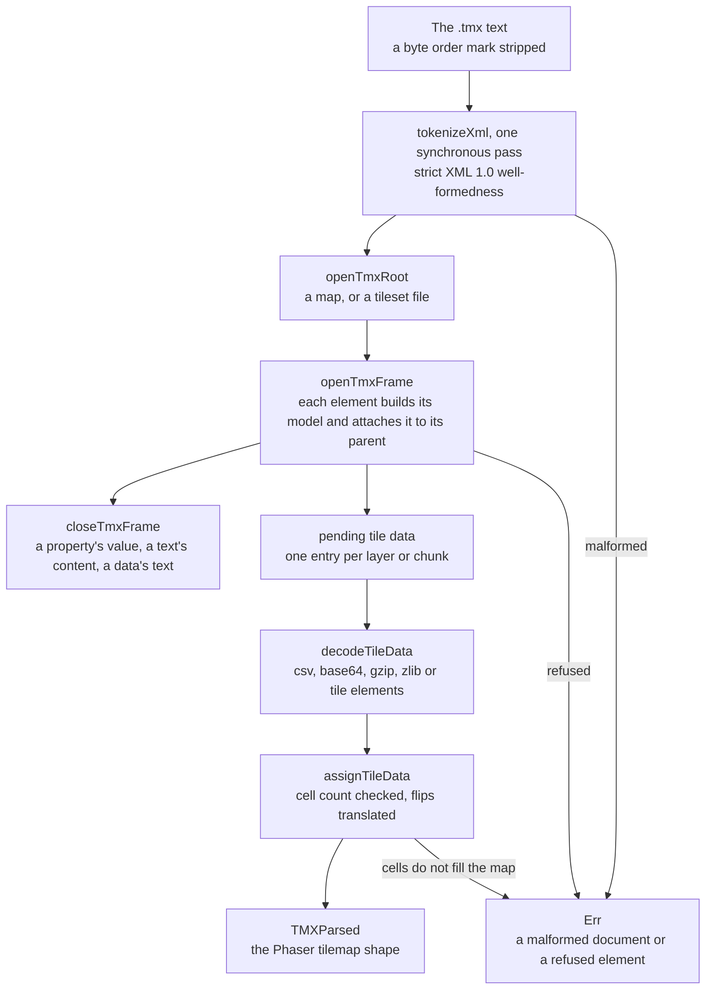

# parse-tmx

`packages/parse-tmx` (npm `parse-tmx`) reads a [Tiled Map Editor](http://www.mapeditor.org/) `.tmx` map into the tilemap shape Phaser's own JSON export produces, so a game loads a Tiled map without running Tiled. Its entry point is `parseTmx(xml, { isTranslateFlips })`, which resolves to a `Result` of a `TMXParsed` map. `parseTileset(xml)` reads a tileset file on its own, as the [vue-phaserjs](../vue-phaserjs/README.md) Tiled plugin does for an external tileset, and returns a `Result` of the embedded tileset it holds.

This is a rewrite. Rather than walking the generic object a separate XML package builds from the document, one function for each function of the upstream [tmx-map-parser](https://github.com/praghus/tmx-map-parser), it makes one pass of its own XML tokenizer and builds the typed models as the document opens, so no generic tree sits between the file and the map. The upstream's issues are still the ones it was judged by, below.

## How a document becomes a tilemap

`parseTmx` reads the text through the tokenizer once. Each element opens a frame that builds its own model and attaches it to its parent's model at that moment, so the map is complete as the reading ends. A frame closes only to read the character data it owns: a property's value, a text object's content and a layer's encoded cells. Tile data is decoded after the pass, because gzip and zlib decompression is asynchronous and the tokenizer is not.

- **One pass, one model.** Every model the reader fills is a `src/models` type, so the parsed map is the TMX model itself and no copy of it is made.
- **The map's data.** A tile layer's cells are one of Tiled's encodings: csv, or base64 with no compression, gzip or zlib, or the `<tile>` elements of the form Tiled deprecated. Each cell is a global tile id, whose high bits are its flips. A csv cell is read a character at a time, and a cell holding anything but a number is refused. `isTranslateFlips` turns those bits into the flip flags, and without it the id is kept as written. A finite layer must hold one cell per tile of its map; an infinite map's layers hold their cells in chunks, and each chunk must hold one cell per tile of its own size.
- **Tilesets.** A tileset that names a file is kept as the reference it is, with its `firstgid` and `source`. An embedded tileset keeps its attributes, its image when it has one, and its tiles. A tileset with no image is an image collection, and its tiles carry their own.
- **Objects.** An object is a rectangle until a shape child says otherwise: an ellipse, a point, a polygon or a polyline, whose points are read off the element. A text object's content is its `text`, and its styling attributes read as its properties.
- **Properties.** A property's value is its attribute, or its character data when it has no attribute, read as its type says: a `bool` is a boolean, an `int` or `float` is a number, and every other type stays a string. A `class` property holds nested properties in place of a value.
- **The output's order.** Layers keep the order the document gives them, since a map's draw order is that order, and a group's layers keep theirs.

## What it reads

The elements the reader models are the map, its `editorsettings` and `export`, tilesets with their `image` and `tile`, `animation` and `frame`, `layer`, `data` and `chunk`, `objectgroup`, `object` with its shapes and `text`, `imagelayer`, `group`, and `properties` with `property`. Tileset children the reader does not model (grids, tile offsets, wang sets, terrain types) are skipped, and so is any child of an element that is not modelled. A child of the map that is not a Tiled map element is refused by name, and so is a compression the reader does not decode: zstd, which no browser ships a decompressor for.

## Decisions

- **The package tokenizes its own XML, and nothing reads it generically.** `tokenizeXml` is one synchronous pass over the whole string, strict as XML 1.0's well-formedness rules are: the first malformed construct throws, naming its line and column from one, and that is the error the caller receives. The reader builds the typed models directly and keeps no object shaped like the XML.
- **The tokenizer reads the XML a Tiled file is written in, and no more.** Line endings and attribute whitespace are normalised as the standard says, the five predefined entities and character references are decoded, and comments, processing instructions, the declaration and a DOCTYPE are read past. There is no streaming, no loose HTML mode, no namespace resolution and no entity a DTD declares, which Tiled never writes.
- **Failures are `Result`s.** `parseTmx` and `parseTileset` return a `Result` whose error is an `InvalidOperationError` naming the step that refused the document, so a caller handles a bad map with `.match` and the reader never throws out of a call.
- **The output is Phaser's shape, with the types it actually holds.** The parsed map keeps the names Phaser's tilemap export uses. A layer's `type` is its element name, and numeric attributes such as `visible` and `opacity` stay numbers as Phaser reads them. A property's value follows its type. A string property holding `"1"` stays a string, where the upstream read it as a number.
- **Image collections are tilesets.** A tileset without an image is valid in Tiled, and its tiles carry their own images, so it parses rather than failing for want of one.
- **The Tiled format is a spec that changes without us.** The reader follows the TMX Map Format reference. A new element Tiled adds under the map is refused by name rather than skipped, since a map child carries layers, and skipping one would draw a map without its content.

## Upstream

### tmx-map-parser

Every issue of the upstream [tmx-map-parser](https://github.com/praghus/tmx-map-parser) repository, open and closed, graded by the [dependency admission triage](../architecture/dependency-admission/design.md). The repository's few issues each have a row below, and its pull requests are dependency updates, which the catalog owns.

| Upstream                                                                                | Verdict            | Proof                                                                                                                                                                                                                                                                          |
| --------------------------------------------------------------------------------------- | ------------------ | ------------------------------------------------------------------------------------------------------------------------------------------------------------------------------------------------------------------------------------------------------------------------------ |
| [#1](https://github.com/praghus/tmx-map-parser/issues/1) — modify and save `.tmx` files | Out of scope       | Declined by the maintainer, who called the upstream "a rather simple reader"; writing a map is a different product, and this package stays a reader                                                                                                                            |
| [#2](https://github.com/praghus/tmx-map-parser/issues/2) — handle groups                | In scope — feature | Built: a group's layers, and a group within a group, are read in document order; "parses a group's layers" in `parseTmx.test.ts` proves it                                                                                                                                     |
| [#4](https://github.com/praghus/tmx-map-parser/issues/4) — can't resolve `xml2js`       | False positive     | The upstream bundle imported an xml2js it did not declare. This package reads through its own tokenizer and declares no xml2js, so the module the issue could not resolve is not a dependency here; the verdict is the upstream's, and this package has no such import to fail |

### sax

Every issue and pull request of [sax](https://github.com/isaacs/sax-js), the XML tokenizer this package used before `tokenizeXml`, open and closed: 304 in all. Each in-scope verdict has a row, and its regression test names the issue; a defect sax has since fixed keeps its test as a pin. The rest are counted by class, with the tracker as the record of each:

- **Removed by construction: 58.** The tokenizer reads one whole string in one synchronous call, imports nothing from Node and is ESM TypeScript with no dependencies, so the streaming, back-pressure, `stream` import, CommonJS, typing and Node-version reports have nothing to apply to.
- **Out of scope: 133.** Loose HTML mode, namespace resolution, the parser's options and the events it emits that a Tiled file needs none of, and sax's own repository, documentation and benchmarks. Entities declared in a DTD's internal subset are among them: Tiled never writes a DTD, so such a reference is refused as an unknown entity, as sax's strict mode refuses it too.
- **False positive: 83.** Usage questions, duplicates, user errors, and defects a sax release already fixed outside the tokenizer's scope.

| Upstream                                                                                                                                                                                                                                                         | Verdict                           | Proof                                                                                                               |
| ---------------------------------------------------------------------------------------------------------------------------------------------------------------------------------------------------------------------------------------------------------------- | --------------------------------- | ------------------------------------------------------------------------------------------------------------------- |
| [sax#10](https://github.com/isaacs/sax-js/issues/10), [sax#73](https://github.com/isaacs/sax-js/issues/73) — Names in non-Latin scripts                                                                                                                          | In scope — defect, fixed upstream | `sax#10 sax#73 reads a name in any script XML allows`; a pin, since sax 1.6.1 passes it                             |
| [sax#97](https://github.com/isaacs/sax-js/issues/97) — An astral character reference decodes wrongly                                                                                                                                                             | In scope — defect, fixed upstream | `sax#97 decodes an astral character reference`; a pin                                                               |
| [sax#116](https://github.com/isaacs/sax-js/issues/116) — A reference with no digits throws a `RangeError`                                                                                                                                                        | In scope — defect, fixed upstream | `sax#116 refuses a character reference with no digits`; a pin                                                       |
| [sax#153](https://github.com/isaacs/sax-js/issues/153) — An unmatched close tag is reported as text                                                                                                                                                              | In scope — defect, fixed upstream | `sax#153 sax#184 refuses a close tag that does not match the open element, naming both`; a pin                      |
| [sax#250](https://github.com/isaacs/sax-js/issues/250) — An attribute on the root is refused                                                                                                                                                                     | In scope — defect, fixed upstream | `sax#250 reads an attribute on the root`; a pin                                                                     |
| [sax#266](https://github.com/isaacs/sax-js/issues/266) — Predefined entities beside a DOCTYPE                                                                                                                                                                    | In scope — defect, fixed upstream | `sax#266 decodes the predefined entities in a document with a DOCTYPE`; a pin                                       |
| [sax#287](https://github.com/isaacs/sax-js/issues/287) — A reference to a character XML forbids                                                                                                                                                                  | In scope — defect, fixed upstream | `sax#287 refuses a reference to a character XML does not allow`; a pin                                              |
| [sax#303](https://github.com/isaacs/sax-js/issues/303) — A quoted declaration swallows the document                                                                                                                                                              | In scope — defect, fixed upstream | `sax#303 refuses a declaration outside a DOCTYPE`; a pin                                                            |
| [sax#76](https://github.com/isaacs/sax-js/issues/76), [sax#166](https://github.com/isaacs/sax-js/issues/166), [sax#295](https://github.com/isaacs/sax-js/issues/295) — A repeated attribute is accepted                                                          | In scope — defect                 | `sax#76 sax#166 sax#295 refuses a repeated attribute`, which sax 1.6.1 fails                                        |
| [sax#86](https://github.com/isaacs/sax-js/issues/86), [sax#168](https://github.com/isaacs/sax-js/issues/168), [sax#182](https://github.com/isaacs/sax-js/issues/182), [sax#246](https://github.com/isaacs/sax-js/issues/246) — A second root element is accepted | In scope — defect                 | `sax#86 sax#168 sax#182 sax#246 refuses a second root element`, which sax fails                                     |
| [sax#125](https://github.com/isaacs/sax-js/issues/125), [sax#164](https://github.com/isaacs/sax-js/issues/164) — A document with no root element is accepted                                                                                                     | In scope — defect                 | `sax#164 refuses an empty document` and `sax#125 refuses a document with no root element`, which sax fails          |
| [sax#178](https://github.com/isaacs/sax-js/issues/178) — The `xml` target is accepted after the start                                                                                                                                                            | In scope — defect                 | `sax#178 refuses an XML declaration after the document's start`, which sax fails                                    |
| [sax#232](https://github.com/isaacs/sax-js/issues/232) — A processing instruction with no target                                                                                                                                                                 | In scope — defect                 | `sax#232 refuses a processing instruction with no target`, which sax fails                                          |
| [sax#233](https://github.com/isaacs/sax-js/issues/233) — A processing instruction ending `??>` runs on                                                                                                                                                           | In scope — defect                 | `sax#233 ends a processing instruction at its first ?>`, which sax fails                                            |
| [sax#298](https://github.com/isaacs/sax-js/issues/298) — A CDATA section outside the root is accepted                                                                                                                                                            | In scope — defect                 | `sax#298 refuses a CDATA section outside the root element`, which sax fails                                         |
| [sax#302](https://github.com/isaacs/sax-js/issues/302) — An attribute named `__proto__` is lost                                                                                                                                                                  | In scope — defect                 | `sax#302 keeps attributes named __proto__ and hasOwnProperty as attributes`, which sax fails                        |
| [sax#304](https://github.com/isaacs/sax-js/issues/304) — No line-ending or attribute-value normalisation                                                                                                                                                         | In scope — defect                 | `sax#304 normalises line endings, and an attribute's literal whitespace…`, which sax fails                          |
| [sax#307](https://github.com/isaacs/sax-js/issues/307) — A processing instruction in the internal subset                                                                                                                                                         | In scope — defect                 | `sax#307 reads past a DOCTYPE whose internal subset holds a processing instruction`, which sax fails                |
| [sax#184](https://github.com/isaacs/sax-js/issues/184) — The mismatch error should name the open tag                                                                                                                                                             | In scope — feature                | Built: `sax#153 sax#184 refuses a close tag that does not match the open element, naming both`                      |
| [sax#215](https://github.com/isaacs/sax-js/issues/215) — An element open at the end should throw                                                                                                                                                                 | In scope — feature                | Built: `sax#215 refuses an element left open at the end`                                                            |
| [sax#89](https://github.com/isaacs/sax-js/issues/89) — The open tag should say whether it self-closed                                                                                                                                                            | In scope — feature, declined      | A self-closing tag is an open and a close at once, and no reader of ours tells the two apart                        |
| [sax#220](https://github.com/isaacs/sax-js/issues/220), [sax#221](https://github.com/isaacs/sax-js/issues/221) — The error should carry line and column as properties                                                                                            | In scope — feature, declined      | The message names both, the error is the shared `InvalidOperationError`, and no caller reads a position as a number |

## Sources

- The upstream repository, [tmx-map-parser](https://github.com/praghus/tmx-map-parser), whose issues the verdicts above answer.
- The [Tiled map format](https://doc.mapeditor.org/en/stable/reference/tmx-map-format/), the specification the reader's models follow.
- Phaser's tilemap JSON export, the shape `parseTmx` produces.
- [sax](https://github.com/isaacs/sax-js), the tokenizer `tokenizeXml` replaced, whose issues the sax verdicts answer.
- [Extensible Markup Language (XML) 1.0, Fifth Edition](https://www.w3.org/TR/xml/), the well-formedness rules, the `Name` and `Char` productions and the normalisation `tokenizeXml` follows.

## Key Files

| File                                                    | Role                                                                  |
| :------------------------------------------------------ | :-------------------------------------------------------------------- |
| `packages/parse-tmx/src/parseTmx.ts`                    | The map entry point: the XML pass, then the decoded tile data         |
| `packages/parse-tmx/src/services/parseTileset.ts`       | The tileset-file entry point, for an external tileset                 |
| `packages/parse-tmx/src/services/tokenizeXml.ts`        | The XML 1.0 tokenizer: one strict pass, its errors at line and column |
| `packages/parse-tmx/src/services/readTmxDocument.ts`    | The tokenizer's driver: opens, closes and reads text into the frames  |
| `packages/parse-tmx/src/services/openTmxFrame.ts`       | Which child an element may hold, and the frame each one opens         |
| `packages/parse-tmx/src/services/openTmxLayerChild.ts`  | The layers a map holds, a tile layer's data and its chunks            |
| `packages/parse-tmx/src/services/openTmxObjectChild.ts` | An object group's objects, their shapes, gids and text                |
| `packages/parse-tmx/src/services/readTmxAttributes.ts`  | Each element's attribute table, read as the model its kinds say       |
| `packages/parse-tmx/src/index.ts`                       | The package's public surface: the entry points and the parsed types   |
| `packages/parse-tmx/src/services/closeTmxFrame.ts`      | The character data each element owns, read on close                   |
| `packages/parse-tmx/src/services/decodeTileData.ts`     | The tile layer's encodings and compression                            |
| `packages/parse-tmx/src/services/assignTileData.ts`     | The cell count check and the flip translation of decoded tile data    |
| `packages/parse-tmx/src/models/tmx/parsed`              | The parsed Phaser tilemap shapes the reader builds                    |
| `packages/parse-tmx/src/models/tmx/TMXFrame.ts`         | The frame each open element holds, typed by its tag                   |
