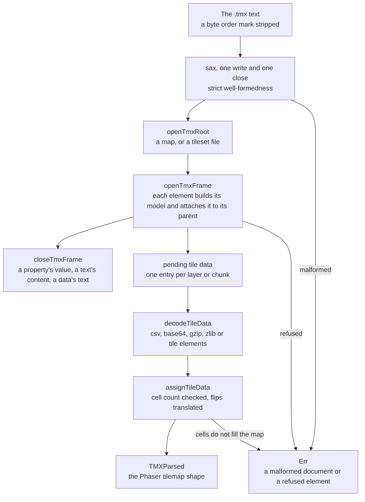

# parse-tmx

`packages/parse-tmx` (npm `parse-tmx`) reads a [Tiled Map Editor](http://www.mapeditor.org/) `.tmx` map into the tilemap shape Phaser's own JSON export produces, so a game loads a Tiled map without running Tiled. Its entry point is `parseTmx(xml, translateFlips)`, which resolves to a `Result` of a `TMXParsed` map. `parseTileset(xml)` reads a tileset file on its own, as the [vue-phaserjs](../vue-phaserjs/README.md) Tiled plugin does for an external tileset, and returns a `Result` of the embedded tileset it holds.

This is a rewrite. The reader used to walk the generic object a separate XML package built from the document, one function for each function of the upstream [tmx-map-parser](https://github.com/praghus/tmx-map-parser). It now makes one sax pass and builds the typed models as the document opens, so no generic tree sits between the file and the map. The upstream's issues are still the ones it was judged by, below.

## How a document becomes a tilemap

`parseTmx` writes the text through sax once. Each element opens a frame that builds its own model and attaches it to its parent's model at that moment, so the map is complete as the reading ends. A frame closes only to read the character data it owns: a property's value, a text object's content and a layer's encoded cells. Tile data is decoded after the pass, because gzip and zlib decompression is asynchronous and sax is not.

- **One pass, one model.** Every model the reader fills is a `src/models` type, so the parsed map is the TMX model itself and no copy of it is made.
- **The map's data.** A tile layer's cells are one of Tiled's encodings: csv, or base64 with no compression, gzip or zlib, or the `<tile>` elements of the form Tiled deprecated. Each cell is a global tile id, whose high bits are its flips. A csv cell is read a character at a time, and a cell holding anything but a number is refused. `translateFlips` turns those bits into the flip flags, and without it the id is kept as written. A finite layer must hold one cell per tile of its map; an infinite map's layers hold their cells in chunks, each with its own size.
- **Tilesets.** A tileset that names a file is kept as the reference it is, with its `firstgid` and `source`. An embedded tileset keeps its attributes, its image when it has one, and its tiles. A tileset with no image is an image collection, and its tiles carry their own.
- **Objects.** An object is a rectangle until a shape child says otherwise: an ellipse, a point, a polygon or a polyline, whose points are read off the element. A text object's content is its `text`, and its styling attributes read as its properties.
- **Properties.** A property's value is its attribute, or its character data when it has no attribute, read as its type says: a `bool` is a boolean, an `int` or `float` is a number, and every other type stays a string. A `class` property holds nested properties in place of a value.
- **The output's order.** Layers keep the order the document gives them, since a map's draw order is that order, and a group's layers keep theirs.

## What it reads

The elements the reader models are the map, its `editorsettings` and `export`, tilesets with their `image` and `tile`, `animation` and `frame`, `layer`, `data` and `chunk`, `objectgroup`, `object` with its shapes and `text`, `imagelayer`, `group`, and `properties` with `property`. Tileset children the reader does not model (grids, tile offsets, wang sets, terrain types) are skipped, and so is any child of an element that is not modelled. A child of the map that is not a Tiled map element is refused by name, and so is a compression the reader does not decode: zstd, which no browser ships a decompressor for.

## Decisions

- **sax reads the document, and nothing reads it generically.** A document is checked by sax's strict well-formedness rules; the first error sax reports is the error the caller receives. The reader builds the typed models directly and keeps no object shaped like the XML.
- **Failures are `Result`s.** `parseTmx` and `parseTileset` return a `Result` whose error is an `InvalidOperationError` naming the step that refused the document, so a caller handles a bad map with `.match` and the reader never throws out of a call.
- **The output is Phaser's shape, with the types it actually holds.** The parsed map keeps the names Phaser's tilemap export uses. A layer's `type` is its element name, and numeric attributes such as `visible` and `opacity` stay numbers as Phaser reads them. A property's value follows its type, which is the one place the output changed: a string property holding `"1"` stays a string, where the upstream read it as a number.
- **Image collections are tilesets.** A tileset without an image is valid in Tiled, and its tiles carry their own images, so it parses rather than failing for want of one.
- **The Tiled format is a spec that changes without us.** The reader follows the TMX Map Format reference. A new element Tiled adds under the map is refused by name rather than skipped, since a map child carries layers, and skipping one would draw a map without its content.

## Upstream

Every issue of the upstream [tmx-map-parser](https://github.com/praghus/tmx-map-parser) repository, open and closed, graded by the [dependency admission triage](../architecture/dependency-admission/design.md). The repository has three issues, and its pull requests are dependency updates, which the catalog owns.

| Upstream                                                                                | Verdict            | Proof                                                                                                                                                                                                                                                            |
| --------------------------------------------------------------------------------------- | ------------------ | ---------------------------------------------------------------------------------------------------------------------------------------------------------------------------------------------------------------------------------------------------------------- |
| [#1](https://github.com/praghus/tmx-map-parser/issues/1) — modify and save `.tmx` files | Out of scope       | Declined by the maintainer, who called the upstream "a rather simple reader"; writing a map is a different product, and this package stays a reader                                                                                                              |
| [#2](https://github.com/praghus/tmx-map-parser/issues/2) — handle groups                | In scope — feature | Built: a group's layers, and a group within a group, are read in document order; "parses a group's layers" in `parseTmx.test.ts` proves it                                                                                                                       |
| [#4](https://github.com/praghus/tmx-map-parser/issues/4) — can't resolve `xml2js`       | False positive     | The upstream bundle imported an xml2js it did not declare. This package reads through sax and declares no xml2js, so the module the issue could not resolve is not a dependency here; the verdict is the upstream's, and this package has no such import to fail |

## Sources

- The upstream repository, [praghus/tmx-map-parser](https://github.com/praghus/tmx-map-parser), whose issues the verdicts above answer.
- The [Tiled map format](https://doc.mapeditor.org/en/stable/reference/tmx-map-format/), the specification the reader's models follow.
- Phaser's tilemap JSON export, the shape `parseTmx` produces.

## Key Files

| File                                                    | Role                                                                |
| :------------------------------------------------------ | :------------------------------------------------------------------ |
| `packages/parse-tmx/src/parseTmx.ts`                    | The map entry point: the sax pass, then the decoded tile data       |
| `packages/parse-tmx/src/services/parseTileset.ts`       | The tileset-file entry point, for an external tileset               |
| `packages/parse-tmx/src/services/readTmxDocument.ts`    | The sax driver: opens, closes and reads text into the frames        |
| `packages/parse-tmx/src/services/openTmxFrame.ts`       | Which child an element may hold, and the frame each one opens       |
| `packages/parse-tmx/src/services/openTmxLayerChild.ts`  | The layers a map holds, a tile layer's data and its chunks          |
| `packages/parse-tmx/src/services/openTmxObjectChild.ts` | An object group's objects, their shapes, gids and text              |
| `packages/parse-tmx/src/services/readTmxAttributes.ts`  | Each element's attribute table, read as the model its kinds say     |
| `packages/parse-tmx/src/api.ts`                         | The package's public surface: the entry points and the parsed types |
| `packages/parse-tmx/src/services/closeTmxFrame.ts`      | The character data each element owns, read on close                 |
| `packages/parse-tmx/src/services/decodeTileData.ts`     | The tile layer's encodings and compression                          |
| `packages/parse-tmx/src/services/assignTileData.ts`     | The cell count check and the flip translation of decoded tile data  |
| `packages/parse-tmx/src/models/tmx/parsed`              | The parsed Phaser tilemap shapes the reader builds                  |
| `packages/parse-tmx/src/models/tmx/TMXFrame.ts`         | The frame each open element holds, typed by its tag                 |
