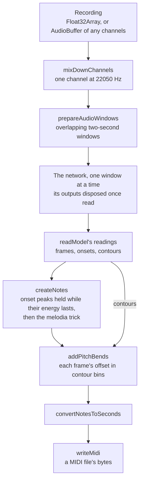

# pitch-transcription

`packages/pitch-transcription` (npm `pitch-transcription`) hears the notes played in a recording: each note's pitch, start, length, loudness and pitch bend. The hearing is Spotify's Basic Pitch, a small trained network that reads several notes at once on any instrument. The package ships the network's published ONNX export unmodified, runs it on the consumer's own ONNX Runtime session, and turns the network's readings into notes, bends and a MIDI file.

It replaced `@spotify/basic-pitch`, which held its consumers to TensorFlow.js 3, and is absorbed through [dependency admission](../architecture/dependency-admission/design.md): the engine (ONNX Runtime, a peer the consumer installs) and the data (the model file) are kept, and the layer between them is ours. TensorFlow.js left the package and the workspace when the network moved onto ONNX Runtime. Its first consumer is the [Genshin music](../genshin/music/README.md) re-derivation, whose fit transcribes the game's decoded sources with it.

## How a recording becomes notes

The network reads two-second windows of one channel at 22050 Hz, a hop of 256 samples to a frame, and gives three readings for every frame: how strongly each of a piano's 88 keys sounds (frames), how strongly each starts (onsets), and the pitch's finer contour at three bins to a semitone (contours). Everything after it is arithmetic over those arrays.

- **Reading.** `readModel` pads the recording with half a window's overlap of silence first, then runs the network one window at a time on an inference session. Every window is a view over that one padded buffer, so nothing is copied per window. Each output is read as its rows, trimmed of its overlap and of anything past the recording's end, and disposed. The loop stops once the readings cover the recording, so memory holds one window's outputs whatever the recording's length.
- **Notes.** `createNotes` is the model repository's `output_to_notes_polyphonic`. Each onset peak — larger than the frames either side, above the onset threshold — starts a note, latest first, that lasts until its key's energy stays under the frame threshold for the energy tolerance, and claims that energy for its key and its neighbours. Inferred onsets add peaks where a key's frame reading jumps. Under the melodia trick the energy no onset claimed is then followed outward from its largest reading into further notes. The readings handed in are never changed.
- **Bends.** `addPitchBends` picks, for each frame of a note, the contour bin within 25 of the note's own whose reading — weighted by a Gaussian centred on the note — is largest, and records its offset in bins.
- **MIDI.** `writeMidi` writes the file's bytes itself, one note track with each note's amplitude its velocity and each bend its share of the bend's two-semitone range. Its output is pinned to the bytes `@tonejs/midi` wrote for the same notes, the library it replaced.

`pitch-transcription/notes` exports note creation, bends, timing and MIDI alone, so a worker holding readings never loads ONNX Runtime. `onnxruntime-common` is a peer dependency, the interface both `onnxruntime-node` and `onnxruntime-web` implement, and the package builds its input tensors from it. The consumer creates the session from `MODEL_URL` with the runtime it chooses. A runtime reads a feed's type, dimensions and data rather than its class, so the package's tensors run on whichever runtime the consumer brings, and the peer leaves that choice to the consumer rather than making it for them.

## Decisions

- **ONNX Runtime over TensorFlow.js.** TensorFlow.js has had no release since October 2024, and under Node its CPU backend reads a window about a hundred times slower than ONNX Runtime does. Basic Pitch publishes the same network as an ONNX export, which ships unmodified, and ONNX Runtime is already installed by Transformers.js, so the engine adds no dependency. Narrowing TensorFlow.js to its core, and a runtime of our own for its graph format, were both rejected: the first keeps a dormant engine, the second writes an engine.
- **The model repository is the reference.** Where the TypeScript port and the Python model repository disagree, the package follows Python: a frequency range rounds to its nearest key, the first and last frames are never an onset peak (SciPy's `argrelmax` clips them), and a tie between readings goes to the earliest frame and lowest key (NumPy's `argmax`). The Gaussian weighting the bends stays symmetric about the note's own bin, where SciPy's periodic window centres it half a bin high.
- **One sort for the melodia trick.** Energy is only ever zeroed, so the largest reading left is always the largest not yet claimed. The candidates are sorted once and walked, where the port rescanned every reading of the recording for each note. `createNotes.bench.md` prices the trick against the onset pass alone over one and five minutes of music. It adds a small share at both lengths, and the cost grows with the length rather than with its square.
- **No inferred frame threshold.** The port infers the frame threshold from the frames' mean and deviation only when handed `null` against its own types; here the option is a number, defaulting to Basic Pitch's own.
- **No "adjustNoteStart".** It shifted every note's start by an offset, a one-line map, and returned the wrong field name besides; a caller maps its own notes.

## Upstream

Every issue and pull request on [basic-pitch-ts](https://github.com/spotify/basic-pitch-ts), read with its comments and judged by the [dependency admission triage](../architecture/dependency-admission/design.md). Where a row is a defect we fixed, its proof is the test the row names, beside the source it fixes.

| Upstream                                  | Verdict            | Proof                                                                                                                                                                                                                             |
| ----------------------------------------- | ------------------ | --------------------------------------------------------------------------------------------------------------------------------------------------------------------------------------------------------------------------------- |
| #20, #21, #13 — update TensorFlow.js      | Resolved           | TensorFlow.js left the catalog, the manifests and the lock; the network runs on ONNX Runtime, a peer Renovate moves                                                                                                               |
| #18 — the model is not exported           | In scope — feature | `MODEL_URL`, the ONNX export, read by "hears a tone's pitch" in `readModel.test.ts`                                                                                                                                               |
| #25 — export "generateFileData"           | In scope — feature | "#25 returns a Uint8Array a browser holds, not a Node Buffer" in `writeMidi.test.ts`                                                                                                                                              |
| #9 — stereo input refused                 | In scope — defect  | "#9 averages a stereo recording's channels" in `mixDownChannels.test.ts`                                                                                                                                                          |
| #8 — shortest note default                | In scope — feature | `MIN_NOTE_LENGTH` is eleven frames, the length the Basic Pitch site uses                                                                                                                                                          |
| #19 — the main thread held                | In scope — feature | "#19 loads the notes subpath without ONNX Runtime" in `index.test.ts`, which fails on any ONNX Runtime specifier in the subpath's module graph; running the network off the main thread is the consumer's, in a worker of its own |
| #17 — the pitch bends' units              | In scope — defect  | "#17 writes a bend as its share of the bend's range, held at its edge" in `writeMidi.test.ts`; the port wrote a count of thirds of a semitone as a raw value                                                                      |
| #22 — no transcription on newer iPhones   | Resolved           | TensorFlow.js's WebGL backend is on no path: the network runs on ONNX Runtime                                                                                                                                                     |
| #23 — `Long.fromString is not a function` | Resolved           | TensorFlow.js's hashing under a bundler's interop with `long` is on no path: TensorFlow.js is not a dependency                                                                                                                    |
| #24 — a TensorFlow Lite model             | Out of scope       | Which network is trained and published is the Basic Pitch model repository's                                                                                                                                                      |
| #12 — real time                           | Out of scope       | The network reads overlapping windows of seconds, as the model repository's own issue explains                                                                                                                                    |
| #7 — spreading a non-iterable             | False positive     | A usage slip accumulating the per-window readings; `readModel` returns them accumulated                                                                                                                                           |
| #6, #10, #16 — examples and docs          | False positive     | The README's Getting Started carries the usage, the sample rate and the channels                                                                                                                                                  |
| #1–#5, #11 — release housekeeping         | False positive     | No behaviour; #5's bundled model is carried                                                                                                                                                                                       |

Reading the source turned up defects nobody has filed, each reproduced against the port and given its test:

| Found in the source                                     | Proof                                                                                         |
| ------------------------------------------------------- | --------------------------------------------------------------------------------------------- |
| No tensor is ever disposed, so memory grows with length | "disposes every output it reads" in `readModel.test.ts`                                       |
| Windows past the recording's end still run              | "runs no window past the recording's last frame" in `readModel.test.ts`                       |
| A frequency range zeroes the caller's own readings      | "leaves the readings it is handed unchanged under a frequency range" in `createNotes.test.ts` |
| "adjustNoteStart" returns `pitch_midi` for `pitchMidi`  | Not carried — see Decisions                                                                   |

## Upstream: @tonejs/midi

The MIDI writer was [@tonejs/midi](https://github.com/Tonejs/Midi) until it was rewritten here. Its tracker holds 107 issues, read by title and, for the ones on the writer's path, with their bodies and comments, judged by the [dependency admission triage](../architecture/dependency-admission/design.md). The writer's bytes are pinned to what the library wrote for the same notes, so a defect the library had on that path it still has, and the rows say which.

| Upstream                                               | Verdict            | Proof                                                                                                                                                 |
| ------------------------------------------------------ | ------------------ | ----------------------------------------------------------------------------------------------------------------------------------------------------- |
| #80 — pitch bends                                      | In scope — feature | A bend's value and its tick in "#17 writes a bend as its share of the bend's range, held at its edge" in `writeMidi.test.ts`                          |
| #174 — a velocity of 0 is a note off                   | In scope — defect  | `writeMidi` clamps the velocity to 1..127, proven by the test "#174 a quiet note still sounds and a loud one stays a velocity" in `writeMidi.test.ts` |
| #149, #182, #187 — the end of track                    | Carried            | The end of track sits at the last event's tick, as the library wrote it; pinned by the byte tests in `writeMidi.test.ts`                              |
| #162, #117 — ES modules under Node                     | Resolved           | No dependency: the package loads as ESM with no CommonJS interop, "loads under plain Node" in `index.test.ts`                                         |
| #184 — control changes                                 | Out of scope       | The writer writes no control change; a caller needing one has no path here                                                                            |
| #52, #98, #116, #161 — reading tempos and the header   | Out of scope       | The writer never parses a file, and writes a fixed 120 beats a minute                                                                                 |
| The rest — parsing, JSON, instruments, lyrics, loaders | Out of scope       | None is on the writer's path: the reads, the JSON conversions, the instrument tables, the browser loaders and the demos                               |

## Key files

| File                                                         | Role                                                         |
| ------------------------------------------------------------ | ------------------------------------------------------------ |
| `packages/pitch-transcription/src/services/readModel.ts`     | The network over a recording, a window at a time             |
| `packages/pitch-transcription/src/services/createNotes.ts`   | The readings turned into notes                               |
| `packages/pitch-transcription/src/services/addPitchBends.ts` | Each note's bend per frame                                   |
| `packages/pitch-transcription/src/services/writeMidi.ts`     | Notes as MIDI bytes                                          |
| `packages/pitch-transcription/src/notes.ts`                  | The entry without ONNX Runtime                               |
| `packages/pitch-transcription/model`                         | The trained model, its ONNX export unmodified, with `NOTICE` |

## Sources

- [spotify/basic-pitch-ts](https://github.com/spotify/basic-pitch-ts) — the package absorbed, its tracker and its Apache-2.0 licence.
- [spotify/basic-pitch](https://github.com/spotify/basic-pitch) — the model repository: its constants and note creation modules, and its issue on real-time transcription.
- [spotify/basic-pitch — `saved_models/icassp_2022`](https://github.com/spotify/basic-pitch/tree/main/basic_pitch/saved_models/icassp_2022) — the ONNX export shipped in place of the TensorFlow.js one, beside the TensorFlow Lite and Core ML exports of the same saved model.
- [ONNX Runtime — JavaScript API](https://onnxruntime.ai/docs/api/js/) — `InferenceSession`, `Tensor`, and `onnxruntime-common` as the interface shared by `onnxruntime-node` and `onnxruntime-web`.
- [tensorflow/tfjs — releases](https://github.com/tensorflow/tfjs/releases) — 4.22.0, October 2024, the last.
- [A Lightweight Instrument-Agnostic Model for Polyphonic Note Transcription and Multipitch Estimation](https://arxiv.org/abs/2203.09893), Bittner et al., ICASSP 2022 — the network and its three readings.
- [`scipy.signal.argrelmax`](https://docs.scipy.org/doc/scipy/reference/generated/scipy.signal.argrelmax.html) — the edge clipping the onset peaks follow.
