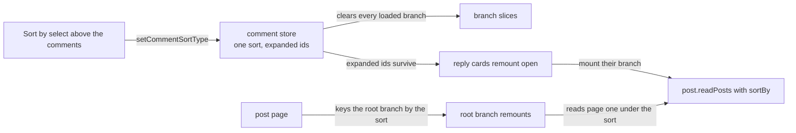

# Comment sort

A post's comments have a **Sort by** select above them, with four orders: Hot (the ranked order replies have always had), Top, New and Old. The chosen order applies to every reply branch the reader has open, not only the top level, so changing it reads a conversation again from its first page in the new order. The feed's own Sort by, over Hot, New and Top, is the [feed and ranking](../feed-and-ranking/design.md) page's, and the two share one sort map.

## How it works

| Option | `sortBy`                    |
| ------ | --------------------------- |
| Hot    | `ranking` desc, `id` desc   |
| Top    | `likeCount` desc, `id` desc |
| New    | `createdAt` desc, `id` desc |
| Old    | `createdAt` asc, `id` asc   |

- **One map.** `PostSortType` carries Old, and `PostSortTypeSortByMap` maps it, so the feed and the comments read the same table. The feed's select lists only Hot, New and Top; Old orders a thread and is not a feed order. Each select draws its options through one helper, so the marks come from one icon map.
- **One sort for the whole tree.** The comment store holds the chosen sort once. Every branch reads its pages with it. Changing the sort clears every loaded branch, so no open branch keeps rows the old order read.
- **The root branch remounts.** A branch reads its first page in setup, and a branch that is already mounted does not run setup again. The post page keys the root branch by the sort, so the root remounts and reads under the new order.
- **Expansion lives in the store.** Which replies are open is a set of comment ids in the store, not a flag on each card. A remounted card therefore comes back open and mounts its branch, which reads its own first page under the current sort.
- **Per visit, not persisted.** Opening a post starts the sort at Hot and closes every reply. The sort is not written to storage, so a reload also starts at Hot.
- **Old pages from the top of the thread.** The cursor compares compound keys lexicographically in either direction, so Old's ascending `(createdAt, id)` pages reach every reply once.

## What is not in it

- **No Best.** Reddit's Best ranks by the Wilson lower bound of the upvote fraction, which needs positive and total counts kept apart. Our `likeCount` is a net sum, and Hot already favours a well-liked early reply.
- **No Controversial or Q&A.** Controversial needs the same split counts, and Q&A needs an author-reply signal the model does not carry.

## Notes

- A cursor from one order is meaningless under another, so the only correct page one is a fresh read.

## Key files

Paths relative to `apps/web`.

| File                                              | Role                                                        |
| ------------------------------------------------- | ----------------------------------------------------------- |
| `app/pages/post/[id].vue`                         | opens the post, resets its sort and keys the root branch    |
| `app/components/Post/Comment/SortSelect.vue`      | the Sort by select above the comments                       |
| `app/components/Post/Comment/Card.vue`            | a reply's expansion, read from the store                    |
| `app/services/post/getPostSortTypeItems.ts`       | the options of a Sort by select, each with its mark         |
| `app/services/post/PostSortTypeSortByMap.ts`      | sort → `sortBy` mapping, Old included                       |
| `app/services/post/PostSortTypeIconMeaningMap.ts` | sort → mark                                                 |
| `app/composables/post/useReadComments.ts`         | a branch's first and later pages, under the thread's sort   |
| `app/store/post/comment/index.ts`                 | the thread's sort, expanded replies and the clear on change |
| `server/trpc/routers/post.ts`                     | `readPosts`, which orders each sort and pages it            |

## Sources

- [Evan Miller — how not to sort by average rating](https://www.evanmiller.org/how-not-to-sort-by-average-rating.html) — the Wilson lower bound behind Reddit's Best comment sort, and why it needs positive and total counts rather than a net score.
