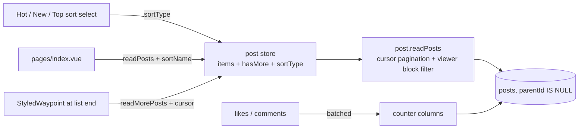

# Feed and Ranking

The home page renders top-level posts across the page's width, with infinite scroll and a Reddit-style Hot / New / Top sort, backed by cursor pagination over a stored ranking score.

## How it works



**Pagination** — `readPosts` pages by the app's one keyset pagination ([pagination](../../architecture/pagination/design.md)): the reader names a sort, its keys end in the unique `id`, and they compare as one row value, so pages of tied values (every new post has `likeCount = 0`) never skip rows. The same procedure serves comment lists via the `parentId` filter.

**Sort options** — a "Sort by" select on the feed's toolbar, beside Create post, switches between Hot (`ranking` desc), New (`id` desc, which is creation order for a UUIDv7) and Top (`likeCount` desc, all-time), each a declared sort in `PostSortTypePageSortMap` ending in `id` and served by an index that leads with the parent or author. The map also holds Old, which only the comments offer. The chosen sort lives in the post store; switching clears the list and refetches page one, and the waypoint continues from the new cursor. Comments take their own Sort by, which adds Old and is owned by [comment sort](../comment-sort/design.md).

**Block filtering** — authenticated feed reads exclude posts and comments authored by users the viewer has blocked — see [feed block filtering](../feed-block-filtering/design.md).

**Ranking** — the hot score is computed at write time, never re-read:

```text
sign(likes) × log10(max(|likes|, 1)) + max(0, createdAtMs − 1.5e12) / 45e6
```

Here `1.5e12` is `POST_RANKING_EPOCH_MS` and `45e6` is `POST_RANKING_AGE_PER_ORDER_OF_MAGNITUDE_MS`, both declared in `apps/web/server/services/post/constants.ts`.

The log term means early likes matter most; the time term gives newer posts a constant head start (each ~12.5 hours of age is worth one order of magnitude of likes). Because age is baked in as an absolute offset, scores never need recomputation — newer posts simply start higher. Every like create/update/delete and comment create recomputes the score in the same transaction that updates the counters.

**Feed UI** — the page's full width: the toolbar, a card per post (who and when with the author's actions at the end, the post, then the vote pill and the comment count), and a `StyledWaypoint` sentinel at the bottom that triggers `readMorePosts` while `hasMore` holds. The page scrolls the document, so pulling to refresh is the browser's own, which reloads the feed.

## Procedures

| Procedure        | Auth         | Input                                                  | Purpose                      |
| ---------------- | ------------ | ------------------------------------------------------ | ---------------------------- |
| `post.readPosts` | rate-limited | `sortName` and cursor params, plus optional `parentId` | one feed/comment page        |
| `post.readPost`  | rate-limited | post id                                                | single post for `/post/[id]` |

## Key files

Paths relative to `apps/web`, except `packages/`, which is relative to the repository root.

| File                                              | Role                                                              |
| ------------------------------------------------- | ----------------------------------------------------------------- |
| `app/pages/index.vue`                             | the feed page                                                     |
| `app/components/Post/List.vue`                    | the toolbar, the cards, the waypoint                              |
| `app/composables/post/useReadPosts.ts`            | initial read + read-more, `sortName`                              |
| `app/composables/post/usePagedPostRead.ts`        | the first page and cursor pages, shared with the comment branches |
| `app/store/post/index.ts`                         | feed items store + `sortType`                                     |
| `shared/services/post/PostSortTypePageSortMap.ts` | sort → declared page sort, Old included                           |
| `server/trpc/routers/post.ts`                     | `readPosts` / `readPost`                                          |
| `server/services/post/getPostRanking.ts`          | the hot score                                                     |
| `packages/db/src/services/pagination/`            | createPageSort, getPageWhere, getPageOrderBy, toPage              |

## Notes

- Casual scale doesn't need "top this week" partitioning yet; revisit if the feed ages badly.
- Every post ships at most the viewer's own like row (`viewerLike`) — see [likes](../likes/design.md) for the viewer-scoped read contract.
