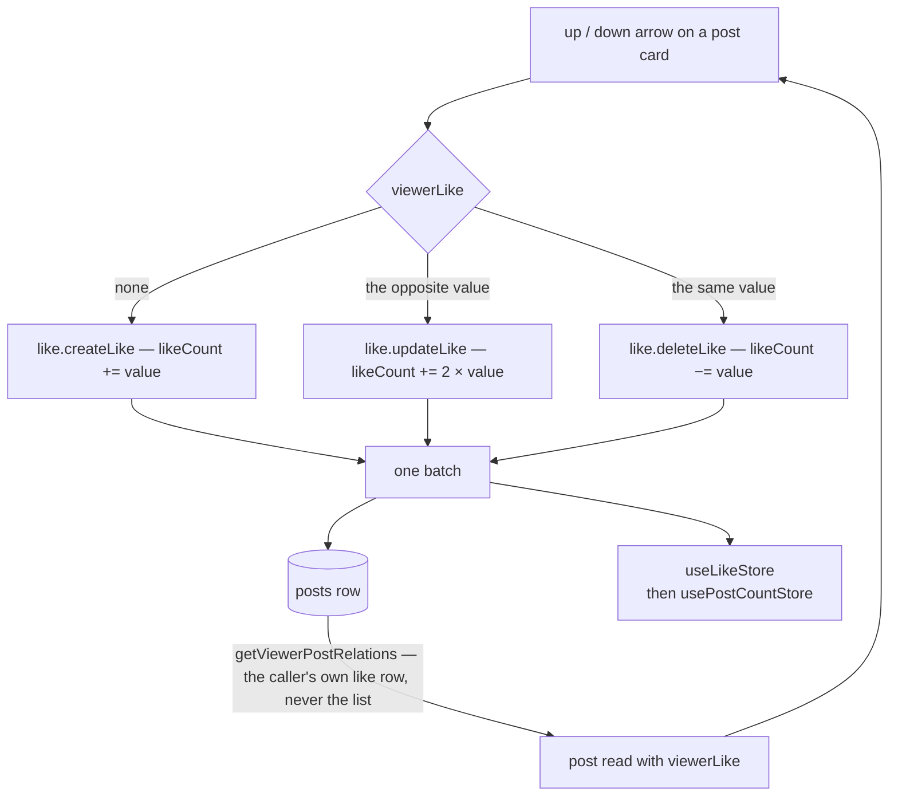

# Likes

Reddit-style voting: each user holds at most one like per post with `value ∈ {1, −1}`, shown as up/down arrows on every post and comment card beside the net count.

## How it works

**Model** — `likes(userId, postId, value)` with a composite primary key (one row per user per post) and a DB check constraining `value` to ±1. The post's `likeCount` is the denormalized net sum.

**Mutations** — three procedures, each one batch that writes the like row and adjusts `likeCount`. The stored [ranking](../feed-and-ranking/design.md) follows in its own write, guarded on the count it was computed from, so the last vote to land writes the final ranking:

The server is the only writer of `likeCount`. The client reads it back with `post.readPostCounts` (a batch read over the ids it changed) and never adds a vote to it, per [client data](../../architecture/client-data/design.md).

- `createLike` — first vote (`likeCount += value`).
- `updateLike` — flip an existing vote (`likeCount += 2 × value`, rejecting no-op flips).
- `deleteLike` — retract (`likeCount −= value`).

**Viewer-scoped reads** — every procedure that returns a post (reads and mutations alike) carries `viewerLike: Like | undefined` on `PostInPostWithRelations`: at most the viewer's own like row, never the full list, since the net count already lives in the denormalized `likeCount`. The `likes` relation is only the server-side fetch strategy — `getViewerPostRelations` filters it to the caller, and `getPostWithViewerLike` maps the result. Unauthenticated rate-limited reads have no viewer, so they skip the like lookup entirely and neither arrow is pressed. A hot feed page's payload is O(posts) instead of O(total likes).

**Client** — the vote pill (`PostLikeSection`) holds two toggles, each pressed while it is the viewer's vote; `PostVoteButton` reads that from `viewerLike` and maps a press to the right mutation (up with no vote held = create, up over a down vote = flip, up over an up vote = retract, …). A withdrawal is a press like any other and is not asked first, so the button's template carries the `vue/no-restricted-syntax` disable for its `deleteLike` call. One like store, `useLikeStore`, is the only write path, and the viewer's vote is a row of the overlay's like table rather than a field patched on each held copy of a post: a create, a flip and a retraction are overlay entries that draw the vote at once — a first vote as a row with no version until the server names one, a retraction as its tombstone — and the server's row confirms them. Every copy of the post reads `viewerLike` from that one row, so a vote cast on a post's page is already on its feed card and no component says which list a post came from, and a refused write drops its entry with nothing to roll back. The counts are server-owned: once a vote settles, both are read back from `post.readPostCounts` by `usePostCountStore`, version-gated, because another viewer's vote changes the count too and the server's adjustment is the only exact value.

## Procedures

| Procedure         | Auth   | Input             | Purpose      |
| ----------------- | ------ | ----------------- | ------------ |
| `like.createLike` | authed | postId, value(±1) | first vote   |
| `like.updateLike` | authed | postId, value(±1) | flip vote    |
| `like.deleteLike` | authed | postId            | retract vote |

## Key files

Paths are `apps/web`-relative; a `packages/` path is repo-relative.

| File                                                            | Role                                                                    |
| --------------------------------------------------------------- | ----------------------------------------------------------------------- |
| `packages/db-schema/src/schema/post/likesInPost.ts`             | table + ±1 check                                                        |
| `packages/db-schema/src/models/post/PostInPostWithRelations.ts` | `PostInPostWithRelations` + `viewerLike`                                |
| `server/trpc/routers/like.ts`                                   | batched mutations                                                       |
| `server/services/post/getViewerPostRelations.ts`                | viewer-filtered likes fetch strategy                                    |
| `server/services/post/getPostWithViewerLike.ts`                 | maps the fetched row to `viewerLike`                                    |
| `app/components/Post/VoteButton.vue`                            | one arrow: its toggle and its write                                     |
| `app/store/post/like.ts`                                        | the one like store over every list, calling the count re-read           |
| `app/store/post/count.ts`                                       | the one owner of the post counts, by post id, and their batched re-read |

## Notes

- Like achievements (`LikeAchievementDefinitionMap`) trigger on these procedure paths like all achievement definitions.
