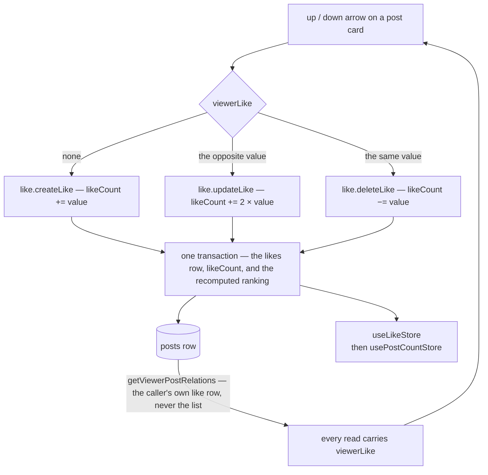

# Likes

Reddit-style voting: each user holds at most one like per post with `value ∈ {1, −1}`, shown as up/down arrows on every post and comment card beside the net count.

## How it works

**Model** — `likes(userId, postId, value)` with a composite primary key (one row per user per post) and a DB check constraining `value` to ±1. The post's `likeCount` is the denormalized net sum.

**Mutations** — three procedures, each a transaction that writes the like row, adjusts `likeCount`, and recomputes the stored [ranking](../feed-and-ranking/design.md) from the new count:

The server is the only writer of `likeCount`. The client reads it back with `post.readPostCounts` (a batch read over the ids it changed) and never adds a vote to it, per [client data](../../architecture/client-data/design.md).

- `createLike` — first vote (`likeCount += value`).
- `updateLike` — flip an existing vote (`likeCount += 2 × value`, rejecting no-op flips).
- `deleteLike` — retract (`likeCount −= value`).

**Viewer-scoped reads** — every procedure that returns a post (reads and mutations alike) carries `viewerLike: Like | undefined` on `PostInPostWithRelations`: at most the viewer's own like row, never the full list, since the net count already lives in the denormalized `likeCount`. The `likes` relation is only the server-side fetch strategy — `getViewerPostRelations` filters it to the caller, and `getPostWithViewerLike` maps the result. Unauthenticated rate-limited reads have no viewer, so they skip the like lookup entirely and neither arrow is pressed. A hot feed page's payload is O(posts) instead of O(total likes).

**Client** — the vote pill (`PostLikeSection`) holds two toggles, each pressed while it is the viewer's vote; `PostVoteButton` reads that from `viewerLike` and maps a press to the right mutation (up with no vote held = create, up over a down vote = flip, up over an up vote = retract, …). A withdrawal is a press like any other and is not asked first, so the button's template carries the `vue/no-restricted-syntax` disable for its `deleteLike` call. One like store, `useLikeStore`, is the only write path: `useLikeOperations` applies the viewer's own vote optimistically to **every copy of the post the client holds** — the feed's row and a post page's own read of it are separate objects, as are the thread's comments — patching each copy's `viewerLike` in place and rolling it back against what it held, so a vote cast on a post's page is already on its feed card and no component says which list a post came from. The count is never moved by the client: once a vote settles, both counts are read back from `post.readPostCounts` by `usePostCountStore`, and the feed and the thread each apply that one read to their own copies, because another viewer's vote changes the count too and the server's adjustment is the only exact value. A count shown while a vote is in flight is therefore the one before it, not a prediction.

## Procedures

| Procedure         | Auth   | Input             | Purpose      |
| ----------------- | ------ | ----------------- | ------------ |
| `like.createLike` | authed | postId, value(±1) | first vote   |
| `like.updateLike` | authed | postId, value(±1) | flip vote    |
| `like.deleteLike` | authed | postId            | retract vote |

## Key files

Paths are `apps/web`-relative; a `packages/` path is repo-relative.

| File                                                           | Role                                                               |
| -------------------------------------------------------------- | ------------------------------------------------------------------ |
| `packages/db-schema/src/schema/post/likesInPost.ts`            | table + ±1 check                                                   |
| `packages/db-schema/src/relations/post/postsInPostRelation.ts` | `PostInPostWithRelations` + `viewerLike`                           |
| `server/trpc/routers/like.ts`                                  | transactional mutations                                            |
| `server/services/post/getViewerPostRelations.ts`               | viewer-filtered likes fetch strategy                               |
| `server/services/post/getPostWithViewerLike.ts`                | maps the fetched row to `viewerLike`                               |
| `app/components/Post/VoteButton.vue`                           | one arrow: its toggle and its write                                |
| `app/composables/post/useLikeOperations.ts`                    | optimistic vote patching, which calls the count re-read            |
| `app/store/post/count.ts`                                      | the one owner of the post count re-read, and its fan-out to copies |
| `app/store/post/like.ts`                                       | the one like store, over every list                                |

## Notes

- Like achievements (`LikeAchievementDefinitionMap`) trigger on these procedure paths like all achievement definitions.
