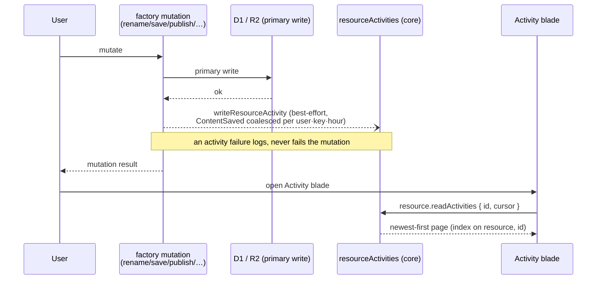

# Activity Log

Every resource has an **Activity** blade: created, renamed, saved, published, unpublished, duplicated, restored — what happened to this resource, and when.

## How it works

Activity events are message-shaped — high write volume, time-ordered, no joins — so they are rows in a D1 table in the `core` database, read newest first through an index on the resource, creation time and id. The table's foreign key cascades from the resource row, so purging the resource clears its trail with no separate sweep.

Events are emitted inside the `createResourceProcedures` mutations, in the best-effort tail after the primary write ([persist then notify](../../architecture/persist-then-notify/design.md)). Losing an audit line is bad; losing someone's save because an audit line failed is worse.

The `Created`/`Duplicated` entry is the one exception to the fire-and-forget tail: `createResourceRow` awaits it. That entry is the only one a caller can roll back over — a failed content clone or a mid-deploy failure rolls back through `deleteCreatedResources`, which deletes the resource row, and the cascade takes the trail with it. A write still in flight after that delete is refused by its foreign key, so no orphan entry is left behind. The write never rejects, so awaiting it costs latency and nothing else.

`ContentSaved` is coalesced, or autosave would flood the trail with one entry per keystroke burst. The rule is "this user, through this API key or by hand, already has a `ContentSaved` inside `CONTENT_SAVED_COALESCE_WINDOW_MS`" — an existence question, asked with a filter, rather than an inspection of the newest entry. Phrasing it that way makes the answer independent of the order entities come back in, and keying it by the API key as well keeps an agent's run of saves a line apart from the owner's typing.

## Data model

`resourceActivities` belongs to its resource through a `resourceId` foreign key that cascades from the resource row. Its index on the resource, creation time and id makes a plain read return newest-first, with the id breaking ties.

Each row carries `activityType` (`Created | Renamed | ContentSaved | Published | Unpublished | Duplicated | Restored`), `userId`, who wrote it as `apiKeyId` and `apiKeyName`, and per-type payload fields (`oldName`/`newName`, `publishVersion`). Every payload field is nullable: one table holds every type, and a `Renamed` has nothing to say about `publishVersion`.

The API key fields are the key an agent wrote through, read off the request's context ([agent access](../../architecture/agent-access/design.md)), or, for the owner's own hand, a null `apiKeyId` and an empty `apiKeyName` — `writeResourceActivity` takes the context rather than a user id, so no write can forget to say who made it. The name is copied in as the key held it when it wrote, so an entry still reads after the key is renamed or deleted, and the blade adds it to the entry's detail.

`Restored` covers both restores: out of the [recycle bin](../recycle-bin/design.md), and of a [snapshot](../resource-snapshots/design.md) into the working copy. Both hand the owner back content they had before, so the trail says the same thing about them.

### Cleanup

Clearing a resource's history is the cascade from its resource row: the purge deletes the row and the trail goes with it, so no batch loop or partition sweep exists.

Soft delete leaves the rows intact: history survives the [recycle bin](../recycle-bin/design.md) window and a restore appends `Restored` to it. The purge deletes the row last, so a failed purge leaves the row to re-drive it on the next pass.

## Procedures

| Procedure                 | Auth                | Input             | Purpose                             |
| ------------------------- | ------------------- | ----------------- | ----------------------------------- |
| `resource.readActivities` | `getOwnerProcedure` | `{ id, cursor? }` | Cursor-paginated read, newest first |

## Key files

| File                                                                     | Role                                         |
| ------------------------------------------------------------------------ | -------------------------------------------- |
| `packages/db-schema/src/schema/resource/resourceActivitiesInResource.ts` | The table and its select schema              |
| `apps/web/server/services/resource/writeResourceActivity.ts`             | Best-effort emit + `ContentSaved` coalescing |
| `apps/web/app/components/Resource/ActivityLog.vue`                       | The blade timeline                           |
| `apps/web/app/components/Resource/ActivityLogListItem.vue`               | One entry, naming the API key an agent used  |

## Notes

- Resources are single-owner and every procedure is owner-scoped, so every actor on a resource's trail is its owner. The blade therefore shows no actor column — it would say the same name on every line.
- Icons are severity-neutral. An activity trail records what happened; it does not judge it.
- Activity is the durable trail; the [notifications bell](../notifications/design.md) is ephemeral session feedback. They share event sources but never storage.
- No cross-resource feed (the portal's subscription-level log) — per-resource only until something needs more.
- Entries are not aged out by a timer and writes are not capped.
