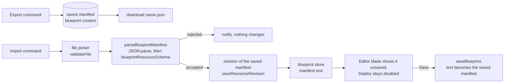

# Blueprint Portability

A blueprint's manifest travels as the JSON the Editor blade already shows, so the file is the manifest and nothing wraps it. Its overflow menu offers Import and Export through the Portable capability, the same entry shape the [Note's Markdown format](../note-markdown-portability/design.md) uses, and an import runs from that menu outside any component.

## How it works

- **Export reads the saved manifest.** Deploy runs the saved copy, so a file must match what a deploy would create. Exporting the text on screen could write a manifest that deploy would reject, or one it never runs.
- **The file is the manifest, verbatim.** A wrapper such as `{ format, version, manifest }` was rejected: the Editor already displays this exact JSON, the schema is the one stated shape of a manifest, and a wrapper would be a second format to version. A change to the manifest is a schema change, checked on import like any other.
- **The text lives in the blueprint store.** That is where an import outside the Editor can reach it, and the store resets it on every read of the saved content. Leaving the Editor discards unsaved text, as the navigation guard already warns, so the text shown next time is the saved manifest again.
- **Import lands as unsaved text, not in a preview dialog.** The Note's import previews in a dialog because a Note replaces its document as soon as it is confirmed. A blueprint's Save is the one commit, and Deploy already refuses to run text the owner has not saved, so a preview would repeat that review.
- **An import takes a revision first, and Save takes none.** An automatic save keeps a revision only once per interval, so a Save soon after another could leave the replaced manifest out of [version history](../resource-snapshots/design.md). The import takes the `BeforeImport` revision the platform takes before any import replaces a draft. The alternative, a revision on Save, needs an imported flag in the store that a discard would have to clear.
- **Import checks the manifest schema, not each entry's content.** Save already checks the schema, so an import is no looser than pasting the same JSON into the Editor. Deploy validates every entry against its type and creates nothing if one fails, so a bad entry cannot become a bad resource.

## Key files

| File                                                                     | Role                                                                |
| ------------------------------------------------------------------------ | ------------------------------------------------------------------- |
| `apps/web/shared/services/resource/ResourceDefinitionMap.ts`             | Blueprint declares `portable`                                       |
| `apps/web/app/services/resource/PortableFormatMap.ts`                    | the JSON format for Blueprint                                       |
| `apps/web/app/services/resource/createBlueprintPortableFormat.ts`        | export and import, as `createNoteMarkdownPortableFormat` does       |
| `apps/web/app/services/resource/blueprint/parseBlueprintManifest.ts`     | the check Save and an import share                                  |
| `apps/web/app/services/resource/blueprint/stringifyBlueprintManifest.ts` | the one text form of a manifest: the Editor, the file and the store |
| `apps/web/shared/models/resource/blueprint/BlueprintResource.ts`         | the manifest schema an import must pass                             |
| `apps/web/app/store/resource/blueprint/index.ts`                         | holds the manifest text, its dirty state and the discard            |
| `apps/web/app/components/Resource/Blueprint/Editor.vue`                  | shows the text unsaved and guards leaving it                        |
| `apps/web/app/services/resource/constants.ts`                            | the accept list for a manifest file, beside Note's `.md`            |

## Notes

- A manifest's own nested blueprint entries travel inside it as opaque content, as capture and deploy already treat them ([blueprint resource](../blueprint-resource/design.md)). The file adds no case of its own.
- An entry that refers to a resource outside the manifest keeps that resource's id verbatim. Capture rewrites only the ids of the resources it selected, and export holds no knowledge of the owner's other resources, so on another account that reference dangles. Deploy already treats such a reference as fail-soft, and the file inherits that.
- A manifest holds no owner ids, so a file carries its blueprint to another account without a server procedure, a migration or a new dependency.
