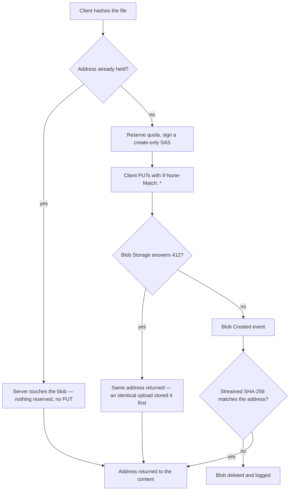
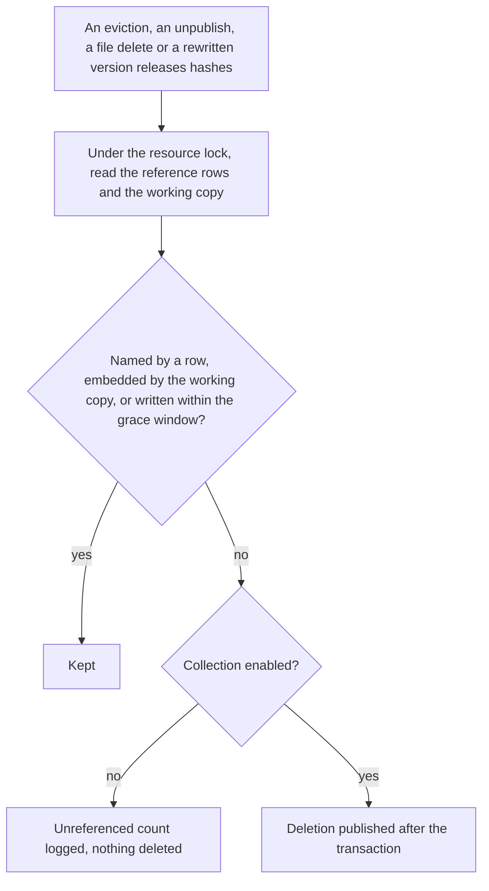

# Content-addressed assets

Uploaded files are stored under the SHA-256 of their bytes. A stored version references the files its content embeds, so a publication, a revision and the working copy share one object, and nothing is copied or has its urls rewritten when a page is published. The difficulty this leaves is reference tracking: a file's references live inside content rather than in a column, so the set of references is derived by scanning each version as it is written, and a release deletes a file only when no reference row, nor the working copy, still names it.

The version store this builds on is [resource version store](../resource-version-store/design.md), and the stable app url a file is served through is [resource file assets](../resource-file-assets/design.md).

## How it works

Upload and verification. The client hashes the file and asks for a write target at that address. A held address is answered without a write, and a fresh one is written create-only.

Release. Every path that can leave a file unreferenced hands its candidate hashes to one release, and the release decides under the resource's object lock.

## Decisions

- **Address is `{resourceId}/files/{sha256}`**, the lowercase hex SHA-256 of the bytes, with no filename. The filename is not part of the address, so identical bytes dedupe whatever they were called. The scope is the resource rather than the owner: a resource is the unit purge takes, the version store's objects are resource-scoped, and a resource has one payer. Identical bytes dedupe inside one resource; a duplicate holds its own copies of them.
- **The client hashes and the server decides.** `generateReservedResourceAssetSasEntities` checks whether the address is held. A held address returns the entry with `isHeld` set and an empty `sasUrl`: nothing is signed or reserved, the server writes a metadata touch to the blob so its last-modified time moves (best-effort: a failed touch is logged and does not fail the upload), and the client skips the PUT. An address not yet held has its quota reserved and receives a create-only SAS. The create-only commit carries `If-None-Match: *`, and a 412 from it means the address is already held: the upload succeeds with that same address. The 412 is recognised by the status carried on `BlobStorageStatusError`, never by the message text. The losing upload's reservation expires like any failed upload's.
- **Blob Created verifies the bytes.** The reconcile handler streams each resource asset's bytes through SHA-256 as they arrive. Only blobs named `{resourceId}/files/{hash}` in the resource assets container are checked. A mismatch is deleted and logged, since nothing may reference bytes stored under a name that does not describe them. A download failure is retried and never deletes; a download that answers not found is a no-op.
- **Reference rows** live in `resourceVersionAssetsInResource`, keyed by resource, channel, version and asset hash, with a composite foreign key to the version row and cascade delete. `writeSnapshotVersion` writes a version's rows under the resource lock. The scan visits every string in the content and keeps the asset urls that name this resource, after own-origin absolute urls are relativized. It does not read the content's schema, so it covers every content type.
- **A version never names a missing object.** Under the same lock, `writeSnapshotVersion` checks that every hash it is about to reference exists, and fails the write when one does not. A publish that races a file delete therefore fails cleanly instead of publishing a page with broken images.
- **Release is one function for every path.** `releaseResourceAssets` is called by an eviction, an unpublish, a file delete, and a version write that replaces its own rows. It runs under the resource lock and computes the candidates that no remaining row of the resource names, that the working copy does not embed, and whose blob was not written within the grace window. The grace window is `ASSET_GRACE_MS`, which protects an upload that dedupes onto an old object and is saved a moment later from a collection running between the two.
- **Counting-only is a shared constant.** `isAssetCollectionEnabled()` in the shared resource constants returns false, so release computes the same candidate set, logs its count as unreferenced, and deletes nothing. Enabling collection is a change to that one function.
- **Publishing neither clones nor rewrites.** A publish stores the content its transform returns and writes that version's reference rows. Unpublish deletes the published channel's version rows, and the files those rows named go to the one release. There is no `{id}/published/` prefix and no sweep of one.
- **Read access.** The owner reads any `{resourceId}/files/{hash}`. Anyone else reads one only while the resource has a publication and its current published version row names the hash. The check runs on every request and is never cached, so an unpublish revokes access at once. A refused anonymous request is 401, and a signed-in caller who may not read is 404.
- **Duplicate still copies.** A duplicate holds its own copies because the copy must own its objects, so `cloneContentAssets` survives for that one caller. It copies each referenced file the caller can read to the destination's own hash name, skipping any name the destination already holds, and charges the copying owner before each copy. A url the caller cannot read is carried over verbatim.
- **Restore needs no clone.** A restored version's reference rows keep its files alive, and they are the same resource's files.

## Key files

| File                                                                            | Role                                                                        |
| ------------------------------------------------------------------------------- | --------------------------------------------------------------------------- |
| `apps/web/app/composables/resource/useUploadResourceFile.ts`                    | hashes the file, skips the PUT for a held address, returns the stable url   |
| `apps/web/app/services/azure/container/commitBlockList.ts`                      | the create-only commit (`If-None-Match: *`) and its 412                     |
| `apps/web/server/services/resource/generateReservedResourceAssetSasEntities.ts` | the held check, the reservation and the create-only SAS per address         |
| `apps/web/shared/models/resource/ResourceFileSasEntity.ts`                      | the write target, with `isHeld`                                             |
| `apps/functions/src/handlers/reconcileStorageLedgerEntryHandler.ts`             | the Blob Created handler                                                    |
| `apps/functions/src/services/storage/verifyResourceAssetBlob.ts`                | the streamed hash check and the delete on mismatch                          |
| `packages/db-schema/src/schema/resource/resourceVersionAssetsInResource.ts`     | the reference table                                                         |
| `apps/web/server/services/resource/snapshot/getSnapshotAssetHashes.ts`          | the scan of a version's content for asset addresses                         |
| `apps/web/server/services/resource/snapshot/writeSnapshotVersion.ts`            | writes the reference rows and checks the addresses exist                    |
| `apps/web/server/services/resource/snapshot/releaseResourceAssets.ts`           | the one release, with the lock, the grace window and the counting-only gate |
| `apps/web/shared/services/resource/constants.ts`                                | `ASSET_GRACE_MS` and `isAssetCollectionEnabled()`                           |
| `apps/web/server/services/resource/checkIsResourceAssetReadable.ts`             | the one read-access question, asked by the endpoint and by duplicate        |
| `apps/web/server/services/resource/cloneContentAssets.ts`                       | duplicate's copy of referenced files                                        |

## Notes

- The scan is the sharp edge. A scan that misses a reference lets release delete a file a version still embeds, and the failure is a broken image in a published page rather than an error. The counting-only period is the guard: an undercount shows up as a file nothing deletes.
- The grace window is judged by the blob's last-modified time at the moment release decides, so an upload that dedupes onto a file moves it out of collection before the save that names it is stored.
- A held upload is free. Only a fresh address reserves quota, and a duplicate charges each copy it makes.
- Anonymous reads are not a grant. The published channel's current row is the only thing that makes a file public, so a file a revision or the working copy alone holds is refused to anonymous callers.
- `releaseResourceAssets` publishes its deletions after the transaction, so a failed publish leaves the file stored and charged until a later release names it again.

## Sources

- [Pro Git — Git objects](https://git-scm.com/book/en/v2/Git-Internals-Git-Objects) — a content-addressable store keyed by the hash of each object's bytes, the addressing that makes an asset impossible to replace in place.
