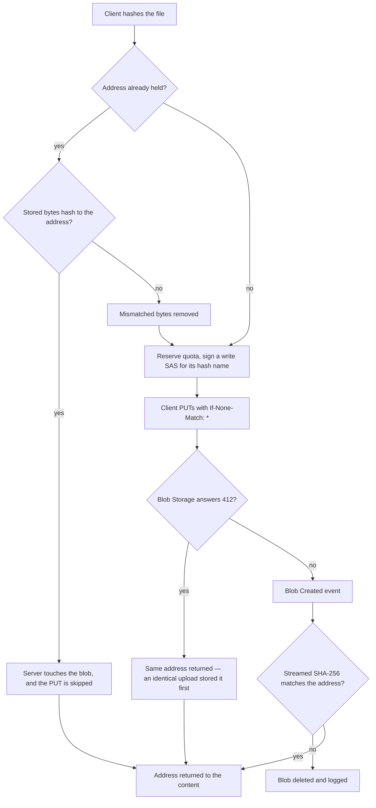
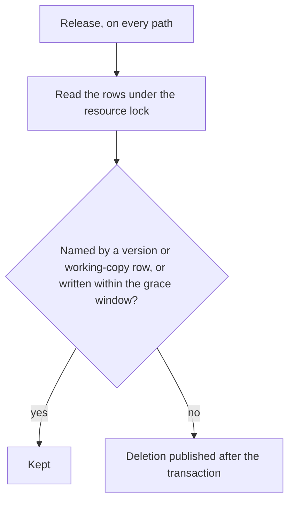
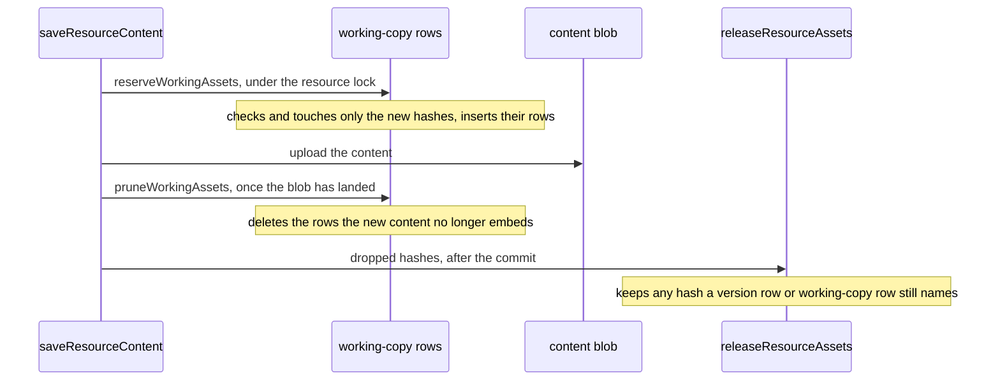

# Content-addressed assets

Uploaded files are stored under the SHA-256 of their bytes. A stored version and the working copy each reference the files their content embeds, so a publication, a revision and the working copy share one object, and nothing is copied or has its urls rewritten when a page is published. The difficulty this leaves is reference tracking: a file's references live inside content rather than in a column, so the set of references is derived by scanning each document as it is written for the addresses it carries, once for each stored version and once for each save of the working copy. A release deletes a file only when neither a version row nor a working-copy row names it.

The version store this builds on is [resource version store](../resource-version-store/design.md), and the stable app url a file is served through is [resource file assets](../resource-file-assets/design.md).

## How it works

Upload and verification. The client hashes the file and asks for a write target at that address. A held address is answered without a write, and a fresh one is written create-only.

Release. Every path that can leave a file unreferenced hands its candidate hashes to one release, and the release decides under the resource's object lease.

## Working-copy references

The working copy has its own reference rows, beside the version rows, and only `saveResourceContent` writes them. A save writes them in two steps around its upload, so the rows never name less than the stored blob embeds.

A reserve names the old content's assets and the new content's together, so a write that fails after it leaves a surplus in place, and the next successful save settles that surplus. A save that names a missing asset is not refused: the reference is the owner's data, and the reserve records it like any other, so the rows name every address the content embeds. Purge deletes the resource's whole blob directory and its rows cascade with it, so purge releases nothing.

## Decisions

- **Address is `{resourceId}/files/{sha256}`**, the lowercase hex SHA-256 of the bytes, with no filename. The filename is not part of the address, so identical bytes dedupe whatever they were called. The scope is the resource rather than the owner: a resource is the unit purge takes, the version store's objects are resource-scoped, and a resource has one payer. Identical bytes dedupe inside one resource.
- **The client hashes and the server decides.** `generateReservedResourceAssetSasEntities` checks whether the address is held, and an address is held only when the bytes stored under it hash to it. The server reads the blob and hashes it with the check the reconcile handler runs after a write (`findMismatchedResourceAssetHash` in `@esposter/db`), and bytes that do not hash to the name are removed by that check, so the address is not held. A held address returns the entry with `isHeld` set and an empty `sasUrl`: nothing is signed or reserved, the server writes a metadata touch to the blob so its last-modified time moves (a touch that finds no blob sends the file down the write path, and any other failed touch fails the upload, so the grace window is never left unrenewed), and the client skips the PUT. An address that is not held has its quota reserved and receives a write SAS for exactly its hash name. The create-only commit carries `If-None-Match: *`, the one part of the upload that refuses an overwrite, and a 412 from it means the address is already held: the upload succeeds with that same address. The 412 is recognised by the status carried on `BlobStorageStatusError`, never by the message text. The losing upload's reservation expires like any failed upload's.
- **A held name is verified before the PUT is skipped.** The reconcile handler checks a blob's bytes only after the PUT that wrote them, so a name already held by bytes that do not hash to it would skip a valid PUT, and then lose the bytes it relied on when that later check removed them. Verifying the held blob before the skip closes that window, and the price is one read of the blob on the dedupe path. Two alternatives lost. Marking a blob verified once checked was rejected, since the mark is a metadata value the client's own create-only PUT can write, so it proves nothing about the bytes beside it. Keeping the skip on existence alone was the state this replaces.
- **Blob Created verifies the bytes.** The reconcile handler checks each resource asset's bytes with the same streamed SHA-256 check the held path runs. Only blobs named `{resourceId}/files/{hash}` in the resource assets container are checked. A mismatch is removed and logged, since nothing may reference bytes stored under a name that does not describe them. A download failure is retried and never deletes; a download that answers not found is a no-op.
- **A reference is a hash occurrence, matched as a whole token.** A file is referenced when its hash occurs, as a whole 64-character lowercase token, in the serialized JSON of the working copy or of a stored version. The scan reads no content type, so a url's last segment matches, a bare id an element stores matches (a whiteboard image is stored that way, and a url scan never saw it), and so does a string of any shape a future type holds. A whole token is a run of letters and digits bounded by characters that are neither, so a hash inside a longer run names no file, and an uppercase hash names none, since a stored address is lowercase. The alternatives lost. A url-path scan misses a bare id, so collection would delete a file a whiteboard still shows. A raw substring match would count a hash inside a longer string as a file it does not name. A release that read each retained document would download every version's object on each release, which this design avoids. One looseness is deliberate: a hash that another resource's url names also counts, since the scan has no resource to check the url against. That keeps this resource's copy of the same bytes, which costs a stored file and never a deleted one. The looseness has a cost, and the touch is where it is bounded. A touch restarts the grace window of an asset nothing references, and a row keeps the asset it names, so a write touches only the hashes no version row or working-copy row of the resource names (`readReferencedAssetHashes`). A document holding N digests in text costs N touches the first time a row names them, from the save that reserves them, and none on any later save or version write, where a url of the resource's own file is still asked of the store, since the publish refusal needs its answer. Measured on a document of 50 digests in text that no file backs: the first version write touches 50 blobs and the next version write touches none, and the first save (`reserveWorkingAssets`) touches 50 and the next save touches none. The alternatives lost. Touching every token on every version write costs N requests per write for tokens no file backs. Counting a bare id only where a known element stores it reverses the schema-free scan this bullet exists for, and would delete a file a shape not yet listed still shows.
- **Version reference rows** live in `resourceVersionAssetsInResource`, keyed by resource, channel, version and asset hash, with a composite foreign key to the version row and cascade delete. `writeSnapshotVersion` writes a version's rows under the resource lock, from `getSnapshotAssetHashes` run on the serialized content it stores. `saveResourceContent` runs the same scan on the content it is about to write.
- **Working-copy rows** live in `resourceWorkingAssetsInResource`, keyed by resource and asset hash, with a foreign key to the resource and cascade delete. They name exactly the assets the working content embeds. The single content writer, `saveResourceContent`, is the only writer: `reserveWorkingAssets` checks and touches only the newly referenced assets under the resource lock, and `pruneWorkingAssets` deletes the rows the new content drops once the blob has landed, inside the write's transaction when it has one. The hashes it drops are released after the commit through `releaseResourceAssets`.
- **A published version never names a missing file by url.** Under the same lock, `writeSnapshotVersion` touches each url of the resource's own file the content names, and every other hash it carries that no row of the resource names, and fails a published write when a url of this resource's own file names one that is not stored, with "cannot store content naming a missing asset". The refusal reads urls only (`getSnapshotUrlAssetHashes`). A bare id is not held to it, since a 64-hex token can be a digest in text rather than a file, and a page that names no file must not fail on one. A url of another resource is not held to it either, since this resource does not serve that file, and refusing it would fail a duplicated or blueprint-deployed page. A publish that races a file delete therefore fails cleanly when the file was named by url, instead of publishing a page with broken images. Other channels keep the content as the owner wrote it: a revision or a restore naming a gone file is data, not a failed write, so a restore is never blocked by a broken reference in the working copy.
- **Release is one function for every path.** `releaseResourceAssets` is called by an eviction, an unpublish, a file delete, a version write that replaces its own rows, and a save that drops working-copy rows. It reads only the two row sets, version rows and working-copy rows, under the resource lock. It never downloads or scans the working content blob. A candidate is deleted only if neither set names it and its blob was not written within the grace window. The grace window is `ASSET_GRACE_MS`.
- **Grace protects an upload until its save.** An upload that dedupes onto an old object touches it, which starts the grace window, so a collection cannot take the object between that upload and the save that names it. That is the window's whole job. Working content does not depend on it: the working-copy rows keep what the working copy embeds.
- **Publishing neither clones nor rewrites.** A publish stores the content its transform returns and writes that version's reference rows. Unpublish deletes the published channel's version rows, and the files those rows named go to the one release. There is no `{id}/published/` prefix and no sweep of one.
- **Read access.** The owner reads any `{resourceId}/files/{hash}`. Anyone else reads one only while the resource has a publication and its current published version row names the hash. The check runs on every request and is never cached, so an unpublish revokes access at once. A refused anonymous request is 401, and a signed-in caller who may not read is 404.
- **Every read is an attachment.** A blob's content type is the uploader's and its name has no extension, so a navigation to an asset would render whatever the uploader sent, on the blob origin. The redirect therefore sends `Content-Disposition: attachment`: a navigation downloads, while an `` or `<video>` still embeds the asset, since those ignore the header.
- **Duplicate copies.** A duplicate holds its own copies because the copy must own its objects, so `cloneContentAssets` exists for that one caller. It copies each file the content names that the caller can read to the destination's own hash name, skipping any name the destination already holds, and charges the copying owner before each copy. A url names its file by path, and a bare id (a whiteboard image) names a file of the source by its hash, found by the same whole-token scan the references use; both are copied, and a bare id needs no rewrite since the destination's element reads the same hash. A url or bare id the caller cannot read is carried over verbatim. The copies reach the new resource's working copy through `saveResourceContent`, which reserves them there.
- **Restore takes no lock of its own.** It lands through the save it performs, which reserves the restored content's assets. The restored version's own version rows keep its files alive while it is stored, and they are the same resource's files.

## Key files

| File                                                                            | Role                                                                                 |
| ------------------------------------------------------------------------------- | ------------------------------------------------------------------------------------ |
| `apps/web/app/composables/resource/useUploadResourceFile.ts`                    | hashes the file, skips the PUT for a held address, returns the stable url            |
| `apps/web/app/services/azure/container/commitBlockList.ts`                      | the create-only commit (`If-None-Match: *`) and its 412                              |
| `apps/web/server/services/resource/generateReservedResourceAssetSasEntities.ts` | the held check, the reservation and the write SAS per address                        |
| `apps/web/server/services/resource/checkIsResourceAssetHeld.ts`                 | the held check: the bytes are verified, then the blob is touched                     |
| `packages/db/src/services/storage/findMismatchedResourceAssetHash.ts`           | the streamed hash check and the removal of mismatched bytes, shared by both paths    |
| `apps/web/shared/models/resource/ResourceFileSasEntity.ts`                      | the write target, with `isHeld`                                                      |
| `apps/functions/src/handlers/reconcileStorageLedgerEntryHandler.ts`             | the Blob Created handler                                                             |
| `apps/functions/src/services/storage/verifyResourceAssetBlob.ts`                | the Blob Created check, logging what the shared hash check removes                   |
| `packages/db-schema/src/schema/resource/resourceVersionAssetsInResource.ts`     | the version reference table                                                          |
| `packages/db-schema/src/schema/resource/resourceWorkingAssetsInResource.ts`     | the working-copy reference table                                                     |
| `apps/web/server/services/resource/saveResourceContent.ts`                      | the one content writer: reserves, prunes and releases its assets                     |
| `apps/web/server/services/resource/reserveWorkingAssets.ts`                     | the first half of a save, under the resource lock, before the upload                 |
| `apps/web/server/services/resource/pruneWorkingAssets.ts`                       | the second half of a save, once the blob has landed, returning dropped hashes        |
| `apps/web/server/services/resource/snapshot/getSnapshotAssetHashes.ts`          | the scan of a serialized document for the file hashes it carries, on every write     |
| `apps/web/server/services/resource/snapshot/getSnapshotUrlAssetHashes.ts`       | the files a document's own urls name, which a publish is refused for when missing    |
| `apps/web/server/services/resource/snapshot/writeSnapshotVersion.ts`            | writes the version reference rows and refuses a publish naming a missing file by url |
| `apps/web/server/services/resource/snapshot/readReferencedAssetHashes.ts`       | the hashes a row of the resource names, which a write has no touch to owe            |
| `apps/web/server/services/resource/snapshot/touchSnapshotAssets.ts`             | touches the stored assets a write names and hands back the missing ones              |
| `apps/web/server/services/resource/snapshot/releaseResourceAssets.ts`           | the one release, with the lock and the grace window                                  |
| `apps/web/shared/services/resource/constants.ts`                                | `ASSET_HASH_TOKEN_REGEX` and `ASSET_GRACE_MS`                                        |
| `apps/web/server/services/resource/checkIsResourceAssetReadable.ts`             | the one read-access question, asked by the endpoint and by duplicate                 |
| `apps/web/server/services/resource/readResourceAccess.ts`                       | the owner and publication checks, made once for all its assets                       |
| `apps/web/server/services/resource/collectResourceAssetPaths.ts`                | the scan of content for asset urls, behind duplicate and the publish refusal         |
| `apps/web/server/services/resource/cloneContentAssets.ts`                       | duplicate's copy of the files its urls and bare ids name, and the url rewrite        |

## Notes

- The scan is the sharp edge, and it runs at write time: a scan that misses a reference leaves a row unwritten, and release then deletes a file a version or the working copy embeds, which fails as a broken image in a published page rather than as an error. The scan's tests hold each shape a reference takes, a url and a bare id, and the grace window covers an upload whose save has not landed yet.
- **A change to what the scan counts owes the stored rows a backfill.** A row is written from the scan of its document when that document is written, so a document stored before a shape was counted has no row for a file named that way, and release would take the file. The backfill rescans each working copy and each retained version and writes the missing rows (the `backfills` skill).
- The grace window is judged by the blob's last-modified time at the moment release decides.
- `releaseResourceAssets` publishes its deletions after the transaction, so a failed publish leaves the file stored and charged until a release names it again.

## Sources

- [Pro Git — Git objects](https://git-scm.com/book/en/v2/Git-Internals-Git-Objects) — a content-addressable store keyed by the hash of each object's bytes, the addressing that makes an asset impossible to replace in place.
