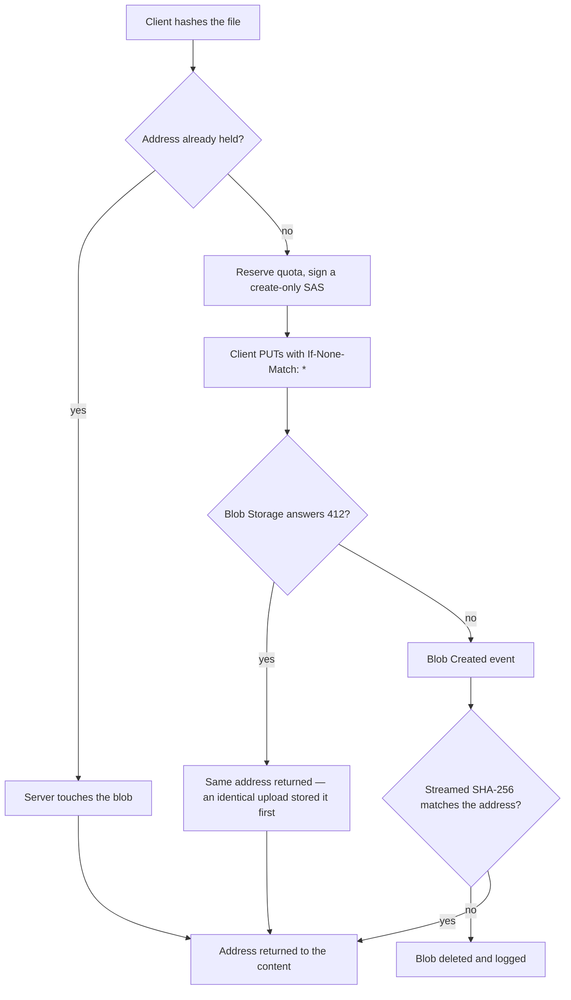
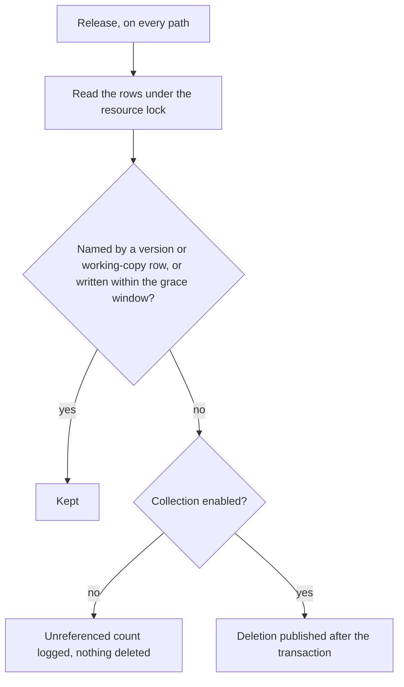
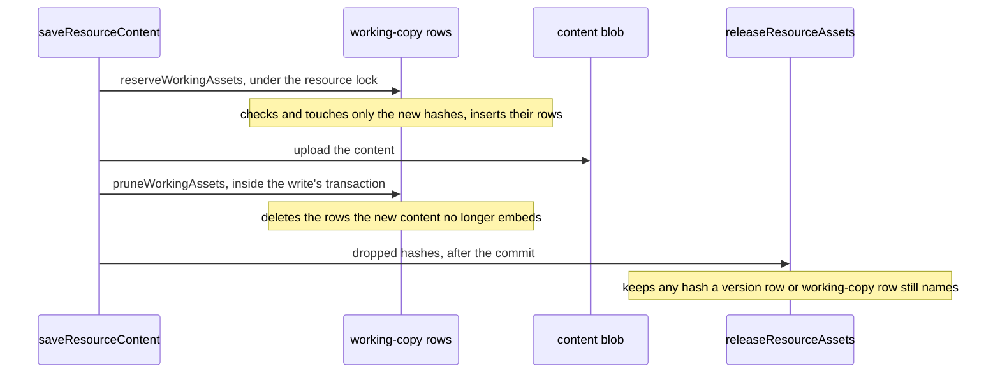

# Content-addressed assets

Uploaded files are stored under the SHA-256 of their bytes. A stored version and the working copy each reference the files their content embeds, so a publication, a revision and the working copy share one object, and nothing is copied or has its urls rewritten when a page is published. The difficulty this leaves is reference tracking: a file's references live inside content rather than in a column, so the set of references is derived by scanning content as it is written, once for each stored version and once for each save of the working copy. A release deletes a file only when neither a version row nor a working-copy row names it.

The version store this builds on is [resource version store](../resource-version-store/design.md), and the stable app url a file is served through is [resource file assets](../resource-file-assets/design.md).

## How it works

Upload and verification. The client hashes the file and asks for a write target at that address. A held address is answered without a write, and a fresh one is written create-only.

Release. Every path that can leave a file unreferenced hands its candidate hashes to one release, and the release decides under the resource's object lock.

## Working-copy references

The working copy has its own reference rows, beside the version rows, and only `saveResourceContent` writes them. A save writes them in two steps around its upload, so the rows never name less than the stored blob embeds.

A reserve names the old content's assets and the new content's together, so a write that fails after it leaves a surplus in place, and the next successful save settles that surplus. A save that names a missing asset is not refused: the reference is the owner's data, and the reserve records it like any other, so the rows name every address the content embeds. Purge deletes the resource's whole blob directory and its rows cascade with it, so purge releases nothing.

## Decisions

- **Address is `{resourceId}/files/{sha256}`**, the lowercase hex SHA-256 of the bytes, with no filename. The filename is not part of the address, so identical bytes dedupe whatever they were called. The scope is the resource rather than the owner: a resource is the unit purge takes, the version store's objects are resource-scoped, and a resource has one payer. Identical bytes dedupe inside one resource; a duplicate holds its own copies of them.
- **The client hashes and the server decides.** `generateReservedResourceAssetSasEntities` checks whether the address is held. A held address returns the entry with `isHeld` set and an empty `sasUrl`: nothing is signed or reserved, the server writes a metadata touch to the blob so its last-modified time moves (best-effort: a failed touch is logged and does not fail the upload), and the client skips the PUT. An address that is not held has its quota reserved and receives a create-only SAS. The create-only commit carries `If-None-Match: *`, and a 412 from it means the address is already held: the upload succeeds with that same address. The 412 is recognised by the status carried on `BlobStorageStatusError`, never by the message text. The losing upload's reservation expires like any failed upload's.
- **Blob Created verifies the bytes.** The reconcile handler streams each resource asset's bytes through SHA-256 as they arrive. Only blobs named `{resourceId}/files/{hash}` in the resource assets container are checked. A mismatch is deleted and logged, since nothing may reference bytes stored under a name that does not describe them. A download failure is retried and never deletes; a download that answers not found is a no-op.
- **Version reference rows** live in `resourceVersionAssetsInResource`, keyed by resource, channel, version and asset hash, with a composite foreign key to the version row and cascade delete. `writeSnapshotVersion` writes a version's rows under the resource lock. The scan visits every string in the content and keeps the asset urls that name this resource, after own-origin absolute urls are relativized. It does not read the content's schema, so it covers every content type. `saveResourceContent` runs the same scan on the content it is about to write.
- **Working-copy rows** live in `resourceWorkingAssetsInResource`, keyed by resource and asset hash, with a foreign key to the resource and cascade delete. They name exactly the assets the working content embeds. The single content writer, `saveResourceContent`, is the only writer: `reserveWorkingAssets` checks and touches only the newly referenced assets under the resource lock, and `pruneWorkingAssets` deletes the rows the new content drops once the blob has landed, inside the write's transaction. The hashes it drops are released after the commit through `releaseResourceAssets`.
- **A published version never names a missing object.** Under the same lock, `writeSnapshotVersion` touches every hash it is about to reference and fails a published write when one is not stored, with "cannot store content naming a missing asset". A publish that races a file delete therefore fails cleanly instead of publishing a page with broken images. Other channels keep the content as the owner wrote it: a revision or a restore naming a gone file is data, not a failed write, so a restore is never blocked by a broken reference in the working copy.
- **Release is one function for every path.** `releaseResourceAssets` is called by an eviction, an unpublish, a file delete, a version write that replaces its own rows, and a save that drops working-copy rows. It reads only the two row sets, version rows and working-copy rows, under the resource lock. It never downloads or scans the working content blob. A candidate is deleted only if neither set names it and its blob was not written within the grace window. The grace window is `ASSET_GRACE_MS`.
- **Grace protects an upload until its save.** An upload that dedupes onto an old object touches it, which starts the grace window, so a collection cannot take the object between that upload and the save that names it. That is the window's whole job. Working content does not depend on it: the working-copy rows keep what the working copy embeds.
- **Counting-only is a shared constant.** `checkIsAssetCollectionEnabled()` in the shared resource constants returns false, so release computes the same candidate set, logs its count as unreferenced, and deletes nothing. Enabling collection is a change to that one function.
- **Publishing neither clones nor rewrites.** A publish stores the content its transform returns and writes that version's reference rows. Unpublish deletes the published channel's version rows, and the files those rows named go to the one release. There is no `{id}/published/` prefix and no sweep of one.
- **Read access.** The owner reads any `{resourceId}/files/{hash}`. Anyone else reads one only while the resource has a publication and its current published version row names the hash. The check runs on every request and is never cached, so an unpublish revokes access at once. A refused anonymous request is 401, and a signed-in caller who may not read is 404.
- **Duplicate copies.** A duplicate holds its own copies because the copy must own its objects, so `cloneContentAssets` exists for that one caller. It copies each referenced file the caller can read to the destination's own hash name, skipping any name the destination already holds, and charges the copying owner before each copy. A url the caller cannot read is carried over verbatim. The copies reach the new resource's working copy through `saveResourceContent`, which reserves them there.
- **Restore takes no lock of its own.** It lands through the save it performs, which reserves the restored content's assets and keeps a missing one as data. The restored version's own version rows keep its files alive while it is stored, and they are the same resource's files.

## Key files

| File                                                                            | Role                                                                            |
| ------------------------------------------------------------------------------- | ------------------------------------------------------------------------------- |
| `apps/web/app/composables/resource/useUploadResourceFile.ts`                    | hashes the file, skips the PUT for a held address, returns the stable url       |
| `apps/web/app/services/azure/container/commitBlockList.ts`                      | the create-only commit (`If-None-Match: *`) and its 412                         |
| `apps/web/server/services/resource/generateReservedResourceAssetSasEntities.ts` | the held check, the reservation and the create-only SAS per address             |
| `apps/web/shared/models/resource/ResourceFileSasEntity.ts`                      | the write target, with `isHeld`                                                 |
| `apps/functions/src/handlers/reconcileStorageLedgerEntryHandler.ts`             | the Blob Created handler                                                        |
| `apps/functions/src/services/storage/verifyResourceAssetBlob.ts`                | the streamed hash check and the delete on mismatch                              |
| `packages/db-schema/src/schema/resource/resourceVersionAssetsInResource.ts`     | the version reference table                                                     |
| `packages/db-schema/src/schema/resource/resourceWorkingAssetsInResource.ts`     | the working-copy reference table                                                |
| `apps/web/server/services/resource/saveResourceContent.ts`                      | the one content writer: reserves, prunes and releases its assets                |
| `apps/web/server/services/resource/reserveWorkingAssets.ts`                     | the first half of a save, under the resource lock, before the upload            |
| `apps/web/server/services/resource/pruneWorkingAssets.ts`                       | the second half of a save, in the write's transaction, returning dropped hashes |
| `apps/web/server/services/resource/snapshot/getSnapshotAssetHashes.ts`          | the scan of a version's content for asset addresses                             |
| `apps/web/server/services/resource/snapshot/writeSnapshotVersion.ts`            | writes the version reference rows and checks the addresses exist                |
| `apps/web/server/services/resource/snapshot/touchSnapshotAssets.ts`             | touches the stored assets a write names and hands back the missing ones         |
| `apps/web/server/services/resource/snapshot/releaseResourceAssets.ts`           | the one release, with the lock, the grace window and the counting-only gate     |
| `apps/web/shared/services/resource/constants.ts`                                | `ASSET_GRACE_MS` and `checkIsAssetCollectionEnabled()`                          |
| `apps/web/server/services/resource/checkIsResourceAssetReadable.ts`             | the one read-access question, asked by the endpoint and by duplicate            |
| `apps/web/server/services/resource/readResourceAccess.ts`                       | the owner and publication checks, made once for all its assets                  |
| `apps/web/server/services/resource/cloneContentAssets.ts`                       | duplicate's copy of referenced files                                            |

## Notes

- The scan is the sharp edge, and it runs at write time: a scan that misses a reference leaves a row unwritten, and release then deletes a file a version or the working copy embeds, which fails as a broken image in a published page rather than as an error. The counting-only period is the guard: an undercount shows up as a file nothing deletes.
- **The working-copy rows need no backfill, by evidence.** The migration does not backfill them. Checked against the stores: production's resources with a working copy have no `files/` blob and no working copy naming an asset, and develop has none with a working copy. So no asset reference exists to be missing a row, and the rows are complete from the first save after deploy. Collection still starts counting-only; the same check reruns before the flag flips, since a later upload is covered only by its own save.
- The grace window is judged by the blob's last-modified time at the moment release decides.
- `releaseResourceAssets` publishes its deletions after the transaction, so a failed publish leaves the file stored and charged until a release names it again.

## Sources

- [Pro Git — Git objects](https://git-scm.com/book/en/v2/Git-Internals-Git-Objects) — a content-addressable store keyed by the hash of each object's bytes, the addressing that makes an asset impossible to replace in place.
