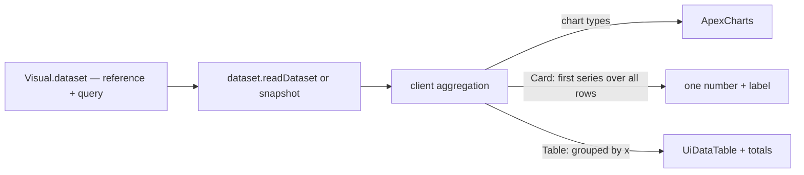

# Dashboard Card and Table Visuals

A dashboard visual is an ApexCharts chart — `VisualType` runs from Area to Treemap — or one of two plain kinds that lead the picker: a Card and a Table. A visual reads a dataset through one query of an x column and aggregated series ([dashboard data binding](../dashboard-data-binding/design.md)), and shows demo data until it is bound. The two kinds answer the questions a report is most often opened for: **the number** ("412 responses", "average rating 4.3") and **the exact values** behind a chart. In Power BI those are the Card — a measure's value as a large callout with its label — and the Table — rows and columns with headers and a totals row, for "reviewing and comparing detailed data and exact values rather than visual representations".

## What it adds

`VisualType` has `Card` and `Table` first, since they are the plainest. Neither is an ApexCharts chart, so each renders through its own component while keeping everything else a visual has: its grid layout item, its dataset binding and snapshot on publish, its per-visual refresh, its loading and error states and the row-cap warning.

- **Card** — one number, large, with its label under it. Bound, it reads the query's first series (a column and an aggregation — count, sum, average, minimum, maximum) over **every** row, ignoring the x column, since a card has no category axis. The label is the title its chart configuration holds, and when that is empty it defaults to "_aggregation_ of _column_". Unbound, it shows the demo value. A value of a thousand or more is written in the compact form (12K), as Power BI's display units do by default; a smaller value keeps `NUMBER_FORMATTER`'s decimals.
- **Table** — the query's grouped result as a `UiDataTable`: the x column's values as rows, one column per series, sortable by header, with a totals row that sums a series whose aggregation is count or sum. An average or an extreme is left blank, since a total of averages is not an average. Numbers read through `NUMBER_FORMATTER`. It is the same aggregation the chart visuals compute on the client, so a Table beside a Bar over the same binding shows the Bar's exact values.
- **Chart options do not apply.** The visual's edit dialog hides the chart type and the chart settings for both kinds, and shows the label for a Card alone. Both kinds keep the one common chart type, which the edit form never offers. The chart-interaction features ([dashboard chart interaction](../dashboard-chart-interaction/design.md)) stay chart-only.

## What is deliberately not in it

- **No multi-card, categories, callout images or conditional formatting** (the modern Power BI card's layout options). One number per Card; a second number is a second Card on the grid.
- **No matrix (pivot) visual.** A Table grouped by one column covers the exact-values need; a pivot is the Sheet's job.
- **No cross-highlighting from a Table row.** Linked highlighting belongs to the charts.
- **The binding form asks for an X column a card ignores.** A card's query takes its one value over every row, but `DatasetQuery.xColumn` is required, so the field stays until that query shape is made optional, a change to the shared dataset query rather than to the card.

## Key files

| File                                                                   | Role                                                                               |
| ---------------------------------------------------------------------- | ---------------------------------------------------------------------------------- |
| `apps/web/shared/models/dashboard/data/VisualType.ts`                  | `Card` and `Table`, in the enum's sorted order                                     |
| `apps/web/app/components/Dashboard/Visual/Index.vue`                   | dispatches the two non-chart kinds to their components                             |
| `apps/web/app/components/Dashboard/Visual/Card.vue`                    | the one number, its label and its compact form                                     |
| `apps/web/app/components/Dashboard/Visual/Table.vue`                   | the grouped rows, the sortable columns and the totals row                          |
| `apps/web/app/services/dashboard/VisualTypeItemCategoryDefinitions.ts` | the picker lists the two plainest kinds first, then the rest in the enum's order   |
| `apps/web/app/services/dashboard/dataset/VisualTypeDatasetShapeMap.ts` | a shape for each, so `computeDatasetVisualPropsData` hands them the grouped result |
| `apps/web/app/services/dashboard/chart/VisualTypeChartTypesMap.ts`     | the two kinds take the common chart type                                           |
| `apps/web/app/services/dashboard/demo/VisualTypeDemoDataMap.ts`        | the demo value and demo rows an unbound Card and Table show                        |
| `apps/web/app/components/Dashboard/Visual/Preview/EditFormDialog.vue`  | hides the chart type and chart settings for the two kinds, shows the Card's label  |
| `apps/web/shared/services/intl/constants.ts`                           | `NUMBER_FORMATTER`, the number formatter a Card and a Table share                  |

## Sources

- [Microsoft Learn — card visual in Power BI](https://learn.microsoft.com/en-us/power-bi/visuals/power-bi-visualization-card) — a measure's value as the card's callout, and display units abbreviating large numbers by default.
- [Microsoft Learn — table visualizations in Power BI](https://learn.microsoft.com/en-us/power-bi/visuals/power-bi-visualization-tables) — headers and a totals row, and when a table beats a chart: exact values across several measures per category.
