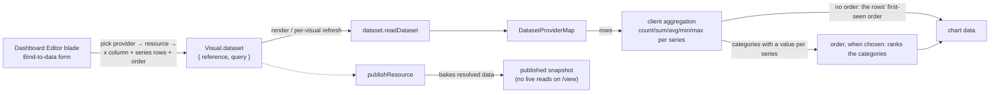

# Dashboard Data Binding

A dashboard visual can bind to a `DatasetReference` (survey responses, a Sheet resource) instead of only embedding static chart data — the marquee cross-product integration, applying the [datasets standard](../../architecture/dataset/design.md) to the dashboard product. A bound visual resolves its chart data from `dataset.readDataset` at render time; static visuals work without one — binding is additive.

## How it works



## Data model

`Visual.dataset?: VisualDatasetBinding` — stored inside the dashboard content blob, no DB columns:

```ts
// apps/web/shared/models/dashboard/data/VisualDatasetBinding.ts
interface VisualDatasetBinding {
  reference: DatasetReference;
  query: DatasetQuery; // { xColumn, series: { column, aggregation }[], order?: { direction, seriesIndex? } }
  snapshot?: Dataset; // baked in at publish time
}
```

## Behavior

- **Bind-to-data form** (in the Dashboard Editor blade): pick a provider → pick a resource via the shared `DatasetReferencePicker` → pick the x column and edit multiple series rows (column + aggregation, add/remove), then choose the order.
- **Which types bind**: a query gives one aggregated value per category, and `VisualTypeDatasetShapeMap` says how each visual type draws that — as axis categories with a series per aggregation (the chart types, and a table of the same), as a single series' labels (pie, polar area, radial bar), as `{ x, y }` points (treemap, slope), or as one value over every row with no category at all (a card, which takes the first series alone). A candlestick, box plot, range area, range bar or bubble draws several values per point, which no aggregation gives, so its edit form explains that in place of the binding form, switching a visual to one clears its binding, and it shows demo data.
- **Order**: the query's optional `order` ranks a bound visual's categories by the category or by one of its series, ascending or descending. A series is named by its place in the query, and the Order control offers the row order (no order), the category, and each series. The ranking runs over the aggregated values, never the rows, and its sort is stable, so categories that tie keep the order their rows first name them. Removing a series moves the series after it up a place with its order, and removing the series an order ranks by drops the order. Because the order is applied where categories are built, a table, a pie's slices and the exported CSV all follow it; a card has no category axis and ignores it. A stored order naming a series the query does not have is refused on save.
- **Render**: a resolver computes chart data from the fetched `Dataset` per bound visual, with loading and error states per visual and a manual refresh action.
- **Publish**: published dashboards bake the resolved data into the snapshot ([publishing](../../architecture/publishing/design.md)) — the public view never issues live dataset reads. The snapshot is a public read, so `projectDatasetToQuery` keeps every row but only the columns the visual's query reads: a chart of one survey question publishes that question's answers and no other.

## Key files

| File                                                                                  | Role                                                                                                    |
| ------------------------------------------------------------------------------------- | ------------------------------------------------------------------------------------------------------- |
| `apps/web/shared/models/dashboard/data/VisualDatasetBinding.ts`                       | binding shape — reference + query, plus the optional publish-time snapshot                              |
| `apps/web/shared/models/dataset/DatasetQuery.ts`                                      | x column, aggregated series and the optional order; refuses an order naming a series the query lacks    |
| `apps/web/shared/models/dataset/DatasetQueryOrder.ts`                                 | the order: a direction, and the series place it ranks by, absent to rank by the category                |
| `apps/web/shared/models/dataset/DatasetOrderDirection.ts`                             | the order's direction, ascending or descending                                                          |
| `apps/web/app/services/dashboard/dataset/VisualTypeDatasetShapeMap.ts`                | how each visual type draws a query's result, or that it cannot                                          |
| `apps/web/app/services/dashboard/dataset/computeDatasetVisualPropsData.ts`            | groups the rows by category, aggregates each series, and orders the categories before the axis is drawn |
| `apps/web/app/services/dashboard/dataset/getCategoryComparator.ts`                    | the comparator an order sorts categories by: a series' value, or the category, in its direction         |
| `apps/web/app/services/dashboard/dataset/removeDatasetQuerySeries.ts`                 | removing a series, with the order following the series it ranked by                                     |
| `apps/web/app/models/dashboard/CategoryEntry.ts`                                      | a category with the value each series aggregates to over its rows                                       |
| `apps/web/app/services/dashboard/export/exportDashboardVisualCsv.ts`                  | a visual's CSV, the drawn rows in the order they are drawn                                              |
| `apps/web/app/services/dashboard/setVisualType.ts`                                    | the type switch: chart fallback and the binding clear                                                   |
| `apps/web/app/components/Dashboard/Visual/Preview/DatasetBindingForm/Index.vue`       | the binding form: the x column, the series rows and the Order control beneath them                      |
| `apps/web/app/components/Dashboard/Visual/Preview/DatasetBindingForm/Order/Index.vue` | the Order by and Direction controls                                                                     |
| `apps/web/app/components/Resource/Dashboard/Editor.vue`                               | canvas incl. bind-to-data flow                                                                          |
| `apps/web/app/components/Resource/Dashboard/View.vue`                                 | published renderer over baked data                                                                      |
| `apps/web/app/components/Dataset/ReferencePicker.vue`                                 | shared provider/resource picker; one reader lists every provider type's sources                         |
| `apps/web/app/services/dataset/DatasetProviderTypeSourceRouterMap.ts`                 | the router each provider type lists its sources from                                                    |

## Notes

- Aggregation runs client-side over the row-capped dataset — no server query language. Revisit only if the row cap becomes a real limit ([dataset row cap](../../../deferred/resource/dataset-row-cap-pagination/design.md)).
- Fetch on dashboard load; live updates are deferred ([realtime dataset refresh](../../../deferred/resource/realtime-dataset-refresh/design.md)).
- A bound visual whose source is deleted or unreadable renders an error state, never breaks the dashboard; a source that is gone says to pick another or restore it, there and under the binding form's Source picker ([datasets](../../architecture/dataset/design.md)).
- A viewer's CSV and the published page image are read from the snapshot, so they hold no live value ([dashboard export](../dashboard-export/design.md)).
- An order names its series by place rather than by column and aggregation, so editing the ordered series keeps the order on it. The cost is that a removal moves places, which is why removing a series follows the order instead of leaving it on a different series.
- A category order compares numbers as numbers only when every category reads as one. Comparing pair by pair would let a mixed set cycle, since a number and a text can each sort before the other in turn.

## Sources

- [Microsoft Learn — Change How a Chart Is Sorted in a Report](https://learn.microsoft.com/en-us/power-bi/consumer/end-user-change-sort): a visual is sorted by a chosen field in an ascending or descending direction, the choice the Order control takes by its category or series.
