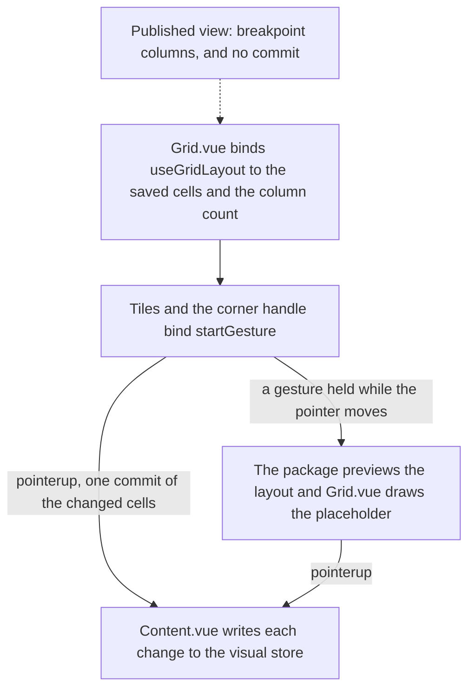

# Dashboard grid of the app's own

The dashboard's visuals sit on a grid the app binds to `vue-grid-layout-headless`, the package that places items and runs their pointer gestures. The package holds the behaviour and the dashboard holds the look: the tiles, the corner handle, the placeholder and the saved layout the grid reads and writes.

## How it works

The editor and the published view both render through one component, `apps/web/app/components/Dashboard/Grid.vue`, which calls the package's `useGridLayout` with the visuals' saved cells, the column count and the row height, and draws what it returns. Each visual is a tile at its geometry. The saved layout is first fitted to the columns on screen and compacted, so a narrower screen reflows without overlap and nothing is written.

A press on a tile starts a gesture in the package, and a move past the start distance becomes a drag. While the gesture runs the package holds the layout the gesture would leave, and the grid draws only a placeholder where the visual will land, so the store is not touched. On release the package commits the cells that changed, once, and the editor writes each change into the visual store. A cancelled pointer discards the gesture.

**Breakpoints are published only.** The published view picks a column count from its width, 12 at 1200 pixels and above down to 2 below 480, and reflows its visuals with it. The editor always has the full 12 columns and saves what the user sets.

## Data model

A placed visual is a `LayoutItem` of four integers in grid cells: `x` and `y` for its origin, `w` and `h` for its span, with `y` nonnegative. `layoutItemSchema` in `apps/web/shared/models/dashboard/data/LayoutItem.ts` validates it. The grid keys each tile by the visual's `id`, so a commit names the visual it changes and carries only those four fields.

## Decisions

- **The library is replaced, not patched.** `grid-layout-plus` carried the drag library, its layout shape and its own resize rules, and keeping it would keep the defects its [upstream verdicts](../../vue-grid-layout-headless/README.md) judge. The placement and gestures now live in the package, which the dashboard consumes like any other.
- **Resize has one corner handle.** A dashboard resizes from its bottom-right corner, so that is the one handle the editor draws. Per-edge handles were rejected for this component, since each edge's resize would need the placement logic on its own side. The grid package builds them once, for every consumer.
- **The grid emits changes, not a whole layout.** Emitting a new layout array on each move, which a parent would copy back, was rejected. The commit carries only the changed visuals and fires once on release, so the store and its autosave see one write per gesture rather than one per pointer move.
- **Rendering compacts; it does not write back.** A saved layout can overlap: a new visual is placed at a fixed cell without checking its neighbours, so rendering a fitted layout can draw a visual above or below its saved row while the store keeps the saved cell. Writing the compacted layout back to the store on render was rejected: it would write on every open.
- **A drag previews in the grid until release.** Writing each intermediate position to the store during a drag was rejected. The preview lives in the package's state until release, so a cancelled drag leaves no trace.
- **Touch is captured only where the page is edited.** Setting `touch-action: none` on every tile was rejected, since it stops a phone from scrolling a published dashboard through its visuals. The published grid leaves touch alone, and the editor claims it for dragging.

## Key files

| File                                                                | Role                                                                        |
| :------------------------------------------------------------------ | :-------------------------------------------------------------------------- |
| `apps/web/app/components/Dashboard/Grid.vue`                        | The dashboard's markup over the package: tiles, corner handle, placeholder  |
| `apps/web/app/components/Dashboard/Editor/Content.vue`              | The editor binding: twelve columns, one store write per commit              |
| `apps/web/app/components/Dashboard/Index.vue`                       | The published view: breakpoint columns, nothing saved                       |
| `apps/web/app/services/dashboard/constants.ts`                      | The dashboard's column counts, row heights, the grid margin and breakpoints |
| `apps/web/app/services/dashboard/grid/getBreakpointColumnNumber.ts` | The column count a published view's width picks                             |
| `apps/web/shared/models/dashboard/data/LayoutItem.ts`               | The placement schema: `x`, `y`, `w` and `h` as cells                        |
| `apps/web/app/components/Resource/Dashboard/Editor.vue`             | The autosave that the store write feeds                                     |

The package the grid is built on is [grid layout](../../vue-grid-layout-headless/grid-layout/design.md).

## Sources

- [Pointer Events, W3C](https://www.w3.org/TR/pointerevents/): pointer capture, the pointer cancel path, and `touch-action`, which the editor's tiles set and the published view leaves unset.
