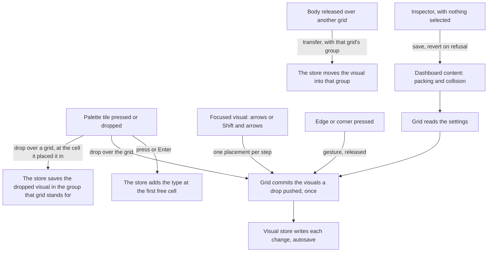

# Dashboard grid of the app's own

The dashboard's visuals sit on a grid the app binds to `vue-grid-layout-headless`, the package that places items and runs their pointer gestures. The package holds the behaviour and the dashboard holds the look: the tiles, the handles, the placeholder, the Visuals region, the inspector, and the saved layout the grid reads and writes. The editor offers every control the package builds, and each control is shown only where its use earns it, so the editor is the canvas and its occasional commands sit one step away.

## Surface

Every visible control of the dashboard, in the editor and on the published page, with the task it serves, how often it is used, where it lives and why it is there. A control that cannot answer all five is removed rather than shown.

| Control                | Task it serves                                                                                        | How often            | Where it lives                                                                                                                                      | Why there                                                                                                                                    |
| :--------------------- | :---------------------------------------------------------------------------------------------------- | :------------------- | :-------------------------------------------------------------------------------------------------------------------------------------------------- | :------------------------------------------------------------------------------------------------------------------------------------------- |
| Visual count           | Says how many visuals the canvas holds, a group's included                                            | every edit           | editor header, left                                                                                                                                 | Reads before the one action; the header is the canvas's bar                                                                                  |
| Add visual             | Adds an area visual at the first free cell                                                            | every edit           | editor header, right, the one accent action                                                                                                         | The only primary action on the surface, so the eye finds it first                                                                            |
| Layout settings        | Sets how visuals pack and what a drop does                                                            | rarely               | the inspector at the end of the editor, while nothing is selected                                                                                   | The setting of the whole canvas is what the reader sees with nothing selected, so the inspector holds it and the bar needs no second control |
| Visuals palette        | Chooses a visual type to drop or press                                                                | sometimes            | the Visuals region at the start edge: docked beside the grid on a wide window, a sheet on a medium or compact one, closed until the reader opens it | Types are chosen where they land, and a docked region keeps the grid wide while it is closed                                                 |
| Palette tile           | Adds a visual of its type, inside the group it is dropped on                                          | sometimes            | a tile in the Visuals region, under Charts or Layout                                                                                                | Dragging lands it where dropped; pressing or activating it is the touch and keyboard path                                                    |
| Visual menu (⋯)        | Holds a visual's occasional actions: edit, duplicate, export, fit height, move to, delete             | sometimes            | the top-right corner of each editor visual, always shown                                                                                            | One place for the occasional actions; always shown because a touch screen has no hover to reveal it                                          |
| Edit visual            | Shows the visual's form in the inspector, or a group's title                                          | every edit           | the inspector, for the selected visual; a press or Enter selects a visual, and the menu's Edit does too                                             | The form sits beside the grid, so a change shows on the tile it edits; pressing a visual is how it is opened, so it needs no button          |
| Resize handles         | Resize from the eight edges and corners; a visual sized to its content, its left and right edges only | every edit           | the visual's edges and corners: invisible hit areas, with the cursor and the visual's outline showing them on hover or focus                        | The cursor and an outline say "resizable"; a permanent dot would clutter every visual                                                        |
| Copy link to this view | Shares the reader's view of one visual                                                                | rarely               | the visual's corner, in both views                                                                                                                  | The visual is drawn by one renderer in both views, so the mark stays where the reader already finds it                                       |
| Refresh data           | Re-reads a bound visual's rows                                                                        | sometimes            | the visual's corner, when bound and live                                                                                                            | Shown only where a read exists to refresh                                                                                                    |
| Export CSV             | Downloads a bound visual's rows                                                                       | sometimes            | the published visual's corner; the editor's menu, never a group's                                                                                   | A viewer's download stays on the page; in the editor it is occasional, so it waits in the menu                                               |
| Fit height to content  | Takes a table's or a group's height from its content                                                  | sometimes            | the visual's menu, tables and groups                                                                                                                | Only a table or a group has content that sets its height, so no chart carries the item                                                       |
| Duplicate visual       | Copies a visual below itself, with the visuals a group holds                                          | sometimes            | the visual's menu                                                                                                                                   | Occasional, and beside the visual's own menu                                                                                                 |
| Delete visual          | Removes a visual after confirmation, naming the visuals a group takes with it                         | rarely               | the visual's menu, marked as danger, then a confirm dialog                                                                                          | Destructive, so it is off the visual's face and asks first                                                                                   |
| Move to…               | Moves a visual into a group, or back onto the dashboard                                               | rarely               | the visual's menu, where the visual has a group or the dashboard to go to                                                                           | A drop reaches a group only by a drag, so the menu is the keyboard and touch route into one, and across the grids                            |
| Keyboard step          | Moves or resizes a focused visual                                                                     | sometimes            | no control; listed in the shortcuts dialog                                                                                                          | Keys need no chrome; the dialog is where the keys are listed                                                                                 |
| Empty state            | Says how to add the first visual                                                                      | once per dashboard   | the grid's place when there are no visuals                                                                                                          | Says what the header and palette do, so nothing is left to guess                                                                             |
| Group header           | Names a group, and its press moves the group                                                          | every view           | the top of a group's frame: always in the editor, and on the published page when the group is titled                                                | A press inside a group's grid belongs to that grid, so the header and the frame are the group's own place to be grabbed                      |
| Group drop area        | Says how to fill an empty group                                                                       | once per empty group | the empty group's grid, in the editor only                                                                                                          | An empty group is a blank box until a visual is in it, so it names the two ways in                                                           |

Nothing else is visible. The published page keeps its title, Export PNG and the visuals; the Visuals region, the inspector, the bar, the visual menu and the keys do not render for a viewer. A published visual is not marked for an outline, so none is drawn when the pointer moves over it.

### Layout, desktop and phone

On desktop the editor is a bar over the canvas, holding the count and Add visual on one row. Beside the canvas the Visuals region is open at the start edge until the reader closes it, a column of type tiles under Charts and Layout, and the inspector is open at the end edge, showing the dashboard's settings while nothing is selected. The grid takes the width between them at `DASHBOARD_NO_COLUMNS` columns. Each visual shows its menu mark at the top right, and an outline when the pointer is over it or focus is within it. The corner marks are inset from the right by the `--dashboard-cap` token the tile's corner handle is drawn with, and from the top by the whole `--dashboard-handle` token, since the cap's percentage has no height to resolve against on an auto-height tile, so no mark covers a handle.

On a phone, the bar keeps the same marks, and the count truncates before a control does. The Visuals region and the inspector are sheets from their edges, closed until the reader opens them, so the grid is the first thing on the screen; the reader opens the palette to add a visual, and the inspector to change a selection. The grid keeps `DASHBOARD_NO_COLUMNS` columns, since the editor's cell size is the same on every width and a narrower grid would change where saved visuals land. Visual menus stay visible on touch, since no hover exists there to reveal them. A touch press on a visual's edge is its move, since resizing is not a touch gesture: on a phone a visual is resized from the keyboard or, for a table, the menu's fit height.

A group's grid keeps the editor's `DASHBOARD_NO_COLUMNS` columns, and its header takes the group's own width. On the published page a group reflows by its own width, as the dashboard does by its own.

### States

- **Empty dashboard.** The empty state names both ways to add a visual: the header's Add visual, and dropping a palette tile on the grid.
- **Drag in progress.** The pressed visual lifts above the others with a lifted shadow and follows the pointer; the other visuals move aside as the push or swap setting says, and hold still while the pointer is over another grid that takes the visual. A group never moves aside: it is solid in its grid, so a visual dragged over its frame or header returns to where it was, and one released over its body joins the group.
- **Drop target.** The placeholder is drawn in the accent tint over the cell the visual would land on, the cell after any compaction.
- **Invalid drop.** Under block overlap the placeholder is drawn in the error tint at the attempted cell, and the release changes nothing, so the refusal is visible before the release. A visual dragged over a group's footprint is drawn the same way whatever the collision setting, since the group is solid in its grid.
- **Resize.** The visual resizes live with its edge; the placeholder outlines the cell it would take, and a visual is never smaller than one cell.
- **Small visual.** Each handle is at most a third of its visual in each axis, so the two corners of a visual one column wide never overlap. The edge handles run between the corners, and a visual too small for them keeps its corners. The keyboard reaches every size.
- **Sized-to-content visual.** It has the two side handles only, and a touch never resizes it. Its height is its content's, so the keyboard takes no vertical step.
- **Loading and error.** A bound visual's skeleton and error state are the visual's own, unchanged.
- **Empty group.** Its grid holds no visual, and its drop area names the two ways to fill it.
- **Group at the depth cap.** A group at the cap holds plain visuals only, and its menu's Move to offers no group that would take it past the cap.
- **Refused move.** A move or an add the store would refuse changes nothing, and the refusal alerts the owner. A body released over a group the grid refuses, one past the depth cap, changes nothing and alerts nothing: that group draws no placeholder, and the visual's own grid previews its layout while the pointer is over it, so a release there returns the visual.
- **A group released over itself.** A group is never a target for its own body or for the groups it holds: the grid does not hit them while the group is dragged, so a release over them is an ordinary move within the grid the group sits in, and nothing is refused or alerted.

### Keyboard model

The editor's visuals are tab stops in their order. Tab moves between them, Enter selects the focused visual and opens its form in the inspector, the arrow keys move it one cell, and Shift with an arrow key resizes it one cell from its bottom-right corner. Each step is saved as it is made, so there is no pick-up mode to cancel. A step that would leave the grid, or land on another visual under block overlap, changes nothing. The keys are the grid's own commands, listed in the shortcuts dialog and never bound as global shortcuts, so they do nothing while a field has focus. The editor registers them once, from its content, and only while the dashboard holds a visual for them to act on, so a dashboard holding groups lists each key once: a group's grid takes the same keys and registers none.

A group's visuals are tab stops of the group's own grid, and an arrow key steps only the visual it is pressed on, never the group around it. The menu's Move to is the route into another group from the keyboard.

## How it works

`Grid/Index.vue` binds `useGridLayout` to the visuals, the column count, the row height and the dashboard's collision and compaction settings. Each visual is a `Grid/Tile.vue`, which carries its handles (eight, or the two side handles of a sized-to-content visual), the keyboard step and, for a table with fit height on, its own measured height. The Visuals region and the inspector live beside the grid in the editor only, drawn by the editor shell. A group's frame, `Visual/Group.vue`, draws its header and a nested `Grid/Index.vue` over its visuals, so a group's grid is the dashboard's own grid. A body released over a grid other than the one the visual left hands the store the visual, the group that grid stands for and the cell, and the store moves it there.

A press on a visual's edge or corner is a gesture of the package, and the grid previews the layout it would leave. A drop from the palette is the package's external drag: the grid previews the landing cell and refuses it under block overlap. A release that is not refused hands the store the cell the package placed the new visual in, and the package commits the visuals that drop pushed, once. A keyboard step is a single placement committed at once. The editor writes each committed change into the visual store, which autosaves the dashboard.

Fit height is a flag on the visual. A tile whose visual fits its height has no fixed height of its own; the tile measures what its table draws and reports it, and the package takes the whole rows that hold it, as one commit.

The layout settings are two fields on the dashboard's content, each a closed set: how items pack, and how a drop on another item resolves. A new dashboard starts packing upward and pushing, and every stored dashboard carries both. The published view passes the same two settings to the same grid.

**Breakpoints are published only.** The published view picks a column count from `DASHBOARD_BREAKPOINTS` by its width, from `DASHBOARD_NO_COLUMNS` at the widest breakpoint down to the fewest at the narrowest, and reflows its visuals with it. It draws the grid only once that width is known, so a first frame never picks the narrowest breakpoint. The editor always has the full `DASHBOARD_NO_COLUMNS` and saves what the user sets. A group's grid reflows by the group's own width.

## Data model

A placed visual is a `LayoutItem` of four integers in grid cells: `x` and `y` for its origin, `w` and `h` for its span, with `y` nonnegative. `layoutItemSchema` in `apps/web/shared/models/dashboard/data/LayoutItem.ts` validates it. The grid keys each tile by the visual's `id`, so a commit names the visual it changes and carries its `id` with those four fields.

## Groups

A group is a visual whose type is `VisualType.Group`. It holds other visuals on a grid of its own, drawn and placed by the same grid as the dashboard's own visuals. It draws no chart: it has no chart type, no dataset shape and no resolver, its demo visual is an empty demo series, and it takes no dataset binding. Its title is the `chart.configuration.title` every visual carries, and it uses no other chart field.

Its children are the optional field `visuals` on `Visual`. A group holds it as an array, which may be empty, and every other type leaves it absent, as `undefined`, never as an empty array. `visualSchema` is recursive through a getter, so a group's visuals are the visual schema again, nested by reference, and the agent's JSON Schema describes one visual definition that each group reuses. The schema refuses a group without `visuals`, a visual of another type that holds them, and a group with a dataset binding. The field is additive and optional, so nothing already stored is invalid, and no backfill or default is owed.

The tree rules are checked over the dashboard's visuals in `dashboardSchema`, which refuses three things no single visual can see. A visual id held twice anywhere in the tree is refused, so an id is unique across every level rather than only within the dashboard's own list. A group nested inside more groups than `MAX_VISUAL_GROUP_DEPTH` allows is refused: the top level counts as none, and a group at the cap holds plain visuals only, since a group inside it would pass the cap. The visuals of the whole tree together are held to `MAX_RESOURCE_CONTENT_SIZE`, and every list keeps its own array cap at the same constant.

Every write names a visual by its id alone, so no write carries a path into the tree. The store finds the list holding an id by walking the tree, and the list's owning group, if any, comes back with it. Save, the fit-height flag, delete, duplicate and the grid's commit all find their visual this way, so a commit reaches a visual wherever it sits. A rollback lands on the list the write started from, a create lands on the dashboard's own list, and an add takes an optional parent group id. A visual placed in a group takes the first free cell of that group's grid, and a group whose depth would pass the cap is refused where it is created or moved. Duplicating a group copies its whole subtree under fresh ids and places the copy below the original in the same list. Deleting a group removes the visuals it holds with it. A move takes a visual, with the subtree it holds, into another group's list at the cell given, or at the first free cell of that list when none is given. It refuses a move into the visual itself or into a group it holds, and a move that would nest any group it carries past the cap. A move within one list is the grid's own commit.

The consumers of a dashboard read its groups through `listVisuals`. A published dashboard bakes a dataset snapshot for every bound visual in the tree, the snapshot summary counts every visual, the resource link index reads a binding held inside a group, and blueprint capture and validation read a group's bindings like any other. The editor draws a group as a frame, a header with its title over a nested grid of its visuals, and a drop area while it is empty. The published page draws the same tree read-only through the same renderer, `Visual/Index.vue`, which takes each child's chrome from its caller, so a bound child keeps its export there. A group's form in the inspector changes its title alone, since a group has no chart type or dataset, and its fit height, as a table's, sets its height from its content.

## Decisions

- **The library is replaced, not patched.** `grid-layout-plus` carried the drag library, its layout shape and its own resize rules, and keeping it would keep the defects its [upstream verdicts](../../vue-grid-layout-headless/README.md) judge. The placement and gestures live in the package, which the dashboard consumes like any other.
- **Resize from all eight edges and corners, not the corner alone.** A visual that grows only from its corner cannot be pulled from its left or top edge, so a corner-only handle is rejected; the package builds every edge's resize, and the dashboard draws them over it.
- **The handles are invisible hit areas, and the outline and the cursor show them.** Eight permanent dots on every visual are rejected: they are the noisiest thing on the canvas and say nothing a cursor and an outline do not say.
- **A sized-to-content visual has side handles only.** Its height is its content's, so a handle that pulled it would reserve rows the content does not fill. The package also refuses such a gesture and step, so no handle is needed to say so.
- **A touch does not resize.** A handle is a precise target a finger cannot aim at a one-column edge, so the grid takes a touch press on a handle as a press on its body, and the touch moves the visual rather than resizing it.
- **The palette is a region the reader opens, not a strip above the grid.** A docked region at the start edge keeps the grid wide while it is closed and gives the groups room while it is open. On a narrow window it is a sheet, since a column would take the phone's narrow width. Rejected: the strip above the grid, which spent the grid's height on a row of chips that wrapped and collapsed.
- **Add visual stays the one accent action.** Making the palette the primary action is rejected: the palette chooses a type, and the common case is one default visual, which the accent button already adds.
- **The occasional actions wait in one menu.** A row of buttons on every visual is rejected for the menu the reader already knows from a list. Delete asks first and is marked as danger.
- **The layout settings are the inspector's face while nothing is selected.** The setting of the whole canvas is what a reader looks at when nothing is selected, so the inspector shows it there and no bar control opens it. Rejected: the popover on the bar, which kept a rarely used setting in the bar's row and gave the editor a second way to open a form.
- **The keyboard steps the visual, with no pick-up mode.** A pick-up, move and drop mode is rejected: each step is already a complete, valid placement, so saving each one needs no cancel, and a mode needs more announcement than a step.
- **Fit height measures the tile, not the chart.** A chart's height is its own choice, so only a table, whose rows set its height, offers the item.
- **Copy link and Refresh stay on the visual's corner in the editor.** Removing them from the editor needed a second visual renderer or a prop that the one renderer would carry to every caller; they are the visual's own marks, and the editor's corner has room for them. A chart tile draws the charting library's own toolbar along the same corner, so the marks start below it and neither covers the other; a card or a table has no toolbar and keeps the marks at the corner.
- **A new item's cell is the grid's own placement.** The palette does not compute its cell: the package does, so the drop, the press and the refusal agree.
- **The grid emits changes, not a whole layout.** Emitting a new layout array on each move, which a parent would copy back, is rejected. The commit carries only the changed visuals and fires once on release. The store applies it one visual at a time, and its autosave flushes once for the gesture rather than once per pointer move.
- **Rendering compacts; it does not write back.** A saved layout can overlap: a new visual is placed at a fixed cell without checking its neighbours, so rendering a fitted layout can draw a visual above or below its saved row while the store keeps the saved cell. Writing the compacted layout back to the store on render is rejected: it would write on every open.
- **A drag previews in the grid until release.** Writing each intermediate position to the store during a drag is rejected. The preview lives in the package's state until release, so a cancelled drag leaves no trace.
- **Touch is captured only where the page is edited.** Setting `touch-action: none` on every tile is rejected, since it stops a phone from scrolling a published dashboard through its visuals. The published grid leaves touch alone, and the editor claims it for dragging.
- **A write names its visual by a path, rejected.** A path into the tree goes stale the moment a move changes it, and the id already identifies the visual wherever it sits, so every write names the id alone.
- **The tree is one flat list with a parent id, rejected.** Each visual would name its group, which loses the grid each group lays out and makes the nesting rules a property every reader rebuilds the tree to check, where the schema checks the tree as it is stored.
- **The look is the dashboard's own style.** `grid-layout-plus` shipped its CSS inside its JavaScript and wrote it into the page at runtime, which is rejected: the app's build never sees CSS a script writes, so it could not be prefixed, transpiled or minified with the rest ([grid-layout-plus#26](https://github.com/qmhc/grid-layout-plus/issues/26)), and the tiles would wear the library's class names and colours rather than the UI library's tokens. The package ships no styles, and the scoped style block in `Grid/Tile.vue` draws the tiles and their handles, and `Grid/Index.vue` draws the placeholder.
- **A group's grid is the dashboard's own grid.** A second grid for groups is rejected: two gesture, placement and keyboard implementations would have to be kept in step by hand, so the group mounts the same `Grid/Index.vue` over its visuals.
- **A group is solid in its grid, not a drop zone for its whole tile.** The editor marks a group solid through the grid's `checkIsSolid`, so a visual dragged over it is refused in the grid around it and the group stays in its cell, and the visual joins the group by its body alone. A drop zone covering the group's whole tile was rejected: it would decide which grid the pointer targets, but the group's footprint pushes the group out from under the pointer while the pointer is still on the grid around it, so the zone never receives the pointer.
- **A group is moved by its header and frame, not by its grid.** A press inside a nested grid belongs to that grid, so a group grabbed anywhere in its grid would move a child instead. The header and the frame are the group's own, so a press on them moves the group.
- **The editor and the published page draw a group with one renderer.** A separate read-only renderer for the published page is rejected: each child would be drawn two ways, and its export and menu would drift apart. The renderer takes each child's chrome from a slot, and its caller decides what the view shows.
- **Move to is a menu route as well as a drag.** A drop is the only drag route into a group, and a keyboard or a touch cannot make it, so the menu names each destination in words.
- **A group's form is its title.** A group has no chart type or dataset, so its form in the inspector is the title field alone, and the type list offers no group: the palette alone places one.
- **The edit form is in the inspector, and a valid draft is written onto its visual as it changes.** A dialog covers the grid the change is seen on, and a Save button would make a change wait for a press. The form edits a draft, so a half-typed invalid value reaches neither the tile nor a save, and the autosave persists what is written. Rejected: the dialog, which covered the canvas, and a Save button, which a form change waited on.

## Notes

- The Visuals region and the inspector are editor-only, so the viewer's page holds no control the editor would need.
- The outline's colour, the handles' invisibility and the corner cap are checked by eye, since happy-dom does not compute the stylesheet. The tests pin which tiles carry the editable marker, which handles each tile draws, and which gestures a handle starts.
- The package's collision and compaction names are its own (`CollisionMode`, `CompactType`); the labels a reader sees are the plain words in the Surface table. The stored packing and overlap values are those enum members, so the shared model imports them rather than keeping a second list, and renaming one needs a backfill of every stored dashboard.

## Key files

| File                                                                   | Role                                                                                                                                                   |
| :--------------------------------------------------------------------- | :----------------------------------------------------------------------------------------------------------------------------------------------------- |
| `packages/vue-grid-layout-headless/src/composables/useGridLayout.ts`   | The gestures, the keyboard step, the external drop preview and the auto-height report                                                                  |
| `packages/vue-grid-layout-headless/src/services/startExternalDrag.ts`  | A palette press that previews and drops onto the grid under the pointer                                                                                |
| `packages/vue-grid-layout-headless/src/placement/getFirstFreeCell.ts`  | The first cell a new visual's span fits in                                                                                                             |
| `apps/web/app/components/Dashboard/Grid/Index.vue`                     | The grid: binds the package, emits the commit and the transfer, and refuses a body drop the move rule refuses                                          |
| `apps/web/app/components/Dashboard/Grid/Tile.vue`                      | One visual's tile: eight handles, the keyboard step, the fit-height measure                                                                            |
| `apps/web/app/components/Dashboard/Editor/Palette.vue`                 | The Visuals region's content: the charts, then the Layout category holding the group                                                                   |
| `apps/web/app/components/Dashboard/Editor/Settings.vue`                | The inspector's entry while nothing is selected: the two radio groups                                                                                  |
| `apps/web/app/components/Dashboard/Editor/VisualForm.vue`              | The inspector's entry for a selected visual, mounting its form once the selection has a draft                                                          |
| `apps/web/app/components/Dashboard/Editor/VisualFormFields.vue`        | The visual's form: type, chart, dataset binding and settings, written onto the visual as a valid draft changes                                         |
| `apps/web/app/components/Dashboard/Editor/GroupForm.vue`               | The inspector's entry for a selected group: its title, written onto the group as it is typed                                                           |
| `apps/web/app/services/dashboard/editor/DashboardLayout.ts`            | The editor's layout as data: the bar, the Visuals region and the inspector, with the selection kinds each shows                                        |
| `apps/web/app/services/dashboard/editor/DashboardEditorRegistry.ts`    | What each content key of the layout draws                                                                                                              |
| `apps/web/app/components/Dashboard/Editor/Header.vue`                  | The bar: the count of every visual, and Add visual                                                                                                     |
| `apps/web/app/components/Dashboard/Editor/Content.vue`                 | The editor binding: writes each commit and transfer, serves Move to and the delete confirm, and registers the keyboard commands once for all its grids |
| `apps/web/app/components/Dashboard/Visual/Preview/Container.vue`       | The editor's visual wrapper: the one menu, and the nested events a group's grid hands up                                                               |
| `apps/web/app/components/Dashboard/Visual/Preview/ActionsMenu.vue`     | The visual's menu: edit, duplicate, export, fit height, move to, delete                                                                                |
| `apps/web/app/components/Dashboard/Index.vue`                          | The published view: the saved packing, no editing control                                                                                              |
| `apps/web/app/store/dashboard/visual.ts`                               | Create, add and move between lists, the writes addressed by id, the selection, and the form draft applied to its visual                                |
| `apps/web/app/store/dashboard/index.ts`                                | The layout settings write, reverted on a refused save                                                                                                  |
| `apps/web/shared/models/dashboard/data/Dashboard.ts`                   | The content's packing and collision settings, and the tree checks over its visuals                                                                     |
| `apps/web/shared/models/dashboard/data/Visual.ts`                      | The visual's fit-height flag, and the visuals a group holds with the group's rules                                                                     |
| `apps/web/shared/services/dashboard/constants.ts`                      | The most groups a visual may sit inside                                                                                                                |
| `apps/web/shared/services/dashboard/listVisuals.ts`                    | Every visual of a tree, depth-first                                                                                                                    |
| `apps/web/shared/services/dashboard/findVisualList.ts`                 | The list holding a visual id, and the group owning that list                                                                                           |
| `apps/web/shared/services/dashboard/getVisualDepth.ts`                 | How many groups a visual sits inside                                                                                                                   |
| `apps/web/app/services/dashboard/VisualTypeCategoryDefinitions.ts`     | The palette's types by category: the charts, then Layout holding the group                                                                             |
| `apps/web/server/services/dashboard/transformPublishedDashboard.ts`    | Bakes each bound visual's dataset, a group's visuals included, into the published view                                                                 |
| `apps/web/shared/services/resource/SnapshotSummaryMap.ts`              | The dashboard's summary line, counting every visual in the tree                                                                                        |
| `apps/web/app/services/dashboard/constants.ts`                         | The dashboard's column counts, row heights, the grid margin and breakpoints                                                                            |
| `apps/web/app/services/dashboard/grid/getBreakpointColumnNumber.ts`    | The column count a published view's width picks                                                                                                        |
| `apps/web/shared/models/dashboard/data/LayoutItem.ts`                  | The placement schema: `x`, `y`, `w` and `h` as cells                                                                                                   |
| `apps/web/app/components/Resource/Dashboard/Editor.vue`                | The editor shell with its layout, the context read from the selected visual, and the autosave the store write feeds                                    |
| `apps/web/app/components/Dashboard/Visual/Group.vue`                   | A group's frame: the header, the drop area and the nested grid of its visuals                                                                          |
| `apps/web/app/components/Dashboard/Visual/Index.vue`                   | The one visual renderer, in both views: a group draws its children through a slot                                                                      |
| `apps/web/app/components/Dashboard/Visual/Preview/MoveDialog.vue`      | Move to: the groups a visual can enter, and the move the store places                                                                                  |
| `apps/web/app/components/Dashboard/Palette/Tile.vue`                   | A palette press adds, and a drop adds inside the group the grid under the pointer stands for                                                           |
| `apps/web/app/models/dashboard/DashboardGridTransfer.ts`               | What a grid hands the editor when a body is released over another grid                                                                                 |
| `apps/web/app/services/dashboard/visual/getVisualMoveTargets.ts`       | The groups a visual may move into, the dashboard first when it sits in a group, each repeated title numbered                                           |
| `apps/web/app/services/dashboard/visual/checkIsMoveTooDeep.ts`         | Whether a move would nest a group past the depth cap, one of the refusals `checkIsMoveRefused` applies                                                 |
| `apps/web/app/services/dashboard/visual/checkIsMoveRefused.ts`         | The one rule a move is refused by, which the store, the menu's Move to and the grid's drop all share                                                   |
| `apps/web/app/services/dashboard/visual/checkIsGroupTooDeep.ts`        | Whether a new group would sit past the depth cap, for the store's add and the palette's drop                                                           |
| `apps/web/app/services/dashboard/visual/getGroupTitle.ts`              | A group's title wherever it is named, with the untitled name standing in for an empty title                                                            |
| `apps/web/app/services/dashboard/visual/findVisualLocation.ts`         | A visual's id, with the group holding its list, from one search of the tree                                                                            |
| `apps/web/app/services/dashboard/visual/getVisualDeleteDescription.ts` | The delete confirm's sentence, counting the visuals a group holds                                                                                      |
| `apps/web/app/store/dashboard/dialog.ts`                               | The one delete and one move dialog, each naming the visual it is for                                                                                   |

The package the grid is built on is [grid layout](../../vue-grid-layout-headless/grid-layout/design.md).

## Sources

- [WAI-ARIA Authoring Practices, keyboard interface for grids and sortable lists](https://www.w3.org/WAI/ARIA/apg/patterns/listbox/): a focusable item with arrow keys to reposition it, and the one-step commit the model uses.
- [Pointer Events, W3C](https://www.w3.org/TR/pointerevents/): pointer capture for the palette press, the touch path, the pointer cancel path and `touch-action`.
- [grid-layout-plus#26, qmhc](https://github.com/qmhc/grid-layout-plus/issues/26): the report that the library injected its CSS from JavaScript.
