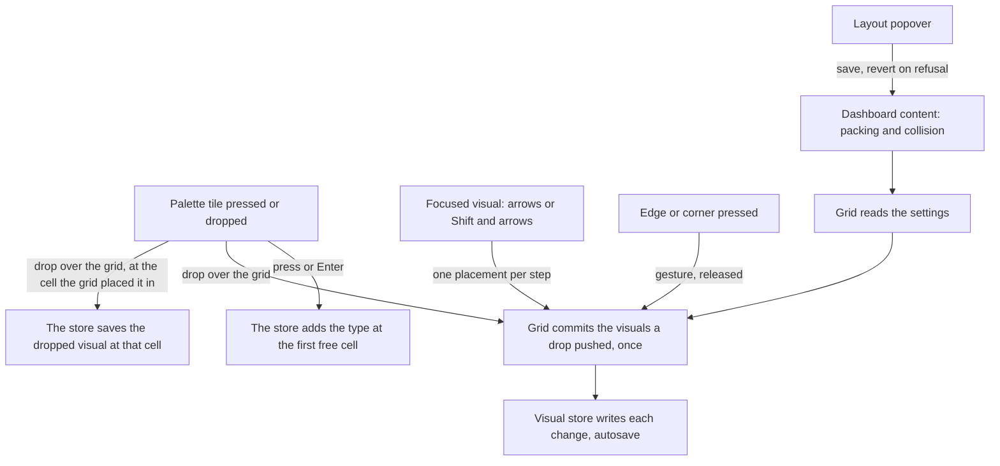

# Dashboard grid of the app's own

The dashboard's visuals sit on a grid the app binds to `vue-grid-layout-headless`, the package that places items and runs their pointer gestures. The package holds the behaviour and the dashboard holds the look: the tiles, the handles, the placeholder, the palette, the Layout popover, and the saved layout the grid reads and writes. The editor offers every control the package builds, and each control is shown only where its use earns it, so the editor is the canvas and its occasional commands sit one step away.

## Surface

Every visible control of the dashboard, in the editor and on the published page, with the task it serves, how often it is used, where it lives and why it is there. A control that cannot answer all five is removed rather than shown.

| Control                | Task it serves                                                                                        | How often          | Where it lives                                                                                                               | Why there                                                                                                              |
| :--------------------- | :---------------------------------------------------------------------------------------------------- | :----------------- | :--------------------------------------------------------------------------------------------------------------------------- | :--------------------------------------------------------------------------------------------------------------------- |
| Visual count           | Says how much the canvas holds                                                                        | every edit         | editor header, left                                                                                                          | Reads before the one action; the header is the canvas's bar                                                            |
| Add visual             | Adds an area visual at the first free cell                                                            | every edit         | editor header, right, the one accent action                                                                                  | The only primary action on the surface, so the eye finds it first                                                      |
| Layout                 | Sets how visuals pack and what a drop does                                                            | rarely             | editor header, quiet, a popover                                                                                              | A setting of the whole canvas belongs in its bar, and a popover keeps it one click away without taking the grid's room |
| Visuals palette        | Chooses a visual type to drop or press                                                                | sometimes          | a collapsible panel above the grid                                                                                           | Types are chosen where they land; above the grid, a row of chips costs no width                                        |
| Palette tile           | Adds a visual of its type                                                                             | sometimes          | a tile in the palette panel                                                                                                  | Dragging lands it where dropped; pressing or activating it is the touch and keyboard path                              |
| Visual menu (⋯)        | Holds a visual's occasional actions: edit, duplicate, export, fit height, delete                      | sometimes          | the top-right corner of each editor visual, always shown                                                                     | One place for the occasional actions; always shown because a touch screen has no hover to reveal it                    |
| Edit visual            | Opens the visual's edit form                                                                          | every edit         | the visual itself, by press or Enter; also the menu                                                                          | Pressing a visual is how it is opened, so it needs no button; the menu repeats it for those who look there             |
| Resize handles         | Resize from the eight edges and corners; a visual sized to its content, its left and right edges only | every edit         | the visual's edges and corners: invisible hit areas, with the cursor and the visual's outline showing them on hover or focus | The cursor and an outline say "resizable"; a permanent dot would clutter every visual                                  |
| Copy link to this view | Shares the reader's view of one visual                                                                | rarely             | the visual's corner, in both views                                                                                           | The visual is drawn by one renderer in both views, so the mark stays where the reader already finds it                 |
| Refresh data           | Re-reads a bound visual's rows                                                                        | sometimes          | the visual's corner, when bound and live                                                                                     | Shown only where a read exists to refresh                                                                              |
| Export CSV             | Downloads a bound visual's rows                                                                       | sometimes          | the published visual's corner; the editor's menu                                                                             | A viewer's download stays on the page; in the editor it is occasional, so it waits in the menu                         |
| Fit height to content  | Takes a table's rows from its content                                                                 | sometimes          | the visual's menu, tables only                                                                                               | Only a table has content that sets its height, so no chart carries the item                                            |
| Duplicate visual       | Copies a visual below itself                                                                          | sometimes          | the visual's menu                                                                                                            | Occasional, and beside the visual's own menu                                                                           |
| Delete visual          | Removes a visual after confirmation                                                                   | rarely             | the visual's menu, marked as danger, then a confirm dialog                                                                   | Destructive, so it is off the visual's face and asks first                                                             |
| Keyboard step          | Moves or resizes a focused visual                                                                     | sometimes          | no control; listed in the shortcuts dialog                                                                                   | Keys need no chrome; the dialog is where the keys are listed                                                           |
| Empty state            | Says how to add the first visual                                                                      | once per dashboard | the grid's place when there are no visuals                                                                                   | Says what the header and palette do, so nothing is left to guess                                                       |

Nothing else is visible. The published page keeps its title, Export PNG and the visuals; the palette, the Layout control, the visual menu and the keys do not render for a viewer.

### Layout, desktop and phone

On desktop the editor is a header over the canvas. The header holds the count, Layout and Add visual on one row. Beneath it the palette panel is open by default, a row of type chips that wraps, and the grid takes the full width at twelve columns. Each visual shows its menu mark at the top right, and an outline when the pointer is over it or focus is within it.

On a phone, the header keeps the same three marks, and the count truncates before a control does. The palette panel is closed by default, so the grid, not the chips, is the first thing on the screen; the reader opens it to add a visual. The grid keeps twelve columns, since the editor's cell size is the same on every width and a narrower grid would change where saved visuals land. The Layout popover is a popover anchored to its mark and sized to the viewport with `min()`, never a sheet. Visual menus stay visible on touch, since no hover exists there to reveal them. A touch press on a visual's edge is its move, since resizing is not a touch gesture: on a phone a visual is resized from the keyboard or, for a table, the menu's fit height.

### States

- **Empty dashboard.** The empty state names both ways to add a visual: the header's Add visual, and dropping a palette tile on the grid.
- **Drag in progress.** The pressed visual lifts above the others with a lifted shadow and follows the pointer; the other visuals move aside as the push or swap setting says.
- **Drop target.** The placeholder is drawn in the accent tint over the cell the visual would land on, the cell after any compaction.
- **Invalid drop.** Under block overlap the placeholder is drawn in the error tint at the attempted cell, and the release changes nothing, so the refusal is visible before the release.
- **Resize.** The visual resizes live with its edge; the placeholder outlines the cell it would take, and a visual is never smaller than one cell.
- **Small visual.** Each handle is at most a third of its visual in each axis, so the two corners of a visual one column wide never overlap. The edge handles run between the corners, and a visual too small for them keeps its corners. The keyboard reaches every size.
- **Sized-to-content visual.** It has the two side handles only, and a touch never resizes it. Its height is its content's, so the keyboard takes no vertical step.
- **Loading and error.** A bound visual's skeleton and error state are the visual's own, unchanged.

### Keyboard model

The editor's visuals are tab stops in their order. Tab moves between them, Enter opens the focused visual's edit form, the arrow keys move it one cell, and Shift with an arrow key resizes it one cell from its bottom-right corner. Each step is saved as it is made, so there is no pick-up mode to cancel. A step that would leave the grid, or land on another visual under block overlap, changes nothing. The keys are the grid's own commands, listed in the shortcuts dialog and never bound as global shortcuts, so they do nothing while a field has focus.

## How it works

`Grid/Index.vue` binds `useGridLayout` to the visuals, the column count, the row height and the dashboard's collision and compaction settings. Each visual is a `Grid/Tile.vue`, which carries its handles (eight, or the two side handles of a sized-to-content visual), the keyboard step and, for a table with fit height on, its own measured height. The palette and the Layout control live beside the grid in the editor only.

A press on a visual's edge or corner is a gesture of the package, and the grid previews the layout it would leave. A drop from the palette is the package's external drag: the grid previews the landing cell and refuses it under block overlap. A release that is not refused hands the store the cell the package placed the new visual in, and the package commits the visuals that drop pushed, once. A keyboard step is a single placement committed at once. The editor writes each committed change into the visual store, which autosaves the dashboard.

Fit height is a flag on the visual. A tile whose visual fits its height has no fixed height of its own; the tile measures what its table draws and reports it, and the package takes the whole rows that hold it, as one commit.

The layout settings are two fields on the dashboard's content, each a closed set: how items pack, and how a drop on another item resolves. A new dashboard starts packing upward and pushing, and every stored dashboard carries both. The published view passes the same two settings to the same grid.

**Breakpoints are published only.** The published view picks a column count from `DASHBOARD_BREAKPOINTS` by its width, from `DASHBOARD_NO_COLUMNS` at the widest breakpoint down to the fewest at the narrowest, and reflows its visuals with it. It draws the grid only once that width is known, so a first frame never picks the narrowest breakpoint. The editor always has the full `DASHBOARD_NO_COLUMNS` and saves what the user sets.

## Data model

A placed visual is a `LayoutItem` of four integers in grid cells: `x` and `y` for its origin, `w` and `h` for its span, with `y` nonnegative. `layoutItemSchema` in `apps/web/shared/models/dashboard/data/LayoutItem.ts` validates it. The grid keys each tile by the visual's `id`, so a commit names the visual it changes and carries its `id` with those four fields.

## Decisions

- **The library is replaced, not patched.** `grid-layout-plus` carried the drag library, its layout shape and its own resize rules, and keeping it would keep the defects its [upstream verdicts](../../vue-grid-layout-headless/README.md) judge. The placement and gestures live in the package, which the dashboard consumes like any other.
- **Resize from all eight edges and corners, not the corner alone.** A visual that grows only from its corner cannot be pulled from its left or top edge, so a corner-only handle is rejected; the package builds every edge's resize, and the dashboard draws them over it.
- **The handles are invisible hit areas, and the outline and the cursor show them.** Eight permanent dots on every visual are rejected: they are the noisiest thing on the canvas and say nothing a cursor and an outline do not say.
- **A sized-to-content visual has side handles only.** Its height is its content's, so a handle that pulled it would reserve rows the content does not fill. The package also refuses such a gesture and step, so no handle is needed to say so.
- **A touch does not resize.** A handle is a precise target a finger cannot aim at a one-column edge, so the tile hands a touch press on a handle to the grid as a press on its body, and the touch moves the visual rather than resizing it.
- **The palette is a panel above the grid, closed by default on a phone.** A sidebar is rejected: it takes a column of a phone's narrow width, and on a desktop it competes with the grid's twelve columns. A row above the grid wraps and collapses.
- **Add visual stays the one accent action.** Making the palette the primary action is rejected: the palette chooses a type, and the common case is one default visual, which the accent button already adds.
- **The occasional actions wait in one menu.** A row of buttons on every visual is rejected for the menu the reader already knows from a list. Delete asks first and is marked as danger.
- **Layout is a popover, not a panel.** A panel in the editor would be permanent chrome for a setting used rarely; the popover is one click away and closes when done.
- **The keyboard steps the visual, with no pick-up mode.** A pick-up, move and drop mode is rejected: each step is already a complete, valid placement, so saving each one needs no cancel, and a mode needs more announcement than a step.
- **Fit height measures the tile, not the chart.** A chart's height is its own choice, so only a table, whose rows set its height, offers the item.
- **Copy link and Refresh stay on the visual's corner in the editor.** Removing them from the editor needed a second visual renderer or a prop that the one renderer would carry to every caller; they are the visual's own marks, and the editor's corner has room for them.
- **A new item's cell is the grid's own placement.** The palette does not compute its cell: the package does, so the drop, the press and the refusal agree.
- **The grid emits changes, not a whole layout.** Emitting a new layout array on each move, which a parent would copy back, is rejected. The commit carries only the changed visuals and fires once on release. The store applies it one visual at a time, and its autosave flushes once for the gesture rather than once per pointer move.
- **Rendering compacts; it does not write back.** A saved layout can overlap: a new visual is placed at a fixed cell without checking its neighbours, so rendering a fitted layout can draw a visual above or below its saved row while the store keeps the saved cell. Writing the compacted layout back to the store on render is rejected: it would write on every open.
- **A drag previews in the grid until release.** Writing each intermediate position to the store during a drag is rejected. The preview lives in the package's state until release, so a cancelled drag leaves no trace.
- **Touch is captured only where the page is edited.** Setting `touch-action: none` on every tile is rejected, since it stops a phone from scrolling a published dashboard through its visuals. The published grid leaves touch alone, and the editor claims it for dragging.
- **The look is the dashboard's own style.** `grid-layout-plus` shipped its CSS inside its JavaScript and wrote it into the page at runtime, which is rejected: the app's build never sees CSS a script writes, so it could not be prefixed, transpiled or minified with the rest ([grid-layout-plus#26](https://github.com/qmhc/grid-layout-plus/issues/26)), and the tiles would wear the library's class names and colours rather than the UI library's tokens. The package ships no styles, and the scoped style block in `Grid/Tile.vue` draws the tiles and their handles, and `Grid/Index.vue` draws the placeholder.

## Notes

- Move to page is not built. The dashboard's content is one list of visuals, and [pages are rejected](../../../rejected/resource/dashboard-pages/design.md).
- A group visual that holds its own grid is not built. It needs a recursive visual schema and path-addressed store writes, and it is on the [resource roadmap](../../../changes/resource-roadmap/tasks.md) as the piece that brings nested grids back.
- The Layout control and the palette are editor-only, so the viewer's page holds no control the editor would need.
- The outline's colour, the handles' invisibility and the corner cap are checked by eye, since happy-dom does not compute the stylesheet. The tests pin which tiles carry the editable marker, which handles each tile draws, and which gestures a handle starts.
- The package's collision and compaction names are its own (`CollisionMode`, `CompactType`); the labels a reader sees are the plain words in the Surface table. The stored packing and overlap values are those enum members, so the shared model imports them rather than keeping a second list, and renaming one needs a backfill of every stored dashboard.

## Key files

| File                                                                  | Role                                                                                  |
| :-------------------------------------------------------------------- | :------------------------------------------------------------------------------------ |
| `packages/vue-grid-layout-headless/src/composables/useGridLayout.ts`  | The gestures, the keyboard step, the external drop preview and the auto-height report |
| `packages/vue-grid-layout-headless/src/services/startExternalDrag.ts` | A palette press that previews and drops onto the grid under the pointer               |
| `packages/vue-grid-layout-headless/src/placement/getFirstFreeCell.ts` | The first cell a new visual's span fits in                                            |
| `apps/web/app/components/Dashboard/Grid/Index.vue`                    | The grid: binds the package, emits the commit, holds the keyboard commands            |
| `apps/web/app/components/Dashboard/Grid/Tile.vue`                     | One visual's tile: eight handles, the keyboard step, the fit-height measure           |
| `apps/web/app/components/Dashboard/Palette/Index.vue`                 | The collapsible palette of visual types                                               |
| `apps/web/app/components/Dashboard/Editor/Layout.vue`                 | The Layout popover: two radio groups                                                  |
| `apps/web/app/components/Dashboard/Editor/Header.vue`                 | The count, Layout and Add visual                                                      |
| `apps/web/app/components/Dashboard/Editor/Content.vue`                | The editor binding: writes each commit, adds a dropped visual                         |
| `apps/web/app/components/Dashboard/Visual/Preview/Container.vue`      | The editor's visual wrapper: the one menu                                             |
| `apps/web/app/components/Dashboard/Visual/Preview/ActionsMenu.vue`    | The visual's menu: edit, duplicate, export, fit height, delete                        |
| `apps/web/app/components/Dashboard/Index.vue`                         | The published view: the saved packing, no editing control                             |
| `apps/web/app/store/dashboard/visual.ts`                              | Create at the first free cell, add, and the auto-height write                         |
| `apps/web/app/store/dashboard/index.ts`                               | The layout settings write, reverted on a refused save                                 |
| `apps/web/shared/models/dashboard/data/Dashboard.ts`                  | The content's packing and collision settings, with their defaults                     |
| `apps/web/shared/models/dashboard/data/Visual.ts`                     | The visual's fit-height flag, with its default                                        |
| `apps/web/app/services/dashboard/constants.ts`                        | The dashboard's column counts, row heights, the grid margin and breakpoints           |
| `apps/web/app/services/dashboard/grid/getBreakpointColumnNumber.ts`   | The column count a published view's width picks                                       |
| `apps/web/shared/models/dashboard/data/LayoutItem.ts`                 | The placement schema: `x`, `y`, `w` and `h` as cells                                  |
| `apps/web/app/components/Resource/Dashboard/Editor.vue`               | The autosave that the store write feeds                                               |

The package the grid is built on is [grid layout](../../vue-grid-layout-headless/grid-layout/design.md).

## Sources

- [WAI-ARIA Authoring Practices, keyboard interface for grids and sortable lists](https://www.w3.org/WAI/ARIA/apg/patterns/listbox/): a focusable item with arrow keys to reposition it, and the one-step commit the model uses.
- [Pointer Events, W3C](https://www.w3.org/TR/pointerevents/): pointer capture for the palette press, the touch path, the pointer cancel path and `touch-action`.
- [grid-layout-plus#26, qmhc](https://github.com/qmhc/grid-layout-plus/issues/26): the report that the library injected its CSS from JavaScript.
