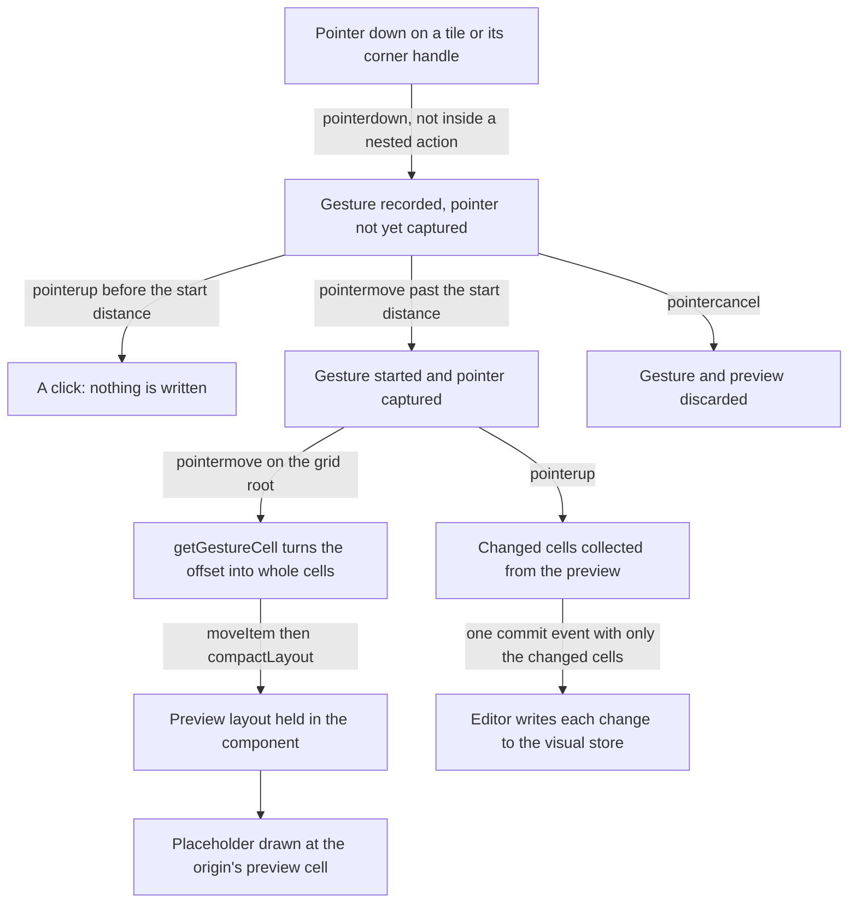

# Dashboard grid of the app's own

The dashboard's visuals sit on a grid the app draws itself: pure placement functions decide where each visual lands, and one Pointer Events component moves them, replacing the `grid-layout-plus` wrapper and its drag library.

## How it works

The editor and the published view both render through one component, `apps/web/app/components/Dashboard/Grid.vue`. Each visual is a tile placed by its saved cell, and the saved layout is first fitted to the columns on screen and compacted, so a narrower screen reflows without overlap and nothing is written. A press on a tile starts a gesture; it becomes a drag only past a small distance, so a click stays a click. While the gesture runs, the grid computes the layout the gesture would leave and draws only a placeholder where the visual will land, so the store is not touched. On release the grid emits one commit with just the cells that changed, and the editor writes each into the visual store. A cancelled pointer discards the gesture.

**Placement is pure.** Everything under `apps/web/app/services/dashboard/grid/` takes a layout and returns a new one: column and row pitch, cell position and size from a span, span from pixels, bounds correction, collision and the push that moves a visual aside, vertical compaction, and the cell a gesture lands on. A visual pushed aside is moved down by the visual it lands on, and a visual the moved one has passed over by more than a quarter of its height stays where it is.

**Breakpoints are published only.** The published view picks a column count from its width, 12 at 1200 pixels and above down to 2 below 480, and reflows its visuals with it. The editor always has the full 12 columns and saves what the user sets.

## Data model

A placed visual is a `LayoutItem` of four integers in grid cells: `x` and `y` for its origin, `w` and `h` for its span, with `y` nonnegative. `layoutItemSchema` in `apps/web/shared/models/dashboard/data/LayoutItem.ts` validates it. The grid keys each tile by the visual's `id`, so a commit names the visual it changes and carries only those four fields.

## Decisions

- **The library is replaced, not patched.** `grid-layout-plus` carried the drag library, its layout shape and its own resize rules; keeping it would keep the defects in the Upstream table below. The placement functions are small and pure, so the grid is the app's own, tested by function.
- **Resize has one corner handle.** A dashboard resizes from its bottom-right corner, so that is the one handle the editor draws. Building per-edge handles (upstream #38 and #51) into this component was rejected, since each edge needs the placement logic again on its own side. The grid package builds them once, for every consumer.
- **The grid emits changes, not a whole layout.** Emitting a new layout array on each move, which a parent would copy back, was rejected. The commit carries only the changed visuals and fires once on release, so the store and its autosave see one write per gesture rather than one per pointer move.
- **Rendering compacts; it does not write back.** A saved layout can overlap: a new visual is placed at a fixed cell without checking its neighbours, so rendering a fitted layout can draw a visual above or below its saved row while the store keeps the saved cell. Writing the compacted layout back to the store on render was rejected: it would write on every open.
- **A drag previews in the component.** Writing each intermediate position to the store during a drag was rejected. The preview lives in the component until release, so a cancelled drag leaves no trace.
- **Touch is captured only where the page is edited.** Setting `touch-action: none` on every tile was rejected, since it stops a phone from scrolling a published dashboard through its visuals (upstream #54). The published grid leaves touch alone, and the editor claims it for dragging.

## Upstream

The library this grid replaced is `qmhc/grid-layout-plus`. Its tracker holds fifty-four issues, and each has one verdict, open or closed, read with its comments and checked against the 1.1.1 source. The defects in scope are the ones this grid must not repeat. Each in-scope row names the test that pins it where one exists, and otherwise the construction that rules the defect out. A "usage" verdict means the reporter's setup, not the library, is the cause, or that the behaviour is documented and by design. A feature the dashboard does not draw is still in scope, because the verdict is a grid's and not one consumer's: those rows link the [grid package](../../../changes/resource-dashboard-grid-package/design.md) that builds them.

| Upstream                                                  | Verdict                         | Proof                                                                                                                                                                         |
| :-------------------------------------------------------- | :------------------------------ | :---------------------------------------------------------------------------------------------------------------------------------------------------------------------------- |
| [#1](https://github.com/qmhc/grid-layout-plus/issues/1)   | In scope — defect               | by construction: each tile is placed by its own left and top from the layout, and the placeholder is drawn from the same cell as the drop target                              |
| [#2](https://github.com/qmhc/grid-layout-plus/issues/2)   | In scope — defect               | "#2 keeps tracking a drag whose pointer has left its tile"                                                                                                                    |
| [#4](https://github.com/qmhc/grid-layout-plus/issues/4)   | False positive — docs           | Example's own mouseAt not reset on dragend (SamX23); library uninvolved                                                                                                       |
| [#5](https://github.com/qmhc/grid-layout-plus/issues/5)   | False positive — usage          | Width-only via resizeOption.edges (right only); height stays                                                                                                                  |
| [#6](https://github.com/qmhc/grid-layout-plus/issues/6)   | In scope — feature              | Dropping an item in from another grid, built by the [grid package](../../../changes/resource-dashboard-grid-package/design.md)                                                |
| [#8](https://github.com/qmhc/grid-layout-plus/issues/8)   | False positive — usage          | User's isCustomElement treats GridLayout as a custom element                                                                                                                  |
| [#9](https://github.com/qmhc/grid-layout-plus/issues/9)   | False positive — fixed upstream | No preinstall script in 1.1.1; only-allow belonged to an older release                                                                                                        |
| [#10](https://github.com/qmhc/grid-layout-plus/issues/10) | False positive — usage          | Height = h * rowHeight + (h - 1) * margin[1] (calcPosition)                                                                                                                   |
| [#11](https://github.com/qmhc/grid-layout-plus/issues/11) | In scope — feature              | Items sized to their content, built by the [grid package](../../../changes/resource-dashboard-grid-package/design.md)                                                         |
| [#13](https://github.com/qmhc/grid-layout-plus/issues/13) | False positive — usage          | dragIgnoreFrom and dragAllowFrom props already exist                                                                                                                          |
| [#14](https://github.com/qmhc/grid-layout-plus/issues/14) | False positive — fixed upstream | state.width started at -1 (fixed by PR #20 merged 2024-04-22; reporter confirmed)                                                                                             |
| [#15](https://github.com/qmhc/grid-layout-plus/issues/15) | False positive — usage          | Width is wrapper offsetWidth; symptom matches transform scale (#30)                                                                                                           |
| [#16](https://github.com/qmhc/grid-layout-plus/issues/16) | In scope — defect               | "#16 Opening a dashboard on a phone fills the fewer columns without overlap"                                                                                                  |
| [#17](https://github.com/qmhc/grid-layout-plus/issues/17) | In scope — feature              | Padding around the grid apart from the margin between items, built by the [grid package](../../../changes/resource-dashboard-grid-package/design.md)                          |
| [#18](https://github.com/qmhc/grid-layout-plus/issues/18) | In scope — defect               | by construction: fitLayout compacts the layout at every column count, so a responsive reflow never leaves its visuals stacked                                                 |
| [#19](https://github.com/qmhc/grid-layout-plus/issues/19) | False positive — usage          | v-model bound to a const, not a ref (commenter fix)                                                                                                                           |
| [#21](https://github.com/qmhc/grid-layout-plus/issues/21) | In scope — feature              | Moving an item between grids, built by the [grid package](../../../changes/resource-dashboard-grid-package/design.md)                                                         |
| [#22](https://github.com/qmhc/grid-layout-plus/issues/22) | In scope — defect               | A nested grid's own items drag and resize, since a press belongs to the nearest grid, built by the [grid package](../../../changes/resource-dashboard-grid-package/design.md) |
| [#23](https://github.com/qmhc/grid-layout-plus/issues/23) | False positive — usage          | w is an integer column span; raise colNum (owner)                                                                                                                             |
| [#24](https://github.com/qmhc/grid-layout-plus/issues/24) | False positive — usage          | verticalCompact=false allows free placement (commenter)                                                                                                                       |
| [#25](https://github.com/qmhc/grid-layout-plus/issues/25) | In scope — defect               | by construction: the grid has no max-rows setting, so a drop or push has no row limit to pass                                                                                 |
| [#26](https://github.com/qmhc/grid-layout-plus/issues/26) | In scope — defect               | by construction: the styles live in the component's own scoped style block, which the build extracts into a stylesheet, not a script injects at runtime                       |
| [#27](https://github.com/qmhc/grid-layout-plus/issues/27) | In scope — defect               | by construction: the pointer listeners are attached with useEventListener, which removes them on unmount, so none outlives the grid                                           |
| [#28](https://github.com/qmhc/grid-layout-plus/issues/28) | In scope — defect               | "#28 Shrinking a visual to nothing keeps it one cell wide and tall"                                                                                                           |
| [#29](https://github.com/qmhc/grid-layout-plus/issues/29) | In scope — defect               | by construction: the component reads no user agent, so there is no navigator.userAgent access to throw                                                                        |
| [#30](https://github.com/qmhc/grid-layout-plus/issues/30) | False positive — usage          | Fixed by passing the scale via transformScale (reporter)                                                                                                                      |
| [#32](https://github.com/qmhc/grid-layout-plus/issues/32) | Out of scope — free-form canvas | Overlap is excluded by the compact and moveElement design                                                                                                                     |
| [#33](https://github.com/qmhc/grid-layout-plus/issues/33) | Out of scope — consumer bundler | Consumer bundler cannot parse @vexip-ui/utils CJS entry                                                                                                                       |
| [#34](https://github.com/qmhc/grid-layout-plus/issues/34) | In scope — defect               | by construction: pushes never consult a row limit, since the grid has no max-rows setting                                                                                     |
| [#36](https://github.com/qmhc/grid-layout-plus/issues/36) | In scope — feature              | Horizontal compaction, built by the [grid package](../../../changes/resource-dashboard-grid-package/design.md)                                                                |
| [#38](https://github.com/qmhc/grid-layout-plus/issues/38) | In scope — feature              | Resizing from the left and top edges, moving the origin, built by the [grid package](../../../changes/resource-dashboard-grid-package/design.md)                              |
| [#39](https://github.com/qmhc/grid-layout-plus/issues/39) | False positive — usage          | layoutUpdate() already exposed on GridLayout                                                                                                                                  |
| [#40](https://github.com/qmhc/grid-layout-plus/issues/40) | In scope — feature              | A grid nested in a tile, built by the [grid package](../../../changes/resource-dashboard-grid-package/design.md)                                                              |
| [#42](https://github.com/qmhc/grid-layout-plus/issues/42) | In scope — feature              | Items sized to their content, built by the [grid package](../../../changes/resource-dashboard-grid-package/design.md)                                                         |
| [#44](https://github.com/qmhc/grid-layout-plus/issues/44) | False positive — docs           | Docs example inserts a duplicate on every throttled tick                                                                                                                      |
| [#45](https://github.com/qmhc/grid-layout-plus/issues/45) | In scope — defect               | "#45 Dragging across several cells writes the visual once, after the release"                                                                                                 |
| [#46](https://github.com/qmhc/grid-layout-plus/issues/46) | In scope — defect               | by construction: the placeholder is drawn from the computed preview, and the container's height is a computed value, so a resize does not toggle the placeholder              |
| [#48](https://github.com/qmhc/grid-layout-plus/issues/48) | In scope — defect               | by construction: the placeholder is drawn from the preview at every position, so a valid drop spot is never hidden                                                            |
| [#50](https://github.com/qmhc/grid-layout-plus/issues/50) | False positive — usage          | User resizeOption.listeners write styles, fighting library positioning                                                                                                        |
| [#51](https://github.com/qmhc/grid-layout-plus/issues/51) | In scope — feature              | Resizing from every edge and corner, built by the [grid package](../../../changes/resource-dashboard-grid-package/design.md)                                                  |
| [#52](https://github.com/qmhc/grid-layout-plus/issues/52) | False positive — usage          | Colliding neighbour is pushed by design (moveElement)                                                                                                                         |
| [#53](https://github.com/qmhc/grid-layout-plus/issues/53) | In scope — defect               | by construction: the grid has no max-rows setting, so there is no row limit for a push to ignore                                                                              |
| [#54](https://github.com/qmhc/grid-layout-plus/issues/54) | In scope — defect               | "#54 Scrolling a published dashboard on a phone never captures the touch"                                                                                                     |
| [#55](https://github.com/qmhc/grid-layout-plus/issues/55) | In scope — feature              | Items sized to their content, built by the [grid package](../../../changes/resource-dashboard-grid-package/design.md)                                                         |
| [#57](https://github.com/qmhc/grid-layout-plus/issues/57) | False positive — usage          | Height formula by design; v2 renames margin to gap                                                                                                                            |
| [#58](https://github.com/qmhc/grid-layout-plus/issues/58) | False positive — usage          | No repro; colNum sets columns outside responsive mode                                                                                                                         |
| [#59](https://github.com/qmhc/grid-layout-plus/issues/59) | False positive — usage          | Entry transition is library CSS on .vgl-item; overridable                                                                                                                     |
| [#60](https://github.com/qmhc/grid-layout-plus/issues/60) | False positive — usage          | Store a key in layout, resolve in item slot (owner)                                                                                                                           |
| [#62](https://github.com/qmhc/grid-layout-plus/issues/62) | In scope — feature              | Padding around the grid apart from the margin between items, built by the [grid package](../../../changes/resource-dashboard-grid-package/design.md)                          |
| [#65](https://github.com/qmhc/grid-layout-plus/issues/65) | False positive — usage          | h=2 gives 2 * 30 + 1 * 10 = 70 by design                                                                                                                                      |
| [#66](https://github.com/qmhc/grid-layout-plus/issues/66) | In scope — feature              | Swapping on drop as a collision mode, built by the [grid package](../../../changes/resource-dashboard-grid-package/design.md)                                                 |
| [#68](https://github.com/qmhc/grid-layout-plus/issues/68) | In scope — defect               | by construction: the component does no RTL mirroring, so the resize handle is bound to the physical bottom-right corner only                                                  |
| [#70](https://github.com/qmhc/grid-layout-plus/issues/70) | Out of scope — free-form canvas | Owner: 1px free drag is a canvas, not grid positioning                                                                                                                        |
| [#71](https://github.com/qmhc/grid-layout-plus/issues/71) | In scope — defect               | by construction: a gesture writes the store once on release, so the per-cell update traffic that slowed 300 cells does not occur                                              |

## Key files

| File                                                     | Role                                                                       |
| -------------------------------------------------------- | -------------------------------------------------------------------------- |
| `apps/web/app/components/Dashboard/Grid.vue`             | The gesture grid: pointer events, the preview, the placeholder, one commit |
| `apps/web/app/services/dashboard/grid/moveItem.ts`       | Places a dropped visual and pushes the visuals it lands on below it        |
| `apps/web/app/services/dashboard/grid/compactLayout.ts`  | Moves every visual up until blocked, then down until clear                 |
| `apps/web/app/services/dashboard/grid/fitLayout.ts`      | Fits a saved layout to a column count, then compacts it                    |
| `apps/web/app/services/dashboard/grid/getGestureCell.ts` | Turns a pointer offset into the whole cells a move or resize lands on      |
| `apps/web/app/services/dashboard/constants.ts`           | Column counts, row heights, the grid margin, the breakpoints               |
| `apps/web/shared/models/dashboard/data/LayoutItem.ts`    | The placement schema: `x`, `y`, `w` and `h` as cells                       |
| `apps/web/app/components/Dashboard/Editor/Content.vue`   | The editor binding: twelve columns, one store write per commit             |
| `apps/web/app/components/Dashboard/Index.vue`            | The published view: breakpoint columns, nothing saved                      |
| `apps/web/app/components/Resource/Dashboard/Editor.vue`  | The autosave that the store write feeds                                    |

## Sources

- [qmhc/grid-layout-plus](https://github.com/qmhc/grid-layout-plus): the library replaced here, whose issues make the Upstream table. Its 1.1.1 source was read for each verdict.
- [Pointer Events, W3C](https://www.w3.org/TR/pointerevents/): pointer capture, the pointer cancel path, and `touch-action`, which the editor's tiles set and the published view leaves unset.
