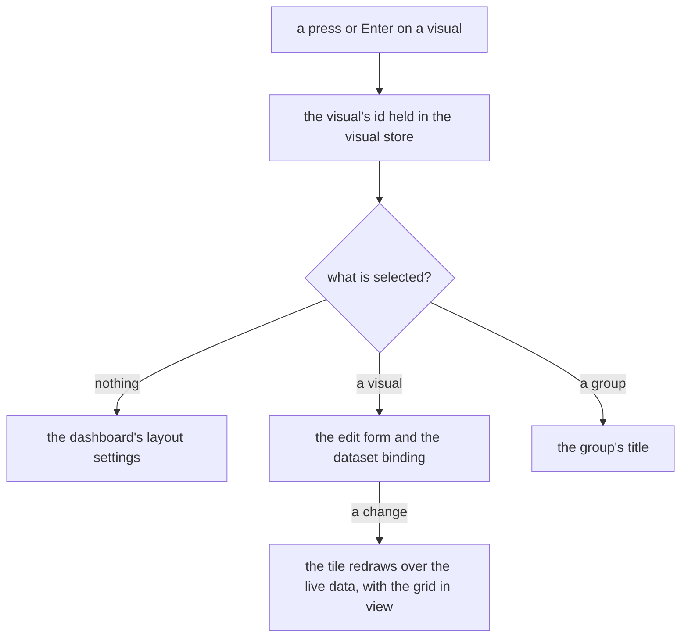

# Dashboard layout

The dashboard editor is one part of the [editor layout program](../editor-shell/design.md): a bar, a palette the reader opens, an inspector for the selection and the grid as the canvas. It keeps what the [dashboard grid](../dashboard-grid/design.md) settled about the grid, the tiles and the published page.

## How it works

The editor shell draws the layout's three regions around the canvas, and the selection decides what the inspector shows.

| Region    | Edge        | Opens                                                                   | Holds                                                                              |
| :-------- | :---------- | :---------------------------------------------------------------------- | :--------------------------------------------------------------------------------- |
| Bar       | top, docked | always                                                                  | the visual count and the one accent action, Add visual                             |
| Visuals   | start       | on demand: open by default on a wide window, until the reader closes it | the palette: Charts and Layout groups                                              |
| Inspector | end         | always, since it holds the settings when nothing is selected            | the selection's form, below                                                        |
| Canvas    | the rest    | always                                                                  | the grid of tiles, each drawn by the same visual component the published page uses |

The Visuals region opens on a wide window and stays open until the reader closes it, and that choice is kept in the browser for the editor. On a compact or medium window the Visuals region and the inspector are sheets: the shell draws a button for each in a strip below the canvas, and each button opens its sheet.

The selection has three kinds. With nothing selected the inspector shows the dashboard's settings, how visuals pack and what a drop does. With a visual selected it shows the visual's edit form and its dataset binding. With a group selected it shows the group's title. A press or Enter on a visual selects it and opens its form, and a press on the empty canvas clears the selection, which closes the form. The visual's menu holds Edit beside its occasional actions: duplicate, export, fit height, move to and delete, with the delete confirmation and the move dialog.

The published page draws the visuals and its own controls, and no editor region.

## Decisions

- **The edit form is in the inspector, not a dialog.** The editor's tiles are the published renderer over live data, so an owner who changes a visual's type or binding sees the tile change. A dialog's scrim hides it. A dialog is for what must interrupt, and an edit that the canvas answers does not interrupt. Rejected: the dialog, and a popover over the tile, which covers the tile it is editing.
- **The dashboard's settings are where nothing is selected.** A setting of the whole canvas belongs to the canvas, and nothing selected is the reader looking at the whole of it. Rejected: a popover on the bar, which kept one rarely used setting in the bar's row and gave the editor a second way to open a form.
- **The palette is a region the reader opens.** Types are chosen where they land, and a docked palette keeps the canvas wide when closed and gives the groups room when open. Rejected: a strip above the grid, which spends the grid's height on a row of chips.
- **Below the mobile breakpoint the palette and the inspector are sheets.** The page's own drawers are sheets below that breakpoint (`apps/web/app/plugins/ui.ts` sets it), so the editor's two side regions follow them. Rejected: docking both there, which takes the phone's width from the grid.
- **The grid package stays.** The canvas region holds the grid. Rejected: [retiring the package](../../../rejected/resource/retire-grid-layout-package/design.md), which the engine does not make unnecessary.
- **Selection is store state, an id.** The pinia skill's rule for selection, so a move or a delete that changes a visual's place keeps it selected or clears it. Rejected: selection held in the tile component, which a second tile or the inspector cannot read.
- **The selection is written where a visual's form opens, in the visual store.** The id lives in the visual store beside the visuals it names, not in the dashboard store that holds the content. Opening a form is the one write: a press, Enter and the menu's Edit all open it, and the `onEdit` hook of the shared edit-form primitive carries the write, so a visual that the deep-link query restores is selected too. A press on the empty canvas clears it. A tile is a nested interaction of the canvas, handles included, so a press on a tile never clears the selection it made. Rejected: a selection written at each press site, which repeats the write in two components and leaves the menu's Edit unselected.
- **A delete clears the selection, and a refused save restores it only if the reader has made no other selection since.** The selection clears with the visual it names, or with a group that held it, before the save. A refused save puts the visual back and reopens the form it had, unless the reader has made a selection while the save was in flight, which is kept. A selection write counts even when it lands back on the value the delete left. Rejected: always restoring, which overwrites that selection; never restoring, which leaves the refused visual on the canvas with its form closed and no sign why.
- **A form change is applied as the reader types, and only what the form edits is written.** The draft is written onto its visual while the schema accepts it, so the tile redraws at once and the dashboard's autosave persists the change, with no Save to press. The write takes the type, the chart and the dataset, and never the visual's place, size or fit height, since a draft copied before the reader moved the visual would put the old place back. A draft the schema refuses is written nowhere, so an invalid value reaches neither the tile nor a save. Rejected: a Save button, which leaves the tile unchanged until pressed, and writing the whole draft, which reverts a move made while the form was open.
- **The bar is a fixed-height region.** It is one row of controls with its padding either side, so its minimum and maximum are both `DASHBOARD_EDITOR_BAR_HEIGHT` in `apps/web/app/services/dashboard/constants.ts`, and it has no resize handle. Its height is in pixels like every region's, so a text size large enough to grow the visual count could clip it. Rejected: a resizable bar, since its one row of controls has no more height to give.

## Not built

- **Palette search.** The palette lists its types without a search field.

## Key files

| File                                                                    | Role                                                                                                                    |
| :---------------------------------------------------------------------- | :---------------------------------------------------------------------------------------------------------------------- |
| `apps/web/app/components/Resource/Dashboard/Editor.vue`                 | the editor shell with the layout, and the context read from the selected visual                                         |
| `apps/web/app/services/dashboard/editor/DashboardLayout.ts`             | the layout as data: the bar, the Visuals region, the inspector and the canvas                                           |
| `apps/web/app/services/dashboard/editor/DashboardEditorRegistry.ts`     | the component each content key draws                                                                                    |
| `apps/web/app/services/dashboard/editor/getDashboardEditorContext.ts`   | the selection read as the layout's context                                                                              |
| `apps/web/app/services/editor/constants.ts`                             | each region's presentation by size class: docked on a wide window, a sheet below the mobile breakpoint                  |
| `apps/web/app/components/Editor/Shell.vue`                              | the editor shell that draws the regions, and the buttons that open the sheets below the canvas                          |
| `packages/vue-editor-layout-headless/src/services/checkIsRegionOpen.ts` | whether a region is open: a sheet waits for the reader, and a docked on-demand region opens unless the reader closed it |
| `apps/web/app/components/Dashboard/Editor/Header.vue`                   | the bar, which keeps the count and Add visual                                                                           |
| `apps/web/app/components/Dashboard/Editor/Settings.vue`                 | the inspector's entry with nothing selected: packing and overlaps                                                       |
| `apps/web/app/components/Dashboard/Editor/Palette.vue`                  | the Visuals region's content: the type tiles by category                                                                |
| `apps/web/app/components/Dashboard/Editor/VisualForm.vue`               | the inspector's entry for a selected visual                                                                             |
| `apps/web/app/components/Dashboard/Editor/VisualFormFields.vue`         | the visual's form, which writes a valid draft onto the visual as it changes                                             |
| `apps/web/app/components/Dashboard/Editor/GroupForm.vue`                | the inspector's entry for a selected group: its title                                                                   |
| `apps/web/app/components/Dashboard/Editor/Content.vue`                  | the grid and the delete confirm, mounted once for the editor                                                            |
| `apps/web/app/components/Dashboard/Visual/Preview/ActionsMenu.vue`      | the visual's menu, which holds Edit beside the occasional actions                                                       |
| `apps/web/app/store/dashboard/visual.ts`                                | the visuals, the selection and the form draft applied to its visual                                                     |
| `apps/web/app/store/dashboard/dialog.ts`                                | the delete and move targets                                                                                             |
| `apps/web/app/services/shared/editForm/createEditFormData.ts`           | the edit-form primitive, whose `onEdit` hook carries the selection write                                                |

## Sources

- [Power BI's report view](https://learn.microsoft.com/en-us/power-bi/create-reports/desktop-report-view): a visualisation pane beside a canvas that redraws a visual as its type is changed, which is the inspector beside the grid here.
- [Nielsen Norman Group, modal and nonmodal dialogs](https://www.nngroup.com/articles/modal-nonmodal-dialog/): a modal only for what must interrupt, which is why the edit form is not a dialog.
