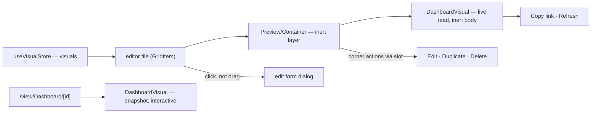

# Dashboard live canvas

The Dashboard editor's grid draws every tile as the same `DashboardVisual` the published `/view/Dashboard/[id]` page mounts, over the data its binding reads ([dashboard data binding](../dashboard-data-binding/design.md)). An owner who binds a bar chart to a survey's responses sees the bars while editing, without publishing.

Power BI's report editing view works the same way: the canvas is the one the reader sees, and changing a selected visual's type redraws it in place.

## How it works

- **Each editor tile renders `DashboardVisual`.** The tile shows the binding's live read, its skeleton while the read is pending, its error state with Retry, the row-cap footnote, and the demo data an unbound visual shows on the published page.
- **The chart body is inert while editing.** The tile wrapper takes the pointer-events off the visual, so a press on the chart is the tile's drag and a click opens its edit form. Zoom, brushing, the ruler and annotation ink are the reader's, on the published page, as [dashboard chart interaction](../dashboard-chart-interaction/design.md) describes.
- **The corner keeps its actions in one row.** Edit, Duplicate and Delete come from the tile through the `actions` slot of `DashboardVisual`, beside the visual's own Copy link and Refresh. The row and the error state's Retry sit above the inert layer.
- **An edit redraws its tile on save**, since the tile reads the visual the store writes; a resized tile redraws at its new height through the resize observer `DashboardVisual` already has.
- **Visuals over the same source share one read.** `useVisualPropsData` resolves through `useDataset`, keyed by the reference, so six charts over one sheet read it once.

## Decisions

- **One renderer for the editor and the published page.** The editor tile reuses `DashboardVisual` rather than a twin, so the editor and the reader cannot disagree about a chart.
- **The stock icons are gone.** The preview component, the per-type icon map and its icon components had no other consumer; the visual-type select's entries come from `VisualTypeItemCategoryDefinitions`, which never used them.
- **The corner actions are a slot, not a second corner.** Two absolutely positioned rows at the same corner would overlap, so the tile passes its actions into the visual's own row.
- **Nothing is persisted differently.** The editor still saves the dashboard content; only what a tile draws changes.
- **No new test.** The change is template wiring over components whose behaviour the existing suites cover; a chart-mounting test would only pin the markup.

## Key files

| File                                                             | Role                                                                               |
| ---------------------------------------------------------------- | ---------------------------------------------------------------------------------- |
| `apps/web/app/components/Dashboard/Visual/Index.vue`             | the one renderer for the editor and the published page; exposes the `actions` slot |
| `apps/web/app/components/Dashboard/Visual/Preview/Container.vue` | the editor tile: inert visual, corner actions, edit form                           |
| `apps/web/app/components/Dashboard/Editor/Content.vue`           | passes each tile its visual rather than only its id and type                       |

## Sources

- [Microsoft Learn — Report view in Power BI Desktop](https://learn.microsoft.com/en-us/power-bi/create-reports/desktop-report-view) — the editing canvas draws visuals over the added data, and a selected visual's type is changed in place.
