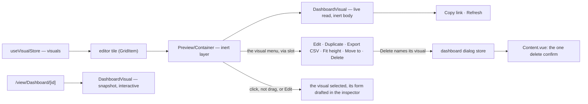

# Dashboard live canvas

The Dashboard editor's grid draws every tile as the same `DashboardVisual` the published `/view/Dashboard/[id]` page mounts, over the data its binding reads ([dashboard data binding](../dashboard-data-binding/design.md)). An owner who binds a bar chart to a survey's responses sees the bars while editing, without publishing.

Power BI's report editing view works the same way: the canvas is the one the reader sees, and changing a selected visual's type redraws it in place.

## How it works

- **Each editor tile renders `DashboardVisual`.** The tile shows the binding's live read, its skeleton while the read is pending, its error state with Retry, the row-cap footnote, and the demo data an unbound visual shows on the published page.
- **The chart body is inert while editing.** The tile wrapper takes the pointer-events off the visual, so a press on the chart is the tile's drag and a click selects it, which opens its form in the inspector. Zoom, brushing, the ruler and annotation ink are the reader's, on the published page, as [dashboard chart interaction](../dashboard-chart-interaction/design.md) describes.
- **The corner keeps its occasional actions in one menu.** The visual's menu comes from the tile through the `actions` slot of `DashboardVisual`, beside the visual's own Copy link and Refresh. The row and the error state's Retry sit above the inert layer.
- **An edit redraws its tile as the form changes**, since the tile reads the visual the store writes. The form edits a draft, and a draft the schema accepts is written onto its visual at once, which the dashboard's autosave then saves; a draft it refuses stays in the form and is written nowhere. A resized tile redraws at its new height through the resize observer `DashboardVisual` already has. An edit onto a visual removed while its form was open is refused.
- **Each visual reads its own source.** `useVisualPropsData` resolves through `useDataset`, which keeps one read and one latest-wins key per instance, so six charts over one sheet make six reads.

## Decisions

- **One renderer for the editor and the published page.** The editor tile reuses `DashboardVisual` rather than a twin, so the editor and the reader cannot disagree about a chart.
- **No stock icons.** The visual-type select's entries come from `VisualTypeCategoryDefinitions`, each with the chart icon meaning rather than a stock image.
- **The corner actions are a slot, not a second corner.** Two absolutely positioned rows at the same corner would overlap, so the tile passes its actions into the visual's own row.
- **Nothing is persisted differently.** The editor saves the dashboard content; only what a tile draws changes.
- **One delete confirm for the whole editor, and one form.** A tile mounts no dialog of its own. Its Delete names its visual in the dashboard dialog store, and the editor's one confirm resolves it, as the [singleton dialogs](../../architecture/singleton-dialogs/design.md) pattern has a list's item do. The form is the inspector's, mounted once on the selected visual's draft, so a grid of N tiles mounts no form until one is selected.
- **The dialogs are tested, the chart's markup is not.** A chart-mounting test would only pin the markup. `Editor/Content.test.ts` covers what a tile can break: one confirm for every tile, and Delete and Edit acting on the visual whose tile was pressed. `Resource/Dashboard/Editor.test.ts` covers the inspector's form and a change redrawing its visual.

## Key files

| File                                                               | Role                                                                                                                        |
| ------------------------------------------------------------------ | --------------------------------------------------------------------------------------------------------------------------- |
| `apps/web/app/components/Dashboard/Visual/Index.vue`               | the one renderer for the editor and the published page; exposes the `actions` slot                                          |
| `apps/web/app/components/Dashboard/Visual/Preview/Container.vue`   | the editor tile: inert visual and corner actions                                                                            |
| `apps/web/app/components/Dashboard/Visual/Preview/ActionsMenu.vue` | the corner's menu: Edit, Duplicate, Export CSV, Fit height, Move to and Delete, which name their visual in the dialog store |
| `apps/web/app/components/Dashboard/Editor/Content.vue`             | passes each tile its visual; mounts the editor's one delete confirm                                                         |
| `apps/web/app/components/Dashboard/Editor/VisualFormFields.vue`    | the inspector's form for the selected visual, which writes a valid draft onto the visual as it changes                      |
| `apps/web/app/store/dashboard/dialog.ts`                           | the delete target, `deletingVisualId`                                                                                       |

## Sources

- [Microsoft Learn — Report view in Power BI Desktop](https://learn.microsoft.com/en-us/power-bi/create-reports/desktop-report-view) — the editing canvas draws visuals over the added data, and a selected visual's type is changed in place.
