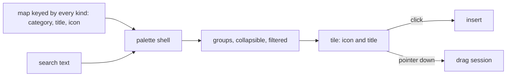

# Editor compact chrome

A palette is the same thing in every editor, a set of kinds the reader picks from, so it is one component fed by a keyed map, and the chrome around it takes one density.

## Decisions

- **Categories and icons live in the app, keyed by every kind.** The typecheck then holds each map complete, as the page builder's icon maps already do. Rejected: a category and an icon on the headless packages' kind definitions, which the survey runner and the publish render never read.
- **The survey's groups are by what the reader asks.** Text, Choice, Scale and ranking, Grids and repeats, Content and Layout, each holding the kinds that answer the same question. Rejected: the earlier "Input" and "Choice grids and lists", which put a ranking beside a dynamic panel and unlike kinds in one list.
- **One palette shell, three feeds.** The shell takes groups of `{ kind, title, icon }`, filters by title, collapses a group and emits an insert and a drag start. A label that is one long word wraps at a slash, and a tile's side padding is tight, so no label spills over its neighbour. Rejected: a search in each editor's own palette, which is what drifted.
- **The whiteboard's properties panel opens over the canvas.** It floats over the canvas edge, below the toolbar's row so a narrow canvas never puts the two on each other, and a selection changes nothing beneath it. The page builder's panes already have fixed places and stay. Rejected: reflowing the canvas, which moves the thing the reader just selected.
- **The survey canvas has a readable width.** Its questions are capped at a measure a form is read at and centred, and the pane around it keeps the rest. Rejected: filling the centre, which stretches a text field across the screen.
- **Density comes from tokens.** Tab panels, toolbars and sectors use the UI library's spacing, and the shared tab panel's top padding is the tighter one for every panel.
- **Overflow folds into one menu.** A toolbar that cannot fit its controls keeps the primary ones and moves the rest into a menu, rather than wrapping or scrolling. Only the survey's toolbar holds enough controls to need it; the whiteboard's tool row and the page builder's device toggle are a few icon buttons that fit any width an editor opens at, so they stay as they are.

## Key files

| Path                                                              | Role                                                  |
| :---------------------------------------------------------------- | :---------------------------------------------------- |
| `apps/web/app/components/Ui/Palette/Index.vue`                    | the palette shell: groups, collapse, search           |
| `apps/web/app/services/resource/survey/getSurveyPaletteGroups.ts` | the survey's groups, from the icon map                |
| `apps/web/app/components/Resource/Survey/Creator/Palette.vue`     | the survey palette                                    |
| `apps/web/app/components/PageBuilder/Palette.vue`                 | the page builder palette                              |
| `apps/web/app/components/Resource/Whiteboard/EditorPalette.vue`   | the whiteboard palette                                |
| `apps/web/app/components/Resource/Whiteboard/Editor.vue`          | the whiteboard editor, with its panel over the canvas |
| `apps/web/app/components/Resource/Survey/Creator/Toolbar.vue`     | the survey toolbar and its fold                       |
| `apps/web/app/components/Ui/Tabs.vue`                             | the shared tab panel and its padding                  |

## Sources

- The page builder's [canvas design](../page-builder/canvas/design.md) and the survey Creator's [design](../survey-creator/design.md), whose layouts this tightens.
