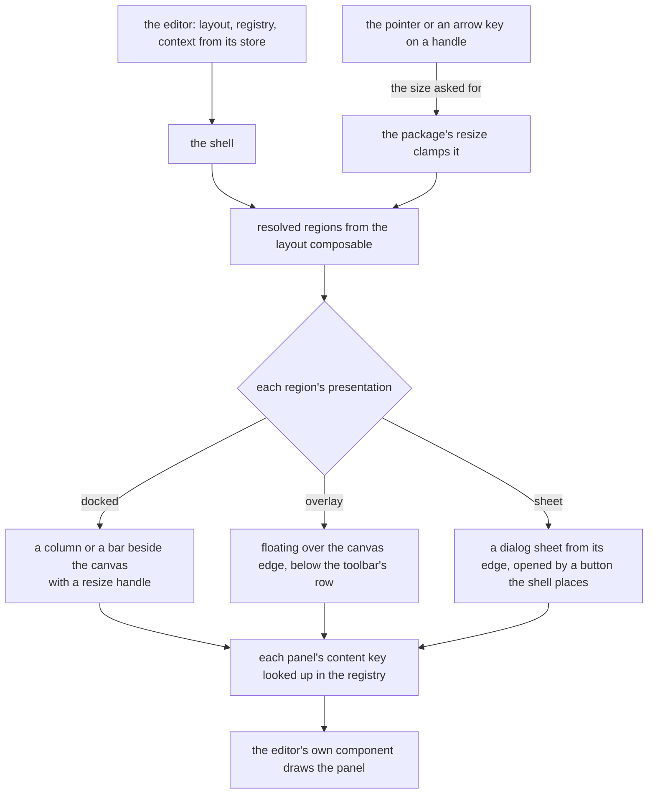

# Editor shell

The one component that draws an editor's screen, over a layout the [layout package](../../vue-editor-layout-headless/layout-engine/design.md) resolved. The package decides which regions exist and how each is presented. The shell draws them, resizes them and makes them reachable from the keyboard and from a phone. The whiteboard, the survey, the email, the webpage and the dashboard all draw through it.

## How it works

The shell calls the layout package's composable with the editor's layout, a reactive context the editor builds from its store (the mode, the tool in hand, and the selection's kind and count) and the size class the window reads. It keeps the reader's state in a store under the editor's type, and it draws each resolved region by its presentation.

Content is the editor's, and placement is the shell's. The registry maps each content key to a component, so the whiteboard's arrow properties, the survey's question properties and the webpage's style panel each stay with their editor, and the shell draws each where the layout put it.

## The toolbar

A toolbar is one component, and every editor's tool region is one. It holds groups of items. An item is a tool, a toggle or a command, with an icon, a title, the shortcut its registered command carries, a pressed state and, when it cannot be used, the reason.

- **One slot holds the variants of a tool.** The variants of a shape tool share one slot, which shows the variant in hand, or else the one last used, with the others in a menu from the slot. A tool with no variants is a single button. This is the arrangement Excalidraw's shape groups and tldraw's use.
- **What does not fit folds into one menu.** The toolbar keeps its pinned items, which the editor marks on each item, and moves the rest, in their order, into the overflow menu, so it never wraps or scrolls. An item the editor holds in that menu at every width takes no room in the bar. One VueUse resize observer reads the toolbar's width, and the items' widths are read when the items change, so the fold is a computation over those numbers and not a measure per frame.
- **A group of tools is one tab stop.** The tools a reader chooses between are a toggle group over Vuetify 0's radio group, so the group is one tab stop and the arrows move the choice along it, with no roving code of our own. The toolbar is a landmark named by its editor, holding such groups and buttons. A disabled item stays focusable and its reason is its description, so a reader learns why an action is unavailable instead of finding it gone.

## The contextual panel

A contextual panel's content follows the selection. An editor with document settings of its own keys a settings panel to the layout's empty selection kind, as the dashboard's settings are, and the whiteboard, which has none, draws no panel while nothing is selected. A panel with several selected elements shows a field's value when every element holds the same one and "Mixed" when they differ, and a change writes to each. The panel's header names what is selected, "Arrow" or "3 shapes", so a reader knows what a change will touch. The panel opens over the canvas, below the toolbar's row, so a selection never moves what the canvas shows. An overlay column starts below each open overlay bar at the top edge and ends above each one at the bottom edge, so a bar and a column never claim the same corner.

## A compact window

- The tool region sits at the bottom edge, within a thumb's reach, as Excalidraw's phone bar does.
- Each side region is a sheet that rises from the bottom, closed until the reader opens it, so the canvas stays in view above it.
- A button the shell places in a strip below the canvas opens each sheet, and it is drawn only while the sheet holds a panel to show. The whiteboard's properties panel holds one while something is selected, so a selection does not cover the canvas with a sheet nobody asked for, as tldraw's style panel waits behind its button on a narrow window.

## Keyboard and focus

The page's main landmark holds the canvas, the toolbar is a landmark named by its editor, and each side region is a complementary landmark named by its region, so a screen reader can jump between them. A handle between docked regions is the app's resize handle: a separator that reports its value and moves by an arrow key, with Home and End as its limits, as the WAI-ARIA window splitter sets out. A sheet closes on Escape and returns focus to the control that opened it. A floating panel has no close the shell draws (see the decisions). The handle's transitions read the app's motion tokens, which the reduced-motion preference sets to zero.

## Decisions

- **The shell owns arrangement and the editor owns content.** A registry maps content keys to components, so a layout names a key and never a component. Rejected: a layout holding components, which makes it code and puts the layout check out of reach of data.
- **One toolbar component serves every editor that has a tool row.** The whiteboard's tools and the survey's bar are instances of it. Rejected: a toolbar per editor, which repeats the same keyboard and folding code in each, and a toolbar that wraps, which moves the canvas under the reader. The page builder's device toggle is not an instance: its few icon buttons fit at any width an editor opens at, so they need no fold.
- **An unavailable action is disabled with its reason, not hidden.** The reader learns why from the item. The guided editors hide what the document cannot accept at a given insertion point, since that choice is never valid there, and disable what is valid elsewhere. See the [guardrails](../editor-guardrails/design.md). Rejected: hiding every unavailable action, which makes an action vanish and reappear with the selection and gives no way to learn why.
- **The compact tool region is at the bottom.** A thumb reaches the bottom edge, and the top is covered by the hand. Rejected: keeping the toolbar on top on a phone, where the reader's own hand covers it.
- **A sheet is the app's own dialog.** It is the container the page's drawers already use on a narrow window. Rejected: a second sheet component for editors.
- **The reader's sizes persist per editor type, in a Pinia store over VueUse's local storage.** The store holds each editor type's reader state under `LocalStorageKey.EditorReaderStates`, as the room's side bar widths are held, and the layout package parses the stored state against the layout, so a changed layout drops what it no longer names. Rejected: storage code in the shell, which the store already does for every other width.
- **The size class is read from the display composable.** The app's breakpoint scale is declared in `apps/web/configuration/breakpoints.ts`. The shell maps its flags to a class: compact in the band the `xs` flag reads, below the small breakpoint; medium in the band below the app's mobile breakpoint, which `apps/web/app/plugins/ui.ts` sets, where the page's drawers are sheets; expanded otherwise. Rejected: measuring the window again, which would be a second reading of the one scale.
- **The palette shell stays.** It is the content a side region draws in the survey, the page builder, the email and the dashboard, with its search and groups. Rejected: replacing it, since the compact chrome settled it and nothing here changes its job.
- **The contextual panel has no document-settings slot.** An editor's own settings are a panel its layout keys to the empty selection kind, so each guided editor reaches its settings through its layout. A panel is present only for the selection kinds its layout names, so an editor with no settings of its own names none. Rejected: a document-settings slot on the panel, since a second path to the same state could disagree with the layout's.
- **The panel takes a title, and the editor builds it.** The title names what is selected, in the editor's own vocabulary and with its count, so the panel needs no kind prop and branches on nothing. Rejected: a generic kind prop, with the panel pluralising names itself.
- **A mixed value names its state, and an empty selection has none.** `getMixedValue` answers `{ isMixed: true }` or the shared value, on the same `isMixed` flag `Ui/Checkbox.vue` reads for its indeterminate state, so a field narrows on the flag and never matches a sentinel. Values compare with `===`, so the compared type is limited to boolean, number and string: two objects with equal content are not the same value. No element selected answers `undefined`, as the whiteboard's `getSelectedElement` does. Rejected: a sentinel string or symbol, which a field could mistake for a stored value.
- **A region's content is the component its active panel's key names; the canvas is the default slot.** The shell draws the default slot where the canvas sits, and an overlay floats over it. A bar or a tool region is an ordinary region whose panel's key the registry maps to the editor's own component, so the shell draws it at its edge like any other. A content component takes no props and reads its own store. Rejected: a slot per region, which would move each panel's content out of the registry the layout check reads.
- **The canvas is not a second main landmark.** The app's default layout holds the page's `main` (`apps/web/app/layouts/default.vue`), so the canvas is a plain element inside it. Rejected: a `main` of the canvas's own, which nests a second main landmark in every editor page.
- **The registry is keyed by string.** `EditorRegistry` is a record of components by string key, and the layout check reports a key with no entry. Rejected: a generic per editor, which the shell would have to thread through every prop.
- **A side region's name is the shell's `regionNameMap`, keyed by region id.** The package's region holds no name, and a landmark and a sheet are each announced by one. Rejected: a name on the package's region, which describes layout and not what a reader is told.
- **`EditorType` names each editor that draws through the shell.** Its members are the whiteboard, the survey, the email, the page builder that draws the webpage, and the dashboard. Each keys its own reader state, so the email and the webpage keep their sizes apart although they share page-builder parts. Rejected: keying the state by resource type, since the editor, not the resource, is what a reader's sizes belong to.
- **One local storage record holds every editor type's state.** `LocalStorageKey.EditorReaderStates` is one record keyed by editor type. It is read with `mergeDefaults`, so a stored value that is not an object reads as an empty record, and each entry is read back through the layout's parse. Rejected: one key per editor type, which needs a ref created on demand for each key.
- **The store is written from a watch on the composable's state.** Keeping a state is a side effect of a change to it, as the `vue` skill's watch decision tree sets out, and every change, a resize, a toggle or an active panel, makes one new state, so one watch covers all of them. Rejected: a save in each function the shell calls, which the next function added would forget.
- **A sheet's placement follows the size class, then the edge.** A compact window is a phone, where an edge drawer is as wide as the window and would cover the canvas, so its sheet is the library's bottom drawer, which rises to most of the height and leaves the canvas visible above it. A medium window's start or end sheet uses the drawer placements the page's drawers use, and a top or bottom sheet there stands high or in the middle (`RegionEdgeDialogPlacementMap`). Rejected: the edge drawer on a phone, which hides the selection the reader is editing, and a full-height bottom sheet, which does the same.
- **A handle sits on the region's inner edge, and the shell assumes left-to-right.** A region at the end or the bottom takes its handle on its start or top side. `ResizeHandle` places itself by physical side, so a right-to-left page would put a handle on the wrong side. No editor is right-to-left yet, so the case waits for the first editor that is.
- **Only docked regions take a handle, and a closed docked or overlay region draws nothing.** A handle goes between docked regions, and an on-demand region that is closed takes no space. A sheet stays mounted closed, so the reader can open it. A docked region whose minimum equals its maximum takes no handle either, since no size of it can move.
- **A sheet's button is the shell's, one per sheet, labelled by the region's name.** The shell derives it from the sheets the layout presents, so no layout names a button, and it is drawn only while the sheet resolves, which is while the region holds a panel. Rejected: a button each layout names, which repeats the label and the open state in every editor.
- **The sheets' buttons sit in a strip below the canvas, in the flow.** The strip is one row the shell draws under the canvas and above any docked bottom region, so no button covers a control of the canvas. A selection that shows the strip moves only the canvas's bottom edge; the canvas's top and content stay where they were. The panel is the part a selection opens over the canvas, and the strip is the one thing a selection adds to the flow. Rejected: a cluster floating over the canvas's top corner, out of the flow, since it covers the canvas's own controls. Rejected also: a button in the tool region, which moves to the bottom edge on a phone and would tie the opener to the layout's edges.
- **Focus returns to the opener from the shell, not from `Ui/Dialog.vue`.** The dialog focuses itself on open and returns nothing on close. The native `<dialog>` restores focus to what the browser had focused before the modal, and Safari on macOS does not focus a button on click, so that restore is not dependable; happy-dom has none. The shell focuses the opener once the close has drawn, since the open modal leaves the opener inert until then. Rejected: changing the dialog, which every dialog shares, for one editor's need.
- **Escape closes a sheet, and a floating panel has no close the shell draws.** A sheet's model takes the browser's cancel as a close, so Escape closes it and returns focus to its button. On the whiteboard, Escape clears the selection, which closes the panel the selection opened, since that panel draws only while it holds a selection. An on-demand overlay has no button until an editor adds one. Rejected: an Escape listener on every overlay, which would close a panel no control can reopen.
- **The compact tool region's edge comes from the layout, and the toolbar's fold needs no shell rule.** The layout's compact edge places the region, and the shell draws it where the resolved edge says. The toolbar folds by its own measured width, so a full-width bar at a phone width folds at a narrower width than a desktop bar would. Rejected: a compact flag on the toolbar, or a width the shell reads a second time to fold earlier.

## The editors on the shell

This section holds the decisions no single editor owns: the three poles the editors fall at, what the shell reuses, and the alternatives the shared arrangement rejected. Each editor's own arrangement is on its layout page, linked from the table below.

The poles differ in what a layout holds, not in the engine. A freeform layout holds a tool region and a contextual panel, and its panels open on demand. A guided layout also holds a structure region that is always present, modes that change which regions exist, and a problems surface that the [guardrails](../editor-guardrails/design.md) define. The guardrails also hold the rule that a guided editor offers only what its document accepts.

| Pole     | The reader's job                          | The screen's job                                                             | Editors                                                                                                                                                      |
| :------- | :---------------------------------------- | :--------------------------------------------------------------------------- | :----------------------------------------------------------------------------------------------------------------------------------------------------------- |
| Freeform | Write a lot, quickly, with few rules      | Stay out of the way: every tool one press away, a panel only for a selection | [whiteboard](../whiteboard-layout/design.md)                                                                                                                 |
| Guided   | Produce a document that is correct to use | Show the structure, offer only what is valid, say what is wrong and where    | [survey](../survey-layout/design.md), [email](../email-layout/design.md), [webpage](../webpage-layout/design.md), [dashboard](../dashboard-layout/design.md) |
| Document | Write prose                               | One bar over the text                                                        | The note, which draws no region beside its bar. The blueprint, the sheet and the to-do list have no panels to arrange and are not drawn by the shell.        |

The shell adds arrangement and not plumbing. Each concern reuses what the app and its libraries already hold:

| Concern                                         | Reused                                                                       | Instead of building                        |
| :---------------------------------------------- | :--------------------------------------------------------------------------- | :----------------------------------------- |
| The size class                                  | the app's display composable over its breakpoint scale                       | a second width reader in the shell         |
| A handle between docked regions                 | the app's resize handle, which carries the window splitter's keys and values | a splitter of the shell's own              |
| A reader's sizes across visits                  | a Pinia store over VueUse's local storage, as the room's side bars are held  | storage code in the shell                  |
| A choice between tools                          | the toggle group, a Vuetify 0 radio group with its own roving focus          | a roving tab index of the shell's own      |
| A toolbar that does not fit                     | the overflow menu and one VueUse resize observer                             | a measurement per item                     |
| A panel on a compact window                     | the dialog sheet the page's drawers already use                              | a second sheet component                   |
| Values derived from the document or the context | computed values over shallow refs                                            | a watcher that copies one ref into another |
| Keyboard shortcuts                              | the registered commands the editors already run                              | a key listener per editor                  |

A reader's state outlives the editor that holds it, so it sits in a store. VueUse's shared singleton helper is not used for it, since it bypasses the store's devtools and reset.

- **Each editor's layout is data that one engine resolves.** The layout names regions, the panels in them and the conditions each panel shows under, and the layout check reads it. A condition is a match on mode, tool and selection kind, so a layout stays data a check and an agent can read. Rejected: one chrome every editor wears, which gives a freeform and a guided editor the same screen; the hand-wired arrangement each editor carried, which no check can read; and a predicate per panel, which no check can read either.
- **The layouts arrange what each editor already edits.** The whiteboard's tools arm and place elements the document already holds, and the shell holds no document of its own.
- **Headless packages are Vue packages with one entry.** Every consumer is Vue code, and the server is the same Nuxt app, so a framework-free tier would buy nothing. Rejected: a framework-free core with a Vue subpath. See the [package shape](../../architecture/headless-package-shape/design.md).
- **The grid is not merged into the engine.** The grid places items inside a canvas by cells, with packing and collision, while the engine places regions around a canvas by size class; the two share only a size and a pointer. The engine's canvas region holds a grid, as the dashboard's does. Rejected: one engine for both, which would give the dashboard the editor's chrome model for a problem it does not have. Whether the grid is needed at all is a product question, held by the [deferred retirement](../../../deferred/resource/retire-grid-layout-package/design.md).
- **A docking library's Vue binding is not used.** Rejected: adopting Dockview's Vue binding, whose docking and popout surface a layout of a few regions does not need.

## Not built

- **A close for a floating panel.** The shell draws none, so Escape closes only a sheet. Its Escape requirement therefore covers a sheet alone, and a floating panel waits for an on-demand panel and the button that opens it.
- **Rearranging the layout.** A reader resizes and collapses regions. They do not drag a panel to another edge or float it. See the [rejected docking layout](../../../rejected/resource/editor-docking-layout/design.md).
- **Email client previews and a dark-mode preview.** Client previews need a rendering service that a plan meters, and a dark preview is an approximation the editor would label as one. See the [deferred idea](../../../deferred/resource/email-client-and-dark-previews/design.md).

## Key files

| File                                                                     | Role                                                                                                        |
| :----------------------------------------------------------------------- | :---------------------------------------------------------------------------------------------------------- |
| `apps/web/app/components/Editor/Shell.vue`                               | the shell: regions, handles, sheets with their buttons, landmarks, and the reader's state kept in the store |
| `apps/web/app/components/Editor/Region.vue`                              | one region: its landmark or its sheet, and its handle                                                       |
| `apps/web/app/components/Editor/RegionContent.vue`                       | a region's content: the component its active panel's key names, tabbed when it holds several panels         |
| `apps/web/app/components/Editor/Toolbar.vue`                             | groups, the variant slot, the fold into the overflow menu and the keyboard contract of a toolbar            |
| `apps/web/app/components/Editor/ContextualPanel.vue`                     | the titled frame around a panel's content                                                                   |
| `apps/web/app/models/editor/EditorRegistry.ts`                           | content key to component                                                                                    |
| `apps/web/app/models/editor/EditorType.ts`                               | the editors that draw through the shell, each keying its own reader state                                   |
| `apps/web/app/models/editor/EditorToolbarItem.ts`                        | one tool, toggle or command a toolbar draws, and the variants a tool shares its slot with                   |
| `apps/web/app/store/editor/readerState.ts`                               | each editor type's reader state, kept over local storage                                                    |
| `apps/web/app/services/shared/LocalStorageKey.ts`                        | the key the reader states are stored under                                                                  |
| `apps/web/app/services/editor/getRegionComponent.ts`                     | the component a region draws, from its active panel's key in the registry                                   |
| `apps/web/app/services/editor/getMixedValue.ts`                          | the one value a field holds across the selection, or Mixed                                                  |
| `apps/web/app/services/editor/getToolbarFolds.ts`                        | which items a toolbar folds into its overflow menu, from the widths it measured                             |
| `apps/web/app/services/editor/constants.ts`                              | the presentation each size class gives a bar and a side region, and the size a side region holds            |
| `apps/web/app/services/editor/RegionEdgeDialogPlacementMap.ts`           | where a sheet stands for the edge its region sits at                                                        |
| `apps/web/app/services/editor/RegionEdgeOverlayClassMap.ts`              | where an overlay floats over the canvas, pinned to its edge                                                 |
| `packages/vue-editor-layout-headless/src/composables/useEditorLayout.ts` | the layout the shell resolves, and the reader's state it changes through three functions                    |
| `apps/web/configuration/breakpoints.ts`                                  | the breakpoint scale the size class reads                                                                   |
| `apps/web/app/plugins/ui.ts`                                             | the app's mobile breakpoint, below which the page's drawers are sheets                                      |
| `apps/web/app/composables/ui/useUiDisplay.ts`                            | the app's reading of the breakpoint scale                                                                   |
| `apps/web/app/store/layout.ts`                                           | the page's own drawers, which the shell leaves alone                                                        |
| `apps/web/app/layouts/default.vue`                                       | the page's `main` landmark, which holds the canvas                                                          |
| `apps/web/app/components/Ui/Palette/Index.vue`                           | the palette shell, kept as the content of a side region                                                     |
| `apps/web/app/components/Ui/OverflowMenu.vue`                            | the overflow menu the toolbar folds into                                                                    |
| `apps/web/app/components/Ui/ResizeHandle.vue`                            | the handle between docked regions, which already carries the window splitter's contract                     |
| `apps/web/app/components/Ui/Dialog.vue`                                  | the sheet a compact region opens as                                                                         |
| `apps/web/app/components/Ui/ToggleGroup.vue`                             | the pressed-state group a toolbar's tools use                                                               |
| `apps/web/app/components/Ui/IconButton.vue`                              | a toolbar's command item                                                                                    |
| `apps/web/app/store/message/ui/layout.ts`                                | the precedent for sizes held in a store over local storage, which the editor reader states follow           |
| `apps/web/app/components/Resource/Whiteboard/Editor.vue`                 | the whiteboard, drawn by the shell from its layout                                                          |
| `apps/web/app/components/Resource/Survey/Creator/Shell.vue`              | the survey, drawn by the shell from its layout                                                              |
| `apps/web/app/components/Resource/Email/Editor.vue`                      | the email, drawn by the shell from its layout                                                               |
| `apps/web/app/components/PageBuilder/Editor.vue`                         | the webpage, drawn by the shell from its layout                                                             |
| `apps/web/app/components/Resource/Dashboard/Editor.vue`                  | the dashboard, drawn by the shell from its layout                                                           |

## Sources

- [WAI-ARIA toolbar](https://www.w3.org/WAI/ARIA/apg/patterns/toolbar/) and [window splitter](https://www.w3.org/WAI/ARIA/apg/patterns/windowsplitter/): the keys of a toolbar and of a handle between regions.
- [Excalidraw's mobile toolbar](https://raw.githubusercontent.com/excalidraw/excalidraw/master/packages/excalidraw/components/MobileToolbar.tsx): shape groups in popovers and a bottom bar on a phone, with items folding into overflow below fixed widths.
- [Excalidraw's toolbar](https://raw.githubusercontent.com/excalidraw/excalidraw/master/packages/excalidraw/components/Toolbar.tsx), [its actions panel](https://raw.githubusercontent.com/excalidraw/excalidraw/master/packages/excalidraw/components/Actions.tsx) and [its layer](https://raw.githubusercontent.com/excalidraw/excalidraw/master/packages/excalidraw/components/LayerUI.tsx): the tool strip of a few direct tools with the rest in one menu, and a properties panel shown while something is selected or a drawing tool is active. The freeform pole's arrangement.
- [tldraw's toolbar](https://raw.githubusercontent.com/tldraw/tldraw/main/packages/tldraw/src/lib/ui/components/Toolbar/DefaultToolbar.tsx) and [its mobile style panel](https://raw.githubusercontent.com/tldraw/tldraw/main/packages/tldraw/src/lib/ui/components/MobileStylePanel.tsx): a toolbar that overflows the tools that do not fit, and the style panel behind a button on a narrow window. Its licence was not verified, so only its behaviour is read.
- [Figma's properties panel](https://help.figma.com/hc/en-us/articles/360039832014-Design-Prototype-and-view-Code-in-the-Properties-Panel): with nothing selected the panel shows the document's settings.
- [Material 3 window size classes](https://m3.material.io/foundations/layout/applying-layout/window-size-classes) and [canonical layouts](https://m3.material.io/foundations/layout/canonical-layouts/overview): the compact, medium and expanded classes, and the supporting pane that becomes a sheet on a compact window.
- [Dockview](https://github.com/mathuo/dockview) (readme): the docking and popout surface a Vue binding would bring, which the layout does not take.
